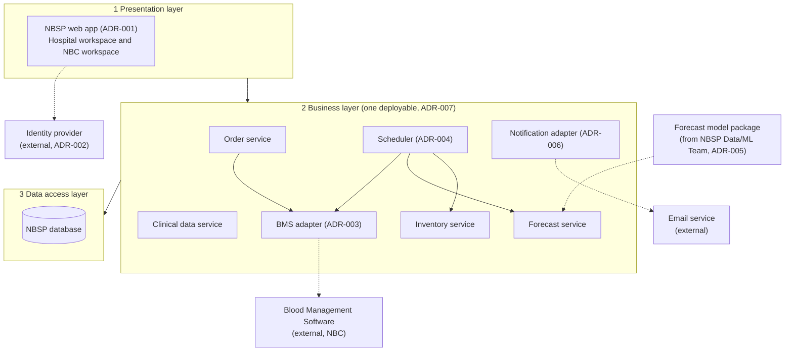

# Architecture: NBSP - National Blood Supply Chain Platform

> DBIZ 2 – Group C. Architecture of the NBSP project, derived from the CVCA, the Context Diagram
> and the Use Case Diagram.

The steps follow the design process of the lecture: stakeholder requirements, system requirements,
functional design, physical design, three layers. Decisions are recorded as ADRs in [`adr/`](adr/).

| Field | Value |
|---|---|
| Version | v1 |
| Inputs | [CVCA](../context/cvca.md) (stakeholder requirements), [Context Diagram](../context/context-diagram.md), [Use Case Diagram](../use-case/use-case-diagram.md) |
| Scope | NBC (National Blood Center) and its 180+ receiving hospitals. Provincial blood units and lower-tier hospitals are future scope (Module 3). |

## 1. Stakeholder requirements

Derived from the value flows of the CVCA and the data flows of the Context Diagram.

| ID | Stakeholder requirement | Stakeholder | Source |
|---|---|---|---|
| StR-01 | Hospitals need to order blood from NBC and know when and what they will receive. | 180+ Hospitals | CVCA: blood NBC → Hospital; Context: orders, shipment confirmation |
| StR-02 | Hospitals need to see how much blood NBC has in stock before they order. | 180+ Hospitals | Context: stock visibility |
| StR-03 | NBC needs usage, wastage and planned demand data from hospitals to plan its supply. | NBC | CVCA: data Hospital → NBC; Context: inventory, utilisation, wastage data |
| StR-04 | NBC needs a demand forecast that its own analysts have checked before it is used. | NBC | CVCA: data Hospital → NBC; NBC plans blood collection for donors and campaigns |
| StR-05 | NBC staff need a network-wide view of inventory and alerts when stock is low or near expiry. | NBC board and staff | Context: dashboards, alerts, network-wide inventory |
| StR-06 | NBC needs the platform to work with its existing Blood Management Software, without entering stock twice. | NBC | CVCA: API sync with Blood Center Management; Context: real-time inventory sync |
| StR-07 | Only authorised staff of a hospital or NBC may see or change data, and only within their role. | NBC, Hospitals, MoH | Health data handled by a public service under MoH/NIHBT direction |
| StR-08 | MoH and NIHBT need performance and utilisation reports from the platform. | MoH, NIHBT | CVCA: performance results NBC → NIHBT; Context: performance and utilisation reports |

StR-08 has no use case in the current Use Case Diagram (see section 6).

## 2. System requirements

| ID | System requirement | From | Use case |
|---|---|---|---|
| SyR-01 | The system shall let Hospital Staff submit a blood provision request with blood group, component, quantity, needed-by date and urgency. | StR-01 | UC-01 |
| SyR-02 | The system shall show Hospital Staff the status and shipment details of each of their requests. | StR-01 | UC-02 |
| SyR-03 | The system shall let Hospital Staff confirm that a shipment was received and record the units received. | StR-01 | UC-03 |
| SyR-04 | The system shall let the NBC Blood Storage and Distribution Dept. view the queue of open requests, and approve and dispatch an order while reserving the units in the Blood Management Software. | StR-01, StR-06 | UC-07, UC-08 |
| SyR-05 | The system shall let Hospital Staff record blood usage, including units transfused, wasted and expired. | StR-03 | UC-04 |
| SyR-06 | The system shall let Hospital Staff log surgical schedules with their expected blood demand. | StR-03 | UC-05 |
| SyR-07 | The system shall let the NBC Forecasting Analyst validate clinical demand data and, when needed, send a verification request that Hospital Staff can answer. | StR-03, StR-04 | UC-13, UC-14 |
| SyR-08 | The system shall produce a draft blood forecast by itself once demand data is finalised, and let the Forecasting Analyst approve it or reject it with a reason. | StR-04 | UC-15 |
| SyR-09 | The system shall show the approved forecast to NBC Operations, read-only. | StR-04 | UC-16 |
| SyR-10 | The system shall show inventory by blood group and component to NBC staff and Hospital Staff. | StR-02, StR-05 | UC-09 |
| SyR-11 | The system shall list blood units that are close to their expiry date. | StR-05 | UC-10 |
| SyR-12 | The system shall alert the NBC Blood Storage and Distribution Dept. when the stock of a blood group or component falls below its threshold. | StR-05 | UC-11 |
| SyR-13 | The system shall synchronise NBC inventory from the Blood Management Software at a regular interval. | StR-06 | UC-17 |
| SyR-14 | The system shall sign users in with a hospital or NBC account and limit each user to the functions and data of their role and organisation. | StR-07 | UC-06, UC-12 |

## 3. Functional design

The system requirements divided into subordinate functions.

| ID | Function | Serves |
|---|---|---|
| F-01 | Identify the user, the organisation and the role | all (SyR-14) |
| F-02 | Create, list and track blood requests through their states (submitted, approved, dispatched, received) | SyR-01, SyR-02, SyR-04 |
| F-03 | Reserve units in the Blood Management Software when an order is dispatched | SyR-04 |
| F-04 | Record receipt of a shipment | SyR-03 |
| F-05 | Record blood usage, wastage and expiry at the hospital | SyR-05 |
| F-06 | Record surgical schedules with blood demand | SyR-06 |
| F-07 | Validate demand data, send verification requests and record the answers | SyR-07 |
| F-08 | Generate a draft forecast on time with the current forecast model | SyR-08 |
| F-09 | Approve or reject a forecast, keep rejection reasons, publish the approved forecast | SyR-08, SyR-09 |
| F-10 | Synchronise inventory from the Blood Management Software | SyR-13 |
| F-11 | Compute inventory views and the near-expiry list | SyR-10, SyR-11 |
| F-12 | Compare stock with thresholds and raise alerts | SyR-12 |
| F-13 | Send notifications (in-app and email) | SyR-02, SyR-07, SyR-12 |

## 4. Physical design

Each function allocated to an element of the system.

Solid arrows run from layer to layer or between business elements; dotted arrows go to external
systems. Inside the business layer, the Scheduler starts the inventory sync (through the BMS
adapter), the forecast generation and the threshold check. The Order service calls the BMS adapter
directly to reserve units. Every service sends messages through the Notification adapter.

| Function | Element | Layer |
|---|---|---|
| F-01 Identify the user, the organisation and the role | Web app with Identity provider (ADR-002) | Presentation, external |
| F-02 Create, list and track blood requests | Order service | Business |
| F-03 Reserve units in the Blood Management Software | Order service calls BMS adapter, direct call (ADR-003) | Business, external |
| F-04 Record receipt of a shipment | Order service | Business |
| F-05 Record usage, wastage and expiry | Clinical data service | Business |
| F-06 Record surgical schedules with demand | Clinical data service | Business |
| F-07 Validate demand data and handle verification requests | Forecast service with Clinical data service | Business |
| F-08 Generate a draft forecast on time | Scheduler starts Forecast service, which runs the model package (ADR-004, ADR-005) | Business |
| F-09 Approve or reject a forecast, keep reasons | Forecast service | Business |
| F-10 Synchronise inventory | Scheduler starts BMS adapter, periodic sync (ADR-003, ADR-004) | Business, external |
| F-11 Compute inventory views and near-expiry list | Inventory service | Business |
| F-12 Compare stock with thresholds and raise alerts | Scheduler starts Inventory service after each sync (ADR-004) | Business |
| F-13 Send notifications | Notification adapter with Email service (ADR-006) | Business, external |
| Keep organisations, users and roles, requests and shipments, usage records, surgical schedules, verification requests, forecasts and rejection reasons, inventory snapshots, thresholds, alerts | NBSP database | Data access |

Actors and their workspace in the web app:

| Actor (Use Case Diagram) | Workspace | Use cases |
|---|---|---|
| Hospital Staff | Hospital | UC-01 to UC-06, UC-09, UC-14 |
| NBC Blood Storage and Distribution Dept. | NBC | UC-07 to UC-12 |
| NBC Forecasting Analyst | NBC | UC-12, UC-13, UC-15 |
| NBC Operations (read-only) | NBC | UC-12, UC-16 |
| Blood Management Software (external system) | none, reached through the BMS adapter | UC-08, UC-09, UC-17 |

## 5. Decisions

| ADR | Decision | Status |
|---|---|---|
| [ADR-001](adr/ADR-001-one-web-app.md) | One responsive web app with a Hospital workspace and an NBC workspace, no native app | Accepted |
| [ADR-002](adr/ADR-002-identity-provider.md) | Sign in through an external identity provider; each account belongs to one organisation and one role; NBSP keeps no passwords | Accepted |
| [ADR-003](adr/ADR-003-bms-integration.md) | Integrate with the Blood Management Software through one adapter: periodic sync for reading stock, direct call for reserving units | Accepted |
| [ADR-004](adr/ADR-004-scheduler.md) | Add a scheduler for timed jobs (inventory sync, threshold check, forecast generation) | Accepted |
| [ADR-005](adr/ADR-005-forecast-model-outside.md) | The forecast model is built and retrained outside NBSP; NBSP only runs a versioned model package and keeps rejection reasons | Accepted |
| [ADR-006](adr/ADR-006-notifications.md) | Send notifications in-app and by email through an external email service | Accepted |
| [ADR-007](adr/ADR-007-modular-monolith.md) | Build the business layer as one deployable with separate modules and one database | Accepted |

## 6. Open points from the inputs

Differences found when the three inputs were compared. They do not block v1, but the team must
decide them before the next version.

| # | Input | Finding | Proposed handling |
|---|---|---|---|
| 1 | Context Diagram | MoH and NIHBT receive performance and utilisation reports (StR-08), but no use case produces them. | Add a reporting use case for NBC staff, or mark the flow as future scope. The data already exists in the NBSP database. |
| 2 | Context Diagram | NIHBT and Viettel send donor registrations, donation history and campaign schedules, but no use case or actor uses this data. | Decide whether donor data is an input to forecasting (would need a second adapter) or out of scope for v1. |
| 3 | Context Diagram | NBC staff "configure threshold", but there is no use case for it. UC-11 needs the thresholds. | v1: thresholds are set as configuration data per blood group and component. Add a use case if NBC must change them in the app. |
| 4 | Context Diagram | Hospitals receive "alerts", but UC-11 only alerts the NBC Blood Storage and Distribution Dept. | v1: hospitals get notifications on request status changes (F-13). Confirm whether hospitals also need low-stock alerts. |
| 5 | Context Diagram / Use Case Diagram | The Context Diagram says "real-time inventory sync"; the Use Case Diagram note says UC-09 reads "periodically synced data". | Resolved by ADR-003: periodic sync for reading, direct call when units are reserved. |
| 6 | Use Case Diagram | The line from Hospital Staff to UC-09 is not attached to the actor shape, and a stray "Hospital" actor sits outside the system boundary. | Read as Hospital Staff → UC-09 (supports StR-02). Fix the drawing. |
| 7 | Use Case Diagram | A note on UC-15 says draft forecasts come from a background job; the job is not a use case. | Allocated to the Scheduler (ADR-004). |

## Change log

| Version | When | Change | Why |
|---|---|---|---|
| v1 | 2026-11-19 | Web app, Order service, Clinical data service, Forecast service, Inventory service, Scheduler, BMS adapter, Notification adapter, NBSP database | First version from CVCA, Context Diagram and Use Case Diagram |
