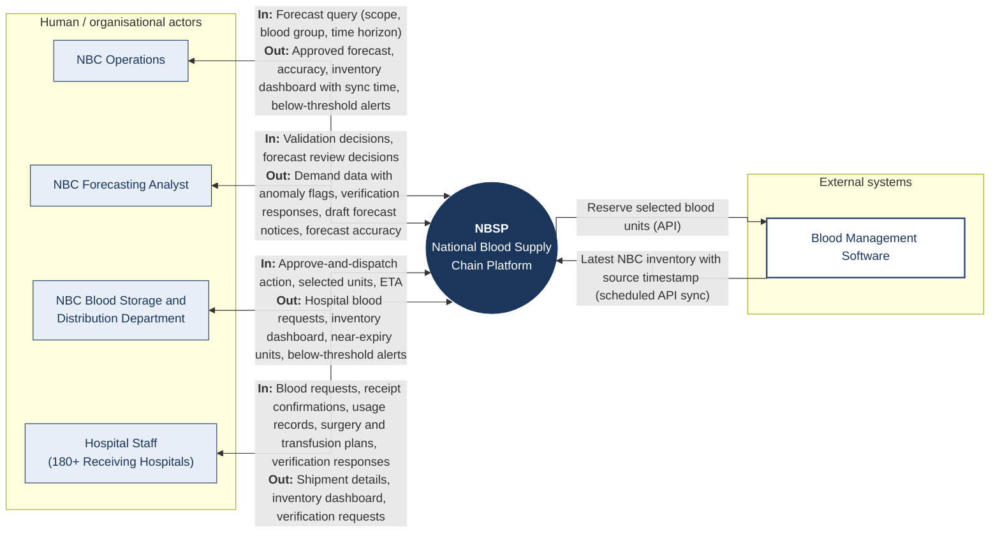

# Context Diagram: NBSP (National Blood Supply Chain Platform)

| Field | Value |
|---|---|
| System in scope | NBSP, National Blood Supply Chain Platform |
| Version | v4 (flow labels checked against Usage Flow v2.2, AD-UC-08 v0.4 and the UC list) |
| Human / organisational actors | NBC Blood Storage and Distribution Department · NBC Forecasting Analyst · NBC Operations · Hospital Staff (180+ Receiving Hospitals) |
| External systems | Blood Management Software |

Legend: light blue box = human / organisational actor; white box with dark border = external system. "In" / "Out" are from the point of view of NBSP. All human actors also sign in (UC-06 for Hospital Staff, UC-12 for NBC actors); sign-in is not drawn as a flow.

## Data flows and traceability

| # | Actor / system | In (to NBSP) | Out (from NBSP) | Use cases |
|---|---|---|---|---|
| 1 | NBC Operations | Forecast query | Approved forecast, accuracy, inventory dashboard with sync time, below-threshold alerts | UC-16, UC-09, UC-11 |
| 2 | NBC Forecasting Analyst | Validation decisions, forecast review decisions | Demand data with anomaly flags, verification responses, draft forecast notices, forecast accuracy | UC-13, UC-15 |
| 3 | NBC Blood Storage and Distribution Department | Approve-and-dispatch action, selected units, ETA | Hospital blood requests, inventory dashboard, near-expiry units, below-threshold alerts | UC-07, UC-08, UC-09, UC-10, UC-11 |
| 4 | Hospital Staff | Blood requests, receipt confirmations, usage records, surgery and transfusion plans, verification responses | Shipment details, inventory dashboard, verification requests | UC-01 to UC-05, UC-09, UC-14 |
| 5 | Blood Management Software | Latest NBC inventory with source timestamp | Reserve selected blood units | UC-17 (FR-02-05, read); UC-08 (FR-01-03, reserve) |

## Actor mapping (UC list names)

| Use case | Actor in this diagram |
|---|---|
| UC-01 to UC-05, UC-14 | Hospital Staff |
| UC-06 Sign in with Hospital account | Hospital Staff |
| UC-07, UC-08, UC-10 | NBC Blood Storage and Distribution Department (was "NBC Staff") |
| UC-11 Receive Below-Threshold Alert | NBC Blood Storage and Distribution Department, NBC Operations (was "NBC Staff") |
| UC-09 View Inventory Dashboard | Hospital Staff, NBC Blood Storage and Distribution Department, NBC Operations (was "NBC Staff"); not the NBC Forecasting Analyst |
| UC-12 Sign in with NBC account | NBC Blood Storage and Distribution Department, NBC Forecasting Analyst, NBC Operations |
| UC-13, UC-15 | NBC Forecasting Analyst |
| UC-16 | NBC Operations |
| UC-17 Synchronise NBC Inventory | Blood Management Software (started by time) |

