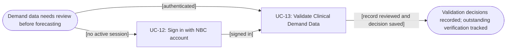
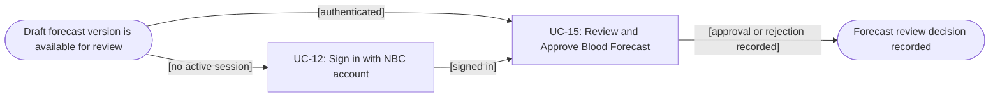

# Usage Flow: NBSP — NBC Forecasting Operations (UC-13 and UC-15)

| Field | Value |
|---|---|
| Product | National Blood Supply Chain Platform (NBSP) |
| Version | v0.3 — corrected Forecasting workstream |
| Date | 2026-11-07 |
| Actor | **NBC Forecasting Analyst** (W0/Use Case actor); workstream label: **NBC Forecasting Operations** |
| In-scope use cases | **UC-13 — Validate Clinical Demand Data**; **UC-15 — Review and Approve Blood Forecast** |
| Shared prerequisite | UC-12 — Sign in with NBC account (another owner's scope) |
| Feature | F-03 — Clinical Demand & Forecasting |
| Source basis | Current UC-13/UC-15 actor listing; W1: FR-03-02, FR-03-03, FR-03-05, FR-03-06, FR-03-08, FR-04-02/03/04; Lesson 8 `usage-flow-template.md` |
| Screen List | **Team-wide Screen List is authoritative; not recreated or modified here.** Screen IDs below are *provisional mappings* pending reconciliation with that list. |

> **Scope correction:** This document replaces the previous UC-07/08/09/10/11 NBC Blood Storage & Distribution usage flows **for this contributor**. Those flows remain in other owners' scopes; they do **not** belong in the present Forecasting workstream. UC-13 and UC-15 are operated by an **NBC Forecasting Analyst**, not by the NBC blood-order dispatcher.
>
> **Notation:** rectangular nodes below are **Use Cases**; rounded nodes are situations or attained goals. Decision details *within* a Use Case belong in its Activity Diagram / Screen Spec, not as extra Use Case boxes.

## Before you draw: is Lesson 4 still true?

- [ ] Review the team `docs/activity/activity-index.md` Inputs check table; mark all findings Done or log an open question. The team index has not been supplied for this revision.
- [x] UC-13 and UC-15 actor and IDs agree with the current W1 trace and the supplied actor/ownership excerpt.
- [x] Forecast generation, period cut-off and Hospital verification are treated as **dependencies/handoffs**, not new manual actions by the Analyst.
- [ ] Confirm provisional Screen IDs against the **single project-wide Screen List** before merging this file.

## NBC Forecasting Analyst — Goal A: validate clinical demand data (UC-13)

| Step | Use case | Activity diagram | Screens in team Screen List | Ownership / scope |
|---|---|---|---|---|
| 1 — conditional | UC-12 — Sign in with NBC account | Team-owned AD/assessment | `S-F00-01` **provisional shared login mapping** | Shared authentication; do not redraw sign-in here. |
| **2** | **UC-13 — Validate Clinical Demand Data** | `AD-UC-13.md` **if selected in the Activity Index** | `S-F03-01` **provisional: Clinical Demand Validation** | **This Forecasting workstream**; FR-03-02 and FR-03-03. |

**Within UC-13 (not separate Use Cases):** The Analyst selects hospital, date range and blood group; NBSP displays blood usage, transfusion-patient counts, scheduled demand and anomaly reasons (FR-03-02). For a flagged record the Analyst can **Accept**, **Exclude** or **Request Verification** (FR-03-03). The system records the decision; a verification request becomes **Pending Verification** and goes to Hospital Staff, whose response is handled in **UC-14 by another actor**. An overdue verification may be accepted with a note or excluded (FR-03-03). None of these decisions is a new screen or UC by itself.

**Goal boundary:** A *decision recorded* does **not** imply that the whole forecasting period is automatically finalised. The period becomes **Finalised** only under FR-03-08 (no unresolved flagged records or cut-off reached); unresolved records are then excluded/flagged as specified. This is the required handoff before forecasting can proceed.

## NBC Forecasting Analyst — Goal B: review a Draft forecast (UC-15)

| Step | Use case | Activity diagram | Screens in team Screen List | Ownership / scope |
|---|---|---|---|---|
| 1 — conditional | UC-12 — Sign in with NBC account | Team-owned AD/assessment | `S-F00-01` **provisional** | Shared authentication. |
| **2** | **UC-15 — Review and Approve Blood Forecast** | `AD-UC-15.md` **if selected in the Activity Index** | `S-F03-02` **provisional: Draft Forecast Review** | **This Forecasting workstream**; FR-03-06. |

**Within UC-15 (not separate Use Cases):** A Draft forecast is produced by the system after data finalisation (FR-03-05). The Analyst reviews the Draft batch and its quality/review indicators, then **Approves** or **Rejects**. NBSP records that decision and audit history; **only approved forecast results** are published for operational use (FR-03-06, FR-04-04). Rejected results are **not published**. There is no automatic retraining or republishing branch unless another approved requirement adds it.

## Connection between the two goals — asynchronous handoff, not an immediate arrow

| Stage | Happens because | Responsible actor/system | Effect on this contributor's flow | Source |
|---|---|---|---|---|
| 1. Demand validation | Analyst reviews flagged demand data | NBC Forecasting Analyst | UC-13, Goal A | FR-03-02 / FR-03-03 |
| 2. Hospital verification, when requested | Analyst chooses Request Verification | Hospital Staff answers in **UC-14**; system records response / overdue | The Analyst may revisit UC-13 after notification; **not** a second Analyst-owned UC-14 | FR-03-03 / FR-03-04 |
| 3. Forecast period finalised | No flagged record unresolved **or** forecast cut-off reached | NBSP (rules/time) | Establishes eligible finalised demand data; not a manual UC | FR-03-08 |
| 4. Draft forecast generated | Demand data for period is Finalised | NBSP active forecasting model | Creates versioned **Draft** and notifies Analyst; not a manual UC | FR-03-05 |
| 5. Draft forecast review | Analyst opens available Draft | NBC Forecasting Analyst | UC-15, Goal B | FR-03-06 |
| 6. Downstream use | Forecast approved | NBC Operations may view results through **UC-16** | **Outside** this actor's contribution; no UC-16 node in these two flows | FR-03-07 |

**Why not simply `UC-13 → UC-15`?** The user goals are connected, but not adjacent actions: the Analyst may have to wait for hospital verification, the cut-off rule, and automatic Draft generation. An immediate arrow would imply an unsupported instant transition.

## Use cases without a human-initiated flow in this contribution

| Use case / function | Trigger / actor | How it is represented |
|---|---|---|
| UC-14 — Respond to Data Verification Request | **Hospital Staff**, on verification request | Cross-actor handoff only; belongs in Hospital's usage flow and screen map. |
| FR-03-08 — Close validation period at forecast cut-off | NBSP rule or configured cut-off | Automated business function, **not** an extra manual UC-13/UC-15 box. |
| FR-03-05 — Generate draft blood-demand forecast | NBSP when period data Finalised | Automated function preceding UC-15, not an Analyst click or new UC. |
| UC-16 — View Validated Blood Forecast | **NBC Operations** (read-only consumer) | Downstream consumer flow, another owner's scope. |

## Checks before you save

- [x] Only the two Forecasting Analyst goals (UC-13 and UC-15) are owned in this contribution.
- [x] Use Case boxes are **UC IDs**; no FR, screen, status, modal or button is presented as another UC.
- [x] No fictitious direct dependency that starts UC-15 immediately on completion of one UC-13 validation decision.
- [x] All steps have a proposed screen mapping; Screen List IDs are explicitly **unconfirmed**.
- [x] Ownership of UC-14 and UC-16 is not silently transferred to the Analyst.
- [ ] Team must replace/confirm `S-F00-01`, `S-F03-01` and `S-F03-02` against the consolidated Screen List.
- [ ] Team must confirm AD-UC-13/AD-UC-15 status in `activity-index.md` and link the actual filenames.
- [ ] Render both Mermaid diagrams in the team's Mermaid editor (not verified in this file).
