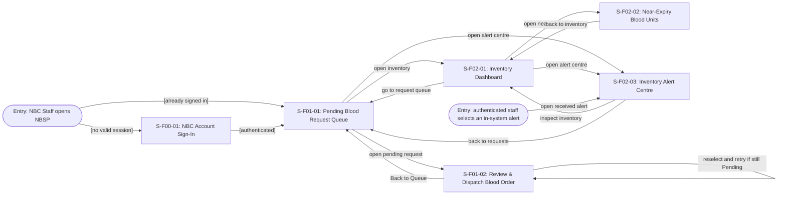

# Screen Transition Diagram: NBSP — NBC Operations

| Field | Value |
|---|---|
| Product | National Blood Supply Chain Platform (NBSP) |
| Version | v0.2 — actor-group Screen Transition Diagram |
| Date | 2026-11-07 |
| Actor | NBC Blood storage & Distribution (operational user: NBC Staff) |
| Sources | `screen-list.md` and `usage-flow.md`; AD-UC-08; SD-UC-08; W1 FR-01-02, FR-01-03, FR-01-08, FR-01-09, FR-02-02, FR-02-03, FR-02-04, FR-04-02; Lesson 8 template |

> This is **one diagram for the NBC Operations actor**, not one diagram per goal or UC. Rectangular nodes below are navigable **Screen IDs only**. Confirmation dialogs, in-screen errors, status banners and persisted business statuses are **not screens**. Landing screen and cross-feature navigation are proposed pending group agreement.

## 1. NBC Operations — actor-wide screen navigation

### UC-08: why Decline and Blocked should not be terminal *screen* nodes

| At `S-F01-02` | What happens *before* result | Screen response *after* result | Can the same order be dispatched immediately? | User navigation | FR |
|---|---|---|---|---|---|
| **Decline** | Staff reviews pending request → selects **Decline** → supplies reason → confirms decision. **No unit selection or dispatch submission is required.** | Show **non-approval recorded** confirmation; do not call reserve/dispatch flow. | **No.** Decision recorded; any later reopening policy requires a new business rule. | Stay for confirmation → **Back to Queue** (manual action). | FR-01-09 |
| **Dispatch success** | Staff selects units and ETA → confirms → NBSP validates Pending request and stock, reserves units, saves shipment. | Show `Dispatched` confirmation, shipment details and ETA. | Not as the same Pending request. | Stay for success → **Back to Queue** (manual action). | FR-01-03 |
| **Blocked: insufficient stock / reservation failed** | Staff tried to confirm dispatch but final stock check or reservation failed. | Show shortage or reservation-conflict message. **No shipment is created; no order/inventory change due to the blocked attempt.** | **Only if** it remains a valid Pending request and staff selects eligible units again. System must revalidate on every retry. | Stay on detail → reselect/retry **or** Back to Queue. | FR-01-08 |
| **Blocked: invalid / no longer Pending** | Staff tried to dispatch a request that fails status/validity validation. | Show status or validation error and disable dispatch for that request. | **No**, not without a separate correction/new request. | Stay on detail to read error → Back to Queue. | FR-01-03 |

**Result type clarification:** `Dispatched` is the confirmed saved shipment/order status. `Decline` is a stored *non-approval decision and reason* (exact persisted state label still unconfirmed). `Blocked` is a description of **failed attempt feedback**, **not** a new persisted Blood Order state, new screen or third business-success endpoint. The error notice disappears or updates upon new valid action; never silently mark the order `Blocked`.

### Other NBC Operations navigation notes

- **UC-07 → UC-08:** pending request Queue (`S-F01-01`) → Review & Dispatch (`S-F01-02`).
- **UC-09 → UC-10:** dashboard (`S-F02-01`) → near-expiry unit list (`S-F02-02`), and Back.
- **UC-11 → UC-09:** system creates below-threshold alert after sync; user opens `S-F02-03` and may navigate to `S-F02-01` to inspect stock. Alert creation itself is **not** a screen navigation action.
- **Authentication:** unexpired NBC session is required for all protected screens; alert entry assumes an authenticated user. If session expired, route through shared sign-in. Exact post-login deep link behaviour is an **open question**.

## 2. Usage-flow paths

| Usage-flow arrow / event | Screen path on this diagram | Evidence / note |
|---|---|---|
| UC-12 → UC-07 | `S-F00-01` → `S-F01-01` after successful sign-in | Proposed Operations landing screen. |
| UC-07 → UC-08 | `S-F01-01` → `S-F01-02` when user opens pending request | Core UC-08 path. |
| UC-08 → dispatched result | `S-F01-02` stays in **success state**, then `Back to Queue` → `S-F01-01` | No new success screen. |
| UC-08 → non-approval recorded | `S-F01-02` stays in **decision-confirmation state**, then Back → `S-F01-01` | No new Declined screen. |
| UC-08 → blocked attempt / retry | `S-F01-02` **error state** → correct selection and reconfirm on same screen, OR Back → `S-F01-01` | Invalid/non-Pending requests cannot retry as-is. |
| UC-09 → UC-10 (optional) | `S-F02-01` → `S-F02-02` | UC-10 Should priority. |
| System-triggered UC-11 → staff reviews inventory | In-system alert → `S-F02-03` → `S-F02-01` | Alert generation not a manual UC. |

## 3. Integration decisions / open questions

1. **[TEAM DECISION]** Confirm globally unique IDs and all screen names in `screen-list.md` before merging.
2. **[TEAM DECISION]** Confirm that first NBC Operations landing page after UC-12 is the Request Queue. If landing on Dashboard instead, update `S-F00-01` outgoing path.
3. **[TEAM DECISION]** Confirm global navigation between Request Queue, Inventory Dashboard and Alert Centre. Those edges are **UI proposals**, not newly costed L2 functions.
4. **[NEEDS CLARIFICATION]** After non-approval, W1 does not specify a final status label; retain decision-and-reason wording until the state model is agreed.
5. **[NEEDS CLARIFICATION]** Confirm whether the user may retry after stock shortage and whether request edits/reselection are allowed. Current behaviour is a proposed recoverable validation state, not a new L2 requirement.
6. **[NEEDS CLARIFICATION]** Confirm session-expiry behaviour when opening an alert directly and whether the target screen resumes after sign-in.

## Checks before you save

- [x] Every screen node occurs in `screen-list.md` and is reachable from an entry point.
- [x] All named screen nodes have navigation to another reachable screen; no disconnected screen.
- [x] The main UC-08 action is available within 3 screens when not signed in (sign-in → queue → detail).
- [x] No outcome/state/modal invented as a Screen ID.
- [x] The diagram covers all NBC Operations screens, not only UC-08.
- [x] Usage-flow UC pairs correspond to actual screen paths or an external/system entry event.
- [ ] Team approval on ID allocation, navigation conventions and Mermaid render.
