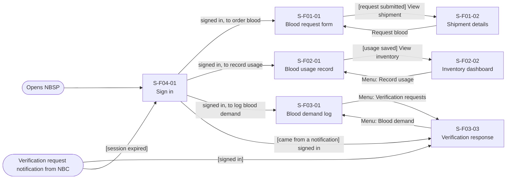
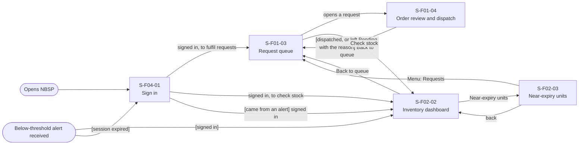
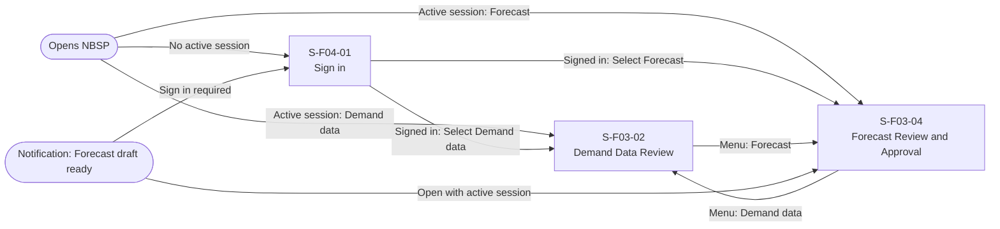
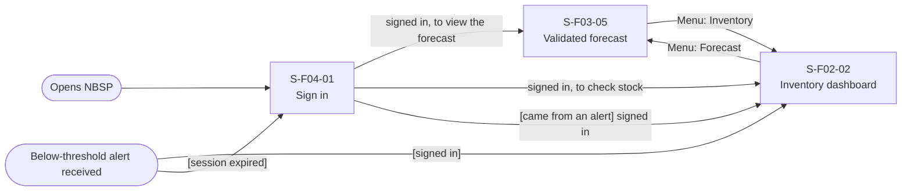

# Screen Transition Diagram: NBSP (National Blood Supply Chain Platform)

> DBIZ2 Group C. Draft. Screen IDs follow `screen-list.md` (13 screens; Sign in is `S-F04-01`) and the merged `usage-flow.md`.

NBSP has no home screen in the screen list, so each diagram has a "Main menu" node. It stands for the navigation bar that is available on every screen of that actor, and each arrow from it is a menu item. This is an assumption to confirm with the team.

## 1. Hospital Staff

Main task "order blood": S-F01-01 → S-F01-02. One step from the start screen; confirming that the blood arrived is an action on S-F01-02.

## 2. NBC Blood Storage and Distribution Department

Main task "dispatch a blood order": S-F01-03 → S-F01-04. Two screens from the start screen.

## 3. NBC Forecasting Analyst

On S-F03-02 the analyst records the validation decision or sends a data-verification request. The request leaves NBSP as an email to the hospital and enters the Hospital Staff diagram at S-F03-03 (see section 1); it is not an arrow here.

## 4. NBC Operations

NBC Operations shares S-F02-02 with the Dept (decided 2026-11-06); the screen is owned in section 2. The alert (UC-11) is a notification with no screen of its own, so the entry point "Below-threshold alert received" leads to S-F02-02.

## Checks

- Every screen in the Screen List appears: yes (13 of 13).
- Every screen reachable from an entry point: yes (menu items and email or alert links count as entry points).
- No dead ends: yes. Every screen has the main menu; the screens with no other arrow out (S-F01-04 returns to the queue, S-F03-03 and S-F03-05 end their task) are left through the menu.
- Usage-flow paths: every arrow of the flows of the four actors in [usage-flow.md](usage-flow.md) has a path (table below).
- Sign in is shared by all actors; signed-out users who open an email or alert link see S-F04-01 first and then return to the screen they asked for (screen-level rule in S-F04-01).
- Screens shared by several actors (S-F04-01, S-F02-02) appear in each actor's diagram.

## Usage-flow paths

| Actor | Usage-flow arrow | Path on this diagram |
|---|---|---|
| Hospital Staff | UC-06 to UC-01 | S-F04-01 Sign in → S-F01-01 Blood request form ("signed in") |
| Hospital Staff | UC-01 to UC-02 | S-F01-01 → S-F01-02 Shipment details ("[request submitted] View shipment") |
| Hospital Staff | UC-02 to UC-03 | Same screen: S-F01-02 Shipment details (confirm blood received) |
| Hospital Staff | UC-06 to UC-04 | S-F04-01 → S-F01-01, then menu "Record usage" → S-F02-01 Blood usage record |
| Hospital Staff | UC-06 to UC-05 | S-F04-01 → S-F01-01, then menu "Blood demand" → S-F03-01 Blood demand log |
| Hospital Staff | UC-06 to UC-14 | Entry point "Link in verification email" → S-F03-03 Verification response (after S-F04-01 when signed out) |
| NBC Dept | UC-12 to UC-07 | S-F04-01 Sign in → S-F01-03 Request queue ("signed in as NBC Dept") |
| NBC Dept | UC-07 to UC-08 | S-F01-03 → S-F01-04 Order review and dispatch ("opens a request") |
| NBC Dept | UC-07 to UC-09 | S-F01-03 → S-F02-02 Inventory dashboard ("Check stock") |
| NBC Dept | UC-09 to UC-08 | S-F02-02 → S-F01-03 ("Back to queue") → S-F01-04 |
| NBC Dept | UC-08 to UC-07 | S-F01-04 → S-F01-03 ("Back to queue") |
| NBC Dept | UC-12 to UC-09 | S-F04-01 → S-F01-03, then menu "Inventory" → S-F02-02 |
| NBC Dept | UC-09 to UC-10 | S-F02-02 → S-F02-03 Near-expiry units ("Near-expiry units") |
| NBC Dept | UC-09 or UC-10 to Flow 1 | S-F02-02 → S-F01-03 ("Back to queue"), or menu "Requests" |
| NBC Dept | alert (UC-11) to UC-09 | Entry point "Below-threshold alert received" (a notification, no screen) → S-F02-02 Inventory dashboard |
| NBC Forecasting Analyst | UC-12 to UC-13 | S-F04-01 Sign in → S-F03-02 Demand data review ("signed in as analyst") |
| NBC Forecasting Analyst | UC-12 to UC-15 | S-F04-01 → S-F03-02, then menu "Forecast" → S-F03-04 Forecast review and approval; or entry point "Notification: forecast draft ready" → S-F03-04 (after S-F04-01 when signed out) |
| NBC Forecasting Analyst | UC-13 and UC-15 | Not joined by an arrow in the usage flow (asynchronous handoff); on the diagram S-F03-04 → S-F03-02 ("back") is only navigation |
| NBC Operations | UC-12 to UC-16 | S-F04-01 → S-F03-05 Validated forecast ("signed in as NBC Operations") |
| NBC Operations | UC-12 to UC-09 | S-F04-01 → S-F03-05, then menu "Inventory" → S-F02-02 Inventory dashboard |
| NBC Operations | alert (UC-11) to UC-09 | Entry point "Below-threshold alert received" (a notification, no screen) → S-F02-02 |

The Hospital Staff diagram has 7 screens and the Dept diagram has 5, so one diagram per actor stays readable; the actors share Sign in and the dashboard.
