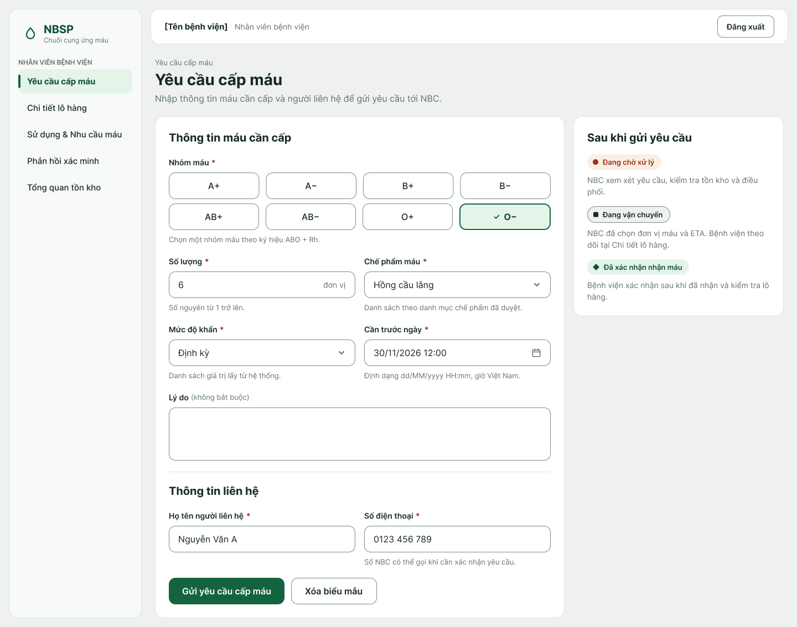
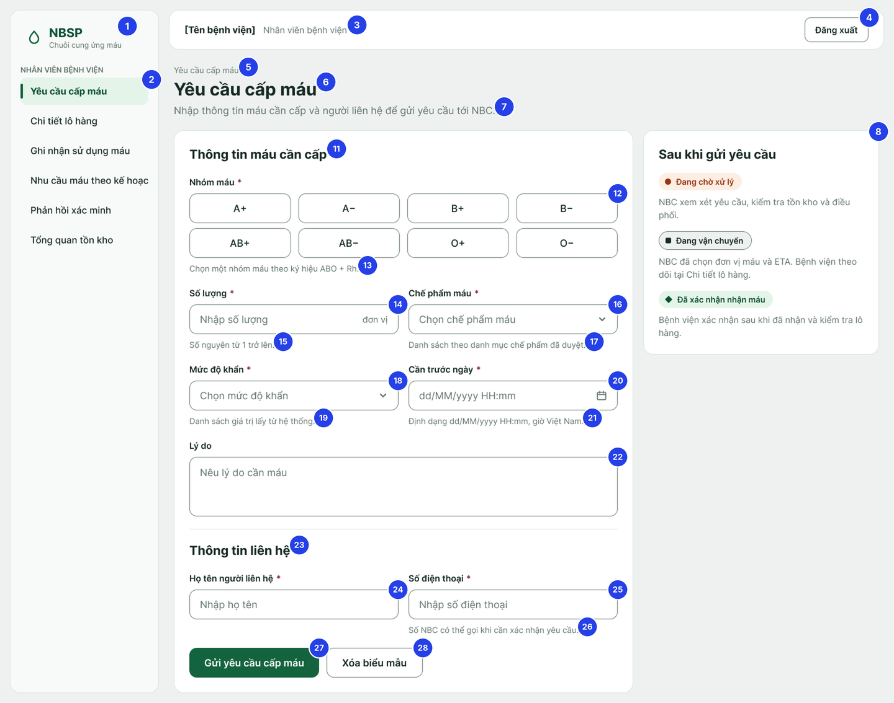
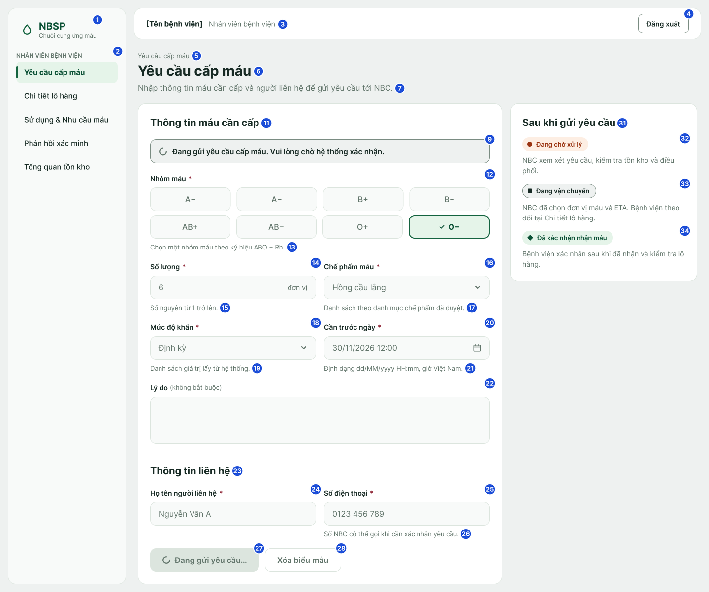

# Screen Spec: S-F01-01 Blood request form

| Field | Value |
|---|---|
| Screen ID | S-F01-01 |
| Screen name | Blood request form (Vietnamese UI title: "Yêu cầu cấp máu") |
| Actor | Hospital Staff |
| Priority | Must |
| Feature | F-01 Blood Ordering & Fulfillment |
| Use cases / FRs | UC-01 · FR-01-01, FR-01-06 (as in `screen-list.md`); related FR-04-03 · BR-01, BR-10 |
| Activity diagrams | AD-UC-01 |
| Sequence diagrams | SD-UC-01 (v2, 21/11/2026) |
| Usage flow | Hospital Staff Flow 1 "Order blood and Receive" (`usage-flow.md` v2.3): S-F04-01 → **S-F01-01** → S-F01-02 |
| Mockup images | `img/s-f01-01-default.png`, `img/s-f01-01-empty.png`, `img/s-f01-01-loading.png`, `img/s-f01-01-error.png`, `img/s-f01-01-success.png`; numbered: the same five names ending in `-numbered.png` (section 2) |
| Frame size | 1440 px wide (desktop, UI conventions v2.0 §2.1), 1× (1440 px). Height grows with the content: 1134 px (default, empty), 1203 px (loading, error), 1024 px (success); the page scrolls vertically |
| Figma frame | https://www.figma.com/design/oR1xULg2oLdGezDpqdwhdz (frames "S-F01-01 · Yêu cầu cấp máu · 1 to 5") |
| Version | v1.2, 21/11/2026 (changes at the end of this file) |
| Status | Draft |

## 1. Purpose

**Shown when:** Hospital Staff need blood. They enter the blood type, quantity, blood product, urgency, the date and time by which the blood is needed, an optional reason and a contact person, then submit the request to NBC (UC-01). It is the first screen after sign-in for Hospital Staff (`screen-transition.md`, section 1).

**The user leaves this screen when:** the request is submitted and the user presses "Xem chi tiết lô hàng" (to S-F01-02), opens another menu item, or signs out. "Gửi yêu cầu khác" stays on this screen with an empty form.

## 2. Mockup

**Layout (all states):** sidebar on the left (brand, role group, menu for Hospital Staff with 5 items); top bar (hospital name, role, Sign out); breadcrumb, title and subtitle; main card on the left of the content area (the form, or the request summary in the success state); "Sau khi gửi yêu cầu" card on the right.

**Numbered images:** each number is the # in the element inventory (section 3), placed at the top-right corner of the element (at the end of the text for one-line texts, at the left edge for element 30). Every visible element has its own number: a field's label and control are one element, its helper text is a separate element, and each part of a card is numbered separately. A repeated element (a chip in a row, a row of the summary) is numbered once, on its first occurrence. Element 8 (error banner) appears only in the error state, element 9 (sending banner) only in the loading state and element 10 (success banner) only in the success state. Elements 29 and 30 appear only in the error state; on the error image they are numbered once, on the Quantity field, and 29 replaces the helper texts 15, 17, 19, 21 and 26 (so these five numbers are not on the error image). Elements 35 to 39 appear only in the success state, where they replace elements 11 to 28 in the main card.

| State | Numbered image | Numbers shown |
|---|---|---|
| Default |  | 1–7, 11–28, 31–34 |
| Empty |  | 1–7, 11–28, 31–34 |
| Loading |  | 1–7, 9, 11–28, 31–34 |
| Error |  | 1–8, 11–14, 16, 18, 20, 22–25, 27–34 |
| Success |  | 1–7, 10, 31–39 |

| State | Image | What it shows |
|---|---|---|
| Default (with data) | `img/s-f01-01-default.png` | All fields filled (O−, 6 đơn vị, Hồng cầu lắng, Định kỳ, 30/11/2026 12:00, Nguyễn Văn A, 0123 456 789), O− selected with a tick, Submit enabled |
| Empty | `img/s-f01-01-empty.png` | No value, placeholders and hints under the fields |
| Loading | `img/s-f01-01-loading.png` | Sending banner, fields disabled, Submit with spinner |
| Error | `img/s-f01-01-error.png` | Invalid fields (FR-01-06): banner plus a message under each invalid field (quantity 0, product, urgency, needed-by, contact name and phone empty); O− kept; values kept. The uncertain-result error is described in section 4 only |
| Success | `img/s-f01-01-success.png` | Success banner, request summary, status "Đang chờ xử lý" |

All colours, fonts and corners come from the design tokens in the UI conventions v2.0, section 6 ([ui-conventions.md](../ui-conventions.md#6-design-tokens)), except the colours listed in open question 7.

## 3. Element inventory

Vietnamese labels are written as they appear in the mockup.

### 3.1 Page frame (all states)

| # | Element | Type | Content / data source | Required | Validation |
|---|---|---|---|---|---|
| 1 | Brand | Logo and text | static: "NBSP", "Chuỗi cung ứng máu" | Yes | none |
| 2 | Menu | Navigation | static; role group "NHÂN VIÊN BỆNH VIỆN" and the 5 items allowed for Hospital Staff (FR-04-03): "Yêu cầu cấp máu" (current, marked by background, left bar and bold text), "Chi tiết lô hàng", "Sử dụng & nhu cầu máu" (S-F02-01, covers UC-04 and UC-05), "Phản hồi xác minh", "Tổng quan tồn kho". No count badge on any item (`screen-list.md`, UI conventions OQ-03) | Yes | none |
| 3 | Account info | Text | `hospital.name` ("[Tên bệnh viện]") and the role "Nhân viên bệnh viện", from the session | Yes | none |
| 4 | Sign out | Secondary button | label "Đăng xuất" | Yes | none |
| 5 | Breadcrumb | Text | static: "Yêu cầu cấp máu" | Yes | none |
| 6 | Title | Header | static: "Yêu cầu cấp máu" | Yes | none |
| 7 | Subtitle | Text | static: "Nhập thông tin máu cần cấp và người liên hệ để gửi yêu cầu tới NBC." | Yes | none |

### 3.2 Banners (one per state)

| # | Element | Type | Content / data source | Required | Validation |
|---|---|---|---|---|---|
| 8 | Error banner | Banner (`role="alert"`) with error icon | static: "Chưa tạo yêu cầu. Vui lòng sửa các trường được đánh dấu và gửi lại." (UI conventions §4.2) | No | shown only after a failed validation, at the top of the form card, under the section title |
| 9 | Sending banner | Banner (`role="status"`) with spinner | static: "Đang gửi yêu cầu cấp máu. Vui lòng chờ hệ thống xác nhận." | No | shown only in the loading state, at the top of the form card, under the section title |
| 10 | Success banner | Banner (`role="status"`) with tick icon | static: "Đã gửi yêu cầu cấp máu. Yêu cầu đang chờ NBC xử lý." (UI conventions §4.2) | No | shown only after the server confirms, at the top of the main card |

### 3.3 Request form (default, empty, loading and error states)

| # | Element | Type | Content / data source | Required | Validation |
|---|---|---|---|---|---|
| 11 | Section title | Header | static: "Thông tin máu cần cấp" | Yes | none |
| 12 | Blood type | Label and single-choice chips (8, two rows of 4) | label "Nhóm máu *"; `request.blood_type`: A+, A−, B+, B−, AB+, AB−, O+, O−; the selected chip has a tick, a thicker border and a light background | Yes | exactly one of the 8 valid types (BR-01) |
| 13 | Blood type hint | Helper text | static: "Chọn một nhóm máu theo ký hiệu ABO + Rh." | Yes | replaced by the error message when invalid |
| 14 | Quantity | Label and number input with unit | label "Số lượng *"; `request.quantity`; placeholder "Nhập số lượng"; unit "đơn vị" inside the field (one unit = one 350 ml bag) | Yes | whole number of 1 or more (BR-01); maximum [TBD, open question 9] |
| 15 | Quantity hint | Helper text | static: "Số nguyên từ 1 trở lên." | Yes | replaced by the error message when invalid |
| 16 | Blood product | Label and select | label "Chế phẩm máu *"; `request.blood_product`, list from the approved product catalogue (release 1: red blood cells only, BR-01, D-12); placeholder "Chọn chế phẩm máu"; sample value "Hồng cầu lắng" | Yes | one value of the list |
| 17 | Blood product hint | Helper text | static: "Danh sách theo danh mục chế phẩm đã duyệt." | Yes | replaced by the error message when invalid |
| 18 | Urgency | Label and select | label "Mức độ khẩn *"; `request.urgency`, the three values of BR-01 in the order of BR-05: Emergency "Cấp cứu", Urgent "Khẩn", Periodic "Định kỳ" (labels proposed in UI conventions §1.2, to confirm with the client); placeholder "Chọn mức độ khẩn"; the mockup shows the sample value "Định kỳ" | Yes | one of the 3 values (BR-01) |
| 19 | Urgency hint | Helper text | static: "Danh sách giá trị lấy từ hệ thống." (open question 11) | Yes | replaced by the error message when invalid |
| 20 | Needed by | Label and date and time input with calendar icon | label "Cần trước ngày *"; `request.needed_by`; placeholder "dd/MM/yyyy HH:mm" | Yes | valid date and time in the format dd/MM/yyyy HH:mm, Vietnam time (UTC+07:00); not in the past (BR-10) |
| 21 | Needed by hint | Helper text | static: "Định dạng dd/MM/yyyy HH:mm, giờ Việt Nam." | Yes | replaced by the error message when invalid |
| 22 | Reason | Label and multi-line text | label "Lý do (không bắt buộc)"; `request.reason`; placeholder "Nêu lý do cần máu"; no helper text | No | at most 500 characters (BR-10) |
| 23 | Contact section title | Header (after a divider) | static: "Thông tin liên hệ" | Yes | none |
| 24 | Contact name | Label and text input | label "Họ tên người liên hệ *"; `request.contact_name`; placeholder "Nhập họ tên" | Yes | 1 to 100 characters (BR-10) |
| 25 | Contact phone | Label and text input | label "Số điện thoại *"; `request.contact_phone`; placeholder "Nhập số điện thoại" | Yes | 10 or 11 digits starting with 0; spaces and dots are ignored (BR-10) |
| 26 | Contact phone hint | Helper text | static: "Số NBC có thể gọi khi cần xác nhận yêu cầu." | Yes | replaced by the error message when invalid |
| 27 | Submit request | Primary button | label "Gửi yêu cầu cấp máu"; in the loading state a spinner and "Đang gửi yêu cầu…" | Yes | disabled while the request is being sent |
| 28 | Clear form | Secondary button | label "Xóa biểu mẫu" | No | disabled while the request is being sent (see mockup correction 3) |
| 29 | Field error messages | Inline text with error icon | one message under each invalid field, in place of its helper text (texts in section 4, Error) | No | shown only after a failed validation |
| 30 | Invalid field marker | Border | red 2 px border on each invalid field, together with element 29 | No | shown only after a failed validation |

### 3.4 Next-steps card (all states)

| # | Element | Type | Content / data source | Required | Validation |
|---|---|---|---|---|---|
| 31 | Card title | Header | static: "Sau khi gửi yêu cầu" | Yes | none |
| 32 | Step "Đang chờ xử lý" | Status chip (circle marker) and one line | static: "NBC xem xét yêu cầu, kiểm tra tồn kho và điều phối." Status `Pending` | Yes | none |
| 33 | Step "Đang vận chuyển" | Status chip (square marker) and one line | static: "NBC đã chọn đơn vị máu và ETA. Bệnh viện theo dõi tại Chi tiết lô hàng." Explanatory label of `Dispatched`, not a database status (UI conventions §1.2) | Yes | none |
| 34 | Step "Đã xác nhận nhận máu" | Status chip (diamond marker) and one line | static: "Bệnh viện xác nhận sau khi đã nhận và kiểm tra lô hàng." Status `Received` | Yes | none |

### 3.5 Request summary (success state only)

| # | Element | Type | Content / data source | Required | Validation |
|---|---|---|---|---|---|
| 35 | Summary title | Header | static: "Tóm tắt yêu cầu" | No | none |
| 36 | Request summary | List of label–value rows | "Mã yêu cầu" `request.id` ("[Mã yêu cầu]"); "Nhóm máu" `request.blood_type`; "Số lượng" `request.quantity` + " đơn vị"; "Chế phẩm máu" `request.blood_product`; "Mức độ khẩn" `request.urgency`; "Cần trước ngày" `request.needed_by`; "Lý do" `request.reason` ("—" when empty, see mockup correction 1); "Người liên hệ" `request.contact_name` · `request.contact_phone`; "Gửi lúc" `request.created_at` (dd/MM/yyyy HH:mm); "Trạng thái" (element 37) | No | read-only |
| 37 | Status chip | Chip, in the row "Trạng thái" | `request.status` = Pending, label "Đang chờ xử lý" (marker, text and colour) | No | read-only |
| 38 | View shipment | Primary button | label "Xem chi tiết lô hàng" | No | none |
| 39 | Send another request | Secondary button | label "Gửi yêu cầu khác" | No | none |

## 4. States

| State | What the user sees | Trigger |
|---|---|---|
| Default (with data) | Form filled with a valid request (example: O−, 6 đơn vị, Hồng cầu lắng, Định kỳ, 30/11/2026 12:00, contact Nguyễn Văn A, 0123 456 789; reason empty because it is optional); hints under the fields; Submit request and Clear form enabled | The user has entered all required values |
| Empty (no data) | No blood type selected and no text; placeholders in every field; hints under the fields; Submit request enabled (pressing it shows the error state) | Screen opened for a new request, or after "Gửi yêu cầu khác" or "Xóa biểu mẫu" |
| Loading | Sending banner (element 9) at the top of the form card; every field and chip disabled (grey background) and keeps its value; Submit request shows a spinner and "Đang gửi yêu cầu…"; Clear form disabled | The user pressed Submit request and the server has not answered |
| Error | Error banner (element 8) at the top of the form card. Under each invalid field, a red border, an error icon and the message that replaces the hint: "Chọn nhóm máu.", "Nhập số đơn vị là số nguyên từ 1 trở lên.", "Chọn chế phẩm máu.", "Chọn mức độ khẩn.", "Nhập thời hạn theo dd/MM/yyyy HH:mm.", "Nhập họ tên người liên hệ.", "Nhập số điện thoại liên hệ.". Proposed copy for the other BR-10 rules (open question 10): "Thời hạn cần máu không được ở trong quá khứ.", "Họ tên tối đa 100 ký tự.", "Nhập số điện thoại gồm 10 hoặc 11 chữ số, bắt đầu bằng 0.", "Lý do tối đa 500 ký tự.". Valid fields keep their hint and normal border. No request is created and every value already entered is kept, including invalid ones such as "0" (FR-01-06). **Uncertain result** (no image): banner "Chưa xác định được kết quả thao tác. Hãy tải lại trạng thái hiện tại trước khi thử lại."; the form keeps its values and nothing is shown as sent | Validation fails; or the connection is lost before the server answers |
| Success / confirmation | The form is replaced by the success banner, the request summary with the status chip "Đang chờ xử lý", and the buttons "Xem chi tiết lô hàng" and "Gửi yêu cầu khác". The next-steps card stays on the right | The server created the request with status Pending (FR-01-01) |

## 5. Interactions and navigation

| # | Element | User action | System response | Goes to screen |
|---|---|---|---|---|
| 1 | Blood type chip (12) | click | Selects that type and shows the tick; any other selected type is cleared; clears the blood type error | stays |
| 2 | Quantity (14), Blood product (16), Urgency (18), Needed by (20), Reason (22), Contact name (24), Contact phone (25) | enter or choose | Stores the value in the form; clears the error message and red border of that field | stays |
| 3 | Submit request (27) | click, or Enter in the form | Checks the values (FR-01-06, BR-01, BR-10). If valid: shows the loading state, creates the request as Pending and puts it in the NBC queue (FR-01-01), then shows the success state. If not valid: shows the error state | stays (loading, then success or error state) |
| 4 | Clear form (28) | click | Empties every field, the blood type and every message; shows the empty state | stays |
| 5 | View shipment (38) | click (success state) | Opens the new request on the shipment screen. While the request is Pending, S-F01-02 shows its empty state "Chưa có thông tin lô hàng được điều phối cho yêu cầu này." | S-F01-02 |
| 6 | Send another request (39) | click (success state) | Shows the empty form | stays |
| 7 | Menu item "Yêu cầu cấp máu" (2) | click | Current screen; opens the empty form if the success state is shown | stays |
| 8 | Menu item "Chi tiết lô hàng" (2) | click | Opens the shipment screen | S-F01-02 |
| 9 | Menu item "Sử dụng & nhu cầu máu" (2) | click | Opens the blood usage and demand record (tabs "Sử dụng máu", "Nhu cầu theo kế hoạch", "Số dư đầu kỳ") | S-F02-01 |
| 10 | Menu item "Phản hồi xác minh" (2) | click | Opens the verification response | S-F03-03 |
| 11 | Menu item "Tổng quan tồn kho" (2) | click | Opens the inventory dashboard | S-F02-02 |
| 12 | Sign out (4) | click | Ends the session | S-F04-01 |

Leaving the screen with unsaved values discards them; no confirmation dialog is shown (no modal for this screen in `screen-list.md`).

## 6. Screen-level rules

| Rule ID | Rule | Source |
|---|---|---|
| SR-001 | A request is created only if blood type, quantity, blood product, urgency, needed-by date and time, contact name and contact phone are all valid (and the optional reason, when given, is within its limit); otherwise nothing is created. | FR-01-06, BR-01, BR-10 |
| SR-002 | After a failed validation every value already entered stays in the form. | FR-01-06 |
| SR-003 | The screen shows "success" only after the server confirms the new request; while it waits, the fields and buttons are disabled so the request cannot be sent twice. If the result is unknown, the screen does not say that the request was sent or failed. | UI conventions v2.0 §3, §4.1; SD-UC-01 (success shown only after the request ID is returned) |
| SR-004 | The new request has status Pending ("Đang chờ xử lý"); the screen does not show it as Dispatched or Received. "Đang vận chuyển" in the next-steps card is an explanatory label, not a status of this request. | FR-01-01, BR-02, UI conventions §1.2 |
| SR-005 | Hospital Staff see and create requests only for their own hospital; the hospital comes from the session and is not a field of the form. | BR-06, FR-04-03 |
| SR-006 | State is never shown by colour alone: a selected blood type has a tick and a border, an error has an icon and text, a status has a marker and a word. | UI conventions v2.0 §5 |
| SR-007 | No count badge is shown on the menu. | `screen-list.md`, UI conventions OQ-03 |

## 7. Linked requirements

| FR ID | What this screen does for it |
|---|---|
| FR-01-01 | Provides the form and the Submit action, and shows the new Pending request in the success state |
| FR-01-06 | Shows a reason for each invalid field and keeps the entered values so the user can correct and resubmit |
| FR-04-03 | Shows only the menu items and the hospital data allowed for the signed-in Hospital Staff |
| BR-01, BR-10 | Allowed values and limits of the fields (sections 3.3 and 6) |

## 8. Responsive and accessibility notes

- The mockups are drawn at 1440 px wide only, as the UI conventions v2.0 require. A narrow window and mobile are out of scope for this release (UI conventions §2.1); if they are added later, the two-column fields stack.
- Every field has a visible label that stays when a value is entered; placeholders never replace labels. Required fields are marked with *, and the Reason label says "(không bắt buộc)".
- Error messages sit directly under their field and are linked to it; the error banner announces the failure (`role="alert"`); the sending and success banners use `role="status"`.
- Keyboard: Tab follows the reading order (blood type chips, then the fields row by row, then Submit and Clear); a focus outline is visible; arrow keys move between blood type chips; Enter on Submit request sends the form.
- Body text contrast at least 4.5:1; borders of inputs and chips at least 3:1. Disabled fields in the loading state keep their values readable.
- Body text 14–16 px; helper and error text 13 px.

## 9. Mockup corrections

Differences between the five images and this spec. Fix them in Figma before exporting the final images.

| # | Image | Problem | Fix |
|---|---|---|---|
| 1 | All | The menu label is "Sử dụng & Nhu cầu máu" with a capital N | Use "Sử dụng & nhu cầu máu" as in the UI conventions and S-F02-01 v2.0 |

## 10. Open questions

| # | Question | Blocking? | Status |
|---|---|---|---|
| 1 | Blood product, Needed by, Reason, Contact name and Contact phone were not in FR-01-01, FR-01-06 or SD-UC-01. | No | Closed 21/11/2026: W1 FR-01-01 and FR-01-06 list blood product, needed-by and contact; SD-UC-01 v2 carries all fields; BR-10 defines them. Only the optional Reason is not in the W1 EARS (non-blocking). |
| 2 | May Needed by be in the past? | No | Closed: not in the past (BR-10). Whether it must fit the urgency is still open; default: no check. |
| 3 | Phone number format and maximum length of Reason? | No | Closed (BR-10): phone 10 or 11 digits starting with 0, spaces and dots ignored; Reason at most 500 characters. |
| 4 | Is Reason required for the most urgent level? | No | Closed (BR-10): optional for every level. |
| 6 | Which element numbers should the numbered images show? | No | Closed: five numbered images made from section 3 (39 elements, section 2). |

---

## Completion checklist

- [x] The mockup images are separate files, named with the Screen ID, at the frame width. *(five state images; corrections 1 to 3 in section 9 still to apply)*
- [x] The numbered images exist, and their numbers match the # column of the element inventory. *(five images, 39 elements; redo them after the corrections in section 9)*
- [x] Every visible element in the mockup appears in the element inventory.
- [x] Every colour in the mockup is a design token from the UI conventions.
- [x] Every input element has a validation rule or an explicit "none".
- [x] All five states are filled in.
- [x] Every navigation target is a Screen ID that exists in the Screen List.
- [x] Every element that displays data names the field it displays.
- [x] Every linked FR exists in the Function List, and every action of this screen in AD-UC-01 is covered by an interaction row.
