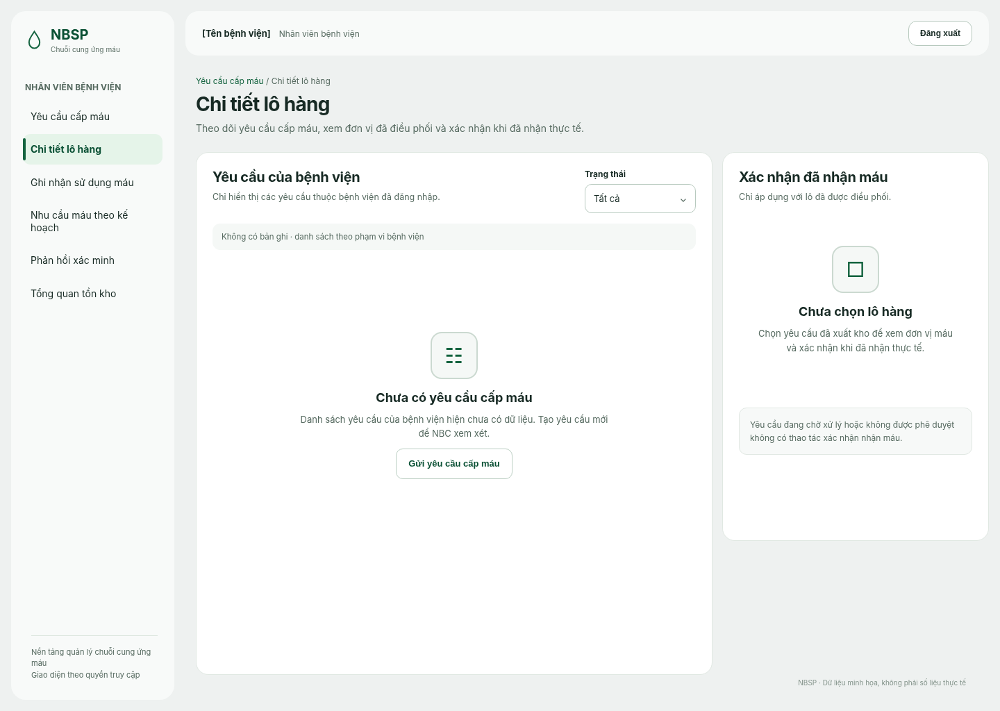
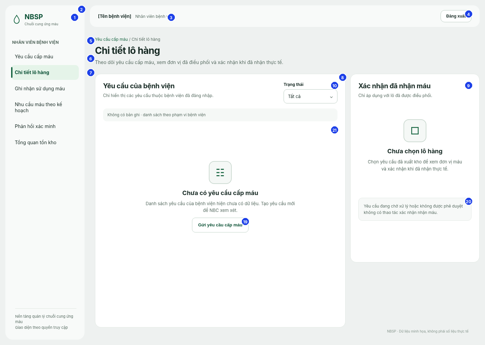
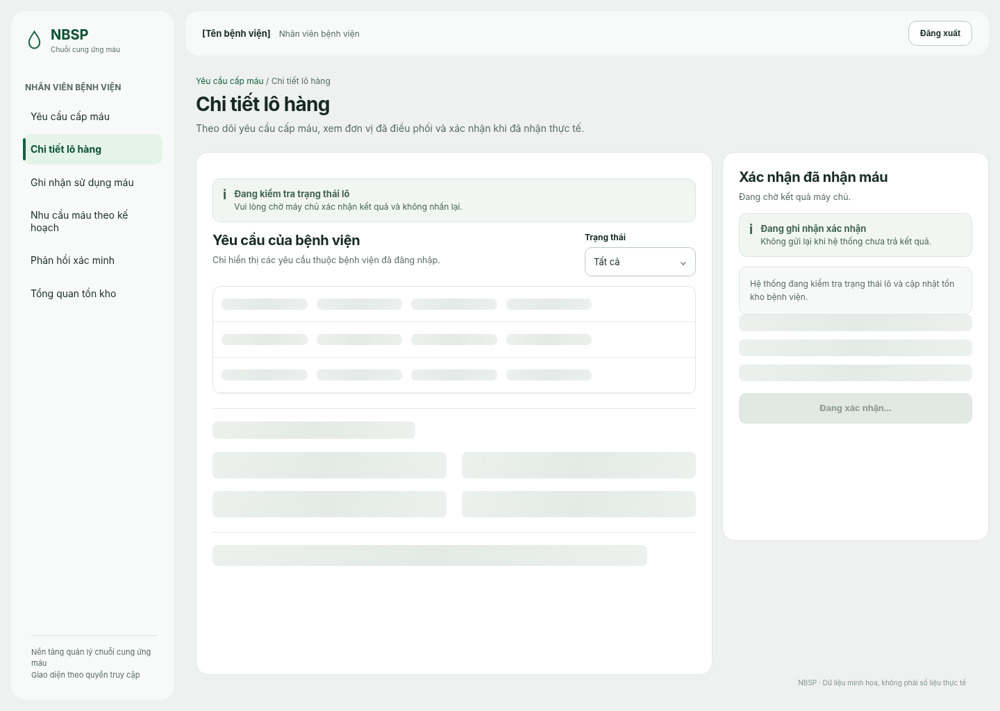
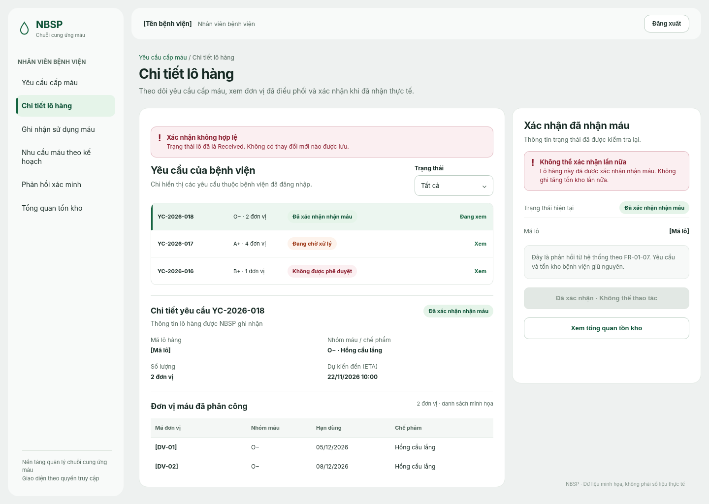
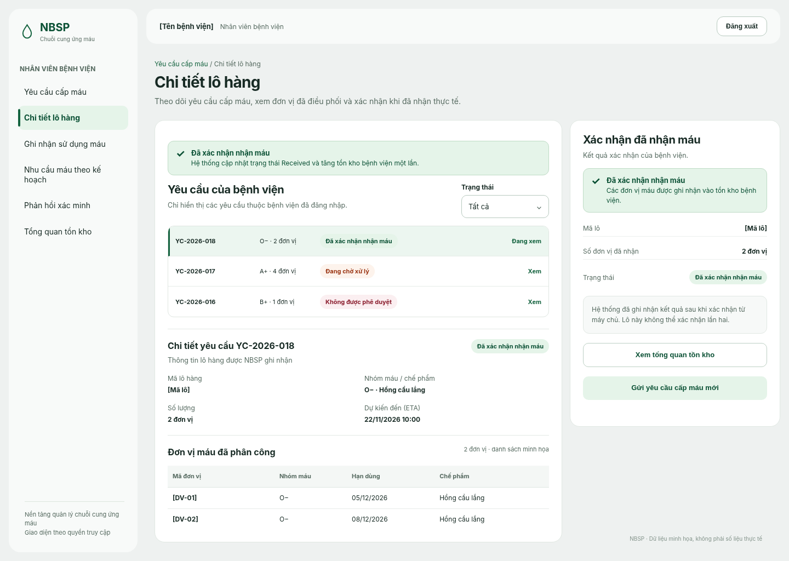

# Screen Spec: S-F01-02 Shipment Details and Receipt Confirmation

| Field | Value |
|---|---|
| Screen ID | `S-F01-02` |
| Screen name | Shipment Details and Receipt Confirmation (Vietnamese UI title: **“Chi tiết lô hàng”**) |
| Actor | Hospital Staff — Nhân viên bệnh viện |
| Priority | **Must** (Screen List; function priorities are kept separate) |
| Feature | F-01 Blood Ordering & Fulfillment |
| Use cases / FRs | UC-02, UC-03 · FR-01-04, FR-01-05, FR-01-07; supporting FR-04-03 |
| Activity / sequence | [`SD-UC-02`](../../../use-case/SD-UC-02.md), [`SD-UC-03`](../../../use-case/SD-UC-03.md), [`AD-UC-03`](../../../activity/AD-UC-03.md) |
| Usage flow | Hospital Staff Flow 1: `S-F04-01 → S-F01-01 → S-F01-02`; [`usage-flow.md`](../usage-flow.md) v2.3 |
| Design references | [UI Conventions](../../ui-conventions.md) · canonical [S-F01-01](../s-f01-01/screen-spec-s-f01-01.md) (layout only) |
| Screen List | [`screen-list.md`](../../screen-list.md) |
| Frame size | **1440 × 1024 px**, desktop, 1×; additional content scrolls vertically in implementation |
| Language | **Documentation: English; user-facing application/UI copy: Vietnamese** |
| Artefacts | **5 normal PNG + 5 numbered PNG**, `img/s-f01-02-*.png` |
| Version / status | **v1.0, 21/11/2026 — Reviewed draft**, pending listed Open Questions |
## 1. Purpose

**Shown when:** Hospital Staff opens the hospital's request list from the menu or after successful UC-01 submission. Each hospital sees only its own requests (BR-06); a record may be `Pending`, `Dispatched`, `Received`, or `Not approved` with a reason (BR-02). For a dispatched request, staff can inspect assigned units, expiry dates, shipment status and ETA without modifying records (UC-02, FR-01-04).

**Primary task:** confirm **physical receipt** of a whole dispatched shipment once, after checking the real shipment. A successful server transaction changes the request to `Received` and increases this hospital's inventory exactly once (FR-01-05, BR-03). Any confirmation submitted when the status is not `Dispatched` is rejected without changing request or inventory (FR-01-07). `Dispatched` **does not prove physical delivery**, and ETA does not create a new delivery status.

**Leaves the screen when:** Hospital Staff navigates to `S-F01-01` (new blood request), `S-F02-02` (own inventory), another authorised menu item, or signs out via `S-F04-01`. Receipt confirmation and state feedback stay on this same Screen ID. A `Not approved` request has its reason shown in detail; **no separate notification or screen** is created.

## 2. Mockup

**Layout:** same NBSP outer shell as S-F01-01: left role-scoped sidebar, NBSP identity, account + sign-out top bar, breadcrumb, Vietnamese heading and subtitle, two white task/support cards. Business contents are intentionally screen-specific. **No HuyếtMạch rebrand, analytics KPI strip, invented global search, avatar card or extra Screen ID.** The numbers on the blue circles map directly to the Element Inventory below. The frame contains synthetic display values only.

| State | Original image | Numbered image | Element numbers shown |
|---|---|---|---|
| **Default** |  |  | 2,1,3,4,5,6,7,8,10,11,12,13,15,14,9,16,17,18,20 |
| **Empty** |  |  | 2,1,3,4,5,6,7,8,10,21,19,9,20 |
| **Loading** |  |  | 2,1,3,4,5,6,7,8,22,10,9,16,18 |
| **Error** |  |  | 2,1,3,4,5,6,7,8,23,10,11,12,13,15,14,9,20,18,27 |
| **Success** |  |  | 2,1,3,4,5,6,7,8,24,10,11,12,13,15,14,9,25,27,19 |

**State intent:** **Default** — hospital request list and an existing `Dispatched` shipment, with receipt acknowledgement chosen by the user · **Empty** — no hospital requests returned by a successful query (distinct from a Pending request having no shipment) · **Loading** — receipt request is being checked and saved, with repeated submission prevented · **Error** — server rejects a repeat receipt confirmation because the shipment is already `Received` · **Success** — server confirms `Received` and a single hospital inventory increment.

## 3. Element inventory

### 3.1. Shared page frame (all states)

| # | Element | Type | Content / source | Required | Behaviour / validation |
|---:|---|---|---|---|---|
| 1 | NBSP brand | Logo and name | “NBSP”, “Chuỗi cung ứng máu” | Yes | Same brand and proportions as `S-F01-01`. |
| 2 | Role-aware sidebar | Navigation | Only the menu items authorised for the current actor | Yes | Active item has background, left indicator, bold text; no alert badge on the menu. |
| 3 | Account header | Session summary | Organisation from session and Vietnamese role | Yes | Never reveal another hospital's identity or data. |
| 4 | Đăng xuất | Secondary button | Sign-out action | Yes | Ends session → `S-F04-01`. |
| 5 | Breadcrumb | Text / authorised links | Vietnamese hierarchy; links only to existing screens | Yes | No fabricated home screen. |
| 6 | Screen heading | H1 | Vietnamese UI title | Yes | Corresponds to the Screen List. |
| 7 | Screen subtitle | Description | One sentence describing the current task | Yes | No premature confirmation of an action. |
| 8 | Primary task card | Rounded white card | List/table and controls for the current use case | Yes | Reuses the visual shell, typography and spacing of `S-F01-01`. |
| 9 | Supporting card | Rounded white card | Details, guidance or related action | Yes | Relevant to actor; may have contextual placeholders. |

### 3.2. Request/receipt elements

| # | Element | Type | Displayed content / logical source | Required | Validation and behaviour |
|---:|---|---|---|---|---|
| 10 | Yêu cầu của bệnh viện + Trạng thái | Heading + status filter | Hospital-scoped requests; Pending / Dispatched / Received / Not approved | Yes | Filter is presentation/query only; not a state mutation. |
| 11 | Request list | Read-only list | Request ID, blood type/quantity, status, “Xem” | If records exist | Only current hospital; selecting a request loads its own detail. |
| 12 | Selected request heading and status | Summary + chip | Request ID; database status rendered in Vietnamese | If selected | `Dispatched` label “Đã xuất kho / đang vận chuyển” is explanatory, **not proof of delivery**. |
| 13 | Shipment detail values | Read-only key/value | Shipment ID, blood group/product, assigned quantity | If `Dispatched`/`Received` | Values from authorised shipment, not values inferred from request form. |
| 14 | Assigned unit table | Read-only table | Unit ID, ABO/Rh, expiry date, product | If shipment exists | Complete unit IDs and expiries. No row allocation action in Hospital screen. |
| 15 | ETA | Read-only date/time | Shipment ETA `dd/MM/yyyy HH:mm` | If available | Estimate only; never displays delivery completion by itself. |
| 16 | Receipt guidance | Banner | “Chỉ xác nhận sau khi bệnh viện đã nhận và kiểm tra lô.” | Default / Loading | Separate physical receipt from Dispatched DB status. |
| 17 | Physical-check acknowledgement | Checkbox | “Tôi đã nhận và kiểm tra thực tế toàn bộ lô hàng này.” | **Proposed UI safeguard** | Checked in Default mock to illustrate user action; never pre-check automatically. **Backend rule remains the status check in FR-01-07.** |
| 18 | Xác nhận đã nhận máu | Primary / disabled button | Submit receipt for the selected shipment ID | If dispatched | When activated, prevent double-submit; server must recheck status and commit one atomic inventory update. |
| 19 | Gửi yêu cầu cấp máu | Navigation | Open request screen | Empty / Success | Target `S-F01-01`; not a new function. |
| 20 | Receipt safety / status explanation | Support note | Whole-shipment confirmation, status and duplicate protection | When applicable | Not a record status; no temperature, courier or damaged-package fields are implied by W1. |
| 21 | Empty result block | Empty state | “Chưa có yêu cầu cấp máu” | Empty | Means no requests at all in this query; **not** “request Pending”. |
| 22 | Loading message and placeholders | `role="status"` + skeleton | “Đang kiểm tra trạng thái lô” and disabled action | Loading | No second confirmation before response. |
| 23 | Failed receipt / duplicate banner | `role="alert"` | “Lô hàng này đã được xác nhận nhận máu. Không ghi tăng tồn kho lần nữa.” | Error | FR-01-07: unchanged DB/inventory; selection is refreshed to Received in sample. |
| 24 | Receipt success feedback | `role="status"` | “Đã xác nhận nhận máu. Các đơn vị máu được ghi nhận vào tồn kho bệnh viện.” | Success | Only after server confirms both status and inventory mutation. |
| 25 | Receipt result summary | Read-only | Shipment ID, count, Received status | Success | No second confirm CTA. |
| 26 | Not approved reason (alternate branch) | Read-only detail | “Không được phê duyệt”, stored reason | If selected request is Not approved | Required by Screen List/FR-01-09 (upstream); no receipt action and no separate notification. *Not one of the five illustrated PNG states.* |
| 27 | Xem tổng quan tồn kho | Navigation button | Open inventory dashboard | Error / Success | Target `S-F02-02`, hospital-scoped view. |

## 4. States

| State | Trigger | Visible result | Persisted result |
|---|---|---|---|
| **Default** | Request list + dispatched shipment successfully loaded | Hospital request list, assigned units, expiry, ETA, status, physical-check acknowledgement | No data change; illustrative acknowledgement is a user choice, never automatic. |
| **Empty** | Successful request-list query returns no records | “Chưa có yêu cầu cấp máu”, navigation to request form | None. A Pending request is **not** considered no request. |
| **Loading** | Receipt submitted, reply pending | Loading message, skeleton/disabled confirmation, no success claim | Pending server result; no client-side update. |
| **Error** | Duplicate receipt or status changed on server | Failed-confirmation reason; current `Received` status shown | No additional receipt/inventory increment (FR-01-07). |
| **Success** | Backend confirms atomic receipt transaction | Received status, summary and inventory navigation | Request `Received`, assigned units added once to same hospital inventory. |

**Other business views on the same screen (not separate PNGs):** `Pending` → request details but no shipment yet, no confirmation; `Not approved` → reason and new-request option; `Received` → read-only confirmation state, disabled repeat action. A technically uncertain response must show an unknown-result message, then re-fetch status before any retry (UI Conventions §4).

## 5. Interactions and navigation

| # | Element / user action | NBSP response | Destination |
|---:|---|---|---|
| 1 | Menu “Chi tiết lô hàng” / enter from `S-F01-01` | Query requests for authenticated hospital | Stays (`Loading` → `Default`/`Empty`/`Error`) |
| 2 | Status filter | Query/filter within the same hospital scope | Stays |
| 3 | “Xem” request | Loads that request; for `Dispatched`, displays units, expiry, ETA | Stays |
| 4 | Open `Pending` or `Not approved` | Show status; for Not approved show stored reason; no confirm | Stays |
| 5 | Toggle acknowledgement | Local UI only; **does not mark request Received** | Stays |
| 6 | “Xác nhận đã nhận máu” | Backend checks status, updates Received and inventory once, or rejects with reason | Stays → `Loading` → `Success`/`Error` |
| 7 | “Xem tổng quan tồn kho” | Fetch own hospital/NBC available inventory | `S-F02-02` |
| 8 | “Gửi yêu cầu cấp máu (mới)” | Opens request form | `S-F01-01` |
| 9 | Other Hospital menu item | Authorised route only | `S-F02-01`, `S-F03-01`, `S-F03-03` as appropriate |
| 10 | “Đăng xuất” | Ends session | `S-F04-01` |

## 6. Screen-level rules

| ID | Rule | Source |
|---|---|---|
| SR-02-01 | Request-list data and shipment details belong to the currently authenticated hospital only. | BR-06; FR-04-03; SD-UC-02 |
| SR-02-02 | UC-02 is read-only; assigned units/expiry/status/ETA are displayed only for a dispatched shipment. | FR-01-04 |
| SR-02-03 | `Pending`, `Dispatched`, `Received`, `Not approved` are the request status set; a non-approved request shows a reason. | BR-02; Screen List; UI Conventions |
| SR-02-04 | `Dispatched`/ETA must never be labelled as physical delivery success. | UI Conventions §1.2; UC-03 |
| SR-02-05 | Receipt requires backend status `Dispatched`, once per shipment; reject any other status and preserve inventory. | FR-01-07; BR-03 |
| SR-02-06 | On valid receipt, server marks `Received` and adds all assigned units to hospital inventory together. | FR-01-05; AD-UC-03; SD-UC-03 |
| SR-02-07 | Loading or uncertain connectivity does not permit duplicate submission or a premature Success message. | UI Conventions §3–4 |
| SR-02-08 | Physical-check checkbox is a **UI safeguard proposal**, not a newly approved field or database status. | UI design proposal, needs team confirmation |

## 7. Linked requirements

| Requirement | Screen responsibility |
|---|---|
| FR-01-04 | List hospital requests and inspect authorised dispatched shipment details. |
| FR-01-05 | Confirm receipt, show `Received`, and explain one atomic inventory increment. |
| FR-01-07 | Reject premature or duplicate confirmation with reason, preserve data and inventory. |
| FR-04-03 / BR-06 | Hospital-scoped menu and data, backend authorisation. |
| BR-02 / FR-01-09 (upstream) | Present `Not approved` and its recorded reason; the hospital does not decide approval here. |
| UC-04 (related) | Damaged/missing units follow approved usage/discard flow; this screen does not create partial-receipt controls. |

## 8. Desktop and accessibility notes

- Rendered at **1440 × 1024 px, 1×**, shared NBSP shell. Real datasets may scroll vertically; do not reduce core text to fit.
- Focus order: sidebar → request filter/list → selected detail → acknowledgement → receipt action → related links. Button/checkbox targets ≥24 CSS px (prefer 40–44 px); primary action ≥44 px.
- All statuses have text, not colour alone. Unit ID, expiry, ETA and request code stay legible. The warning banner is `role="status"`, transaction errors `role="alert"`, success `role="status"`.
- Client acknowledgement may aid safe interaction but **does not replace the backend `Dispatched` check**. In the Default screenshot it is checked to demonstrate the user-selected ready-to-submit case, not automatically checked based on ETA.

## 9. Mockup corrections and scope decisions

| Source concern | Resolution in this package |
|---|---|
| Sample LabDesk seat-booking images are unrelated | Used **only** S-F01-01 as NBSP layout reference; no seat-map content. |
| Earlier receipt prototype added courier/temperature/package conditions | Not reproduced as mandatory fields: FR-01-04/05/07 do not specify them. |
| Earlier prototype inferred “Đã giao tới bệnh viện” from Dispatched | Replaced with explanatory `Dispatched` / “Đang vận chuyển”; physical receipt is a Hospital action. |
| Need to display declined requests | Same S-F01-02 list and reason in detail; no new Screen ID. |
| Receipt duplicate protection | Error is an actual backend rejection, not an invented `Blocked` status. |

## 10. Open questions

| ID | Question | Blocking? | Status |
|---|---|---|---|
| OQ-02-01 | Should the physical-check acknowledgement checkbox be compulsory client-side, or should the existing Confirm button rely solely on the server precondition? | No | **UI proposal only**; no new backend FR assumed. |
| OQ-02-02 | Exact request ID / shipment ID / unit ID API schema and selection filters? | For binding | Pending backend contract. |
| OQ-02-03 | Whether a Pending request has a selectable detail view with only request data, and how the list handles very large histories. | No | Keep as read-only list detail, pagination TBD. |
| OQ-02-04 | Must the hospital acknowledge mismatch/damage during receipt, beyond the current whole-shipment rule? | Scope-impacting | **No additional UI**; D-10 points to UC-04 for discard reason. |

### Implementation invariants (all states)

- **Server authority:** database records and status transitions are controlled by the backend, not a badge, button, ETA, filter or mockup.
- **Confidentiality:** scoped data must be enforced by the backend (`FR-04-03`, BR-06), not by frontend menu hiding alone.
- **Message discipline:** distinguish Empty (successful query with no data), Error (unavailable/invalid operation), Loading (pending response) and Success (server-confirmed result). If a mutation response is uncertain, do not claim success or retry without checking the server state first.
- **Visual standard:** Vietnamese visible labels, date `dd/MM/yyyy`, date/time `dd/MM/yyyy HH:mm`, ABO+Rh notation, text+icon/shape status; no state inferred from colour alone.

## Completion checklist

- [x] Five unnumbered and five numbered PNGs, all 1440 × 1024 px.
- [x] Vietnamese application UI; English specification; S-F01-01 shell reused.
- [x] Hospital-only requests; `Pending`, `Dispatched`, `Received`, `Not approved` and reason are covered.
- [x] No delivery-status inference, no double inventory increment, no unapproved extra fields.
- [x] UC-02 and UC-03 share one Screen ID; all visible interactions remain on-screen except authorised navigation.
- [ ] Confirm checkbox UX and backend payload/pagination before coding.
