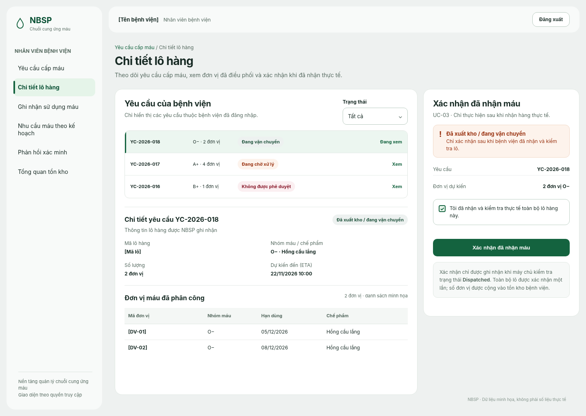
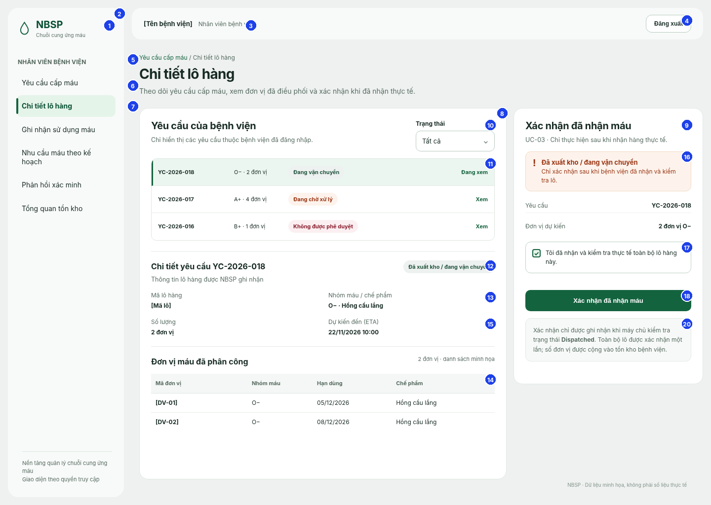
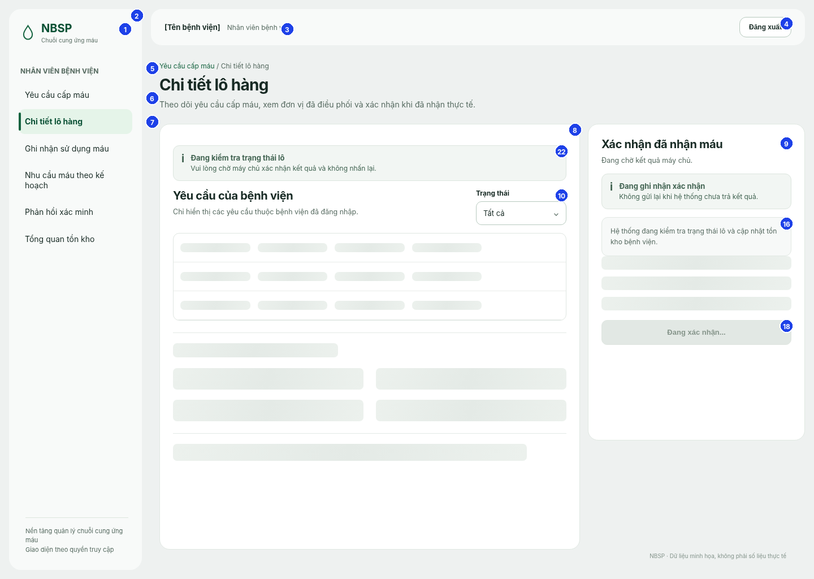
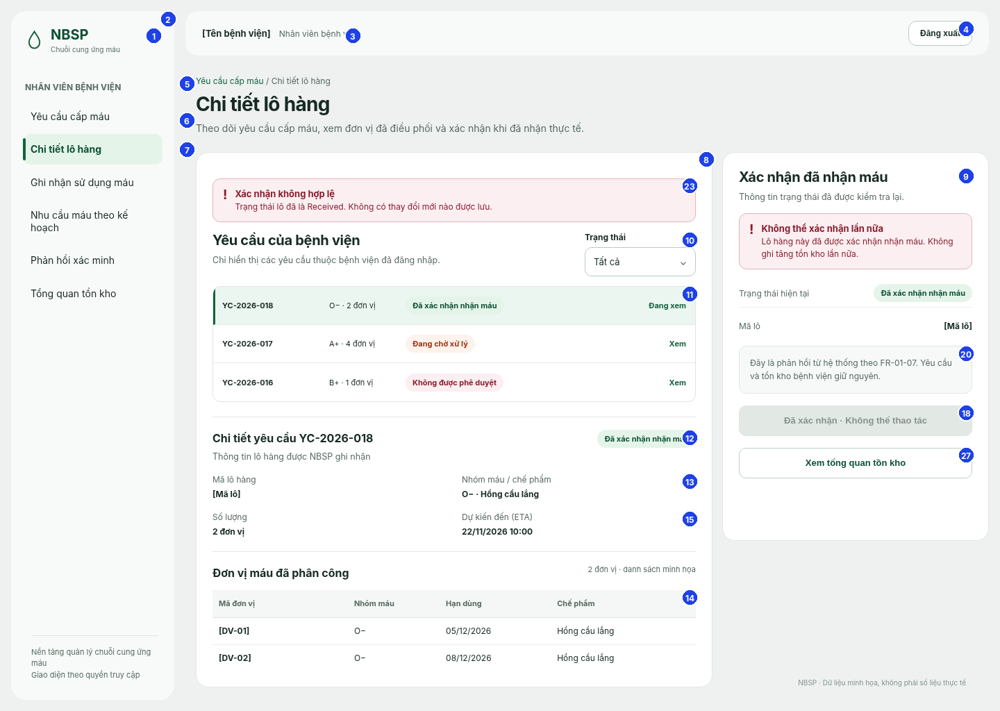
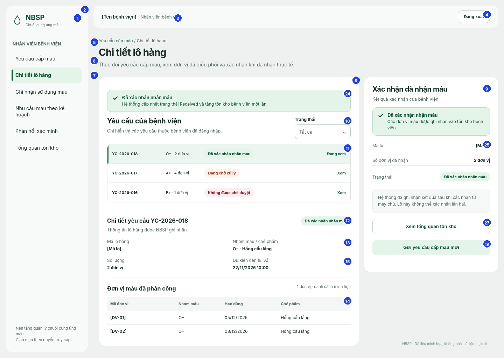

# Screen Spec: S-F01-02 Shipment details
 
| Field | Value |
|---|---|
| Screen ID | S-F01-02 |
| Screen name | Shipment details (Vietnamese UI title: "Chi tiết lô hàng") |
| Actor | Hospital Staff |
| Priority | Must |
| Feature | F-01 Blood Ordering & Fulfillment |
| Use cases / FRs | UC-02, UC-03 · FR-01-04, FR-01-05, FR-01-07 (as in `screen-list.md`); related FR-04-03 · BR-02, BR-03, BR-06 |
| Activity diagrams | AD-UC-03 (action "Confirm arrival of dispatched shipment"); UC-02 has no activity diagram ("not needed", `usage-flow.md`) |
| Sequence diagrams | SD-UC-02 (v1), SD-UC-03 (v1) |
| Usage flow | Hospital Staff Flow 1 "Order blood and Receive" (`usage-flow.md` v2.3): S-F04-01 → S-F01-01 → **S-F01-02** |
| Mockup images | `img/s-f01-02-default.png`, `img/s-f01-02-empty.png`, `img/s-f01-02-loading.png`, `img/s-f01-02-error.png`, `img/s-f01-02-success.png`; numbered: the same five names ending in `-numbered.png` (section 2) |
| Frame width | 1440 px wide (desktop, UI conventions v2.0 §2.1), 1× (1440 × 1024 px in all five states); the page scrolls vertically when the content is longer |
| Figma frame | not used (drawn as an HTML wireframe) |
| Status | Reviewed |
 
## 1. Purpose
 
**Shown when:** Hospital Staff open "Chi tiết lô hàng" from the menu, or press "Xem chi tiết lô hàng" in the success state of S-F01-01. The screen lists the hospital's own requests with their status (Pending, Dispatched, Received, or Not approved with its reason). For a Dispatched request it shows the assigned units, their expiry dates, the shipment status and the ETA without changing stored data (UC-02, FR-01-04). After the staff have physically received and checked the whole shipment, they confirm receipt once on the same screen: NBSP marks the request Received and adds the units to the hospital inventory (UC-03, FR-01-05), or rejects the confirmation and changes nothing if the shipment is not Dispatched (FR-01-07).
 
**The user leaves this screen when:** receipt is confirmed (success state, then "Xem tổng quan tồn kho" or "Gửi yêu cầu cấp máu mới"), or the user opens another menu item, the breadcrumb link "Yêu cầu cấp máu", or signs out. A Not approved request and its reason are read here; no message is sent to the hospital and no other screen opens for it.
 
## 2. Mockup
 

 
**Layout (all states):** sidebar on the left (brand, role group, Hospital Staff menu); top bar (hospital name, role, Sign out); breadcrumb, title and subtitle; main card on the left ("Yêu cầu của bệnh viện": status filter, request list, details of the selected request); card "Xác nhận đã nhận máu" on the right (receipt guidance, check box, confirm button, result).
 
**Numbered:** each number is the # of the element inventory in section 3. A repeated element (a row of the list, a row of the unit table) is numbered once. Elements 21 to 25 appear only in one state each and are numbered on that state's image. Element 26 (status message for a Pending or Not approved request) has no image; it is described in sections 3 and 4 only.
 
| State | Numbered image | Numbers shown |
|---|---|---|
| Default |  | 1–18, 20 |
| Empty |  | 1–10, 19–21 |
| Loading |  | 1–10, 16, 18, 22 |
| Error |  | 1–15, 18, 20, 23, 27 |
| Success |  | 1–15, 19, 24, 25, 27 |
 
| State | Image |
|---|---|
| Default | `img/s-f01-02-default.png` (request YC-2026-018 Dispatched and selected, 2 units O−, ETA 22/11/2026 10:00, check box ticked by the user) |
| Empty | `img/s-f01-02-empty.png` (the hospital has no request yet) |
| Loading | `img/s-f01-02-loading.png` (receipt confirmation sent, waiting for the server) |
| Error | `img/s-f01-02-error.png` (repeated confirmation of a shipment already Received, FR-01-07; the "not yet Dispatched" and "unknown result" errors are described in section 4 only) |
| Success | `img/s-f01-02-success.png` (request Received, units added to the hospital inventory) |
 
All colours, fonts and corners come from the design tokens in the UI conventions v2.0, section 6 ([ui-conventions.md](../../ui-conventions.md#6-design-tokens)), except the colours listed in open question 2.
 
**Mockup corrections** (differences between the images and this spec; fix them before the final export):
 
| # | Image | Problem | Fix |
|---|---|---|---|
| 1 | All | The menu has 6 items ("Ghi nhận sử dụng máu", "Nhu cầu máu theo kế hoạch") | Use the 5 items of S-F01-01 v1.2, with "Sử dụng & nhu cầu máu" (S-F02-01 v2.0) |
| 2 | Default | Subtitle of card 9 starts with the code "UC-03 ·" | Remove the code: "Chỉ thực hiện sau khi nhận hàng thực tế." (UI conventions §0 rule 5, §1.1) |
| 3 | Default, Error, Success | Texts 20, 23 and 24 show "Dispatched", "Received" and "FR-01-07" | Use the Vietnamese labels "Đã xuất kho / đang vận chuyển", "Đã xác nhận nhận máu" and no FR code (UI conventions §1.1, §1.2) |
| 4 | Default | Banner 16 body text differs from the message library | "Lô hàng đang vận chuyển. Chỉ xác nhận sau khi bệnh viện đã nhận và kiểm tra lô." (UI conventions §4.2) |
| 5 | All | Footer note "NBSP · Dữ liệu minh họa, không phải số liệu thực tế" under the cards | Mockup annotation only; not part of the screen, remove from the final export |
 
## 3. Element inventory
 
Vietnamese labels are written as they appear in the mockup (after the corrections above).
 
### 3.1 Page frame (all states)
 
| # | Element | Type | Content / data source | Required | Validation |
|---|---|---|---|---|---|
| 1 | Brand | Logo and text | static: "NBSP", "Chuỗi cung ứng máu" | Yes | none |
| 2 | Menu | Navigation | static; role group "NHÂN VIÊN BỆNH VIỆN" and the 5 items allowed for Hospital Staff (FR-04-03): "Yêu cầu cấp máu", "Chi tiết lô hàng" (current, marked by background, left bar and bold text), "Sử dụng & nhu cầu máu", "Phản hồi xác minh", "Tổng quan tồn kho"; footer text "Nền tảng quản lý chuỗi cung ứng máu", "Giao diện theo quyền truy cập". No count badge | Yes | none |
| 3 | Account info | Text | `hospital.name` ("[Tên bệnh viện]") and the role "Nhân viên bệnh viện", from the session | Yes | none |
| 4 | Sign out | Secondary button | label "Đăng xuất" | Yes | none |
| 5 | Breadcrumb | Text with link | "Yêu cầu cấp máu" (link to S-F01-01) / "Chi tiết lô hàng" | Yes | none |
| 6 | Title | Header | static: "Chi tiết lô hàng" | Yes | none |
| 7 | Subtitle | Text | static: "Theo dõi yêu cầu cấp máu, xem đơn vị đã điều phối và xác nhận khi đã nhận thực tế." | Yes | none |
 
### 3.2 Request card (left)
 
| # | Element | Type | Content / data source | Required | Validation |
|---|---|---|---|---|---|
| 8 | Request card | Card with title | static: "Yêu cầu của bệnh viện", "Chỉ hiển thị các yêu cầu thuộc bệnh viện đã đăng nhập." | Yes | none |
| 10 | Status filter | Label and select | label "Trạng thái"; values "Tất cả" (default), "Đang chờ xử lý", "Đã xuất kho / đang vận chuyển", "Đã xác nhận nhận máu", "Không được phê duyệt" (`request.status`, BR-02, UI conventions §1.2) | Yes | one value of the list; filters inside the hospital's own requests only (BR-06) |
| 11 | Request list | List of rows | per row: `request.id`; `request.blood_type` · `request.quantity` + " đơn vị"; status chip from `request.status` (Pending "Đang chờ xử lý", Dispatched "Đang vận chuyển", Received "Đã xác nhận nhận máu", Not approved "Không được phê duyệt"); link "Xem", or "Đang xem" on the selected row (background and left bar) | Yes, when the hospital has requests | read-only; only requests of `session.hospital_id` (BR-06, FR-04-03) |
| 12 | Selected request header | Header and status chip | "Chi tiết yêu cầu " + `request.id`; caption "Thông tin lô hàng được NBSP ghi nhận"; chip `request.status` with its full label ("Đã xuất kho / đang vận chuyển", "Đã xác nhận nhận máu") | Yes, when a request is selected | read-only |
| 13 | Shipment details | Label–value rows | "Mã lô hàng" `shipment.id`; "Nhóm máu / chế phẩm" `shipment.blood_type` · `shipment.blood_product`; "Số lượng" `shipment.unit_count` + " đơn vị" | Yes, when the request is Dispatched or Received | read-only (FR-01-04) |
| 14 | Assigned units | Table with title | title "Đơn vị máu đã phân công", count `shipment.unit_count` + " đơn vị"; columns "Mã đơn vị" `unit.id`, "Nhóm máu" `unit.blood_type`, "Hạn dùng" `unit.expiry_date` (dd/MM/yyyy), "Chế phẩm" `unit.blood_product` | Yes, when the request is Dispatched or Received | read-only; unit IDs and expiry dates never truncated (UI conventions §5) |
| 15 | ETA | Label–value | "Dự kiến đến (ETA)" `shipment.eta` (dd/MM/yyyy HH:mm) | Yes, when the request is Dispatched or Received | read-only; an estimate, never shown as delivery |
 
### 3.3 Receipt card (right)
 
| # | Element | Type | Content / data source | Required | Validation |
|---|---|---|---|---|---|
| 9 | Receipt card | Card with title and rows | title "Xác nhận đã nhận máu"; subtitle by state ("Chỉ thực hiện sau khi nhận hàng thực tế.", "Đang chờ kết quả máy chủ.", "Thông tin trạng thái đã được kiểm tra lại.", "Kết quả xác nhận của bệnh viện."); rows "Yêu cầu" `request.id`, "Đơn vị dự kiến" `shipment.unit_count` + `shipment.blood_type`; error state: "Trạng thái hiện tại" chip and "Mã lô" `shipment.id`; empty state: icon, "Chưa chọn lô hàng", "Chọn yêu cầu đã xuất kho để xem đơn vị máu và xác nhận khi đã nhận thực tế." | Yes | read-only |
| 16 | Receipt guidance | Banner (`role="status"`) with icon | Default: "Đã xuất kho / đang vận chuyển" + "Lô hàng đang vận chuyển. Chỉ xác nhận sau khi bệnh viện đã nhận và kiểm tra lô." (UI conventions §4.2); Loading: "Hệ thống đang kiểm tra trạng thái lô và cập nhật tồn kho bệnh viện." | Yes, when the request is Dispatched | none |
| 17 | Physical-check box | Check box with label | "Tôi đã nhận và kiểm tra thực tế toàn bộ lô hàng này." | Yes, when the request is Dispatched | never ticked by default or from the ETA; must be ticked before element 18 is enabled (SR-007) |
| 18 | Confirm receipt | Primary button | label "Xác nhận đã nhận máu"; loading: "Đang xác nhận..."; request already Received: "Đã xác nhận · Không thể thao tác" | Yes, when the request is Dispatched or Received | enabled only when the request is Dispatched and element 17 is ticked; disabled while sending and once Received |
| 19 | New request | Secondary button | label "Gửi yêu cầu cấp máu" (empty state), "Gửi yêu cầu cấp máu mới" (success state) | No | none |
| 20 | Receipt note | Information box | Default: "Xác nhận chỉ được ghi nhận khi máy chủ kiểm tra trạng thái Đã xuất kho. Toàn bộ lô được xác nhận một lần; số đơn vị được cộng vào tồn kho bệnh viện."; Empty: "Yêu cầu đang chờ xử lý hoặc không được phê duyệt không có thao tác xác nhận nhận máu."; Error: "Đây là phản hồi từ hệ thống. Yêu cầu và tồn kho bệnh viện giữ nguyên." | No | none |
| 25 | Receipt result | Label–value rows | "Mã lô" `shipment.id`; "Số đơn vị đã nhận" `shipment.unit_count` + " đơn vị"; "Trạng thái" chip `request.status` = Received "Đã xác nhận nhận máu"; note "Hệ thống đã ghi nhận kết quả sau khi xác nhận từ máy chủ. Lô này không thể xác nhận lần hai." | No (success state only) | read-only |
| 27 | View inventory | Secondary button | label "Xem tổng quan tồn kho" | No (error and success states) | none |
 
### 3.4 State messages
 
| # | Element | Type | Content / data source | Required | Validation |
|---|---|---|---|---|---|
| 21 | Empty list | Empty-state block with icon and button 19 | strip "Không có bản ghi · danh sách theo phạm vi bệnh viện"; "Chưa có yêu cầu cấp máu"; "Danh sách yêu cầu của bệnh viện hiện chưa có dữ liệu. Tạo yêu cầu mới để NBC xem xét." | No (empty state only) | none |
| 22 | Sending banner and placeholders | Banner (`role="status"`) and grey placeholders | main card: "Đang kiểm tra trạng thái lô" + "Vui lòng chờ máy chủ xác nhận kết quả và không nhấn lại."; receipt card: "Đang ghi nhận xác nhận" + "Không gửi lại khi hệ thống chưa trả kết quả."; grey placeholders replace the list, the details and the card rows | No (loading state only) | none |
| 23 | Error banners | Banner (`role="alert"`) with error icon | main card: "Xác nhận không hợp lệ" + "Trạng thái lô đã là Đã xác nhận nhận máu. Không có thay đổi mới nào được lưu."; receipt card: "Không thể xác nhận lần nữa" + "Lô hàng này đã được xác nhận nhận máu. Không ghi tăng tồn kho lần nữa." (UI conventions §4.2). Other texts in section 4, Error | No (error state only) | none |
| 24 | Success banners | Banner (`role="status"`) with tick icon | main card: "Đã xác nhận nhận máu" + "Hệ thống cập nhật trạng thái Đã xác nhận nhận máu và tăng tồn kho bệnh viện một lần."; receipt card: "Đã xác nhận nhận máu" + "Các đơn vị máu được ghi nhận vào tồn kho bệnh viện." (UI conventions §4.2) | No (success state only) | shown only after the server confirms |
| 26 | Request status message | Banner in the details area, in place of elements 13–15 and 16–18 | Pending: "Chưa có thông tin lô hàng được điều phối cho yêu cầu này. Vui lòng kiểm tra lại sau."; Not approved: "Yêu cầu không được phê duyệt. Lý do: " + `request.not_approved_reason` + ". Nếu vẫn cần máu, vui lòng gửi yêu cầu mới." (UI conventions §4.2, FR-01-09) | No (a Pending or Not approved request is selected; no image) | read-only |
 
## 4. States
 
| State | What the user sees | Trigger |
|---|---|---|
| Default | Request list with the selected Dispatched request (YC-2026-018); shipment details, ETA and the two assigned units with expiry dates; guidance banner; check box ticked by the user; Confirm receipt enabled. Other views of the same state, no image: a **Pending** request shows element 26 "Chưa có thông tin lô hàng được điều phối…" and no confirm action; a **Not approved** request shows element 26 with the stored reason and button 19; a **Received** request shows the details read-only and button 18 disabled "Đã xác nhận · Không thể thao tác" | Screen opened and the hospital's requests loaded; a request selected with "Xem". From S-F01-01 "Xem chi tiết lô hàng" the new Pending request is selected |
| Empty (no data) | Status filter, empty block "Chưa có yêu cầu cấp máu" with button "Gửi yêu cầu cấp máu"; receipt card "Chưa chọn lô hàng" and note 20. With a filter other than "Tất cả" and no match, the same block reads "Không có yêu cầu phù hợp bộ lọc" | The hospital has no request, or none matches the filter |
| Loading | Sending banners (element 22); grey placeholders in the list, the details and the receipt card; Confirm receipt shows "Đang xác nhận..." and is disabled so the confirmation cannot be sent twice | The user pressed Confirm receipt and the server has not answered (also on first load of the list, without banner) |
| Error | **Repeated confirmation** (image): error banners (element 23); list and details reloaded, the row now shows "Đã xác nhận nhận máu"; Confirm receipt disabled; note 20 and "Xem tổng quan tồn kho"; request and inventory unchanged (FR-01-07). **Not yet Dispatched** (no image): banner "Chưa thể xác nhận nhận máu vì lô hàng chưa ở trạng thái đã xuất kho/điều phối."; status reloaded; nothing changed (FR-01-07). **Unknown result** (no image): banner "Chưa xác định được kết quả thao tác. Hãy tải lại trạng thái hiện tại trước khi thử lại."; the screen claims neither success nor failure and reloads the request status before the button can be used again (UI conventions §4.1) | The server rejected the confirmation because the shipment is not Dispatched (already Received, or not yet dispatched); or the connection was lost before the server answered |
| Success / confirmation | Success banners (element 24); the row and chip show "Đã xác nhận nhận máu"; receipt result (element 25) with shipment ID and number of units received; buttons "Xem tổng quan tồn kho" and "Gửi yêu cầu cấp máu mới"; no second confirm action | The server marked the request Received and added the units to the hospital inventory (FR-01-05) |
 
## 5. Interactions and navigation
 
| # | Element | User action | System response | Goes to screen |
|---|---|---|---|---|
| 1 | Status filter (10) | choose a value | Reloads the list with the hospital's requests of that status (BR-06) | stays |
| 2 | "Xem" in a request row (11) | click | Selects the request and loads its details: Dispatched → elements 12–18; Received → details read-only, 18 disabled; Pending or Not approved → element 26, no confirm action (FR-01-04) | stays |
| 3 | Physical-check box (17) | tick or untick | Enables or disables Confirm receipt; saves nothing | stays |
| 4 | Confirm receipt (18) | click | Shows the loading state; the server checks that the shipment is Dispatched, then marks the request Received and adds all its units to the hospital inventory (FR-01-05), or rejects and changes nothing (FR-01-07) | stays (loading, then success or error state) |
| 5 | View inventory (27) | click (error and success states) | Opens the hospital inventory | S-F02-02 |
| 6 | New request (19) | click (empty and success states, and with a Not approved request) | Opens the empty request form | S-F01-01 |
| 7 | Breadcrumb "Yêu cầu cấp máu" (5) | click | Opens the request form | S-F01-01 |
| 8 | Menu item "Yêu cầu cấp máu" (2) | click | Opens the request form | S-F01-01 |
| 9 | Menu item "Chi tiết lô hàng" (2) | click | Current screen; reloads the list | stays |
| 10 | Menu item "Sử dụng & nhu cầu máu" (2) | click | Opens the usage and planned demand record | S-F02-01 |
| 11 | Menu item "Phản hồi xác minh" (2) | click | Opens the verification response | S-F03-03 |
| 12 | Menu item "Tổng quan tồn kho" (2) | click | Opens the inventory dashboard | S-F02-02 |
| 13 | Sign out (4) | click | Ends the session | S-F04-01 |
 
## 6. Screen-level rules
 
| Rule ID | Rule | Source |
|---|---|---|
| SR-001 | The list and every detail belong to the signed-in hospital only; the hospital comes from the session, not from the screen. | BR-06, FR-04-03, SD-UC-02 |
| SR-002 | Shipment details (units, expiry dates, status, ETA) are shown only for a Dispatched or Received request, read-only; opening them changes no stored data. | FR-01-04, SD-UC-02 |
| SR-003 | A request has one of four statuses: Pending, Dispatched, Received, Not approved. Not approved is final and shows its stored reason here; no separate message or screen. | BR-02, FR-01-09, UI conventions §1.2 |
| SR-004 | Dispatched and the ETA are never shown as delivered; "Đang vận chuyển" is an explanatory label, not a status. | UI conventions §1.2 |
| SR-005 | Receipt can be confirmed only for a Dispatched shipment and only once; any other status is rejected with the reason, and neither the request nor the inventory changes. | BR-03, FR-01-07, AD-UC-03 |
| SR-006 | A valid confirmation marks the request Received and adds all its units to the hospital inventory together. Only the whole shipment is confirmed; damaged or missing units are recorded afterwards on S-F02-01 as Discarded ("Damaged on arrival", "Missing on arrival"). | FR-01-05, AD-UC-03 (Q2 resolved, D-10) |
| SR-007 | Confirm receipt is enabled only when the selected request is Dispatched and the physical-check box is ticked; the box is never ticked by default. The server check of SR-005 still applies. | UI conventions §1.2 (receipt note), §3 (Disabled state) |
| SR-008 | "Success" is shown only after the server confirms; while waiting, Confirm receipt is disabled so it cannot be sent twice. If the result is unknown, the screen reloads the status before allowing a new try. | UI conventions §3, §4.1; SD-UC-03 |
| SR-009 | State is never shown by colour alone: chips and banners have text and an icon or marker. | UI conventions §5 |
| SR-010 | No count badge on the menu. | `screen-list.md`, UI conventions OQ-03 |
 
## 7. Linked requirements
 
| FR ID | What this screen does for it |
|---|---|
| FR-01-04 | Lists the hospital's requests with their status (the list is counted in FR-01-04, `screen-list.md`) and displays the units, expiry dates, shipment status and ETA of a dispatched request |
| FR-01-05 | Provides the Confirm receipt action and the success state (Received, units added to the hospital inventory) |
| FR-01-07 | Shows the rejection and its reason when the shipment is not Dispatched, with request and inventory unchanged |
| FR-04-03 | Shows only the menu items and the hospital data allowed for the signed-in Hospital Staff |
| BR-02, BR-03, BR-06 | Status set and Not approved reason, single confirmation, hospital scope (section 6) |
 
## 8. Responsive and accessibility notes
 
- The mockups are drawn at 1440 px wide only, as the UI conventions v2.0 require. A narrow window and mobile are out of scope for this release (UI conventions §2.1); if added later, the receipt card moves under the request card.
- Keyboard: Tab follows the reading order (menu, status filter, request rows, details, check box, Confirm receipt, other buttons); a focus outline is visible; Space ticks the check box; Enter activates a row link or a button.
- The guidance, sending and success banners use `role="status"`; the error banners use `role="alert"`.
- Statuses use a chip with text (and a marker), never colour alone; unit IDs, expiry dates, ETA and request IDs are never truncated.
- Body text contrast at least 4.5:1; borders of inputs, chips and the check box at least 3:1. Primary button 44–48 px high; other targets at least 24 × 24 px.
- Body text 14–16 px; helper text 12–13 px.
## 9. Open questions
 
| # | Question | Blocking? | Status |
|---|---|---|---|
| 1 | [NEEDS CLARIFICATION: in which order is the request list sorted, and is it paged when a hospital has many requests? No FR or SD sets it.] | No | Open. Default: newest first; the list scrolls vertically, no paging in release 1. |
| 2 | Colours in the mockup that are not tokens of UI conventions v2.0 §6: selected row and current menu item `#ECF6F0`, table header `#F4F7F5`, borders `#E0E8E2` / `#DFE6E1`, error border `#E0B5BD`, grey placeholders (`#E2E8E4` and similar; `color/disabled-bg` not defined). | No | Open. Follows UI conventions OQ-08 (`color/border-strong`, `color/disabled-bg` to define). |
 
---
 
## Completion checklist
 
- [x] The mockup is a separate cropped image file, named with the Screen ID, at the frame width. *(five state images, 1440 × 1024 px; corrections 1 to 5 in section 2 still to apply)*
- [x] The numbered image exists, and its numbers match the # column of the element inventory. *(five numbered images; element 26 has no image, see section 2)*
- [x] Every visible element in the mockup appears in the element inventory.
- [ ] Every colour in the mockup is a design token from ui-conventions.md. *(non-token colours, see open question 2)*
- [x] Every input element has a validation rule or an explicit "none". *(elements 10, 17, 18)*
- [x] All five states are filled in.
- [x] Every navigation target is a Screen ID that exists in the Screen List. *(S-F01-01, S-F02-01, S-F02-02, S-F03-03, S-F04-01)*
- [x] Every element that displays data names the field it displays.
- [x] Every linked FR exists in the Function List, and every action of this screen in AD-UC-03 is covered by an interaction row. *(FR-01-04, FR-01-05, FR-01-07, FR-04-03 in W1; "Confirm arrival of dispatched shipment" → interaction 4)*
 
