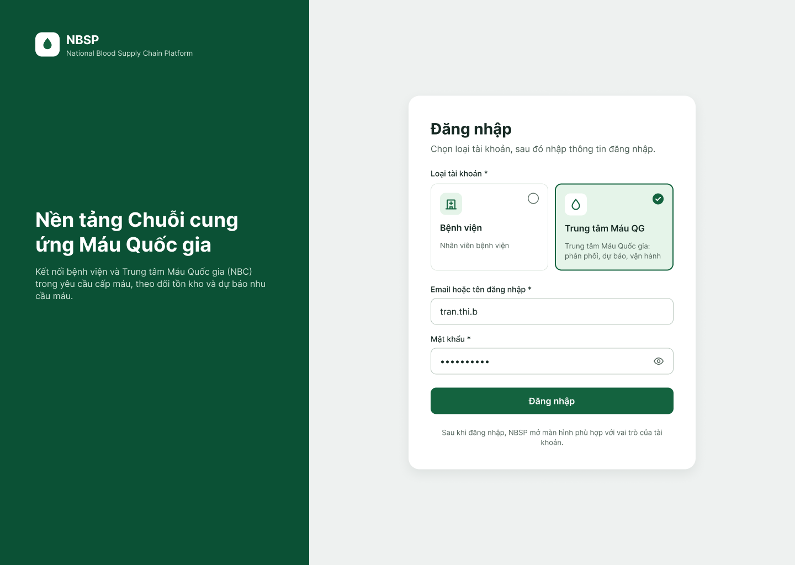
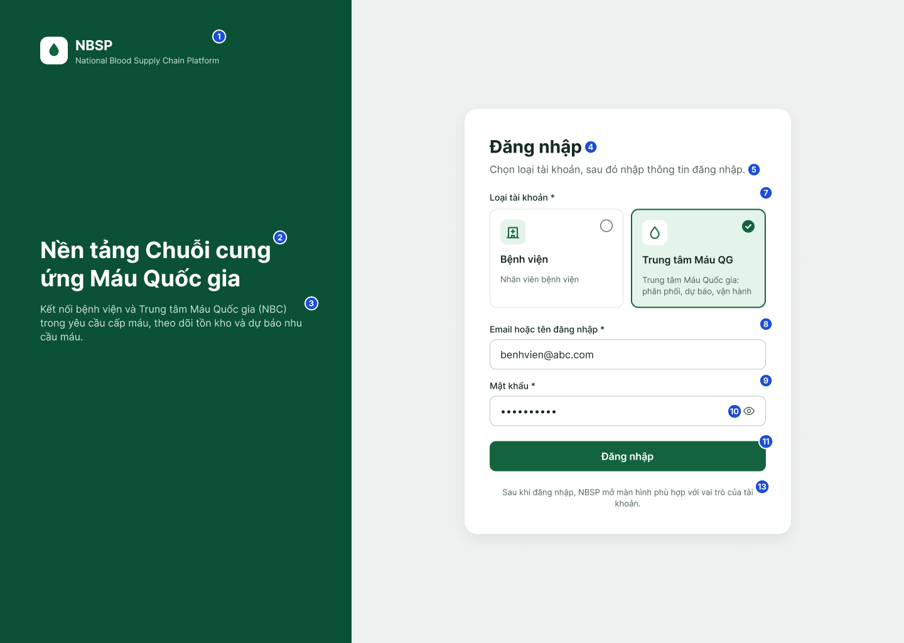
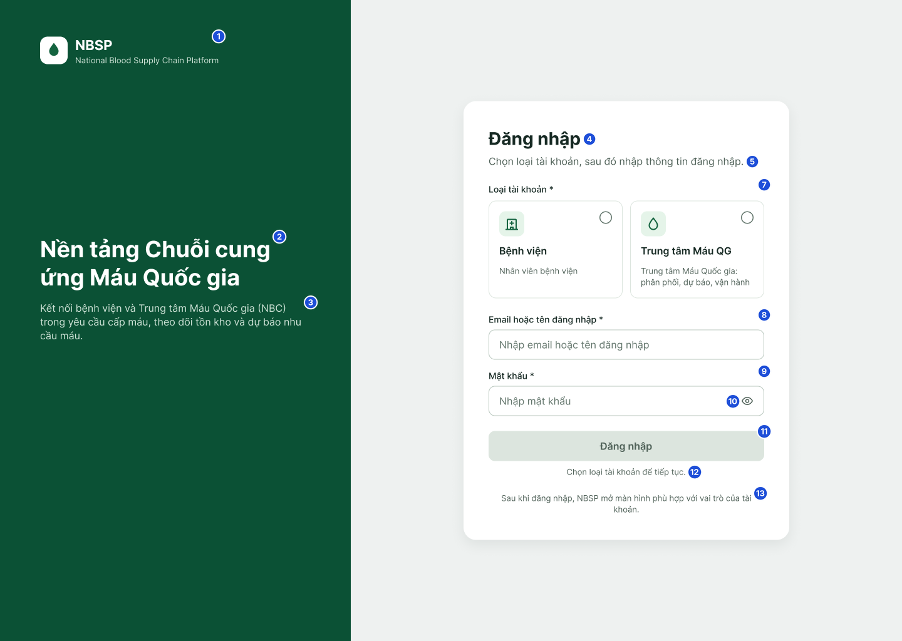
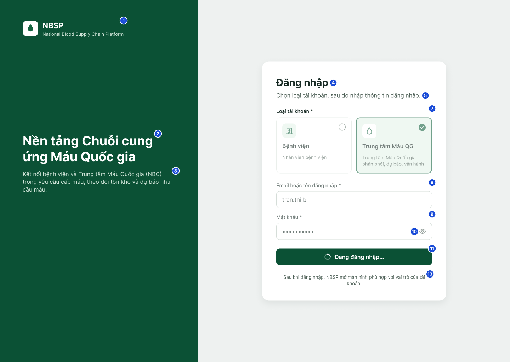
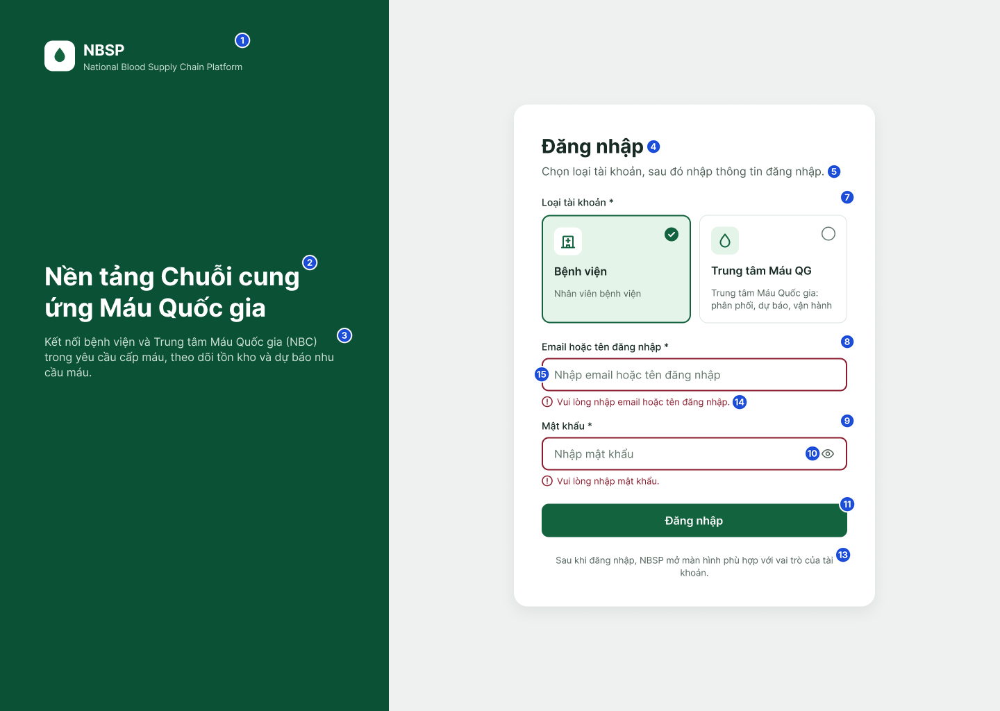
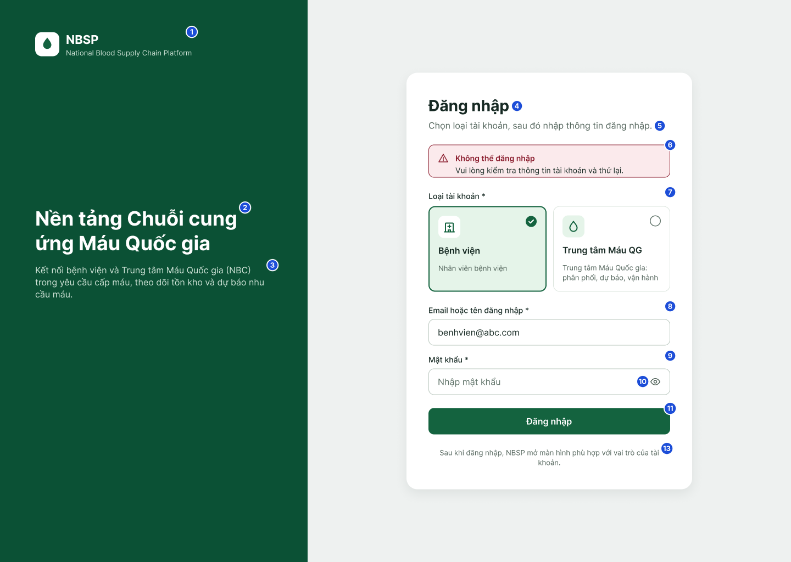

# Screen Spec: S-F04-01 Sign in

| Field | Value |
|---|---|
| Screen ID | S-F04-01 |
| Screen name | Sign in (Vietnamese UI title: "Đăng nhập") |
| Actor | Hospital Staff, NBC Blood Storage and Distribution Department, NBC Forecasting Analyst, NBC Operations (one shared screen) |
| Priority | Must |
| Feature | F-04 Access & Authorization |
| Use cases / FRs | UC-06, UC-12 · FR-04-01, FR-04-02 (as in `screen-list.md`); related FR-04-03 · BR-06 |
| Activity diagrams | None: "not needed" for UC-06 and UC-12 (`usage-flow.md` v2.3; the sign-in is the same in every flow and other ADs only state "signed in" as a precondition) |
| Sequence diagrams | SD-UC-06, SD-UC-12 |
| Usage flow | First step of every flow of the four actors (`usage-flow.md` v2.3): UC-06 for Hospital Staff, UC-12 for the NBC actors |
| Mockup images | `img/s-f04-01-default.png`, `img/s-f04-01-empty.png`, `img/s-f04-01-loading.png`, `img/s-f04-01-error.png`, `img/s-f04-01-error-failed.png`; numbered: the same five names ending in `-numbered.png` (section 2) |
| Frame size | 1440 × 1024 px, 1× (desktop, UI conventions v2.0 §2.1). All five images have the same size; the content fits the frame |
| Figma frame | Not yet linked |
| Version | v1.0, 21/11/2026 |
| Status | Draft |

## 1. Purpose

**Shown when:** a user opens NBSP for the first time, the session has expired, or the user followed a link (verification email, alert email, draft-ready email) while signed out. The user chooses the type of account, enters the account name and the password, and signs in. A hospital account signs in through UC-06 (FR-04-01); an NBC account (Department, Forecasting Analyst or NBC Operations) signs in through UC-12 (FR-04-02).

**The user leaves this screen when:** the server accepts the credentials. NBSP opens the workspace that fits the role of the account (section 5), or the screen the user asked for through an email link. The screen has no other way out: there is no menu, no password recovery and no registration (SR-006).

## 2. Mockup

**Layout (all states):** two halves, as in the project wireframe. On the left, a dark green panel with the brand, the headline and a short introduction. On the right, on the grey page background, a white card with the sign-in form. There is no sidebar and no top bar (UI conventions v2.0 §2.1); fonts, colours, inputs and messages follow the same conventions as the other screens.

**Numbered images:** each number is the # in the element inventory (section 3), placed at the top-right corner of the element (at the end of the text for one-line texts, at the left edge for elements 10 and 15). Every visible element has its own number: a field's label and control are one element, its helper text is a separate element. Element 6 appears only in the failed sign-in image. Element 12 appears only in the empty image. Elements 14 and 15 appear only in the error image and are numbered once, on the first field.

| State | Numbered image | Numbers shown |
|---|---|---|
| Default |  | 1–5, 7–11, 13 |
| Empty |  | 1–5, 7–13 |
| Loading |  | 1–5, 7–11, 13 |
| Error (required fields missing) |  | 1–5, 7–11, 13–15 |
| Error (sign-in failed) |  | 1–11, 13 |

| State | Image | What it shows |
|---|---|---|
| Default (with data) | `img/s-f04-01-default.png` | "Trung tâm Máu QG" selected, account name and password filled (password masked), Submit enabled |
| Empty | `img/s-f04-01-empty.png` | No account type chosen, empty fields with placeholders, Submit disabled with the hint "Chọn loại tài khoản để tiếp tục." |
| Loading | `img/s-f04-01-loading.png` | Account type cards and fields disabled and keeping their values; Submit with spinner "Đang đăng nhập…" |
| Error (required fields missing) | `img/s-f04-01-error.png` | "Bệnh viện" selected, both fields empty: red border and a message under each field; nothing is sent |
| Error (sign-in failed) | `img/s-f04-01-error-failed.png` | Banner "Không thể đăng nhập"; the account type and the account name are kept, the password is cleared |
| Success | none | The screen is replaced by the workspace of the role (section 4) |

All colours, fonts and corners come from the design tokens in the UI conventions v2.0, section 6 ([ui-conventions.md](../ui-conventions.md#6-design-tokens)), except the colours listed in section 9.

## 3. Element inventory

Vietnamese labels are written as they appear in the mockup.

### 3.1 Brand panel (all states)

| # | Element | Type | Content / data source | Required | Validation |
|---|---|---|---|---|---|
| 1 | Brand | Logo and text | static: "NBSP" and the product name under it (the mockup shows "National Blood Supply Chain Platform", see mockup correction 2) | Yes | none |
| 2 | Headline | Header | static: "Nền tảng Chuỗi cung ứng Máu Quốc gia" | Yes | none |
| 3 | Introduction | Text | static: "Kết nối bệnh viện và Trung tâm Máu Quốc gia (NBC) trong yêu cầu cấp máu, theo dõi tồn kho và dự báo nhu cầu máu." | Yes | none |

### 3.2 Sign-in form

| # | Element | Type | Content / data source | Required | Validation |
|---|---|---|---|---|---|
| 4 | Card title | Header | static: "Đăng nhập" | Yes | none |
| 5 | Subtitle | Text | static: "Chọn loại tài khoản, sau đó nhập thông tin đăng nhập." | Yes | none |
| 6 | Sign-in error banner | Banner (`role="alert"`) with warning icon | static: title "Không thể đăng nhập" and "Vui lòng kiểm tra thông tin tài khoản và thử lại." (UI conventions §4.2), above the account type | No | shown only after the server rejects the sign-in; the same text for every cause (SR-003) |
| 7 | Account type | Label and single-choice cards (2, radio group) | label "Loại tài khoản *"; `signin.account_type`: "Bệnh viện" (Nhân viên bệnh viện) signs in through UC-06; "Trung tâm Máu QG" (Trung tâm Máu Quốc gia: phân phối, dự báo, vận hành) signs in through UC-12; the selected card has a filled tick, a 2 px border and a light green background | Yes | exactly one value; Submit stays disabled until one is chosen (element 12) |
| 8 | Account name | Label and text input | label "Email hoặc tên đăng nhập *"; `signin.username`; placeholder "Nhập email hoặc tên đăng nhập" | Yes | not empty after trimming spaces |
| 9 | Password | Label and masked input | label "Mật khẩu *"; `signin.password`; placeholder "Nhập mật khẩu"; the value is hidden | Yes | not empty; spaces are not trimmed |
| 10 | Show or hide password | Icon button (eye) inside the password field | toggles between hidden and visible text; accessible name "Hiện mật khẩu" / "Ẩn mật khẩu", `aria-pressed` | No | disabled while signing in |
| 11 | Sign in | Primary button | label "Đăng nhập"; in the loading state a spinner and "Đang đăng nhập…" | Yes | disabled until an account type is chosen and while signing in |
| 12 | Disabled-button hint | Helper text under the button | static: "Chọn loại tài khoản để tiếp tục." | Yes (while no type is chosen) | shown only while Submit is disabled for lack of an account type |
| 13 | Role note | Helper text | static: "Sau khi đăng nhập, NBSP mở màn hình phù hợp với vai trò của tài khoản." | Yes | none |
| 14 | Field error messages | Inline text with error icon | one message under each empty required field: "Vui lòng nhập email hoặc tên đăng nhập." and "Vui lòng nhập mật khẩu." | No | shown only after Submit with a missing value |
| 15 | Invalid field marker | Border | red 2 px border on each empty required field, together with element 14 | No | shown only after Submit with a missing value |

## 4. States

| State | What the user sees | Trigger |
|---|---|---|
| Default (with data) | An account type chosen (tick, border, light green background), account name and password filled (password masked), Submit enabled, no hint under the button (example in the mockup: "Trung tâm Máu QG", benhvien@abc.com, see mockup correction 3) | The user has chosen a type and filled both fields |
| Empty (no data) | Neither card chosen, empty fields with placeholders, Submit disabled (grey) with the hint "Chọn loại tài khoản để tiếp tục." | Screen opened; or after the session expired |
| Loading | Account type cards, fields and the eye button disabled (dimmed) and keeping their values; Submit shows a spinner and "Đang đăng nhập…" (dark green); no second submission is possible. The change is announced to assistive technology (`aria-live="polite"`) | The user pressed Submit with valid values and the server has not answered |
| Error: required fields missing | No banner. Under each empty field a red border, an error icon and its message (elements 14 and 15); the chosen type and any filled value are kept; nothing is sent | Submit pressed with an empty account name or password |
| Error: sign-in failed | Banner (element 6); the account type and the account name are kept, the password is cleared; Submit enabled again; no session is created (FR-04-01, FR-04-02) | The server rejects the credentials, or the account does not belong to the chosen type, or it has no permission |
| Error: no connection | Banner with proposed copy "Chưa thể kết nối tới hệ thống. Vui lòng thử lại sau." (no image; open question 3); the form keeps its values; nothing is shown as signed in | The connection is lost before the server answers |
| Success / confirmation | No view of its own: the sign-in screen is replaced by the workspace of the role (section 5). The screen never says "signed in" before the server confirms the session | The server verified the credentials and established the session (FR-04-01, FR-04-02) |

## 5. Interactions and navigation

| # | Element | User action | System response | Goes to screen |
|---|---|---|---|---|
| 1 | Account type card (7) | click, or arrow keys | Selects that type and shows the tick; any other selected type is cleared; enables Submit and hides the hint 12; the other fields keep their values | stays |
| 2 | Account name (8), Password (9) | enter | Stores the value; clears the error message and red border of that field | stays |
| 3 | Eye button (10) | click | Shows or hides the password text | stays |
| 4 | Sign in (11) | click, or Enter in the form | If the account name or the password is empty: error state, nothing is sent. Otherwise: loading state, then the server verifies the credentials (SD-UC-06 or SD-UC-12 by account type): accepted → establishes the session with the role and scope and opens the workspace (rows 5 to 9); rejected → error state "sign-in failed" | stays, or the workspace |
| 5 | Sign-in accepted: Hospital Staff | automatic | Opens the blood request form, the first screen after sign-in (FR-04-01; `screen-transition.md` §1) | S-F01-01 |
| 6 | Sign-in accepted: NBC Blood Storage and Distribution Department | automatic | Opens the request queue (`screen-list.md` "Home after sign in (NBC)"; open question 1) | S-F01-03 |
| 7 | Sign-in accepted: NBC Forecasting Analyst | automatic | Opens the demand data review (`screen-list.md` "Home after sign in (analyst)") | S-F03-02 |
| 8 | Sign-in accepted: NBC Operations | automatic | Opens the validated forecast (`screen-list.md` "Home after sign in (NBC Operations)") | S-F03-05 |
| 9 | Sign-in accepted after an email link or an expired session | automatic | Returns to the screen the link asked for: verification email → S-F03-03; below-threshold alert → S-F02-02; draft forecast ready → S-F03-04 (`screen-transition.md`) | S-F03-03, S-F02-02 or S-F03-04 |

Leaving the screen with typed values discards them; no confirmation dialog is shown (no modal for this screen in `screen-list.md`).

## 6. Screen-level rules

| Rule ID | Rule | Source |
|---|---|---|
| SR-001 | The account type decides the use case: a hospital account signs in through UC-06, an NBC account through UC-12. Submit is enabled only after a type is chosen; an empty account name or password sends nothing. | UC-06, UC-12, `usage-flow.md` v2.3 |
| SR-002 | A valid hospital sign-in creates a session scoped to that hospital and exposes only hospital-authorised functions; a valid NBC sign-in creates a session with the user's role and department permissions. | FR-04-01, FR-04-02, FR-04-03, BR-06 |
| SR-003 | A failed sign-in creates no session and shows one message for every cause (unknown account, wrong password, an account of the other type, no permission), so the screen does not say which part was wrong. The account type and the account name are kept, the password is cleared, and the user can try again. | SD-UC-06, SD-UC-12, UI conventions §4.2 |
| SR-004 | The screen shows nothing as "signed in" until the server confirms; while it waits, the fields and the button are disabled so the credentials cannot be sent twice. | UI conventions v2.0 §3, §4.1 |
| SR-005 | The password is masked unless the user presses the eye button; the screen never fills it back in after a failure. | SD-UC-06 |
| SR-006 | The screen has no registration, password recovery or second factor: accounts are created by an NBSP administrator and these are not assumed. | ADR-002, SD-UC-12 |
| SR-007 | State is never shown by colour alone: a chosen account type has a tick and a border, an error has an icon and text, the disabled button has a hint. | UI conventions v2.0 §5 |
| SR-008 | After a sign-in that started from an email link or an expired session, the user returns to the screen they asked for. | `screen-transition.md`, UI conventions §3.2 |

## 7. Linked requirements

| FR ID | What this screen does for it |
|---|---|
| FR-04-01 | Hospital account: collects the credentials, shows the failure, and opens the hospital workspace once the hospital-scoped session exists |
| FR-04-02 | NBC account: collects the credentials, shows the failure, and opens the NBC workspace of the role once the session exists |
| FR-04-03 | Opens only the workspace allowed for the role; shows no data before sign-in |

## 8. Responsive and accessibility notes

- The mockups are drawn at 1440 × 1024 px only, as the UI conventions v2.0 require. A narrow window and mobile are out of scope for this release (UI conventions §2.1); if they are added later, the brand panel moves above the card.
- Every field has a visible label that stays when a value is entered; placeholders never replace labels. Required fields are marked with *.
- The account type cards are a `radiogroup`; arrow keys move between them. Error messages sit under their field and are linked to it (`aria-invalid`, `aria-describedby`); the sign-in banner uses `role="alert"` and receives focus; the loading change is announced with `aria-live="polite"`.
- Keyboard: Tab follows the reading order (account type, account name, password, eye button, Sign in); a focus outline is visible; Enter sends the form. Use `autocomplete="username"` and `autocomplete="current-password"`.
- Contrast measured on the mockups: helper and subtitle text `#4F6158` on white 6.6:1; placeholder `#62756B` 4.9:1; error text `#8A1C2D` on white 9.2:1 and 7.9:1 on the banner; white on the primary button `#14633F` 7.3:1; text on the brand panel `#CFE3D7` on `#0B5135` 7.0:1; the border of the chosen card `#14633F` 7.3:1. The borders of the inputs and of the unchosen cards (`#DCE3DE`, `#DCE5DE`) are 1.3:1, below the 3:1 required (mockup correction 1).
- Body text 14–16 px; helper and error text 13 px.

## 9. Mockup corrections

Differences between the five images and the conventions. Fix them in Figma before exporting the final images.

| # | Image | Problem | Fix |
|---|---|---|---|
| 1 | All | The borders of the inputs (`#DCE3DE`) and of the unchosen account type cards (`#DCE5DE`) are 1.3:1 on white; UI conventions §5 ask for 3:1. The proposed `color/border-strong` `#AFC0B5` is only 1.9:1 | Use a border of at least 3:1 on white, for example `#7F9387` (3.3:1), and set it as the value of `color/border-strong` (UI conventions OQ-08) |
| 2 | All | The brand subtitle is in English ("National Blood Supply Chain Platform"); the other screens show "Chuỗi cung ứng máu" under NBSP | Use "Chuỗi cung ứng máu" (UI conventions §1.1), or confirm that the English product name stays |
| 3 | Default | The example is inconsistent: "Trung tâm Máu QG" is chosen with the hospital-looking account "benhvien@abc.com" | Choose "Bệnh viện" in this image, or use an NBC-style account name as in the loading image |
| 4 | All | Colours that are not tokens: secondary text `#4F6158` (token `#566A60`), error banner background `#FBEAEC` (token `#FBEFF1`; `#FBEAED` is proposed in S-F02-01), disabled button `#DCE5DE` (`color/disabled-bg` has no value), input border `#DCE3DE` (token `#DCE5DE`) | Replace with the tokens, or add the values to the UI conventions §6 |

## 10. Open questions

| # | Question | Blocking? | Status |
|---|---|---|---|
| 1 | Which screen does each NBC role open after sign-in? `screen-list.md` also marks S-F01-02 and S-F02-02 as "Home after sign in", and the Department has two starting paths (S-F01-03 to fulfil requests, S-F02-02 to check stock). SD-UC-12 assumes no default landing screen. | No | Open. Default: Hospital Staff S-F01-01, Department S-F01-03, Analyst S-F03-02, NBC Operations S-F03-05. |
| 2 | Is an account locked after repeated failures? The account states Active and Locked are listed in `activity-index.md`, but no FR or use case says when or how, or which message a locked account sees. | No | Open. Default: no locking on this screen; a locked account sees the same failure message. |
| 3 | The UI conventions §4.2 message library has only the failed sign-in copy. Add the texts of elements 14 and the proposed "no connection" text of section 4. | No | Open. |

---

## Completion checklist

- [x] The mockup images are separate files, named with the Screen ID, at the frame width. *(five images, all 1440 × 1024 px; corrections 1 to 4 in section 9 still to apply)*
- [x] The numbered images exist, and their numbers match the # column of the element inventory. *(five images, 15 elements; redo them after the corrections in section 9)*
- [x] Every visible element in the mockup appears in the element inventory.
- [ ] Every colour in the mockup is a design token from the UI conventions. *(the brand panel, page background, card, primary button, chosen card, error text and loading button are tokens; four colours are not, see correction 4)*
- [x] Every input element has a validation rule or an explicit "none".
- [x] All five states are filled in. *(plus the failed sign-in and no-connection variants; success has no view of its own)*
- [x] Every navigation target is a Screen ID that exists in the Screen List. *(S-F01-01, S-F01-03, S-F03-02, S-F03-05, S-F03-03, S-F02-02, S-F03-04)*
- [x] Every element that displays data names the field it displays.
- [x] Every linked FR exists in the Function List, and every step of SD-UC-06 and SD-UC-12 is covered by an interaction row. *(enter and submit → 4; valid credentials → 5 to 9; invalid or unauthorised → Error: sign-in failed. No AD exists for these use cases, see Activity diagrams above)*
- [x] Contrast measured on the mockups (section 8). *(text passes 4.5:1; component borders fail 3:1, see correction 1)*

## Changes in v1.0 (21/11/2026)

- First version, written from the five wireframes (empty, default, loading, required fields missing, sign-in failed) and the repository documents: `screen-list.md`, `screen-transition.md`, `usage-flow.md` v2.3, UI conventions v2.0, W1 (FR-04-01 to FR-04-03), SD-UC-06 and SD-UC-12.
- Element inventory of 15 elements, numbered in the images.
- Sign-in outcomes by role and by email link defined in section 5.
- Four mockup corrections (borders, brand subtitle, example data, non-token colours); three open questions.
