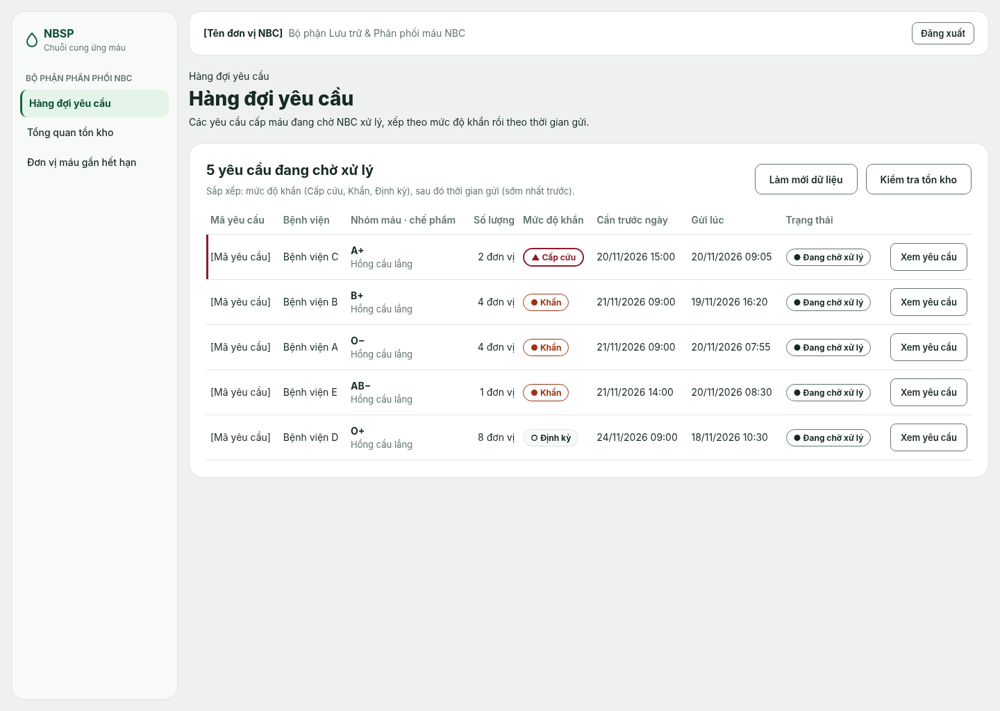
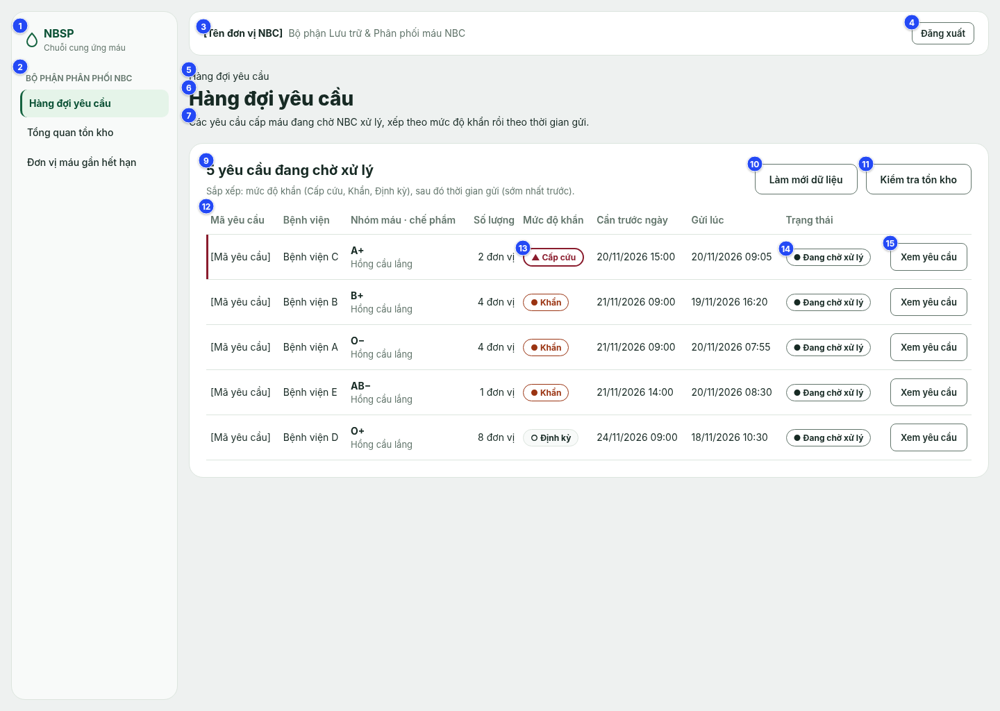
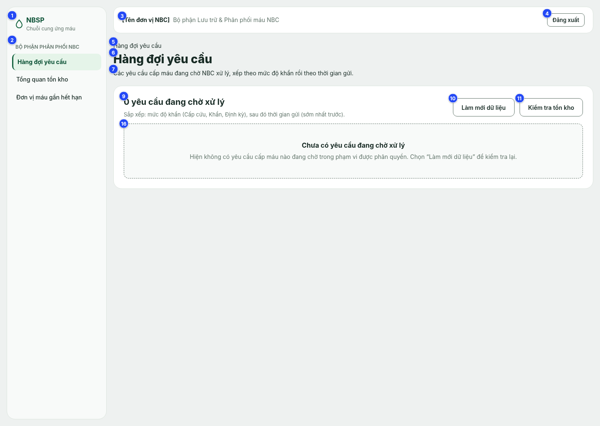
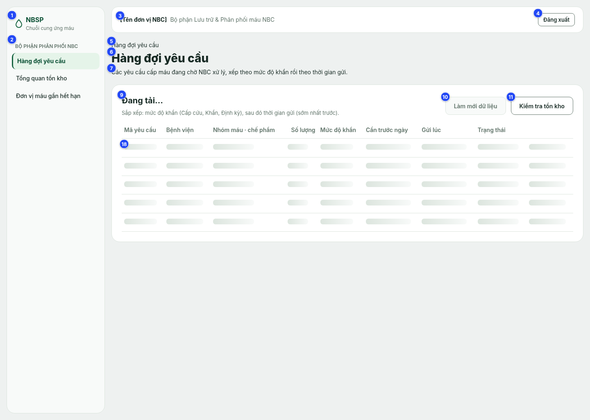
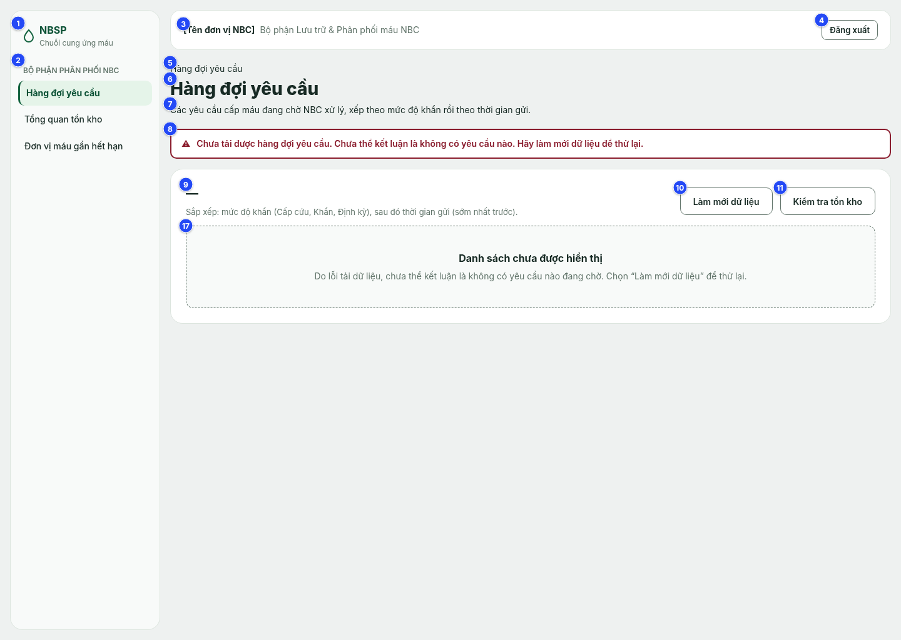
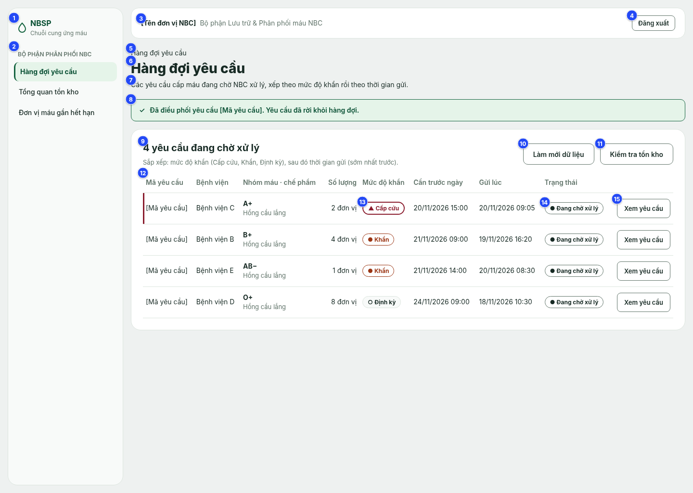
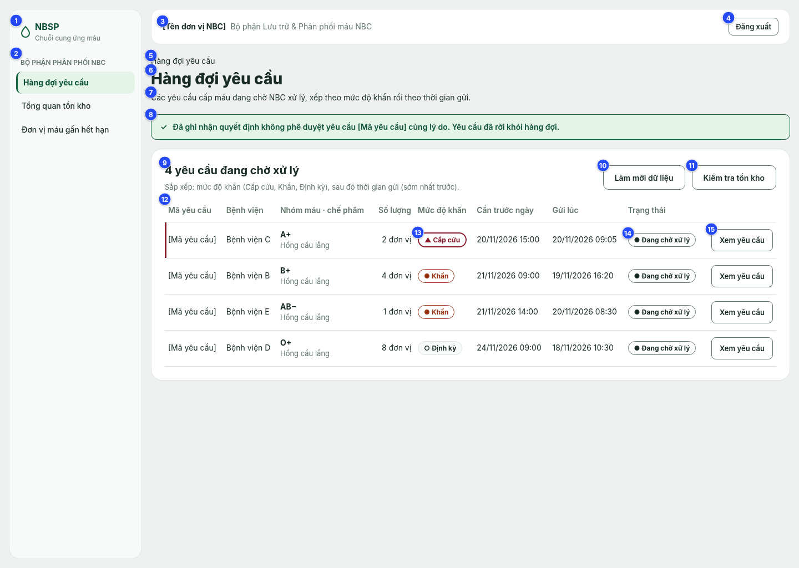

# Screen Spec: S-F01-03 Request queue

| Field | Value |
|---|---|
| Screen ID | S-F01-03 |
| Screen name | Request queue (Vietnamese UI title: "Hàng đợi yêu cầu") |
| Actor | NBC Blood Storage and Distribution Department (the Dept) |
| Priority | Must (screen-list.md; FR-01-02 is Must in W4) |
| Feature | F-01 Blood Ordering & Fulfillment |
| Use cases / FRs | UC-07 · FR-01-02 (entry point of FR-01-03) |
| Activity diagrams | AD-UC-08 (a pending request is opened from here). UC-07 has no AD: "not needed", a single display step (usage-flow.md) |
| Usage flow | NBC Dept Flow 1 "Fulfil hospital blood requests" (`usage-flow.md` v2.3): S-F04-01 → **S-F01-03** → S-F01-04 |
| Mockup images | `img/s-f01-03-default.png`, `img/s-f01-03-empty.png`, `img/s-f01-03-loading.png`, `img/s-f01-03-error.png`, `img/s-f01-03-success.png`, `img/s-f01-03-success-not-approved.png`; numbered: the same names ending in `-numbered.png` (section 2) |
| Frame size | 1440 px wide (desktop, UI conventions v2.0 §2.1), 1024 px high in all states (the 9-column table fits the 1104 px card without horizontal scroll) |
| Source of the mockup | `nbsp-ui-mockups.html` v3 (21/11/2026), tab "S-F01-03" |
| Version | v2.2, 21/11/2026 (changes at the end of this file) |
| Status | Draft |

## 1. Purpose

**Shown when:** NBC Dept staff signed in (UC-12) need to see which hospital blood requests are waiting, ordered by urgency and then by submission time, and pick one to handle (UC-07).

**The user leaves this screen when:** the user opens a request (S-F01-04), opens the inventory dashboard to check stock (S-F02-02), opens another menu item, or signs out.

## 2. Mockup

**Layout (all states):** same shell as S-F01-01 (sidebar with role group and menu for the Dept; top bar with unit, role and "Đăng xuất"; breadcrumb, title, subtitle), then one white card with the queue summary, two secondary buttons and the request table.

**Numbered images:** each number is the # in the element inventory (section 3). Element 8 (banner) appears in the error and both success states; element 16 only in the empty state; element 17 only in the error state; element 18 only in the loading state.

| State | Numbered image | Numbers shown |
|---|---|---|
| Default |  | 1–7, 9–15 |
| Empty |  | 1–7, 9–11, 16 |
| Loading |  | 1–7, 9–11, 18 |
| Error |  | 1–11, 17 |
| Success (dispatched) |  | 1–15 |
| Success (not approved) |  | 1–15 |

| State | Image |
|---|---|
| Default (with data) | `img/s-f01-03-default.png` |
| Empty | `img/s-f01-03-empty.png` |
| Loading | `img/s-f01-03-loading.png` |
| Error | `img/s-f01-03-error.png` |
| Success (dispatched) | `img/s-f01-03-success.png` |
| Success (not approved) | `img/s-f01-03-success-not-approved.png` |

Hospital names, quantities and dates are sample data. The third row (Bệnh viện A, O−, 4 đơn vị, Khẩn, sent 20/11/2026 07:55) is the request opened on S-F01-04 and removed from the queue in both success states. Request IDs are shown as `[Mã yêu cầu]` because the ID rule belongs to the system (UI conventions §2.2). Only the design tokens of UI conventions v2.0 §6 are used.

## 3. Element inventory

Data group (W0 Table 4): **Blood request & shipment records** (ILF).

### 3.1 Page frame (all states)

| # | Element | Type | Content / data source | Required | Validation |
|---|---|---|---|---|---|
| 1 | Brand | Logo and text | static: "NBSP", "Chuỗi cung ứng máu" | Yes | none |
| 2 | Menu | Navigation (links, reachable with Tab) | static; role group "BỘ PHẬN PHÂN PHỐI NBC" and the items allowed for the Dept (FR-04-03): "Hàng đợi yêu cầu" (current: background, left bar, bold text), "Tổng quan tồn kho", "Đơn vị máu gần hết hạn" | Yes | none |
| 3 | Account info | Text | `user.department.name`, role "Bộ phận Lưu trữ & Phân phối máu NBC" from the session | Yes | none |
| 4 | Sign out | Secondary button | label "Đăng xuất" | Yes | none |
| 5 | Breadcrumb | Text | static: "Hàng đợi yêu cầu" (current page, not a link) | Yes | none |
| 6 | Title | Header | static: "Hàng đợi yêu cầu" | Yes | none |
| 7 | Subtitle | Text | static: "Các yêu cầu cấp máu đang chờ NBC xử lý, xếp theo mức độ khẩn rồi theo thời gian gửi." | Yes | none |

### 3.2 Queue

| # | Element | Type | Content / data source | Required | Validation |
|---|---|---|---|---|---|
| 8 | Banner | Banner | error (`role="alert"`): "Chưa tải được hàng đợi yêu cầu. Chưa thể kết luận là không có yêu cầu nào. Hãy làm mới dữ liệu để thử lại."; success after a dispatch (`role="status"`): "Đã điều phối yêu cầu [Mã yêu cầu]. Yêu cầu đã rời khỏi hàng đợi."; success after a non-approval (`role="status"`): "Đã ghi nhận quyết định không phê duyệt yêu cầu [Mã yêu cầu] cùng lý do. Yêu cầu đã rời khỏi hàng đợi." | No | shown only in the error and success states |
| 9 | Queue summary | Header (`role="status"`) and text | count of Pending requests in scope ("N yêu cầu đang chờ xử lý"; "Đang tải…" while loading; "—" on error) and the sort note "Sắp xếp: mức độ khẩn (Cấp cứu, Khẩn, Định kỳ), sau đó thời gian gửi (sớm nhất trước)." | Yes | read-only |
| 10 | Refresh | Secondary button | label "Làm mới dữ liệu" | Yes | disabled while loading |
| 11 | Check stock | Secondary button | label "Kiểm tra tồn kho" | Yes | always enabled (opening S-F02-02 does not depend on the queue data) |
| 12 | Request table | Table (9 columns, caption for assistive technology) | one row per Pending request: "Mã yêu cầu" `request.id`; "Bệnh viện" `hospital.name`; "Nhóm máu · chế phẩm" `request.blood_type` with `request.blood_product` on a second line; "Số lượng" `request.quantity` + " đơn vị"; "Mức độ khẩn" `request.urgency`; "Cần trước ngày" `request.needed_by`; "Gửi lúc" `request.created_at` (both dd/MM/yyyy HH:mm); "Trạng thái" `request.status`; action column | Yes | read-only; order by BR-05; no manual sort or filter; emergency rows have a left bar in the error colour in addition to the chip |
| 13 | Urgency chip | Chip | `request.urgency` shown with a Vietnamese label (UI conventions §0 rule 5, §1.1): `Emergency` → ▲ "Cấp cứu", `Urgent` → ● "Khẩn", `Periodic` → ○ "Định kỳ" (marker and text; labels proposed, see question 2) | Yes | one of the 3 values (BR-01) |
| 14 | Status chip | Chip | `request.status` = Pending, label "Đang chờ xử lý" (neutral outline, marker and text) | Yes | only Pending is listed (FR-01-02) |
| 15 | Open request | Secondary button, 40 px high (one per row) | label "Xem yêu cầu" (UI conventions §1.3). Secondary, so the screen has no row of primary buttons (§3: at most one primary per task region) | Yes | none |
| 16 | Empty message | Message block | static: "Chưa có yêu cầu đang chờ xử lý" + "Hiện không có yêu cầu cấp máu nào đang chờ trong phạm vi được phân quyền. Chọn “Làm mới dữ liệu” để kiểm tra lại." | No | shown only in the empty state |
| 17 | Error message block | Message block | static: "Danh sách chưa được hiển thị" + "Do lỗi tải dữ liệu, chưa thể kết luận là không có yêu cầu nào đang chờ. Chọn “Làm mới dữ liệu” để thử lại." | No | shown only in the error state; never shows "0" or the empty message |
| 18 | Loading rows | Skeleton rows | placeholders for the table rows | No | shown only in the loading state |

## 4. States

| State | What the user sees | Trigger |
|---|---|---|
| Default (with data) | Summary with the count, request table ordered by urgency then submission time, "Làm mới dữ liệu" and "Kiểm tra tồn kho" enabled | Screen opened and at least one Pending request is in the Dept's scope |
| Empty (no data) | Summary "0 yêu cầu đang chờ xử lý" and the empty message (16); the table is hidden | Screen opened and no Pending request is in scope |
| Loading | Summary "Đang tải…" (announced through `role="status"`), skeleton rows (18), "Làm mới dữ liệu" disabled; "Kiểm tra tồn kho" stays enabled | Screen opened or "Làm mới dữ liệu" pressed, server has not answered |
| Error | Error banner (8) and the error block (17); "Làm mới dữ liệu" stays enabled for a retry. No "empty" is claimed while the result is unknown (conventions §4.1) | The queue query fails (SD-UC-07 error branch) or the connection is lost |
| Success / confirmation (conditional) | Success banner (8) with the request ID, worded for a dispatch or for a non-approval; the handled request is no longer in the table, the count drops by one | The user returns from S-F01-04 after the server confirmed a dispatch (FR-01-03) or a non-approval (FR-01-09); see question 6 |

## 5. Interactions and navigation

| # | Element | User action | System response | Goes to screen |
|---|---|---|---|---|
| 1 | Open request (15) | click | Opens that request with its details and eligible units | S-F01-04 |
| 2 | Check stock (11) | click | Opens the inventory dashboard | S-F02-02 |
| 3 | Refresh (10) | click | Reloads the queue (loading state, then default, empty or error) | stays |
| 4 | Menu item "Tổng quan tồn kho" | click | Opens the inventory dashboard | S-F02-02 |
| 5 | Menu item "Đơn vị máu gần hết hạn" | click | Opens the near-expiry units | S-F02-03 |
| 6 | Menu item "Hàng đợi yêu cầu" | click | Reloads this screen | stays |
| 7 | Sign out (4) | click | Ends the session | S-F04-01 |

## 6. Screen-level rules

| Rule ID | Rule | Source |
|---|---|---|
| SR-001 | The table lists only requests with status Pending, within the scope the signed-in Dept user is allowed to see. | FR-01-02, BR-06, FR-04-03 |
| SR-002 | Order: urgency first (Emergency, Urgent, Periodic, shown as Cấp cứu, Khẩn, Định kỳ), then submission time (earliest first). | FR-01-02, BR-05 |
| SR-003 | The screen is read-only. Approving, dispatching or not approving happens only on S-F01-04. | FR-01-03, FR-01-09 |
| SR-004 | The success banner appears only after S-F01-04 received the server's confirmation; the screen never marks a request as handled on its own. | ui-conventions §3, §4.2 |
| SR-005 | State is never shown by colour alone: urgency and status chips carry a marker and a word; emergency rows also carry a bar. | ui-conventions §5 |
| SR-006 | An unknown result (connection lost) is shown as an error, not as an empty queue. | ui-conventions §4.1 |
| SR-007 | Urgency codes stay in English in data and code; only the displayed label is Vietnamese. | ui-conventions §0 rule 5 |

## 7. Linked requirements

| FR ID | What this screen does for it |
|---|---|
| FR-01-02 | Displays pending requests within the user's scope, ordered by urgency and then submission time |
| FR-01-03 | Entry point: leads to S-F01-04 where the order is approved and dispatched |
| FR-04-03 | Shows only the menu items and the data allowed for the signed-in Dept user |

## 8. Responsive and accessibility notes

- Smallest supported width: 1440 px (desktop only). The mockups are drawn at 1440 px wide, as UI conventions v2.0 §2.1 require; a narrower window and mobile are out of scope for this release (same wording as S-F01-01). If the table gets wider (more columns), it scrolls inside its card.
- Information never carried by colour alone: urgency and status chips have marker and text; the selected menu item has a bar and bold text.
- Table headers are real column headers (`scope="col"`), the table has a caption, units are attached to values ("4 đơn vị"); no ID, date or status is cut off.
- Body text contrast at least 4.5:1 (secondary text #62756B is 4.9:1 on white and 4.7:1 on the sidebar #F8FAF9; text placed directly on the page background uses the primary text colour). Borders of controls use #62756B (4.9:1, above 3:1). Row buttons are 40 px high, the other buttons 44 px; "Đăng xuất" 32 px (above the 24 px minimum).
- Text sizes: table and labels 14 px, chips and helper text 12–13 px, title 28 px.
- Keyboard: Tab follows the reading order (menu links, sign out, buttons, row buttons), a visible focus outline, Enter opens the focused row's button. The error banner uses `role="alert"`; the success banners and the queue summary use `role="status"`, so "Đang tải…" and the new count are announced.

## 9. Open questions

| # | Question | Blocking? | Status |
|---|---|---|---|
| 1 | [NEEDS CLARIFICATION: screen-list.md says "by urgency and status", FR-01-02 only defines the order and lists Pending requests. Are filters wanted?] | No | Open. Default: no filter. Fix the screen-list wording ("and status" removed). |
| 2 | [NEEDS CLARIFICATION: confirm the Vietnamese labels of the urgency values (W0 BR-01): Emergency → "Cấp cứu", Urgent → "Khẩn", Periodic → "Định kỳ". UI conventions §1.2 has no row for them yet; S-F01-01 and S-F01-04 use the same labels.] | No | Open. Proposed labels applied in the mockup v3. |
| 3 | RESOLVED: "Cần trước ngày" and "Chế phẩm" are in W1 FR-01-01 (blood product, needed-by date and time, contact) and in BR-01 / BR-10. | No | Closed |
| 4 | [NEEDS CLARIFICATION: what defines the Dept's "scope" in FR-01-02?] | No | Open. Default: all hospitals (NBC is the only receiver of requests, W0 BR-06). |
| 5 | [NEEDS CLARIFICATION: paging or scrolling when the queue is long?] | No | Open. Default: vertical scroll, no paging in release 1 (the queue holds only Pending requests). |
| 6 | [NEEDS CLARIFICATION: the success banner comes from the transition S-F01-04 to S-F01-03 ("Quay lại hàng đợi"). Confirm it is wanted. Both texts are defined (element 8); the non-approval text reuses ui-conventions §4.2 and adds the queue result.] | No | Open. Default: shown. |
| 7 | RESOLVED: menu labels are the Vietnamese UI names of the screens in ui-conventions §3.2 ("Hàng đợi yêu cầu", "Tổng quan tồn kho", "Đơn vị máu gần hết hạn"). | No | Closed |

---

## Completion checklist

- [x] The mockup images are separate files, named with the Screen ID, at the frame width. *(export from `nbsp-ui-mockups.html` v3)*
- [ ] The numbered images exist, and their numbers match the # column of the element inventory. *(to export again from v3: new success image, new button)*
- [x] Every visible element in the mockup appears in the element inventory.
- [x] Every colour in the mockup is a design token from ui-conventions.md §6.
- [x] Every input element has a validation rule or an explicit "none".
- [x] All five states are filled in.
- [x] Every navigation target is a Screen ID that exists in the Screen List.
- [x] Every element that displays data names the field it displays.
- [x] Every linked FR exists in the Function List (FR-01-02, FR-01-03, FR-04-03). AD-UC-08 v0.6 opens a pending request from this screen.

## Changes in v2.2 (21/11/2026)

- Checklist: reference updated to AD-UC-08 v0.6 (new branch "shipment not saved"); no change to this screen.

## Changes in v2.1 (21/11/2026)

- Urgency shown with Vietnamese labels (Cấp cứu, Khẩn, Định kỳ), codes unchanged (conventions §0 rule 5, §1.1); sort note translated; new SR-007; question 2 reworded.
- Row button: secondary "Xem yêu cầu", 40 px (conventions §1.3, §3: one primary per task region, 44–48 px for primaries).
- "Kiểm tra tồn kho" no longer disabled while loading (conventions §3: disable only with a reason).
- Queue summary has `role="status"`; menu items are links reachable with Tab.
- Success state split into dispatched and not approved, with the second banner text; question 6 updated; question 7 closed (conventions §3.2).
- Numbered-image table corrected (error 1–11, 17; success 1–15); section 8 states the smallest supported width.

## Changes in v2.0 (21/11/2026)

- Image names made consistent with S-F01-01 (lowercase, one name per state, `-numbered` files); frame height recorded.
- Element inventory rebuilt in the S-F01-01 style: page frame (brand, menu, account, sign out, breadcrumb, title, subtitle) and numbering 1 to 18; columns "Nhóm máu" and "Chế phẩm" merged into one cell so the 9-column table fits without scrolling.
- Sample data aligned with S-F01-04: the request opened there is a real row of the queue, and the success state removes that row.
- Urgency value "Routine" replaced by "Periodic" (W0 BR-01, BR-05).
- Error block no longer reads "Không có dữ liệu để hiển thị" (it sounded like the empty state); new copy follows conventions §4.1. "của bạn" removed (conventions §1.1).
- Colours: only §6 tokens. Chips and banners use white background with a coloured border; the proposed colours error-bg, warning-bg, border-strong are no longer used (old question 8 closed). Text sizes raised to conventions §5 (table 14 px, smallest text 12 px).
- Section 8: "smallest supported width" replaced by the desktop-only wording of S-F01-01; question 3 closed (W1 FR-01-01 updated).

