# Screen Spec: S-F01-04 Order review and dispatch

| Field | Value |
|---|---|
| Screen ID | S-F01-04 |
| Screen name | Order review and dispatch (Vietnamese UI title: "Xem xét & điều phối đơn máu") |
| Actor | NBC Blood Storage and Distribution Department (the Dept) |
| Priority | Must (screen-list.md). The "Không phê duyệt yêu cầu" action serves FR-01-09, priority Should in W4 v2 |
| Feature | F-01 Blood Ordering & Fulfillment |
| Use cases / FRs | UC-08 · FR-01-03, FR-01-08, FR-01-09 |
| Activity diagrams | AD-UC-08 v0.6, SD-UC-08 v3 (checked against this spec on 21/11/2026) |
| Usage flow | NBC Dept Flow 1 "Fulfil hospital blood requests": S-F01-03 → **S-F01-04** → S-F01-03 |
| Mockup images | `img/s-f01-04-default.png`, `img/s-f01-04-empty.png`, `img/s-f01-04-loading.png`, `img/s-f01-04-error-eta.png`, `img/s-f01-04-error.png` (insufficient stock), `img/s-f01-04-error-taken.png`, `img/s-f01-04-error-not-pending.png`, `img/s-f01-04-error-bms.png`, `img/s-f01-04-error-save.png`, `img/s-f01-04-success.png`, `img/s-f01-04-success-not-approved.png`, `img/s-f01-04-modal-confirm.png`, `img/s-f01-04-modal-not-approve.png`; numbered: the same names ending in `-numbered.png` (section 2) |
| Frame size | 1440 px wide (desktop, UI conventions v2.0 §2.1), 1024 px high in all states |
| Source of the mockup | `nbsp-ui-mockups.html` v3 (21/11/2026), tab "S-F01-04" (11 states; the two modals open from the buttons, and "Xác nhận không phê duyệt" leads to the state "Success: không phê duyệt") |
| Version | v2.2, 21/11/2026 (changes at the end of this file) |
| Status | Draft |

## 1. Purpose

**Shown when:** Dept staff opened a Pending request from the request queue. They check the request and the eligible NBC units, choose the units and the ETA and approve and dispatch the order, or record that the request is not approved, with a reason (UC-08).

**The user leaves this screen when:** the dispatch or the non-approval is confirmed by the server and the user presses "Quay lại hàng đợi", or the user opens the queue from the breadcrumb or another menu item, or signs out.

## 2. Mockup

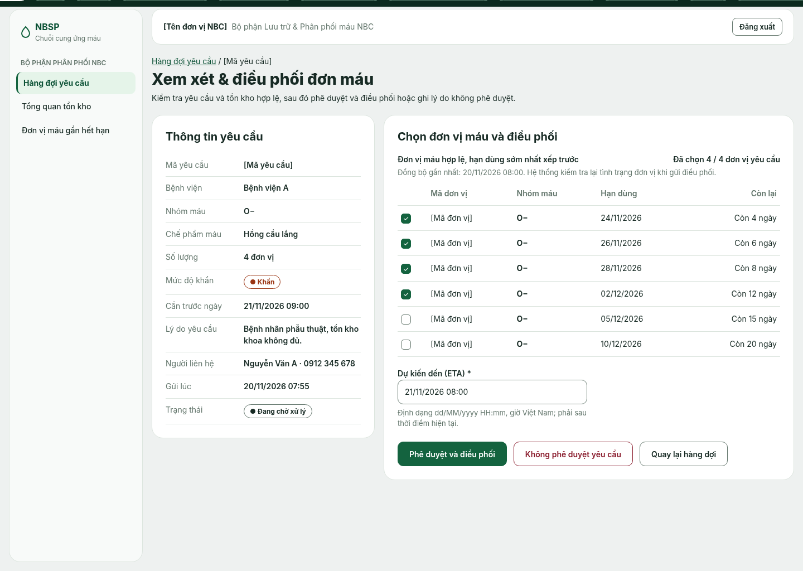

**Layout:** same shell as S-F01-01. Left card: request information (read-only). Right card: eligible units with a checkbox per row, the selection counter, the ETA, the three buttons; in the success states it is replaced by the shipment summary or the decision result. The two modals open over the frame.

**Numbered images:** each number is the # of the element inventory (section 3). Elements 8, 14, 18 to 23 appear only in some states or in the modals.

| State or modal | Image | Numbers shown |
|---|---|---|
| Default (with data) | 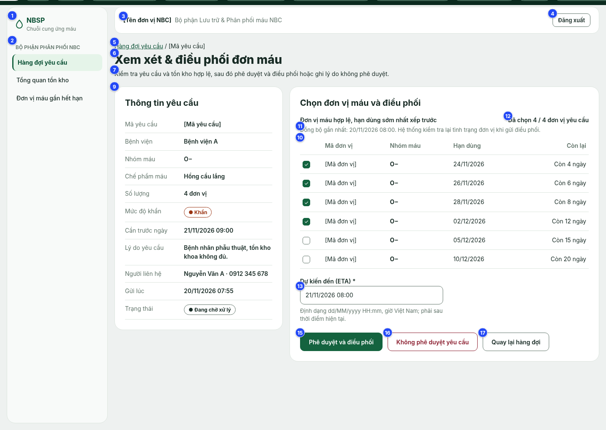 | 1–7, 9–13, 15–17 |
| Empty | 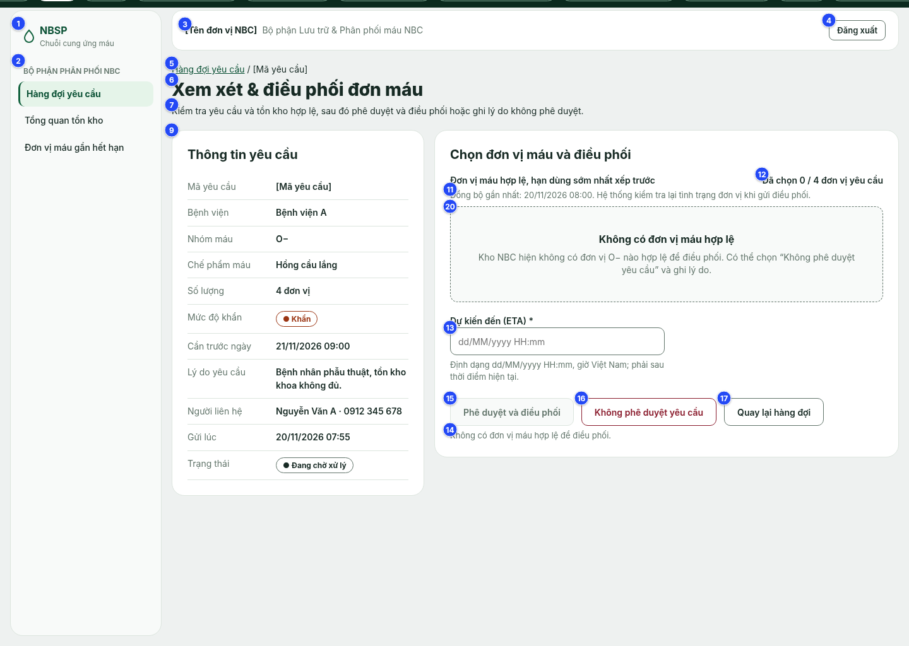 | 1–7, 9, 11–17, 20 |
| Loading (dispatch in progress) | 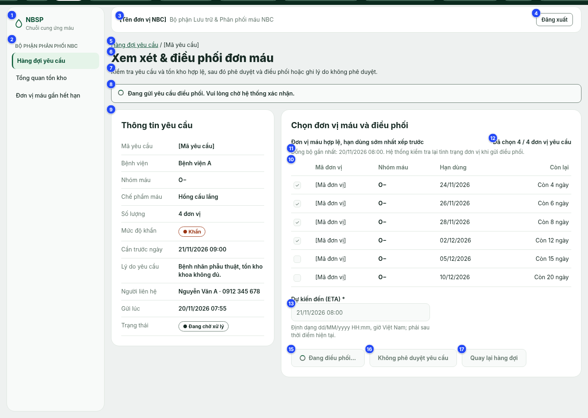 | 1–13, 15–17 |
| Error: invalid ETA | 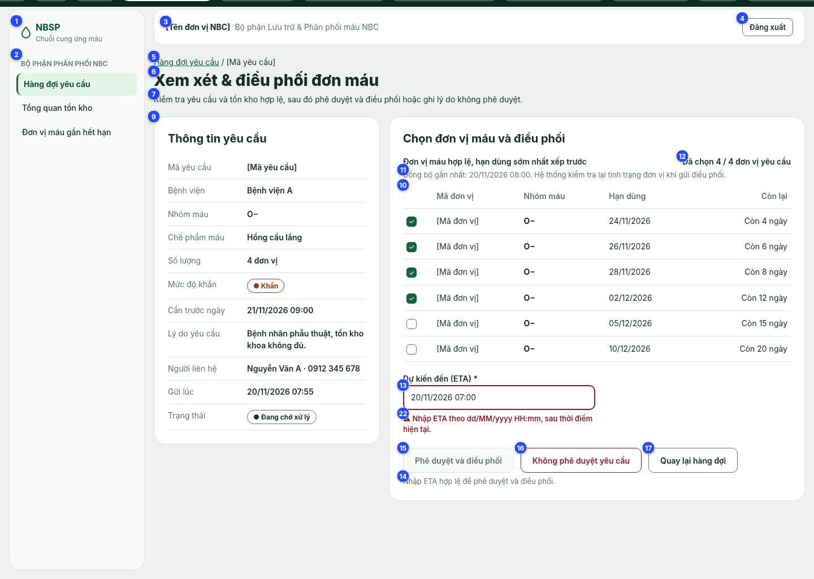 | 1–7, 9–17, 22 |
| Error: insufficient stock (FR-01-08) | 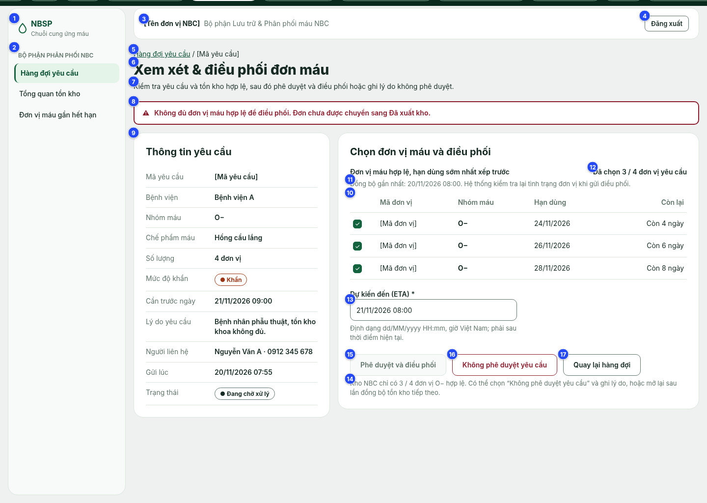 | 1–17 |
| Error: unit taken by another request | 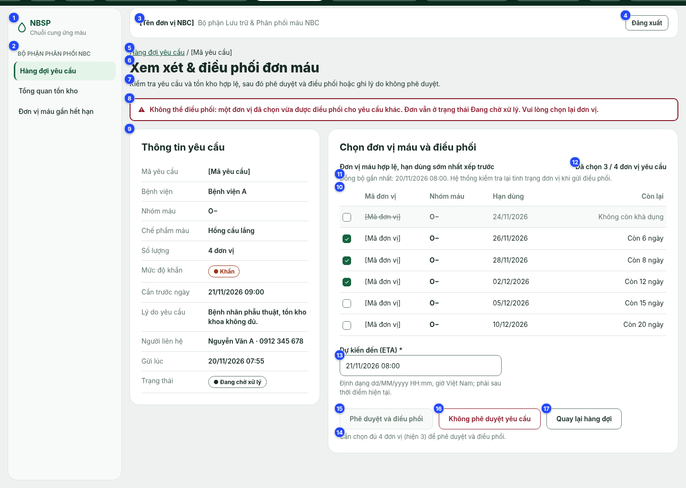 | 1–17 |
| Error: request no longer Pending | 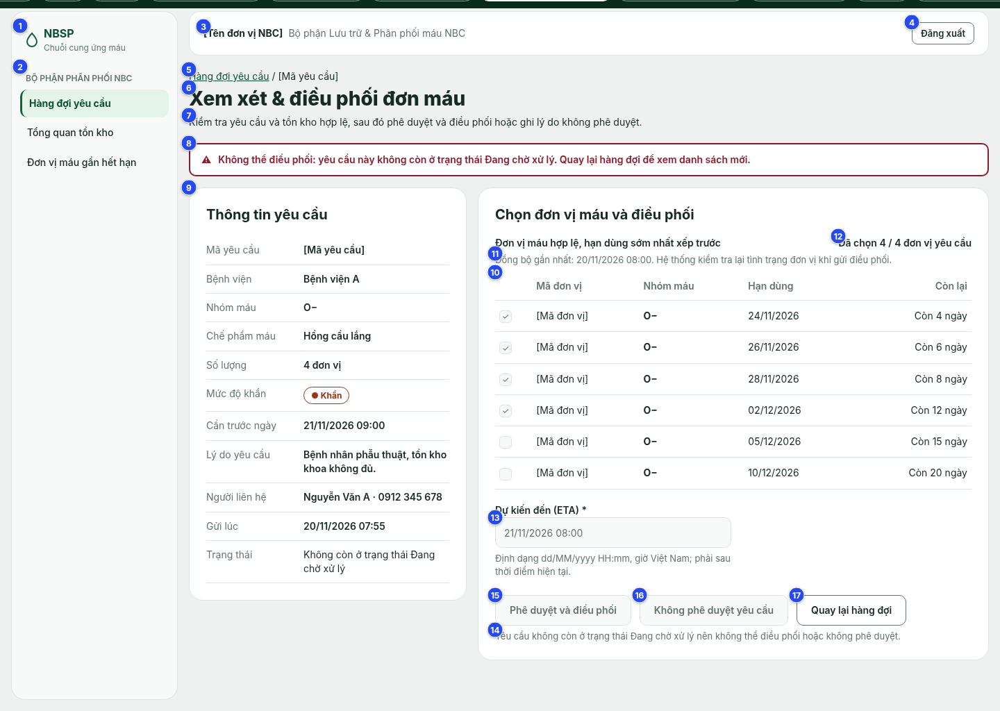 | 1–17 |
| Error: Blood Management Software not answering | 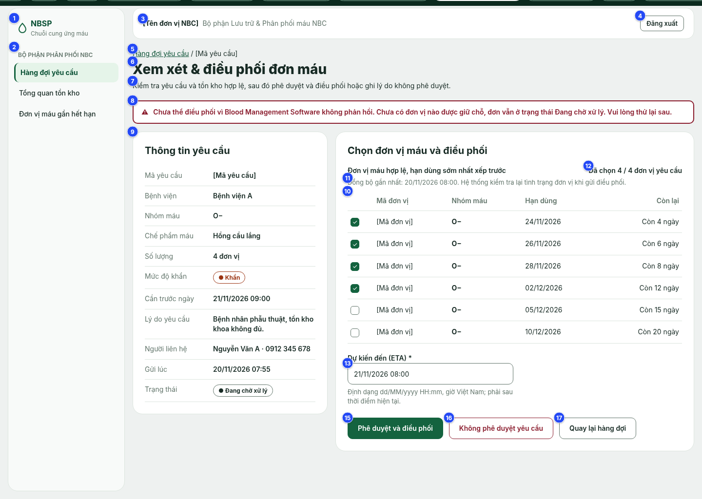 | 1–13, 15–17 |
| Error: shipment not saved, reservation released | 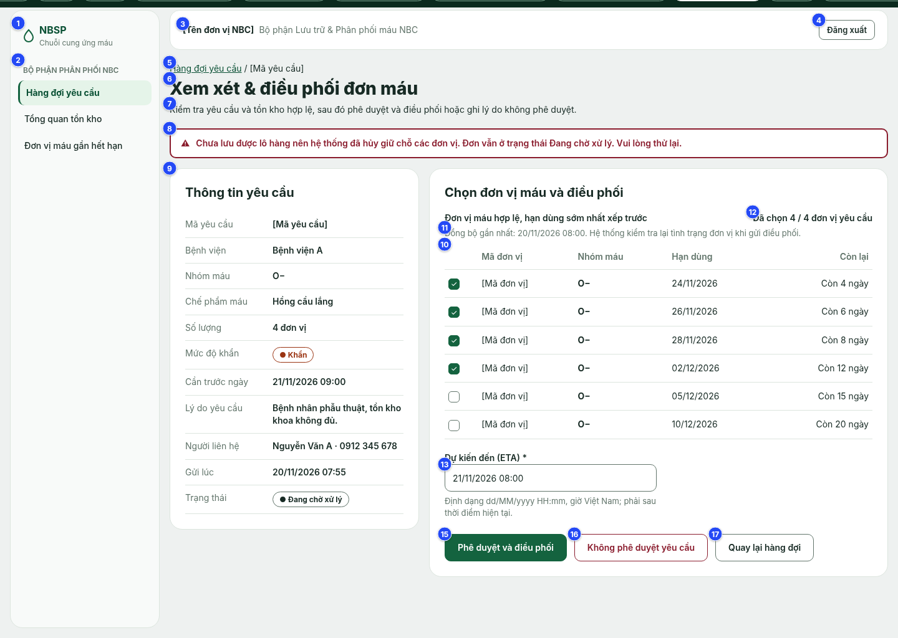 | 1–13, 15–17 |
| Success (dispatched) | 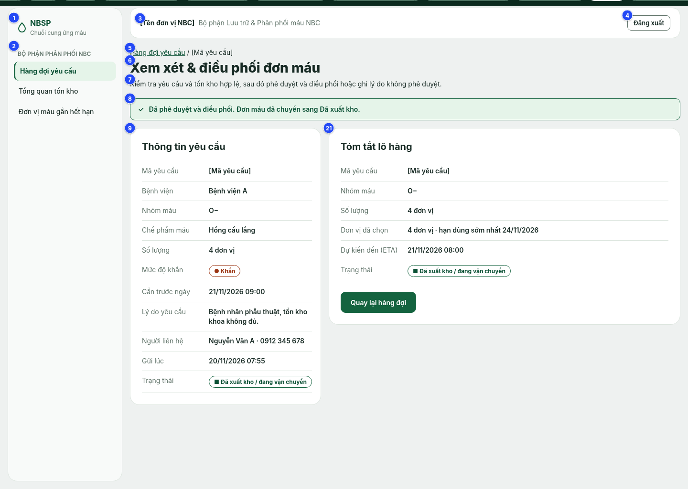 | 1–9, 21 |
| Success (not approved) | 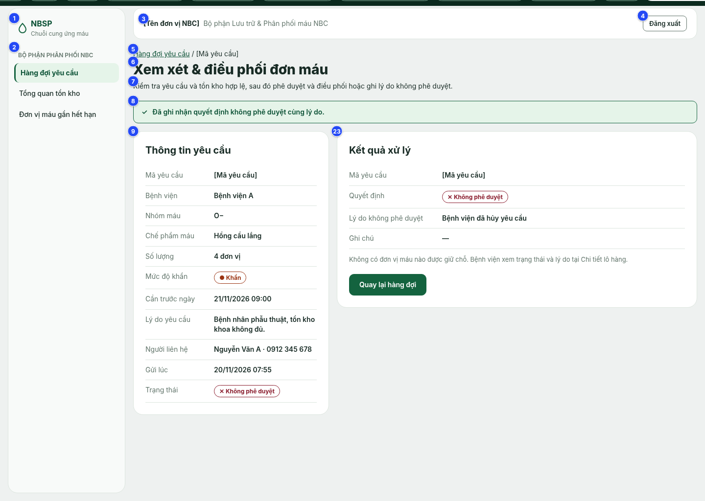 | 1–9, 23 |
| Modal "Confirm approve & dispatch" | 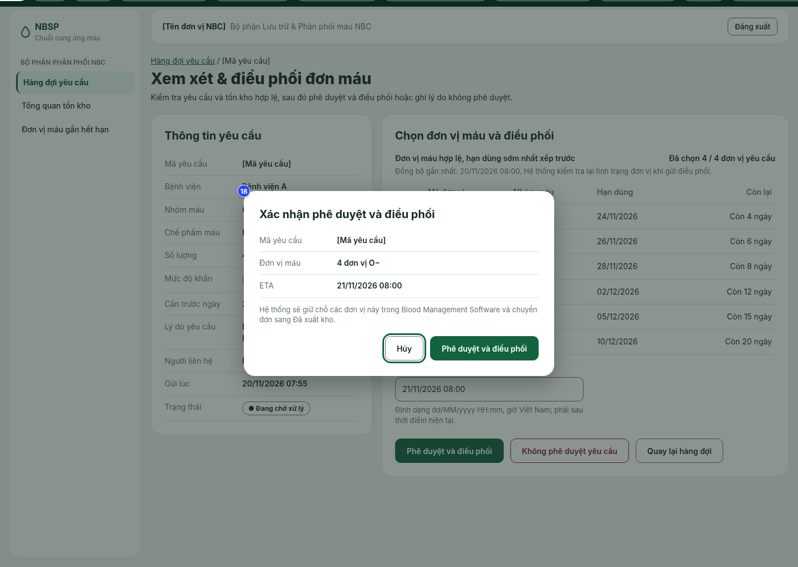 | 18 |
| Modal "Not approve request" | 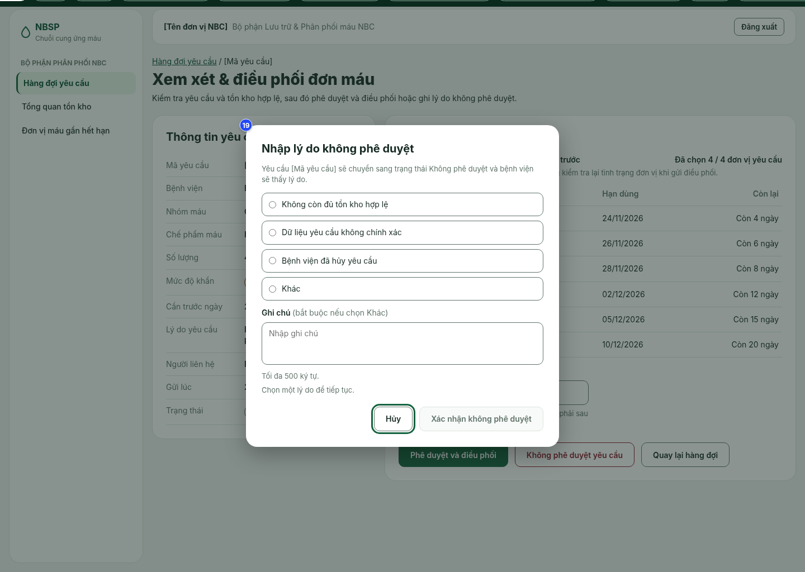 | 19 |

The numbered version of each image has the same name ending in `-numbered.png`. The uncertain-result error (connection lost) is described in section 4 only.

Request IDs and unit IDs are shown as `[Mã yêu cầu]` and `[Mã đơn vị]` (ui-conventions §2.2). Hospital names, quantities, dates and contact data are sample data; the request (Bệnh viện A, O−, 4 đơn vị, Khẩn, sent 20/11/2026 07:55) is the third row of the queue on S-F01-03. Only the design tokens of UI conventions v2.0 §6 are used; the modal backdrop is text-primary at 50 % opacity.

## 3. Element inventory

Data groups (W0 Table 4): **Blood request & shipment records** (ILF) and **NBC inventory snapshot** (EIF).

### 3.1 Page frame (all states)

| # | Element | Type | Content / data source | Required | Validation |
|---|---|---|---|---|---|
| 1 | Brand | Logo and text | static: "NBSP", "Chuỗi cung ứng máu" | Yes | none |
| 2 | Menu | Navigation (links, reachable with Tab) | static; role group "BỘ PHẬN PHÂN PHỐI NBC" and the items allowed for the Dept (FR-04-03): "Hàng đợi yêu cầu" (selected: background, left bar, bold text), "Tổng quan tồn kho", "Đơn vị máu gần hết hạn" | Yes | none |
| 3 | Account info | Text | `user.department.name`, role "Bộ phận Lưu trữ & Phân phối máu NBC" from the session | Yes | none |
| 4 | Sign out | Secondary button | static: "Đăng xuất" | Yes | none |
| 5 | Breadcrumb | Link and text | "Hàng đợi yêu cầu" (link to S-F01-03, conventions §3) + " / [Mã yêu cầu]" | Yes | none |
| 6 | Title | Header | static: "Xem xét & điều phối đơn máu" | Yes | none |
| 7 | Subtitle | Text | static: "Kiểm tra yêu cầu và tồn kho hợp lệ, sau đó phê duyệt và điều phối hoặc ghi lý do không phê duyệt." | Yes | none |
| 8 | Banner | Banner | error (`role="alert"`): reason of the block (texts in section 4); loading (`role="status"`): "Đang gửi yêu cầu điều phối. Vui lòng chờ hệ thống xác nhận."; success (`role="status"`): "Đã phê duyệt và điều phối. Đơn máu đã chuyển sang Đã xuất kho." or "Đã ghi nhận quyết định không phê duyệt cùng lý do." (ui-conventions §4.2) | No | shown only in the error (except invalid ETA), loading and success states |

### 3.2 Request and units

| # | Element | Type | Content / data source | Required | Validation |
|---|---|---|---|---|---|
| 9 | Request info | Card of rows | "Mã yêu cầu" `request.id`, "Bệnh viện" `hospital.name`, "Nhóm máu" `request.blood_type`, "Chế phẩm máu" `request.blood_product`, "Số lượng" `request.quantity`, "Mức độ khẩn" `request.urgency` (chip with the Vietnamese label of S-F01-03: Cấp cứu, Khẩn, Định kỳ), "Cần trước ngày" `request.needed_by`, "Lý do yêu cầu" `request.reason`, "Người liên hệ" `request.contact_name` · `request.contact_phone`, "Gửi lúc" `request.created_at`, "Trạng thái" `request.status` (chip "Đang chờ xử lý", "Đã xuất kho / đang vận chuyển" or "Không phê duyệt"; plain text "Không còn ở trạng thái Đang chờ xử lý" in that error) | Yes | read-only |
| 10 | Eligible units | Table with a checkbox per row (caption for assistive technology) | `unit.id`, `unit.blood_type`, `unit.expiry_date` (dd/MM/yyyy), days left, from the NBC inventory snapshot; only eligible units (not expired, available, BR-04); earliest expiry first and pre-selected up to the requested quantity (BR-09). A unit that was taken meanwhile stays in the list, struck through, with "Không còn khả dụng". Unchecked boxes have a #62756B border; boxes are greyed only while locked (loading, request no longer Pending) | Yes | selected units = requested quantity (no partial dispatch) |
| 11 | Sync note | Helper text | "Đồng bộ gần nhất: [dd/MM/yyyy HH:mm]. Hệ thống kiểm tra lại tình trạng đơn vị khi gửi điều phối." (`inventory.last_sync_at`, FR-02-05) | Yes | shown when the snapshot has a timestamp (conventions §3) |
| 12 | Selection counter | Text | "Đã chọn N / Q đơn vị yêu cầu", N = selected, Q = `request.quantity` | Yes | read-only |
| 13 | ETA | Date and time input with label and helper | label "Dự kiến đến (ETA) *"; `shipment.eta`; empty when the screen opens (the user enters it, FR-01-03); helper "Định dạng dd/MM/yyyy HH:mm, giờ Việt Nam; phải sau thời điểm hiện tại."; placeholder "dd/MM/yyyy HH:mm" when empty | Yes | valid date and time; after the current time; on error see element 22 |
| 14 | Disabled reason | Helper text | under the buttons while "Phê duyệt và điều phối" is disabled (not loading), one text per cause (conventions §3: a disabled action says why): fewer units selected "Cần chọn đủ Q đơn vị (hiện N) để phê duyệt và điều phối."; invalid or empty ETA "Nhập ETA hợp lệ để phê duyệt và điều phối."; no eligible unit "Không có đơn vị máu hợp lệ để điều phối."; insufficient stock "Kho NBC chỉ có N / Q đơn vị [nhóm máu] hợp lệ. Có thể chọn “Không phê duyệt yêu cầu” và ghi lý do, hoặc mở lại sau lần đồng bộ tồn kho tiếp theo."; request no longer Pending "Yêu cầu không còn ở trạng thái Đang chờ xử lý nên không thể điều phối hoặc không phê duyệt." | No | shown only while the approve button is disabled |
| 15 | Approve and dispatch | Primary button | label "Phê duyệt và điều phối"; in the loading state a spinner and "Đang điều phối…" | Yes | enabled only when N = Q and ETA is valid and the request is Pending; disabled while loading |
| 16 | Not approve | Secondary (destructive) button | label "Không phê duyệt yêu cầu" | Yes | disabled while loading and when the request is no longer Pending |
| 17 | Back to queue | Secondary button | label "Quay lại hàng đợi" | Yes | disabled while loading |

### 3.3 State- and modal-specific elements

| # | Element | Type | Content / data source | Required | Validation |
|---|---|---|---|---|---|
| 18 | Confirm modal | Modal (`role="dialog"`) | title "Xác nhận phê duyệt và điều phối"; request ID, number and blood type of units, ETA; helper "Hệ thống sẽ giữ chỗ các đơn vị này trong Blood Management Software và chuyển đơn sang Đã xuất kho."; buttons "Hủy" and "Phê duyệt và điều phối" | No | opened by element 15; closes with Escape without changing anything |
| 19 | Not-approve modal | Modal (`role="dialog"`) | title "Nhập lý do không phê duyệt"; text "Yêu cầu [Mã yêu cầu] sẽ chuyển sang trạng thái Không phê duyệt và bệnh viện sẽ thấy lý do."; single choice of 4 reasons, none selected at first: "Không còn đủ tồn kho hợp lệ", "Dữ liệu yêu cầu không chính xác", "Bệnh viện đã hủy yêu cầu", "Khác"; note field (label "Ghi chú (bắt buộc nếu chọn Khác)", helper "Tối đa 500 ký tự."); helper "Chọn một lý do để tiếp tục." (or "Nhập ghi chú khi chọn Khác."); buttons "Hủy" and "Xác nhận không phê duyệt" | No | opened by element 16; the confirm button stays disabled until one reason is chosen (and a note when "Khác" is chosen); note at most 500 characters; closes with Escape |
| 20 | Empty message | Message block | static: "Không có đơn vị máu hợp lệ" + "Kho NBC hiện không có đơn vị [nhóm máu] nào hợp lệ để điều phối. Có thể chọn “Không phê duyệt yêu cầu” và ghi lý do." | No | shown only in the empty state, in place of the unit table |
| 21 | Shipment summary | Card of rows | `request.id`, `request.blood_type`, `request.quantity`, selected units with the earliest expiry date, `shipment.eta`, `request.status` (chip "Đã xuất kho / đang vận chuyển") and the primary button "Quay lại hàng đợi" | No | read-only; shown only in the dispatched success state |
| 22 | ETA error message | Inline text with error icon, red border on element 13 | "Nhập ETA theo dd/MM/yyyy HH:mm, sau thời điểm hiện tại." (replaces the helper; linked to the field with `aria-describedby`) | No | shown only when the ETA is invalid or in the past; the value is kept |
| 23 | Decision result | Card of rows | title "Kết quả xử lý"; `request.id`, "Quyết định" chip "Không phê duyệt", "Lý do không phê duyệt" `request.not_approved_reason`, "Ghi chú" `request.not_approved_note` ("—" when empty); helper "Không có đơn vị máu nào được giữ chỗ. Bệnh viện xem trạng thái và lý do tại Chi tiết lô hàng."; primary button "Quay lại hàng đợi" | No | read-only; shown only in the not-approved success state |

## 4. States

| State | What the user sees | Trigger |
|---|---|---|
| Default (with data) | Request info (9), eligible units (10) with the earliest-expiry units pre-selected up to the requested quantity, sync note (11), counter "Đã chọn Q / Q", ETA entered by the user, "Phê duyệt và điều phối" enabled. On opening, the ETA is empty and the button is disabled with "Nhập ETA hợp lệ để phê duyệt và điều phối." | Request is Pending and the eligible units cover the requested quantity |
| Empty (no data) | Request info (9), the empty message (20) instead of the unit table, counter "Đã chọn 0 / Q", empty ETA, "Phê duyệt và điều phối" disabled with its reason (14); "Không phê duyệt yêu cầu" stays enabled | Request is Pending and no eligible unit of that blood type exists in the NBC inventory snapshot (FR-01-08 with zero units) |
| Loading | Loading banner (8), unit checkboxes and ETA disabled, "Phê duyệt và điều phối" shows a spinner and "Đang điều phối…", the other buttons disabled so the order cannot be sent twice. The same disabling applies, with skeleton rows instead of the table, while the screen first loads the request and the units, and while "Xác nhận không phê duyệt" is being sent (described here, not drawn) | The user confirmed in a modal and the server has not answered, or the screen is opening |
| Error | No change to the request or to the stock in any case below. **Invalid ETA (drawn):** no banner; red border and message (22) under the ETA, value kept, approve disabled with its reason (14). **Insufficient stock (drawn, FR-01-08):** banner "Không đủ đơn vị máu hợp lệ để điều phối. Đơn chưa được chuyển sang Đã xuất kho." (ui-conventions §4.2), counter "Đã chọn N / Q", approve disabled with the insufficient-stock reason (14); "Không phê duyệt yêu cầu" stays enabled. **Unit taken by another request (drawn, FR-01-03):** "Không thể điều phối: một đơn vị đã chọn vừa được điều phối cho yêu cầu khác. Đơn vẫn ở trạng thái Đang chờ xử lý. Vui lòng chọn lại đơn vị."; the unit is struck through and the Dept reselects. The same text covers a reservation that the Blood Management Software refuses because the unit is no longer available. **Request no longer Pending (drawn, FR-01-03, SR-001):** "Không thể điều phối: yêu cầu này không còn ở trạng thái Đang chờ xử lý. Quay lại hàng đợi để xem danh sách mới."; units, ETA, approve and not-approve locked; only "Quay lại hàng đợi" and the menu stay usable. **Blood Management Software not answering (drawn, FR-01-03):** "Chưa thể điều phối vì Blood Management Software không phản hồi. Chưa có đơn vị nào được giữ chỗ, đơn vẫn ở trạng thái Đang chờ xử lý. Vui lòng thử lại sau."; selection and ETA kept, approve enabled for a retry. A BMS answer later than the timeout (10 s, D-09) counts here: it is a known result from the server. **Shipment not saved (drawn, FR-01-03):** "Chưa lưu được lô hàng nên hệ thống đã hủy giữ chỗ các đơn vị. Đơn vẫn ở trạng thái Đang chờ xử lý. Vui lòng thử lại."; selection and ETA kept, approve enabled. **Uncertain result (not drawn):** "Chưa xác định được kết quả thao tác. Hãy tải lại trạng thái hiện tại trước khi thử lại." (ui-conventions §4.2); only when the connection between the browser and NBSP is lost before the server answers | ETA invalid or in the past; available units fewer than requested when opening or at the check before saving; a unit or the request changed meanwhile; the Blood Management Software refuses, errors or does not answer in time; NBSP cannot save the shipment and releases the reservation (SD-UC-08 "Save failed"); the connection is lost |
| Success / confirmation | **Dispatched (drawn):** success banner (8), request info with status chip "Đã xuất kho / đang vận chuyển", shipment summary (21), button "Quay lại hàng đợi". **Not approved (drawn):** banner "Đã ghi nhận quyết định không phê duyệt cùng lý do.", request info with status chip "Không phê duyệt", decision result (23) with the chosen reason and note, button "Quay lại hàng đợi" | The server confirmed the dispatch (units reserved, shipment created, request Dispatched, FR-01-03), or confirmed the non-approval (FR-01-09) |

## 5. Interactions and navigation

| # | Element | User action | System response | Goes to screen |
|---|---|---|---|---|
| 1 | Unit checkbox (10) | click | Selects or clears that unit; updates the counter, the approve button and its reason | stays |
| 2 | ETA (13) | enter | Stores the value and checks it (format, after the current time); if invalid, shows element 22 and the ETA reason (14); if valid, clears them | stays |
| 3 | Approve and dispatch (15) | click | Opens the confirm modal (18) | stays |
| 4 | Confirm modal, "Phê duyệt và điều phối" | click | Shows the loading state; re-checks that the request is still Pending and the units are still available; reserves the units in the Blood Management Software; creates the shipment and sets Dispatched (FR-01-03); else shows the matching error state (section 4) | stays (success or error state) |
| 5 | Confirm modal, "Hủy" or Escape | click, key | Closes the modal, nothing changes | stays |
| 6 | Not approve (16) | click | Opens the not-approve modal (19) | stays |
| 7 | Not-approve modal, reason and note | choose, enter | Enables "Xác nhận không phê duyệt" once a reason is chosen (and a note for "Khác") | stays |
| 8 | Not-approve modal, "Xác nhận không phê duyệt" | click | Shows the loading state; records Not approved with the reason and note and blocks dispatch (FR-01-09); shows the not-approved success state. If the request is no longer Pending, shows that error | stays |
| 9 | Not-approve modal, "Hủy" or Escape | click, key | Closes the modal, nothing changes | stays |
| 10 | Back to queue (17, 21, 23) | click | Returns to the queue; after a confirmed dispatch or non-approval the queue shows the matching success banner | S-F01-03 |
| 11 | Breadcrumb "Hàng đợi yêu cầu" (5) | click | Opens the queue | S-F01-03 |
| 12 | Menu item "Hàng đợi yêu cầu" | click | Opens the queue | S-F01-03 |
| 13 | Menu item "Tổng quan tồn kho" | click | Opens the inventory dashboard | S-F02-02 |
| 14 | Menu item "Đơn vị máu gần hết hạn" | click | Opens the near-expiry units | S-F02-03 |
| 15 | Sign out (4) | click | Ends the session | S-F04-01 |

## 6. Screen-level rules

| Rule ID | Rule | Source |
|---|---|---|
| SR-001 | Only a Pending request can be approved and dispatched or not approved. A request that is no longer Pending is rejected on submit with the reason, and its actions are locked. | BR-02, FR-01-03 |
| SR-002 | Only eligible units (not expired, available) are listed and selectable. | BR-04 |
| SR-003 | The selected units must cover exactly the requested quantity: there is no partial dispatch. | AD-UC-08 (D-05) |
| SR-004 | The units with the earliest expiry date are pre-selected; the Dept can change the selection. | BR-09 |
| SR-005 | If eligible stock is insufficient, dispatch is blocked and the request and the inventory stay unchanged. | BR-04, FR-01-08 |
| SR-006 | Approve, unit selection, ETA and dispatch are one action: there is no separate "Approved" state. | AD-UC-08, W1 FR-01-03 |
| SR-007 | A non-approval needs one reason (a note when "Khác", at most 500 characters); "Not approved" is a final state. | BR-02, FR-01-09 |
| SR-008 | The screen shows "success" only after the server confirmed; while it waits, the fields and buttons are disabled so the order cannot be sent twice. | ui-conventions §3, W1 FR-01-03 (idempotency) |
| SR-009 | State is never shown by colour alone: chips have marker and text, an error has an icon and text, a selected unit has a tick. | ui-conventions §5 |
| SR-010 | The Dept sees only requests and data allowed for its role. | BR-06, FR-04-03 |
| SR-011 | The unit list is a periodic snapshot and is shown with its last sync time; the system re-checks availability when the order is submitted. | FR-02-05, ui-conventions §3, SD-UC-08 |
| SR-012 | If NBSP cannot save the shipment after the units were reserved, the reservation is released and the request stays Pending. A Blood Management Software error or timeout blocks dispatch and keeps the request Pending. | FR-01-03, SD-UC-08, D-09 |

## 7. Linked requirements

| FR ID | What this screen does for it |
|---|---|
| FR-01-03 | Provides unit selection, ETA and the approve-and-dispatch action; shows the shipment and the Dispatched status; shows the "no longer valid", BMS and save errors |
| FR-01-08 | Blocks dispatch and shows the shortage reason when eligible units are insufficient |
| FR-01-09 | Provides the "Không phê duyệt yêu cầu" action with the reason list and shows the confirmation |
| FR-04-03 | Shows only the menu items and the data allowed for the signed-in Dept user |

## 8. Responsive and accessibility notes

- Smallest supported width: 1440 px (desktop only). The mockups are drawn at 1440 px wide, as UI conventions v2.0 §2.1 require; a narrower window and mobile are out of scope for this release (same wording as S-F01-01). The unit table scrolls inside its card if it becomes wider than the card.
- Information never carried by colour alone: urgency and status chips have marker and text; a selected unit has a tick (and "Đã chọn" for assistive technology); an error has an icon and text; the disabled approve button is explained by element 14.
- Every field has a visible label; required fields are marked with *. The ETA error sits under the field and is linked to it (`aria-invalid`, `aria-describedby`). Modals have a title, move the focus into the modal, close with Escape without losing the screen state, and name the object and the effect (ui-conventions §3).
- Body text contrast at least 4.5:1 (secondary text #62756B is 4.9:1 on white, so it is used only inside cards and on the sidebar); borders of inputs, checkboxes (checked or not) and secondary buttons use #62756B (4.9:1, above 3:1); buttons 44 px high.
- The error banner uses `role="alert"`; the loading and success banners use `role="status"`. Menu items and the breadcrumb link are reachable with Tab.

## 9. Open questions

| # | Question | Blocking? | Status |
|---|---|---|---|
| 1 | RESOLVED (AD-UC-08 question 2, D-09): one attempt, timeout 10 s (configurable), idempotency key = request ID, the reservation is released if NBSP cannot save the shipment. | No | Closed |
| 2 | [NEEDS CLARIFICATION: ETA rules: not in the past is the default (AD-UC-08 question 4). May it be after "Cần trước ngày"?] | No | Open. Default: after the current time; no check against "Cần trước ngày". |
| 3 | [NEEDS CLARIFICATION: Vietnamese labels for the urgency values (Emergency, Urgent, Periodic, W0 BR-01): proposed "Cấp cứu", "Khẩn", "Định kỳ" as on S-F01-03. The final state "Not approved" uses "Không phê duyệt": change log B27 adds this label to ui-conventions §1.2, not applied in the file yet.] | No | Open |
| 4 | [NEEDS CLARIFICATION: the Vietnamese text of the four non-approval reasons is a translation made for this mockup. Confirm.] | No | Open |
| 5 | [NEEDS CLARIFICATION: the copy of the errors "unit taken", "request no longer Pending", "Blood Management Software not answering" and "shipment not saved" is proposed; the project UI conventions define the insufficient-stock and uncertain-result messages only.] | No | Open |
| 6 | [NEEDS CLARIFICATION: screen-transition.md still says the Dept returns to the queue "[dispatched, or left Pending with the reason]" and has the entry "Notification: order rejected"; usage-flow.md still says release 1 has no "not approved" outcome. This spec follows change-log 18/11 (B13, B24, B26, D-04). Update those two files.] | No | Open |
| 7 | RESOLVED: "Cần trước ngày", "Chế phẩm", "Người liên hệ" are in W1 FR-01-01 and BR-10; "Lý do" is optional (BR-10, at most 500 characters) and not yet in the FR-01-01 text. | No | Closed |
| 8 | RESOLVED (D-11, AD-UC-08 question 3): no message is sent to the hospital on dispatch or non-approval; the hospital sees the status, and the reason of a non-approval, on S-F01-02. W1 FR-01-04 still says "dispatched request" only: add "or Not approved" with the reason. | No | Closed here; W1 to update |
| 9 | [NEEDS CLARIFICATION: W1 FR-01-09 does not yet say that Not approved is a final state, that the reason comes from a list, or that the hospital sees it (change-log B5). Update the EARS.] | No | Open |
| 10 | [NEEDS CLARIFICATION: the sync note (11) is a design choice (ui-conventions §3 allows it); FR-01-03 does not ask for it. Keep?] | No | Open. Default: keep. |
| 11 | RESOLVED 21/11/2026: AD-UC-08 v0.6 section 5 now says that the user stays on S-F01-04 (success state) and leaves with "Quay lại hàng đợi", and has a row for the non-approval. | No | Closed |
| 12 | [NEEDS CLARIFICATION: maximum length of the non-approval note. The mockup uses 500 characters, as the request reason in BR-10.] | No | Open. Default: 500. |
| 13 | RESOLVED 21/11/2026: the row "Confirm approve & dispatch" is added to the table "Modals and overlays" of `screen-list.md` (to push to GitHub). | No | Closed |

---

## Completion checklist

- [x] The mockup images are separate files, named with the Screen ID, at the frame width. *(export from `nbsp-ui-mockups.html` v3)*
- [ ] The numbered images exist, and their numbers match the # column of the element inventory. *(to export again: five new states in v3)*
- [x] Every visible element in the mockup appears in the element inventory.
- [x] Every colour in the mockup is a design token from ui-conventions.md §6 (backdrop: text-primary at 50 %).
- [x] Every input element has a validation rule or an explicit "none".
- [x] All five states are filled in.
- [x] Every navigation target is a Screen ID that exists in the Screen List.
- [x] Every element that displays data names the field it displays.
- [x] Every linked FR exists in the Function List, and every action of this screen in AD-UC-08 v0.6 is covered by an interaction row.

## Changes in v2.2 (21/11/2026)

- Header: activity diagrams AD-UC-08 v0.6 and SD-UC-08 v3. The new AD branch "shipment not saved, reservation cancelled" and the separate SD branch "Blood Management Software not answering" match the error states already drawn here ("Error: BMS không phản hồi", "Error: lỗi lưu lô hàng", SR-012); no change to the screen itself.
- Questions 11 and 13 closed (AD-UC-08 section 5 reworded; modal row added to `screen-list.md`).
- Checklist: the AD coverage item no longer refers to a wording difference.

## Changes in v2.1 (21/11/2026)

- New error branches from FR-01-03 and SD-UC-08, drawn in the mockup: request no longer Pending (own text, actions locked), Blood Management Software not answering, shipment not saved with reservation released (new SR-012); the uncertain result is limited to a lost connection.
- ETA: empty on opening; new element 22 (inline error) and an ETA variant of the disabled reason; new state "Error: invalid ETA".
- Insufficient stock: the disabled reason now says what to do next (conventions §4.1) instead of asking to select more units.
- Not approved outcome drawn ("Success: không phê duyệt", element 23); the modal button leads to it; note limited to 500 characters (question 12).
- Labels: "Không phê duyệt yêu cầu" (verb + object, conventions §1.1); "Lý do yêu cầu" in the request card; urgency chip with the Vietnamese label.
- Breadcrumb "Hàng đợi yêu cầu" is a link (conventions §3, interaction 11); menu items reachable with Tab.
- Unchecked checkboxes use the #62756B border (3:1); the grey style is kept for locked boxes only.
- Numbered-image table corrected (default without 14; empty and loading with 11 and 12); question 13 for the screen list.

## Changes in v2.0 (21/11/2026)

- Image names made consistent with S-F01-01; the state "Empty" and the second error (unit taken) now exist in the mockup file; frame height recorded.
- Element inventory rebuilt in the S-F01-01 style: page frame (1 to 8), request and units (9 to 17), state and modal elements (18 to 21). New elements: sync note (11) and disabled reason (14).
- Modal "Không phê duyệt": no reason is preselected, and the confirm button waits for a reason (a note for "Khác"); text says "trạng thái Không phê duyệt" instead of the English code.
- Questions 1, 7 and 8 closed (AD-UC-08 v0.5, W1 FR-01-01, D-11); new questions 9 to 11 for the files that still differ from the change-log.
- Colours: only §6 tokens (old question 10 closed). Text sizes raised to conventions §5. Section 8: desktop-only wording of S-F01-01.

