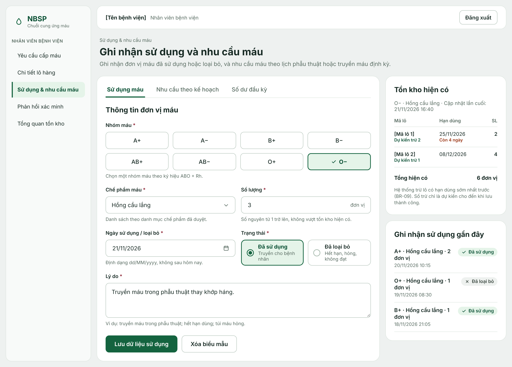
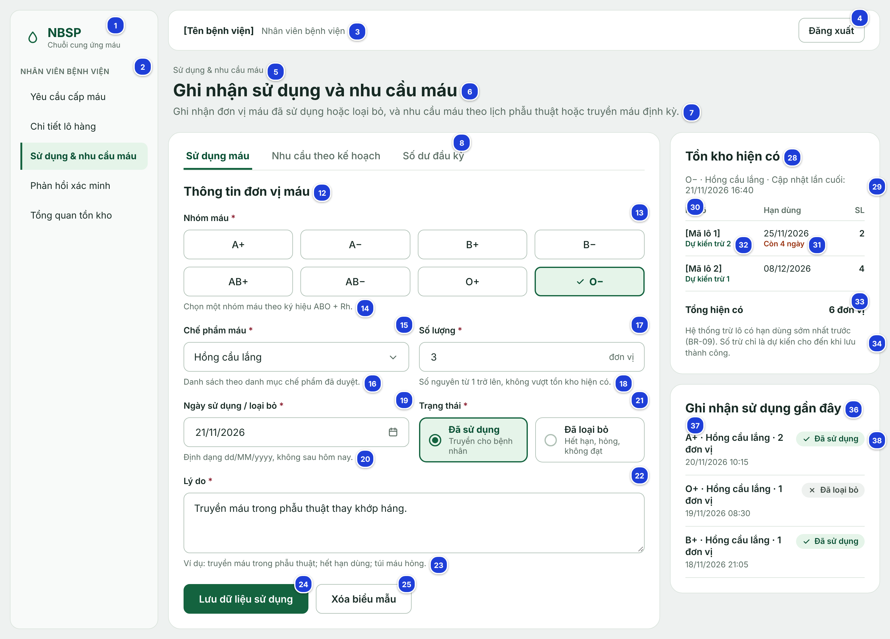
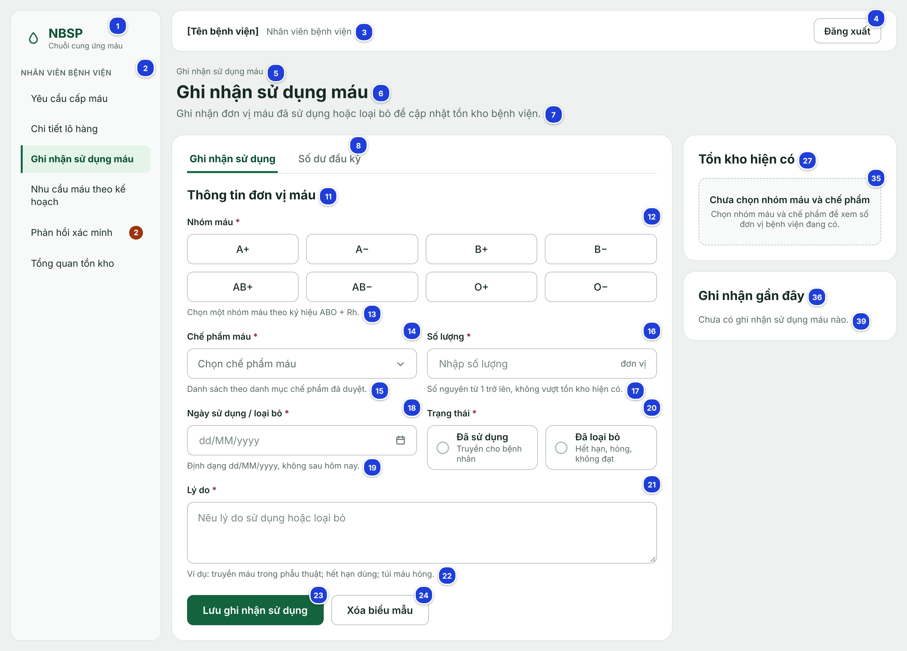
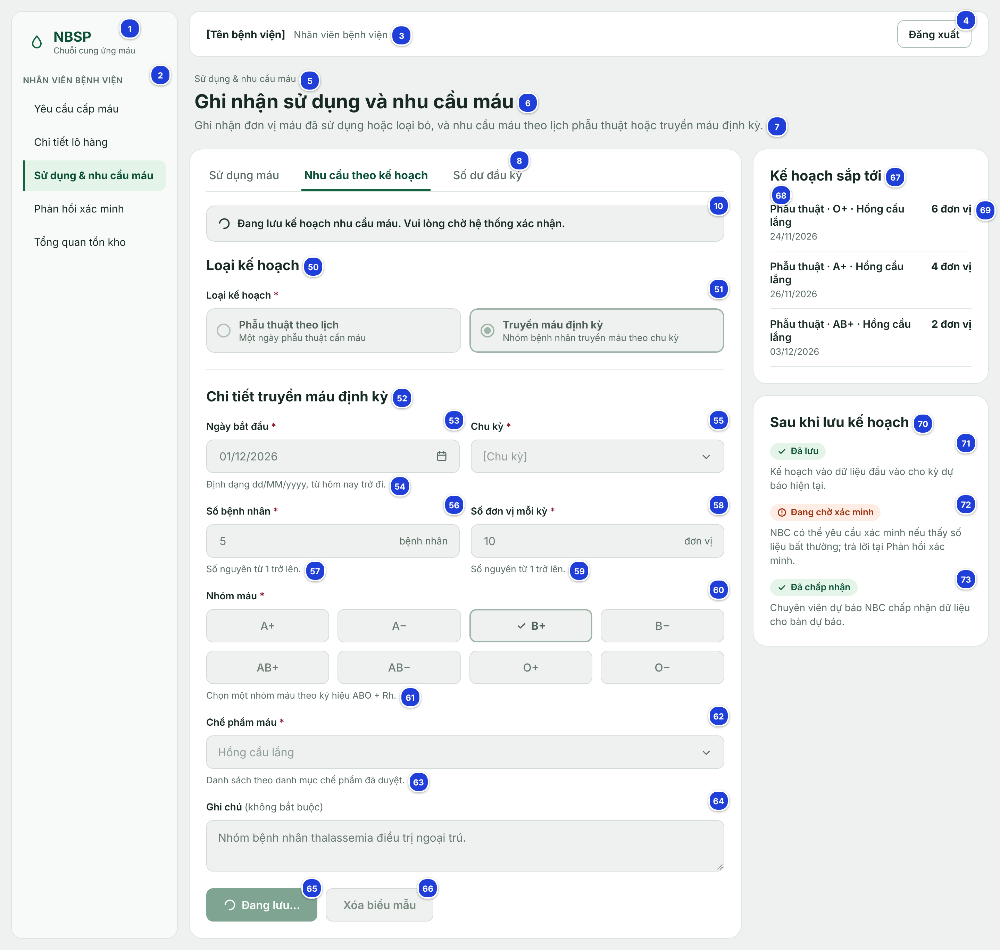
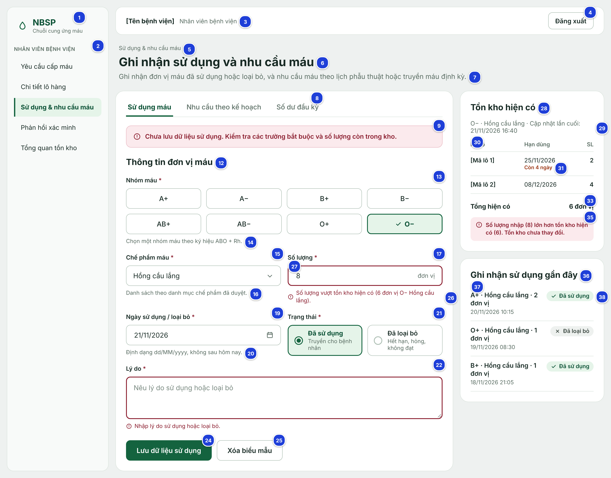
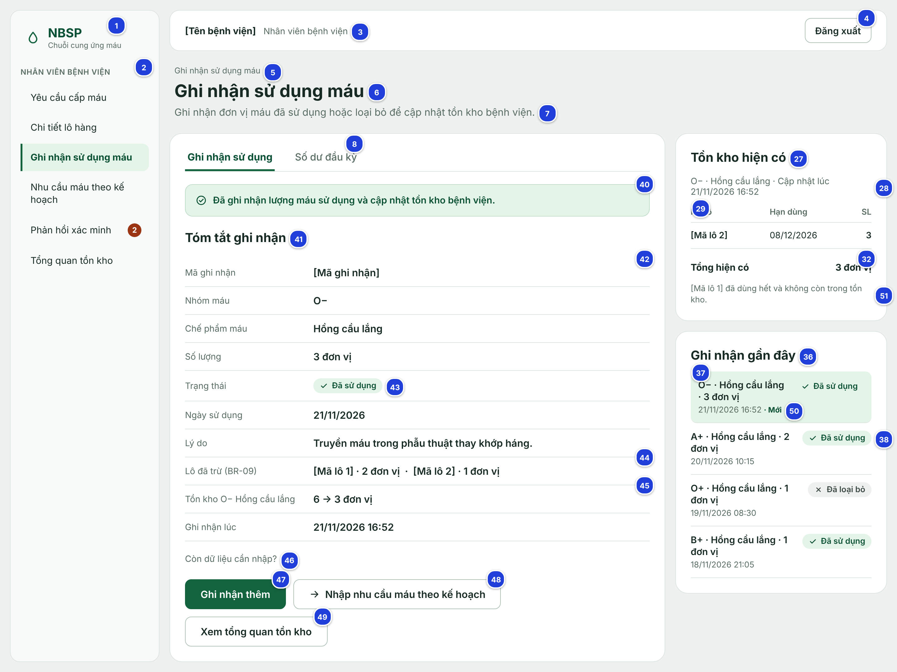
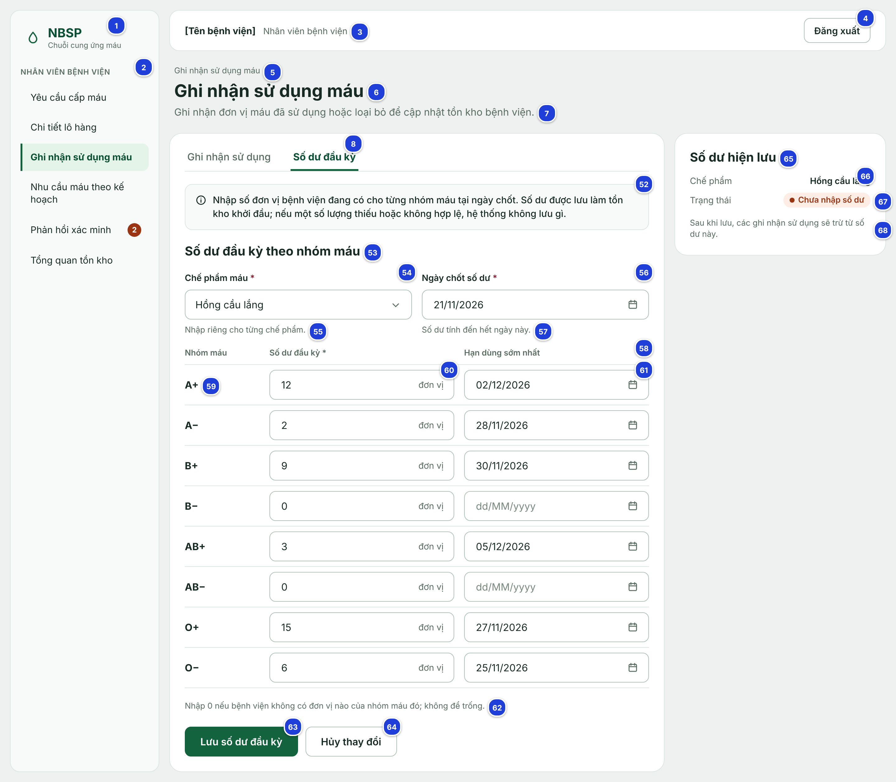

# Screen Spec: S-F02-01 Blood usage record

| Field | Value |
|---|---|
| Screen ID | S-F02-01 |
| Screen name | Blood usage record (Vietnamese UI title: "Ghi nhận sử dụng máu") |
| Actor | Hospital Staff |
| Priority | Must (`screen-list.md`). Effective priorities in W4: FR-02-01 Must, FR-02-06 Should (R2), FR-02-07 Should (R2) |
| Feature | F-02 Inventory Monitoring & Usage |
| Use cases / FRs | UC-04 · FR-02-01, FR-02-06, FR-02-07 (opening balance tab: entered once, per blood type quantity and earliest expiry date, stored as one lot; later changes by the NBSP administrator) (as in `screen-list.md`) |
| Activity diagrams | AD-UC-04 (v0.2) |
| Sequence diagrams | SD-UC-04 |
| Usage flow | Hospital Staff Flow 2 "Record blood usage and planned blood demand" (`usage-flow.md` v2.3): S-F04-01 → **S-F02-01** ⇄ S-F03-01 |
| Mockup images | `img/s-f02-01-default.png`, `img/s-f02-01-empty.png`, `img/s-f02-01-loading.png`, `img/s-f02-01-error.png`, `img/s-f02-01-success.png`, `img/s-f02-01-opening-balance.png`, `img/s-f02-01-opening-balance-saved.png`; numbered: the same seven names ending in `-numbered.png` (section 2) |
| Frame size | 1440 px wide (desktop, UI conventions v2.0 §2.1). Height grows with the content: 1035 px (default), 1125 px (empty), 1107 px (loading), 1127 px (error), 1080 px (success), 1298 px (opening balance tab, not saved), 1194 px (opening balance tab, saved); the page scrolls vertically |
| Figma frame | Not yet in Figma. Draft frames on the design canvas https://claude.ai/artifact/BF77VmyRjL3vdqqTiHCMYU (frames "S-F02-01 · Ghi nhận sử dụng máu · 1 to 5", "S-F02-01 · Tab Số dư đầu kỳ · Chưa lưu" and "S-F02-01 · Tab Số dư đầu kỳ · Đã lưu") |
| Version | v1.2, 21/11/2026 (changes at the end of this file) |
| Status | Draft |

## 1. Purpose

**Shown when:** Hospital Staff have used blood units for a patient or discarded them (expired, damaged, failed check) and must record it so the hospital inventory stays correct (UC-04). They choose the blood type and product, enter the quantity, the date, the status Used or Discarded and a reason, then save. NBSP deducts the units from the hospital lots, earliest expiry first (BR-09), and appends the transaction to the usage history (FR-02-01). The second tab, "Số dư đầu kỳ", records the hospital's opening inventory once, before the first usage record: per blood type, the quantity and the earliest expiry date at a cut-off date. NBSP stores each blood type as one lot with that expiry date, so FEFO applies from the start. After it is saved the tab is read-only; a later change is made by the NBSP administrator, not by Hospital Staff (FR-02-07, `usage-flow.md` v2.3 Flow 2, `screen-list.md`).

**The user leaves this screen when:** the record is saved and the user presses "Nhập nhu cầu máu theo kế hoạch" (to S-F03-01) or "Xem tổng quan tồn kho" (to S-F02-02), opens another menu item, or signs out. "Ghi nhận thêm" stays on this screen with an empty form.

**Entry points** (`screen-list.md`): menu item "Ghi nhận sử dụng máu"; success state of S-F03-01 ("Ghi nhận sử dụng máu").

## 2. Mockup

**Layout (all states):** sidebar on the left (brand, role group, menu for Hospital Staff); top bar (hospital name, role, Sign out); breadcrumb, title and subtitle; main card on the left of the content area, with the two tabs at the top (the usage form, the record summary in the success state, or the opening balance form); on the right, the card "Tồn kho hiện có" and the card "Ghi nhận gần đây" (usage tab), or the card "Số dư hiện lưu" (opening balance tab).

**Numbered images:** each number is the # in the element inventory (section 3), placed at the top-right corner of the element (at the left edge for elements 26, 29 and 37, at the end of the text for one-line texts). Every visible element has its own number, as on the S-F02-02 numbered images: a field's label and control are one element, its helper text is a separate element, and each part of a card (title, scope line, table, total, note) is numbered separately. A repeated element (a lot row, a list row, a status chip in a list) is numbered once, on its first occurrence. Element 9 (error banner) appears only in the error state and element 10 (saving banner) only in the loading state. Elements 25, 26 and 34 appear only in the error state; 25 and 26 are numbered once, on the Quantity field, and 25 replaces the helper texts 17 and 22. Elements 40 to 51 appear only in the success state, where 40 to 49 replace elements 11 to 24 in the main card. Elements 69 and 70 appear only in the empty state (no opening balance yet). Elements 52 to 68, 71 and 72 appear only on the opening balance tab, where they replace elements 11 to 51; 52, 55, 57 and 62 to 64 only before the balance is saved, 71 and 72 only after.

| State | Numbered image | Numbers shown |
|---|---|---|
| Default |  | 1–8, 11–24, 27–33, 36–38 |
| Empty |  | 1–8, 11–24, 27, 35–36, 39, 69–70 |
| Loading |  | 1–8, 10–24, 27–33, 36–38 |
| Error |  | 1–9, 11–16, 18–21, 23–30, 32, 34, 36–38 |
| Success |  | 1–8, 27–29, 32, 36–38, 40–51 |
| Opening balance tab, not saved |  | 1–8, 52–68 |
| Opening balance tab, saved |  | 1–8, 53–54, 56, 58–61, 65–68, 71–72 |

| State | Image | What it shows |
|---|---|---|
| Default (with data) | `img/s-f02-01-default.png` | All fields filled (O−, Hồng cầu lắng, 3 đơn vị, 21/11/2026, Đã sử dụng, reason); stock card with the lots and the expected FEFO deduction; Save enabled |
| Empty | `img/s-f02-01-empty.png` | A hospital with no opening balance and no usage record yet: notice with a link to the tab "Số dư đầu kỳ"; empty form with placeholders and hints; stock card "Chưa có tồn kho để hiển thị"; no recent record |
| Loading | `img/s-f02-01-loading.png` | Saving banner, fields disabled, Save with spinner |
| Error | `img/s-f02-01-error.png` | Quantity above the stock (8 > 6) and missing reason (FR-02-06): banner, a message under each invalid field, a notice in the stock card; values kept. The uncertain-result error is described in section 4 only |
| Success | `img/s-f02-01-success.png` | Success banner, record summary with the lots deducted and the stock before and after, status "Đã sử dụng"; stock and recent cards updated |
| Opening balance tab, not saved | `img/s-f02-01-opening-balance.png` | Opening balance form for one blood product: cut-off date and one row per blood type with quantity and earliest expiry; status "Chưa nhập số dư". Its loading and error states are described in section 4 only |
| Opening balance tab, saved | `img/s-f02-01-opening-balance-saved.png` | After the save: success banner, read-only notice, all values read-only, no buttons; status "Đã lưu · `saved_at`" |

Images are exported at 2x (2880 px wide for the 1440 px frame).

All colours, fonts and corners come from the design tokens in the UI conventions v2.0, section 6 ([ui-conventions.md](../ui-conventions.md#6-design-tokens)), except the colours listed in open question 8.

## 3. Element inventory

Vietnamese labels are written as they appear in the mockup.

### 3.1 Page frame (all states)

| # | Element | Type | Content / data source | Required | Validation |
|---|---|---|---|---|---|
| 1 | Brand | Logo and text | static: "NBSP", "Chuỗi cung ứng máu" | Yes | none |
| 2 | Menu | Navigation | static; role group "NHÂN VIÊN BỆNH VIỆN" and the items allowed for Hospital Staff (FR-04-03): "Yêu cầu cấp máu", "Chi tiết lô hàng", "Ghi nhận sử dụng máu" (current, marked by background, left bar and bold text), "Nhu cầu máu theo kế hoạch", "Phản hồi xác minh", "Tổng quan tồn kho". No count badge on any item: verification requests and alerts reach the user by email (`screen-list.md`, UI conventions OQ-03) | Yes | none |
| 3 | Account info | Text | `hospital.name` ("[Tên bệnh viện]") and the role "Nhân viên bệnh viện", from the session | Yes | none |
| 4 | Sign out | Secondary button | label "Đăng xuất" | Yes | none |
| 5 | Breadcrumb | Text | static: "Ghi nhận sử dụng máu" | Yes | none |
| 6 | Title | Header | static: "Ghi nhận sử dụng máu" | Yes | none |
| 7 | Subtitle | Text | static: "Ghi nhận đơn vị máu đã sử dụng hoặc loại bỏ để cập nhật tồn kho bệnh viện." | Yes | none |
| 8 | Tabs | Tab list (2 tabs) | static: "Ghi nhận sử dụng" (selected by default), "Số dư đầu kỳ"; the selected tab has a bold label and an underline | Yes | none |

### 3.2 Usage form (default, empty, loading and error states)

| # | Element | Type | Content / data source | Required | Validation |
|---|---|---|---|---|---|
| 9 | Error banner | Banner (`role="alert"`) | static: "Chưa lưu dữ liệu sử dụng. Kiểm tra các trường bắt buộc và số lượng còn trong kho." (UI conventions §4.2) | No | shown only after a rejected save, at the top of the form card |
| 10 | Saving banner | Banner (`role="status"`) | static: "Đang lưu ghi nhận sử dụng máu. Vui lòng chờ hệ thống xác nhận." with a spinner | No | shown only in the loading state, at the top of the form card |
| 11 | Section title | Header | static: "Thông tin đơn vị máu" | Yes | none |
| 12 | Blood type | Label and single-choice chips (8, two rows of 4) | label "Nhóm máu *"; `usage.blood_type`: A+, A−, B+, B−, AB+, AB−, O+, O−; the selected chip has a tick, a thicker border and a light background | Yes | exactly one of the 8 valid types (BR-01) |
| 13 | Blood type hint | Helper text | static: "Chọn một nhóm máu theo ký hiệu ABO + Rh." | Yes | replaced by the error message when invalid |
| 14 | Blood product | Label and select | label "Chế phẩm máu *"; `usage.blood_product`, list of the enabled products (release 1: red blood cells only, BR-01); placeholder "Chọn chế phẩm máu"; sample value "Hồng cầu lắng" | Yes | one value of the list |
| 15 | Blood product hint | Helper text | static: "Danh sách theo danh mục chế phẩm đã duyệt." | Yes | replaced by the error message when invalid |
| 16 | Quantity | Label and number input with unit | label "Số lượng *"; `usage.quantity`; placeholder "Nhập số lượng"; unit "đơn vị" inside the field | Yes | whole number of 1 or more; not more than the hospital stock of the chosen blood type and product (FR-02-06) |
| 17 | Quantity hint | Helper text | static: "Số nguyên từ 1 trở lên, không vượt tồn kho hiện có." | Yes | replaced by the error message when invalid |
| 18 | Usage date | Label and date input with calendar icon | label "Ngày sử dụng / loại bỏ *"; `usage.usage_date`; placeholder "dd/MM/yyyy" | Yes | valid date dd/MM/yyyy; not after today (Vietnam time); earliest allowed date [TBD, open question 2] |
| 19 | Usage date hint | Helper text | static: "Định dạng dd/MM/yyyy, không sau hôm nay." | Yes | replaced by the error message when invalid |
| 20 | Status | Label and single-choice cards (2) | label "Trạng thái *"; `usage.status`: Used "Đã sử dụng" (Truyền cho bệnh nhân), Discarded "Đã loại bỏ" (Hết hạn, hỏng, không đạt); the selected card has a filled radio, a thicker border and a light background | Yes | exactly one value |
| 21 | Reason | Label and multi-line text | label "Lý do *"; `usage.reason`; placeholder "Nêu lý do sử dụng hoặc loại bỏ" | Yes (default, open question 1) | not empty; maximum length [TBD] |
| 22 | Reason hint | Helper text | static: "Ví dụ: truyền máu trong phẫu thuật; hết hạn dùng; túi máu hỏng." | Yes | replaced by the error message when invalid |
| 23 | Save | Primary button | label "Lưu dữ liệu sử dụng" (UI conventions §1.1); in the loading state a spinner and "Đang lưu…" | Yes | disabled while the record is being saved |
| 24 | Clear form | Secondary button | label "Xóa biểu mẫu" | No | disabled while the record is being saved |
| 25 | Field error messages | Inline text with error icon | one message under each invalid field, in place of its helper text (texts in section 4, Error) | No | shown only after a rejected save |
| 26 | Invalid field marker | Border | red 2 px border on each invalid field, together with element 25 | No | shown only after a rejected save |

### 3.3 Stock card "Tồn kho hiện có" (usage tab, all states)

| # | Element | Type | Content / data source | Required | Validation |
|---|---|---|---|---|---|
| 27 | Card title | Header | static: "Tồn kho hiện có" | Yes | none |
| 28 | Scope and update line | Text | "`blood_type` · `blood_product` · Cập nhật lần cuối: `inventory.updated_at`" (UI conventions §2.2) (dd/MM/yyyy HH:mm) | Yes | hidden in the empty state |
| 29 | Lot table | Table, read-only | header "Mã lô / Hạn dùng / SL"; one row per hospital lot of the chosen type and product: `hospital_lot.code`, `hospital_lot.expiry_date`, `hospital_lot.quantity`; sorted by expiry, earliest first | Yes | read-only; only the signed-in hospital's lots (BR-06) |
| 30 | Near-expiry tag | Text under the expiry date | "Còn N ngày" (N = days to `expiry_date`), shown for a lot inside the near-expiry window | No | window from configuration (D-19); text, not colour alone |
| 31 | Expected deduction | Text under the lot code | "Dự kiến trừ N", computed on screen from the quantity entered, earliest expiry first (BR-09) | No | default state only; a preview, not saved (SR-003) |
| 32 | Total | Label–value row | "Tổng hiện có" and the sum of the lots + " đơn vị" | Yes | read-only |
| 33 | FEFO note | Helper text | static: "Hệ thống trừ lô có hạn dùng sớm nhất trước (BR-09). Số trừ chỉ là dự kiến cho đến khi lưu thành công." | No | default and loading states |
| 34 | Over-quantity notice | Notice with error icon | "Số lượng nhập (`usage.quantity`) lớn hơn tồn kho hiện có (`total`). Tồn kho chưa thay đổi." | No | shown only when the save is rejected because the quantity is above the stock |
| 35 | Stock empty message | Empty-state panel (dashed border) | "Chưa có tồn kho để hiển thị" and "Bệnh viện chưa nhập số dư đầu kỳ. Tồn kho bắt đầu từ số dư đầu kỳ." when no opening balance is stored; "Chưa chọn nhóm máu và chế phẩm" and "Chọn nhóm máu và chế phẩm để xem số đơn vị bệnh viện đang có." when a balance exists but no type or product is chosen | No | shown in place of 28 to 33 |

### 3.4 Recent records card "Ghi nhận gần đây" (usage tab, all states)

| # | Element | Type | Content / data source | Required | Validation |
|---|---|---|---|---|---|
| 36 | Card title | Header | static: "Ghi nhận gần đây" | Yes | none |
| 37 | Record list | List, read-only | the latest [3, open question 6] usage records of the hospital, newest first; each row: "`blood_type` · `blood_product` · `quantity` đơn vị" and `created_at` (dd/MM/yyyy HH:mm) | Yes | read-only |
| 38 | Record status chip | Chip in each row | `usage.status`: "Đã sử dụng" (tick) or "Đã loại bỏ" (cross) | Yes | read-only |
| 39 | Recent empty message | Text | static: "Chưa có ghi nhận sử dụng máu nào." | No | shown only when the hospital has no usage record, in place of 37 |

### 3.5 Success state only

| # | Element | Type | Content / data source | Required | Validation |
|---|---|---|---|---|---|
| 40 | Success banner | Banner (`role="status"`) with tick icon | static: "Đã ghi nhận lượng máu sử dụng và cập nhật tồn kho bệnh viện." (UI conventions §4.2) | No | shown only after the server confirms |
| 41 | Summary title | Header | static: "Tóm tắt ghi nhận" | No | none |
| 42 | Record summary | List of label–value rows | "Mã ghi nhận" `usage.id`; "Nhóm máu" `usage.blood_type`; "Chế phẩm máu" `usage.blood_product`; "Số lượng" `usage.quantity` + " đơn vị"; "Trạng thái" (element 43); "Ngày sử dụng" `usage.usage_date`; "Lý do" `usage.reason`; rows 44 and 45; "Ghi nhận lúc" `usage.created_at` (dd/MM/yyyy HH:mm) | No | read-only |
| 43 | Status chip | Chip, in the row "Trạng thái" | `usage.status`: "Đã sử dụng" (tick) or "Đã loại bỏ" (cross) | No | read-only |
| 44 | Deducted lots row | Label–value row | "Lô đã trừ (BR-09)": `usage.deducted_lots[]` as "`lot.code` · `n` đơn vị", in deduction order | No | read-only |
| 45 | Stock change row | Label–value row | "Tồn kho `blood_type` `blood_product`": stock before → after + " đơn vị" | No | read-only |
| 46 | Next-step prompt | Text | static: "Còn dữ liệu cần nhập?" | No | none |
| 47 | Record more | Primary button | label "Ghi nhận thêm" | No | none |
| 48 | Log blood demand | Secondary button with arrow icon | label "Nhập nhu cầu máu theo kế hoạch" | No | none |
| 49 | View inventory | Secondary button | label "Xem tổng quan tồn kho" | No | none |
| 50 | New-record marker | Text and row highlight in element 37 | the new record is the first row, on a light green background, with "· Mới" after the time | No | success state only |
| 51 | Used-up lot note | Helper text in the stock card | "`lot.code` đã dùng hết và không còn trong tồn kho." for each lot brought to 0, in place of element 33 | No | success state only, when a lot is used up |

### 3.6 Opening balance tab (FR-02-07)

| # | Element | Type | Content / data source | Required | Validation |
|---|---|---|---|---|---|
| 52 | Info banner | Banner (note) with info icon | static: "Nhập một lần, trước lần ghi nhận sử dụng đầu tiên: số đơn vị và hạn dùng sớm nhất của từng nhóm máu tại ngày chốt. Mỗi nhóm máu được lưu thành một lô với hạn dùng đó; nếu một giá trị thiếu hoặc không hợp lệ, hệ thống không lưu gì." | Yes | shown only before the balance is saved |
| 53 | Section title | Header | static: "Số dư đầu kỳ theo nhóm máu" | Yes | none |
| 54 | Blood product | Label and select | label "Chế phẩm máu *"; `opening_balance.blood_product`; sample "Hồng cầu lắng"; read-only after the save | Yes | one value of the enabled list (BR-01) |
| 55 | Blood product hint | Helper text | static: "Nhập riêng cho từng chế phẩm." | Yes | hidden after the save |
| 56 | Cut-off date | Label and date input with calendar icon | label "Ngày chốt số dư *"; `opening_balance.cutoff_date`; read-only after the save | Yes | valid date dd/MM/yyyy; not after today |
| 57 | Cut-off date hint | Helper text | static: "Số dư tính đến hết ngày này." | Yes | replaced by the error message when invalid; hidden after the save |
| 58 | Table header | Column headers | static: "Nhóm máu", "Số dư đầu kỳ *", "Hạn dùng sớm nhất *" | Yes | none |
| 59 | Blood type column | Row labels (8) | A+, A−, B+, B−, AB+, AB−, O+, O−, each the label of its row's inputs | Yes | none |
| 60 | Opening quantity | Number input with unit, one per row | `opening_balance.lines[type].quantity`; unit "đơn vị"; read-only after the save | Yes | whole number of 0 or more, never empty |
| 61 | Earliest expiry | Date input with calendar icon, one per row | `opening_balance.lines[type].earliest_expiry`, stored as the expiry date of the one lot created for that blood type; placeholder "dd/MM/yyyy"; "—" after the save when the quantity is 0 | Yes when quantity > 0 | valid date dd/MM/yyyy; after the cut-off date [TBD, open question 3] |
| 62 | Table hint | Helper text | static: "Nhập 0 nếu bệnh viện không có đơn vị nào của nhóm máu đó; không để trống. Hạn dùng sớm nhất bắt buộc khi số dư lớn hơn 0." | Yes | hidden after the save |
| 63 | Save opening balance | Primary button | label "Lưu số dư đầu kỳ" | Yes | disabled while saving; hidden after the save |
| 64 | Cancel changes | Secondary button | label "Hủy thay đổi" | No | hidden after the save |
| 65 | Stored balance title | Header | static: "Số dư hiện lưu" | Yes | none |
| 66 | Stored product row | Label–value row | "Chế phẩm" `opening_balance.blood_product` | Yes | read-only |
| 67 | Stored balance status | Chip | "Chưa nhập số dư" (no balance stored, dot marker) or "Đã lưu · `opening_balance.saved_at`" (tick) | Yes | read-only |
| 68 | Stored balance note | Helper text | static: "Nhập một lần, trước lần ghi nhận sử dụng đầu tiên. Thay đổi sau đó do quản trị viên NBSP thực hiện." | Yes | none |

### 3.7 Added in v1.2

| # | Element | Type | Content / data source | Required | Validation |
|---|---|---|---|---|---|
| 69 | No-opening-balance notice | Notice (`role="status"`) with info icon | static: "Bệnh viện chưa có số dư đầu kỳ. Nhập số dư đầu kỳ trước khi ghi nhận sử dụng máu lần đầu." | No | usage tab, shown only while no opening balance is stored |
| 70 | Go to opening balance | Secondary link button with arrow icon, inside element 69 | label "Nhập số dư đầu kỳ" | No | none |
| 71 | Opening balance saved banner | Banner (`role="status"`) with tick icon | static: "Đã lưu số dư đầu kỳ. Mỗi nhóm máu được lưu thành một lô và dùng làm tồn kho khởi đầu của bệnh viện." (proposed copy, open question 9) | No | opening balance tab, shown after the server confirms the save |
| 72 | Read-only notice | Banner (note) with info icon | static: "Số dư đầu kỳ chỉ nhập một lần. Cần thay đổi, liên hệ quản trị viên NBSP." | No | opening balance tab, shown whenever a balance is stored (replaces element 52) |

## 4. States

| State | What the user sees | Trigger |
|---|---|---|
| Default (with data) | Usage tab. Form filled with a valid record (example: O−, Hồng cầu lắng, 3 đơn vị, 21/11/2026, Đã sử dụng, "Truyền máu trong phẫu thuật thay khớp háng."); hints under the fields; stock card with 2 lots (2 units expiring 25/11/2026, 4 units expiring 08/12/2026, total 6) and the expected deduction 2 + 1; recent records card with 3 records; Save and Clear form enabled | The user has entered all required values |
| Empty (no data) | The hospital has no opening balance and no usage record yet. Notice (element 69) with the link "Nhập số dư đầu kỳ" at the top of the form card; no blood type, product, status or text; placeholders in every field; hints under the fields; stock card "Chưa có tồn kho để hiển thị"; recent card "Chưa có ghi nhận sử dụng máu nào."; Save enabled (pressing it shows the error state, since the stock is 0). After "Ghi nhận thêm" or "Xóa biểu mẫu" in a hospital that has a balance, the same empty form is shown without element 69, and the stock card asks the user to choose a blood type and product | First use of NBSP by the hospital; or screen opened from the menu, or after "Ghi nhận thêm" or "Xóa biểu mẫu" |
| Loading | Saving banner (element 10) at the top of the form card; every field, chip and status card disabled (grey background) and keeps its value; Save shows a spinner and "Đang lưu…"; Clear form disabled; the stock card keeps its last values | The user pressed Save and the server has not answered |
| Error | Error banner (element 9) at the top of the form card. Under each invalid field, a red border, an error icon and the message that replaces the hint: "Chọn nhóm máu.", "Chọn chế phẩm máu.", "Nhập số đơn vị là số nguyên từ 1 trở lên.", "Số lượng vượt tồn kho hiện có (`total` đơn vị `blood_type` `blood_product`).", "Nhập ngày theo dd/MM/yyyy.", "Ngày sử dụng không được sau hôm nay.", "Chọn trạng thái.", "Nhập lý do sử dụng hoặc loại bỏ.". When the quantity is above the stock, the stock card also shows element 34. Valid fields keep their hint and normal border. Neither the inventory nor the usage history changes, and every value already entered is kept, including invalid ones such as "8" (FR-02-06). **Uncertain result** (no image): banner "Chưa xác định được kết quả thao tác. Hãy tải lại trạng thái hiện tại trước khi thử lại."; the form keeps its values and nothing is shown as saved | The server rejects the record (incomplete, invalid value, or quantity above the stock); or the connection is lost before the server answers |
| Success / confirmation | The form is replaced by the success banner, the record summary with the status chip, and the buttons "Ghi nhận thêm", "Nhập nhu cầu máu theo kế hoạch" and "Xem tổng quan tồn kho". The tabs stay at the top. The stock card shows the lots after the deduction (example: 3 units of [Mã lô 2]; [Mã lô 1] used up); the recent card shows the new record first, marked "Mới" | The server deducted the units earliest expiry first and appended the usage history (FR-02-01, BR-09) |
| Opening balance tab: not saved | Tab "Số dư đầu kỳ" selected; info banner (element 52); product, cut-off date, the 8-row table filled (quantity and earliest expiry; 0 and an empty date for B− and AB−); Save opening balance and Cancel changes enabled; card "Số dư hiện lưu" with status "Chưa nhập số dư" | The user selects the tab "Số dư đầu kỳ", or presses "Nhập số dư đầu kỳ" (element 70), while no balance is stored |
| Opening balance tab: loading (no image) | Banner "Đang lưu số dư đầu kỳ. Vui lòng chờ hệ thống xác nhận."; inputs and buttons disabled | The user pressed Save opening balance |
| Opening balance tab: error (no image) | Error banner "Chưa lưu số dư đầu kỳ. Vui lòng sửa các giá trị được đánh dấu và lưu lại." (proposed copy, open question 9); red border and message under each invalid value ("Nhập số nguyên từ 0 trở lên.", "Nhập hạn dùng sớm nhất theo dd/MM/yyyy."); nothing is stored and the values are kept (FR-02-07) | A quantity is missing or invalid, or an earliest expiry is missing for a quantity above 0 |
| Opening balance tab: saved | Success banner (element 71) right after the save, then the read-only notice (element 72); product, cut-off date and the 8 rows shown read-only (grey), "—" for an empty expiry; no Save or Cancel button; the card "Số dư hiện lưu" shows "Đã lưu · `saved_at`". The usage tab no longer shows element 69 | The server stored the opening balance, one lot per blood type with a quantity above 0 (FR-02-07); or the user opens the tab later |

## 5. Interactions and navigation

| # | Element | User action | System response | Goes to screen |
|---|---|---|---|---|
| 1 | Tab "Ghi nhận sử dụng" / "Số dư đầu kỳ" | click | Shows the usage form or the opening balance form; values typed in the other tab are kept until the user leaves the screen | stays |
| 2 | Blood type chip | click | Selects that type and shows the tick; any other selected type is cleared; clears the blood type error; reloads the stock card for the type and product | stays |
| 3 | Blood product | choose | Stores the value; clears its error; reloads the stock card | stays |
| 4 | Quantity, Usage date, Status, Reason | enter or choose | Stores the value in the form; clears the error message and red border of that field; Quantity also updates the expected FEFO deduction in the stock card | stays |
| 5 | Save | click, or Enter in the form | Shows the loading state and sends the record. If valid and the stock is enough: deducts the lots earliest expiry first, appends the usage history (FR-02-01, BR-09) and shows the success state. If not: changes nothing and shows the error state (FR-02-06) | stays (loading, then success or error state) |
| 6 | Clear form | click | Empties every field, the blood type, the status and every message; shows the empty state | stays |
| 7 | Ghi nhận thêm | click (success state) | Shows the empty form | stays |
| 8 | Nhập nhu cầu máu theo kế hoạch | click (success state) | Opens the demand log ("More to record?" = yes, Flow 2) | S-F03-01 |
| 9 | Xem tổng quan tồn kho | click (success state) | Opens the inventory dashboard | S-F02-02 |
| 10 | Save opening balance | click | Validates all 8 rows; stores all or nothing, one lot per blood type with a quantity above 0 (FR-02-07); shows the saved, read-only tab | stays |
| 11 | Cancel changes | click | Empties the rows typed but not saved | stays |
| 11a | Nhập số dư đầu kỳ (element 70) | click (empty state) | Selects the tab "Số dư đầu kỳ" | stays |
| 12 | Menu item "Yêu cầu cấp máu" | click | Opens the blood request form | S-F01-01 |
| 13 | Menu item "Chi tiết lô hàng" | click | Opens the shipment screen | S-F01-02 |
| 14 | Menu item "Ghi nhận sử dụng máu" | click | Current screen; opens the empty usage form if the success state is shown | stays |
| 15 | Menu item "Nhu cầu máu theo kế hoạch" | click | Opens the demand log | S-F03-01 |
| 16 | Menu item "Phản hồi xác minh" | click | Opens the verification response | S-F03-03 |
| 17 | Menu item "Tổng quan tồn kho" | click | Opens the inventory dashboard | S-F02-02 |
| 18 | Sign out | click | Ends the session | S-F04-01 |

Leaving the screen with unsaved values discards them; no confirmation dialog is shown (no modal for this screen in `screen-list.md`).

## 6. Screen-level rules

| Rule ID | Rule | Source |
|---|---|---|
| SR-001 | A usage record is saved only if blood type, product, quantity, usage date, status and reason are all valid and the quantity is not more than the hospital stock of that type and product; otherwise neither the inventory nor the usage history changes. | FR-02-01, FR-02-06, BR-01 |
| SR-002 | After a rejected save every value already entered stays in the form. | FR-02-06 |
| SR-003 | Units are deducted from the hospital lots earliest expiry first, for Used and Discarded alike. The "Dự kiến trừ" figures in the stock card are only a preview; the server decides the lots, and the summary shows the lots actually deducted. | BR-09, D-13 |
| SR-004 | The screen shows "success" only after the server confirms the record; while it waits, the fields and buttons are disabled so the record cannot be saved twice. If the result is unknown, the screen does not say that the record was saved or rejected. | UI conventions v2.0 §3, §4.1 |
| SR-005 | Hospital Staff see and change only their own hospital's inventory and usage history; the hospital comes from the session and is not a field of the form. | BR-06, FR-04-03 |
| SR-006 | The opening balance is stored for all 8 blood types at once or not at all; an empty quantity is invalid (0 must be typed), and a quantity above 0 needs its earliest expiry date. Each blood type with a quantity above 0 becomes one lot with that expiry date. | FR-02-07, BR-09, `screen-list.md` |
| SR-008 | The opening balance is entered once. After the save the tab is read-only for Hospital Staff; only the NBSP administrator changes it (outside this screen). | `screen-list.md`, `usage-flow.md` v2.3 Flow 2 |
| SR-009 | No count badge is shown on the menu: verification requests and below-threshold alerts reach users by email. | `screen-list.md`, UI conventions OQ-03 |
| SR-007 | State is never shown by colour alone: a selected blood type has a tick and a border, a selected status has a filled radio, an error has an icon and text, a status chip has a marker and a word. | UI conventions v2.0 §5 |

## 7. Linked requirements

| FR ID | What this screen does for it |
|---|---|
| FR-02-01 | Provides the usage form and the Save action; shows the deducted lots, the updated stock and the new history entry in the success state |
| FR-02-06 | Shows the reason for each invalid field and for a quantity above the stock, changes nothing, and keeps the entered values so the user can correct and resubmit |
| FR-02-07 | Provides the opening balance tab: one quantity and one earliest expiry per blood type, stored once as one lot each, nothing stored if a value is missing or invalid; read-only afterwards |
| FR-04-03 | Shows only the menu items and the hospital data allowed for the signed-in Hospital Staff |
| BR-09 | Stock card and summary show the earliest-expiry-first deduction |

## 8. Responsive and accessibility notes

- The mockups are drawn at 1440 px wide only, as the UI conventions v2.0 require. A narrow window and mobile are out of scope for this release (UI conventions §2.1); if they are added later, the two-column fields stack and the right column moves under the form.
- Every field has a visible label that stays when a value is entered; placeholders never replace labels. Required fields are marked with *.
- Error messages sit directly under their field and are linked to it (`aria-invalid`, `aria-describedby`); the error banner announces the failure (`role="alert"`); the saving and success banners use `role="status"`.
- The tabs use `role="tablist"` / `role="tab"` with `aria-selected`; the status cards are a `radiogroup`; the blood type chips are toggle buttons with `aria-pressed`.
- Keyboard: Tab follows the reading order (tabs, blood type chips, product, quantity, date, status, reason, Save, Clear); arrow keys move between tabs, between chips and between the two status cards; a focus outline is visible; Enter on Save saves the record.
- Body text contrast at least 4.5:1; borders of inputs, chips and cards at least 3:1. Disabled fields in the loading state keep their values readable.
- The lot table keeps the lot code, expiry date and quantity on one row; "Còn N ngày" is text, not only colour.
- Body text 14–16 px; helper and error text 13 px.

## 9. Mockup corrections

Differences between the seven images and this spec. Fix them in Figma when the frames are rebuilt there.

| # | Image | Problem | Fix |
|---|---|---|---|
| 1 | All | The frames exist only on the design canvas, not in the team's Figma file | Rebuild them in Figma as frames "S-F02-01 · Ghi nhận sử dụng máu · 1 to 5" and "S-F02-01 · Tab Số dư đầu kỳ · Chưa lưu / Đã lưu", then export again |
| 2 | Opening balance tab | The loading and error states of the tab are not drawn | Add them if the team wants images for them (section 4 describes them) |

## 10. Open questions

| # | Question | Blocking? | Status |
|---|---|---|---|
| 1 | [NEEDS CLARIFICATION: is the reason mandatory, and is it free text or chosen from a list? (AD-UC-04 Q2)] | Yes | Open. Default: mandatory free text. |
| 2 | [NEEDS CLARIFICATION: how far in the past may the usage date be? Must it be on or after the opening balance cut-off date?] | No | Open. Default: not after today; no lower limit. |
| 3 | Is the opening balance entered per blood type or per lot? | Yes | Closed (`screen-list.md`, `usage-flow.md` v2.3): per blood type, quantity and earliest expiry date, stored as one lot. Still open, not blocking: must the earliest expiry be after the cut-off date, and is the lot code generated by NBSP? |
| 4 | Can the opening balance be changed after it is saved? | No | Closed (`screen-list.md`, `usage-flow.md` v2.3): entered once; later changes by the NBSP administrator. The tab is read-only after the save (SR-008). W4 still names FR-02-07 "… and stock adjustment": align the name with W1. |
| 5 | [NEEDS CLARIFICATION: the expected deduction "Dự kiến trừ" in the stock card is a screen aid that no FR asks for. Keep it?] | No | Open. Default: keep, labelled as a preview (SR-003). |
| 6 | [NEEDS CLARIFICATION: how many records does "Ghi nhận gần đây" show, and is a full usage history screen planned? None is in `screen-list.md`, so the card has no "Xem tất cả" link.] | No | Open. Default: 3 latest records. |
| 7 | Is a count badge shown on the menu item "Phản hồi xác minh"? | No | Closed: no badge. Entry points of S-F03-03 are the email link and the menu (`screen-list.md`, `screen-transition.md`); the UI conventions OQ-03 rule out menu badges (SR-009). |
| 8 | Colours in the mockup that are proposed and not yet in the UI conventions v2.0 §6: border-strong `#AFC0B5` (input, chip and card borders), warning-bg `#FDEDE4` ("Còn N ngày", "Chưa nhập số dư"), error-bg `#FBEAED` (error banner and notice), disabled/loading grey `#EEF1EF`, and text-secondary `#5A6D63` (darker than the token `#62756B`, for 4.5:1 on white). | No | Open. Add them to the tokens or replace them with existing tokens. |
| 9 | The UI conventions §4.2 have no copy for the opening balance banners (loading, error, saved, read-only) or the no-opening-balance notice. Add the texts used here (elements 69, 71, 72 and section 4). | No | Open. |
| 10 | UI conventions §3.2 still lists S-F02-01 with FR-02-01 and FR-02-06 only. Add FR-02-07 (opening balance tab), as in `screen-list.md`. | No | Open. |
| 11 | [NEEDS CLARIFICATION: may Hospital Staff record usage before the opening balance is saved? The flow says the balance comes first; the screen allows the attempt and rejects it because the stock is 0 (FR-02-06). Should Save be disabled instead?] | No | Open. Default: allowed, rejected with the stock reason. |

---

## Completion checklist

- [x] The mockup images are separate files, named with the Screen ID, at the frame width. *(seven images: five usage states and the opening balance tab before and after the save)*
- [x] The numbered images exist, and their numbers match the # column of the element inventory.
- [x] Every visible element in the mockup appears in the element inventory.
- [ ] Every colour in the mockup is a design token from the UI conventions. *(five proposed colours, see question 8)*
- [x] Every input element has a validation rule or an explicit "none".
- [x] All five states are filled in. *(plus the opening balance tab states)*
- [x] Every navigation target is a Screen ID that exists in the Screen List.
- [x] Every element that displays data names the field it displays.
- [x] Every linked FR exists in the Function List, and every action of this screen in AD-UC-04 is covered by an interaction row. *(AD-UC-04: record → interaction 5; reject and show reason → Error state; correct and resubmit → interactions 2–5; deduct and append history → Success state)*

## Changes in v1.1 (21/11/2026)

- Numbering made detailed, as on the S-F02-02 numbered images: helper texts, card titles and each part of the stock card, the recent card, the summary and the opening balance tab now have their own number. Element inventory renumbered 1 to 68 (v1.0 had 39); section 2 table of numbers updated.
- Numbered images exported again at 2x (2880 px wide).

## Changes in v1.2 (21/11/2026)

Aligned with the updated `screen-list.md`, `usage-flow.md` v2.3, `screen-transition.md` and `ui-conventions.md`:

- Opening balance tab: entered once, per blood type quantity and earliest expiry date (now required when the quantity is above 0), stored as one lot; read-only after the save, later changes by the NBSP administrator. New image `s-f02-01-opening-balance-saved.png` and elements 71, 72; rule SR-008; open questions 3 and 4 closed.
- Empty state: the hospital has no opening balance yet; new notice and link to the tab (elements 69, 70); stock card text updated.
- No count badge on the menu (SR-009, open question 7 closed).
- Labels from the UI conventions: Save is "Lưu dữ liệu sử dụng" (§1.1); the stock card says "Cập nhật lần cuối:" (§2.2).
- New open question 11 (usage before the opening balance).
