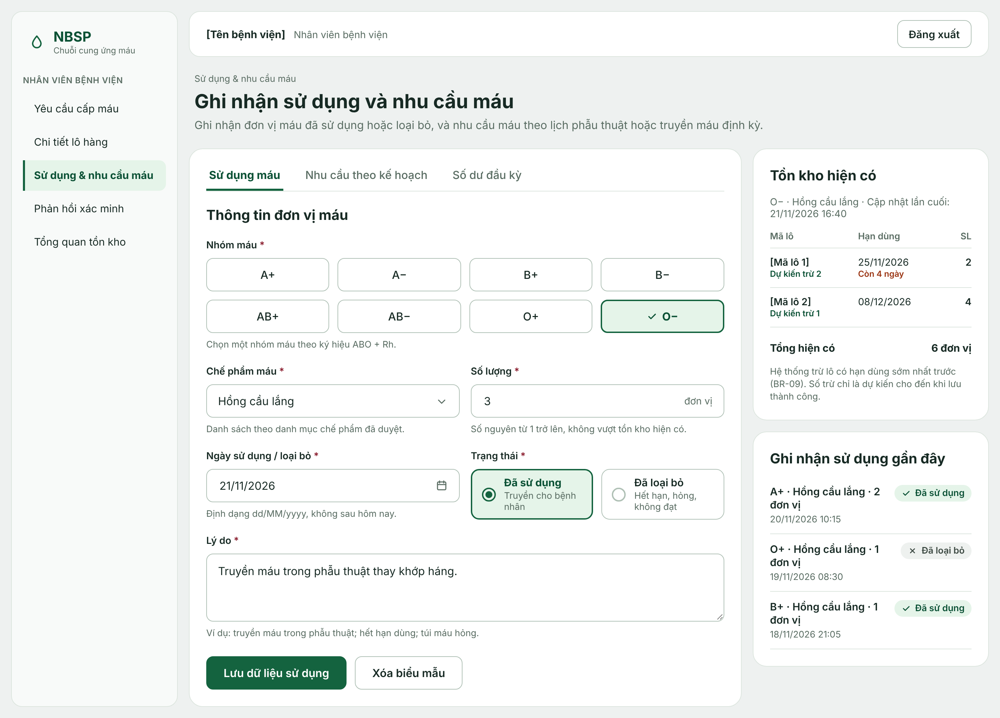
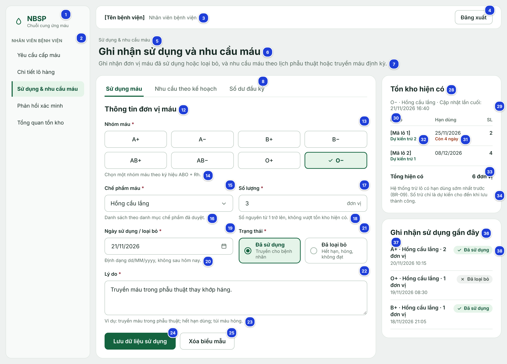
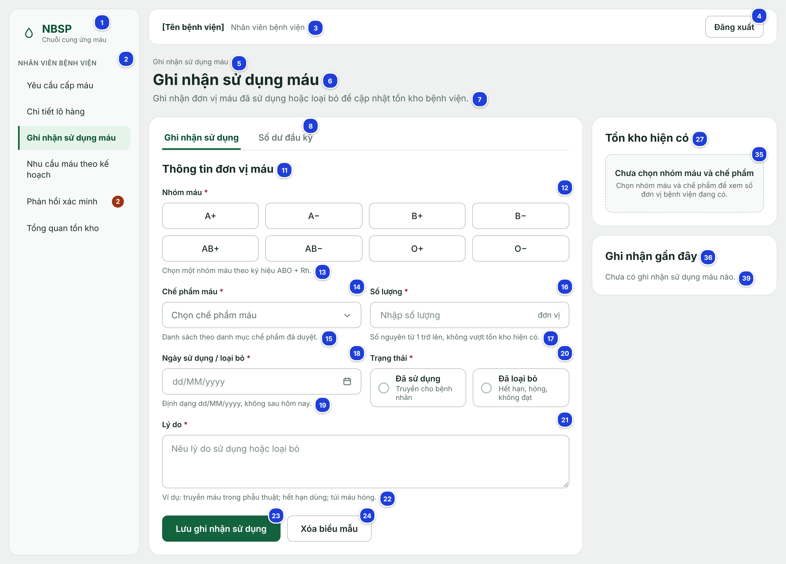
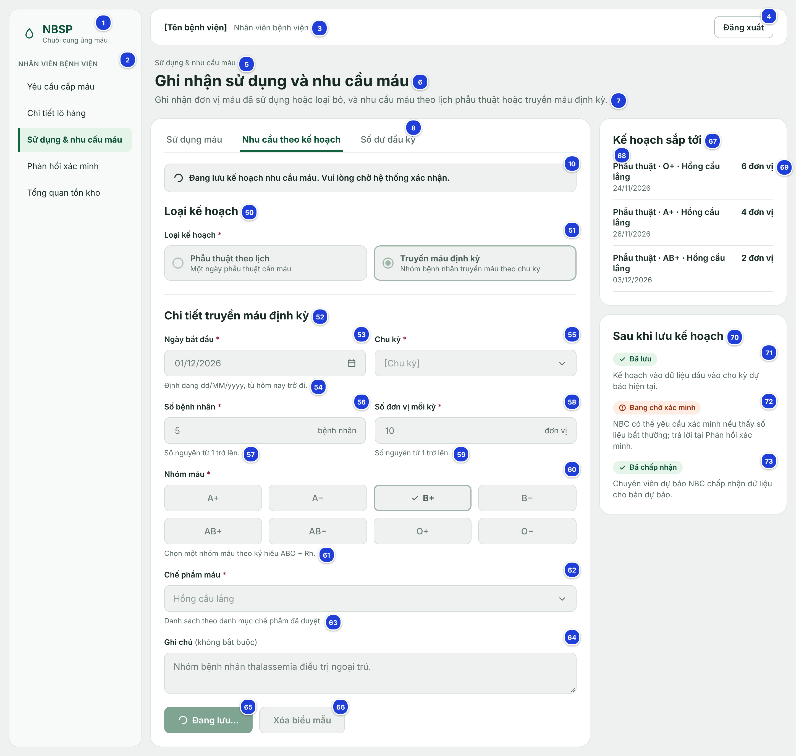
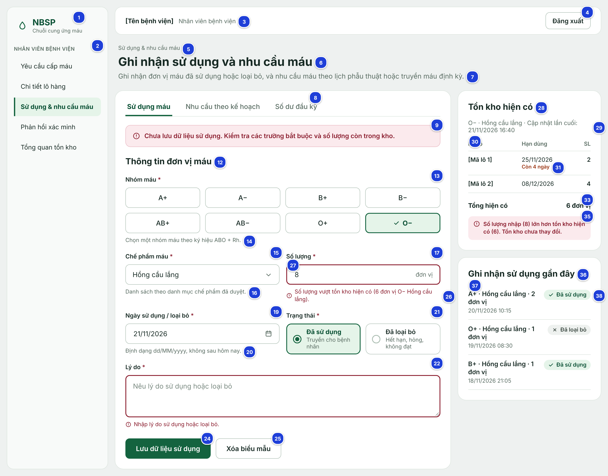
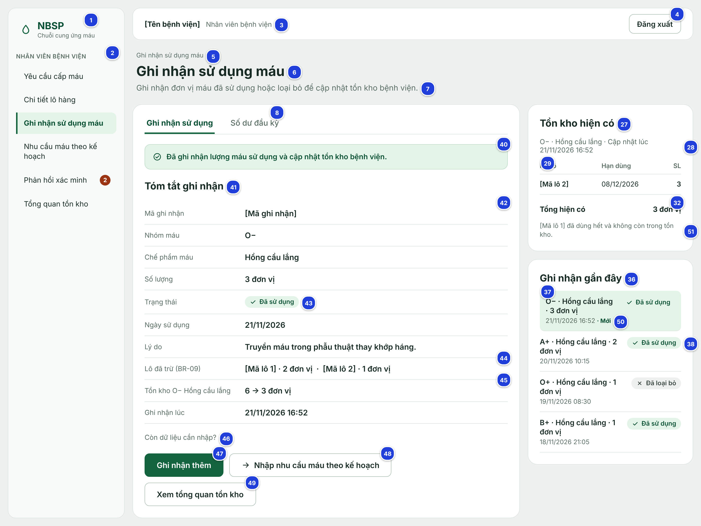

# Screen Spec: S-F02-01 Blood usage and demand record

| Field | Value |
|---|---|
| Screen ID | S-F02-01 |
| Screen name | Blood usage and demand record, "Blood Usage, Demand" (Vietnamese UI title: "Ghi nhận sử dụng và nhu cầu máu"; menu label and breadcrumb "Sử dụng & nhu cầu máu") |
| Actor | Hospital Staff |
| Priority | Must (highest of its FRs). Effective priorities in W4: FR-02-01 Must, FR-02-06 Should (R2), FR-02-07 Should (R2), FR-03-01 Could (R3) |
| Feature | F-02 Inventory Monitoring & Usage (owner of the Screen ID); also serves F-03 Clinical Demand & Forecasting (FR-03-01) |
| Use cases / FRs | UC-04, UC-05 · FR-02-01, FR-02-06, FR-02-07 (opening balance tab: entered once, per blood type quantity and earliest expiry date, stored as one lot; later changes by the NBSP administrator), FR-03-01 |
| Activity diagrams | AD-UC-04 (v0.2), AD-UC-05 (v0.1) |
| Sequence diagrams | SD-UC-04, SD-UC-05 |
| Usage flow | Hospital Staff Flow 2 "Record blood usage and planned blood demand" (`usage-flow.md` v2.3): S-F04-01 → **S-F02-01**. The decision "What to record?" is the choice of tab; the loop "More to record?" stays on this screen |
| Mockup images | `img/s-f02-01-default.png`, `img/s-f02-01-empty.png`, `img/s-f02-01-loading.png`, `img/s-f02-01-error.png`, `img/s-f02-01-success.png`; numbered: the same five names ending in `-numbered.png` (section 2) |
| Frame size | 1440 px wide (desktop, UI conventions v2.0 §2.1), exported at 2x (2880 px). Height grows with the content: 1035 px (default), 1298 px (empty), 1368 px (loading), 1127 px (error), 1024 px (success); the page scrolls vertically |
| Figma frame | Not yet in Figma. Draft frames on the design canvas https://claude.ai/artifact/BF77VmyRjL3vdqqTiHCMYU (frames "S-F02-01 · Sử dụng & nhu cầu máu · 1 to 5") |
| Version | v2.0, 21/11/2026 (replaces S-F02-01 v1.2 and S-F03-01 v1.2; changes at the end of this file) |
| Status | Draft |

## 1. Purpose

**Shown when:** Hospital Staff have something to record for the hospital (Hospital Staff Flow 2). The screen has three tabs:

- **"Sử dụng máu" (UC-04):** blood units used for a patient or discarded. The user chooses the blood type and product and enters the quantity, the date, the status Used or Discarded and a reason. NBSP deducts the units from the hospital lots, earliest expiry first (BR-09), and appends the transaction to the usage history (FR-02-01). An incomplete record, or a quantity above the stock, changes nothing and shows the reason (FR-02-06).
- **"Nhu cầu theo kế hoạch" (UC-05):** a scheduled surgery or a periodic transfusion plan that will need blood. NBSP stores the plan as input for the NBC forecast; an invalid plan is not saved and the reason is shown (FR-03-01, IF clause).
- **"Số dư đầu kỳ" (FR-02-07):** the hospital's opening inventory, entered once before the first usage record. Per blood type, the user enters the quantity and the earliest expiry date at a cut-off date; NBSP stores each blood type as one lot with that expiry date, so FEFO applies from the start. After the save the tab is read-only; a later change is made by the NBSP administrator.

**The user leaves this screen when:** the work is saved and the user presses "Xem tổng quan tồn kho" (to S-F02-02), opens another menu item, or signs out. "Ghi nhận thêm" and "Ghi nhận nhu cầu theo kế hoạch" stay on this screen.

**Entry points** (`screen-list.md`, `screen-transition.md`): menu item "Sử dụng & nhu cầu máu". With no opening balance stored, the screen opens on the tab "Số dư đầu kỳ" (empty state).

## 2. Mockup

**Layout (all states):** sidebar on the left (brand, role group, menu for Hospital Staff); top bar (hospital name, role, Sign out); breadcrumb, title and subtitle; main card on the left of the content area with the three tabs at the top; on the right, the cards of the selected tab: "Tồn kho hiện có" and "Ghi nhận sử dụng gần đây" (usage tab), "Kế hoạch sắp tới" and "Sau khi lưu kế hoạch" (demand tab), "Số dư hiện lưu" (opening balance tab).

**The five images and their tab:** default, error and success show the usage tab; loading shows the demand tab (a periodic plan, which has every demand field); empty shows the opening balance tab of a hospital with no balance yet. The states of each tab that have no image are described in section 4.

**Numbered images:** each number is the # in the element inventory (section 3), placed at the top-right corner of the element (at the left edge for elements 27, 30, 37 and 68, at the end of the text for one-line texts). Every visible element has its own number: a field's label and control are one element, its helper text is a separate element, and each part of a card is numbered separately. A repeated element (a lot row, a list row, a status chip in a list) is numbered once, on its first occurrence. Elements 26 and 27 are numbered once, on the Quantity field; 26 replaces the helper texts 18 and 23 in the error image.

| State | Tab | Numbered image | Numbers shown |
|---|---|---|---|
| Default | Usage |  | 1–8, 12–25, 28–34, 36–38 |
| Empty | Opening balance |  | 1–8, 74–90 |
| Loading | Demand |  | 1–8, 10, 50–73 |
| Error | Usage |  | 1–9, 12–17, 19–22, 24–31, 33, 35–38 |
| Success | Usage |  | 1–8, 11, 28–30, 33, 36–49 |

| State | Image | What it shows |
|---|---|---|
| Default (with data) | `img/s-f02-01-default.png` | Usage tab, all fields filled (O−, Hồng cầu lắng, 3 đơn vị, 21/11/2026, Đã sử dụng, reason); stock card with 2 lots and the expected FEFO deduction; Save enabled |
| Empty | `img/s-f02-01-empty.png` | First use: no opening balance. The screen opens on the opening balance tab: notice, empty product, cut-off date and 8-row table; status "Chưa nhập số dư" |
| Loading | `img/s-f02-01-loading.png` | Demand tab: a periodic plan (01/12/2026, [Chu kỳ], 5 bệnh nhân, 10 đơn vị mỗi kỳ, B+, Hồng cầu lắng) being saved: saving banner, fields disabled, Save with spinner |
| Error | `img/s-f02-01-error.png` | Usage tab: quantity above the stock (8 > 6) and missing reason (FR-02-06): banner, a message under each invalid field, a notice in the stock card; values kept |
| Success | `img/s-f02-01-success.png` | Usage tab: success banner, record summary with the lots deducted and the stock before and after; stock and recent cards updated; next-step buttons |

All colours, fonts and corners come from the design tokens in the UI conventions v2.0, section 6 ([ui-conventions.md](../ui-conventions.md#6-design-tokens)), except the colours listed in open question 10.

## 3. Element inventory

Vietnamese labels are written as they appear in the mockup.

### 3.1 Page frame and shared banners (all tabs)

| # | Element | Type | Content / data source | Required | Validation |
|---|---|---|---|---|---|
| 1 | Brand | Logo and text | static: "NBSP", "Chuỗi cung ứng máu" | Yes | none |
| 2 | Menu | Navigation | static; role group "NHÂN VIÊN BỆNH VIỆN" and the items allowed for Hospital Staff (FR-04-03): "Yêu cầu cấp máu", "Chi tiết lô hàng", "Sử dụng & nhu cầu máu" (current, marked by background, left bar and bold text), "Phản hồi xác minh", "Tổng quan tồn kho". No count badge on any item (`screen-list.md`, UI conventions OQ-03) | Yes | none |
| 3 | Account info | Text | `hospital.name` ("[Tên bệnh viện]") and the role "Nhân viên bệnh viện", from the session | Yes | none |
| 4 | Sign out | Secondary button | label "Đăng xuất" | Yes | none |
| 5 | Breadcrumb | Text | static: "Sử dụng & nhu cầu máu" | Yes | none |
| 6 | Title | Header | static: "Ghi nhận sử dụng và nhu cầu máu" | Yes | none |
| 7 | Subtitle | Text | static: "Ghi nhận đơn vị máu đã sử dụng hoặc loại bỏ, và nhu cầu máu theo lịch phẫu thuật hoặc truyền máu định kỳ." | Yes | none |
| 8 | Tabs | Tab list (3 tabs) | static: "Sử dụng máu" (selected by default when a balance exists), "Nhu cầu theo kế hoạch", "Số dư đầu kỳ" (selected on first use); the selected tab has a bold label and an underline | Yes | none |
| 9 | Error banner | Banner (`role="alert"`) at the top of the tab | usage: "Chưa lưu dữ liệu sử dụng. Kiểm tra các trường bắt buộc và số lượng còn trong kho." (UI conventions §4.2); demand: "Chưa lưu kế hoạch. Vui lòng sửa các trường được đánh dấu và lưu lại."; opening balance: "Chưa lưu số dư đầu kỳ. Vui lòng sửa các giá trị được đánh dấu và lưu lại." | No | shown only after a rejected save |
| 10 | Saving banner | Banner (`role="status"`) with spinner | usage: "Đang lưu ghi nhận sử dụng máu. Vui lòng chờ hệ thống xác nhận."; demand: "Đang lưu kế hoạch nhu cầu máu. Vui lòng chờ hệ thống xác nhận."; opening balance: "Đang lưu số dư đầu kỳ. Vui lòng chờ hệ thống xác nhận." | No | shown only while the server has not answered |
| 11 | Success banner | Banner (`role="status"`) with tick icon | usage: "Đã ghi nhận lượng máu sử dụng và cập nhật tồn kho bệnh viện." (UI conventions §4.2); demand: "Đã lưu kế hoạch nhu cầu máu. Kế hoạch được dùng làm đầu vào cho dự báo của NBC."; opening balance: "Đã lưu số dư đầu kỳ. Mỗi nhóm máu được lưu thành một lô và dùng làm tồn kho khởi đầu của bệnh viện." | No | shown only after the server confirms |

### 3.2 Usage tab: form (UC-04)

| # | Element | Type | Content / data source | Required | Validation |
|---|---|---|---|---|---|
| 12 | Section title | Header | static: "Thông tin đơn vị máu" | Yes | none |
| 13 | Blood type | Label and single-choice chips (8, two rows of 4) | label "Nhóm máu *"; `usage.blood_type`: A+, A−, B+, B−, AB+, AB−, O+, O−; the selected chip has a tick, a thicker border and a light background | Yes | exactly one of the 8 valid types (BR-01) |
| 14 | Blood type hint | Helper text | static: "Chọn một nhóm máu theo ký hiệu ABO + Rh." | Yes | replaced by the error message when invalid |
| 15 | Blood product | Label and select | label "Chế phẩm máu *"; `usage.blood_product`, list of the enabled products (release 1: red blood cells only, BR-01); placeholder "Chọn chế phẩm máu"; sample "Hồng cầu lắng" | Yes | one value of the list |
| 16 | Blood product hint | Helper text | static: "Danh sách theo danh mục chế phẩm đã duyệt." | Yes | replaced by the error message when invalid |
| 17 | Quantity | Label and number input with unit | label "Số lượng *"; `usage.quantity`; placeholder "Nhập số lượng"; unit "đơn vị" | Yes | whole number of 1 or more; not more than the hospital stock of the chosen type and product (FR-02-06) |
| 18 | Quantity hint | Helper text | static: "Số nguyên từ 1 trở lên, không vượt tồn kho hiện có." | Yes | replaced by the error message when invalid |
| 19 | Usage date | Label and date input with calendar icon | label "Ngày sử dụng / loại bỏ *"; `usage.usage_date`; placeholder "dd/MM/yyyy" | Yes | valid date dd/MM/yyyy; not after today (Vietnam time); earliest date [TBD, open question 2] |
| 20 | Usage date hint | Helper text | static: "Định dạng dd/MM/yyyy, không sau hôm nay." | Yes | replaced by the error message when invalid |
| 21 | Status | Label and single-choice cards (2) | label "Trạng thái *"; `usage.status`: Used "Đã sử dụng" (Truyền cho bệnh nhân), Discarded "Đã loại bỏ" (Hết hạn, hỏng, không đạt) | Yes | exactly one value |
| 22 | Reason | Label and multi-line text | label "Lý do *"; `usage.reason`; placeholder "Nêu lý do sử dụng hoặc loại bỏ" | Yes (default, open question 1) | not empty; maximum length [TBD] |
| 23 | Reason hint | Helper text | static: "Ví dụ: truyền máu trong phẫu thuật; hết hạn dùng; túi máu hỏng." | Yes | replaced by the error message when invalid |
| 24 | Save usage | Primary button | label "Lưu dữ liệu sử dụng" (UI conventions §1.1); while saving a spinner and "Đang lưu…" | Yes | disabled while saving |
| 25 | Clear form | Secondary button | label "Xóa biểu mẫu" | No | disabled while saving |
| 26 | Field error messages | Inline text with error icon | one message under each invalid field, in place of its helper text (texts in section 4); used in all three tabs | No | shown only after a rejected save |
| 27 | Invalid field marker | Border | red 2 px border on each invalid field, together with element 26; used in all three tabs | No | shown only after a rejected save |

### 3.3 Usage tab: stock card "Tồn kho hiện có"

| # | Element | Type | Content / data source | Required | Validation |
|---|---|---|---|---|---|
| 28 | Card title | Header | static: "Tồn kho hiện có" | Yes | none |
| 29 | Scope and update line | Text | "`blood_type` · `blood_product` · Cập nhật lần cuối: `inventory.updated_at`" (UI conventions §2.2) | Yes | shown once a type and product are chosen |
| 30 | Lot table | Table, read-only | header "Mã lô / Hạn dùng / SL"; one row per hospital lot of the chosen type and product: `hospital_lot.code`, `hospital_lot.expiry_date`, `hospital_lot.quantity`; earliest expiry first | Yes | only the signed-in hospital's lots (BR-06) |
| 31 | Near-expiry tag | Text under the expiry date | "Còn N ngày" for a lot inside the near-expiry window | No | window from configuration (D-19); text, not colour alone |
| 32 | Expected deduction | Text under the lot code | "Dự kiến trừ N", computed on screen from the quantity entered, earliest expiry first (BR-09) | No | a preview, not saved (SR-004, open question 5) |
| 33 | Total | Label–value row | "Tổng hiện có" and the sum of the lots + " đơn vị" | Yes | read-only |
| 34 | FEFO note | Helper text | static: "Hệ thống trừ lô có hạn dùng sớm nhất trước (BR-09). Số trừ chỉ là dự kiến cho đến khi lưu thành công." | No | default and loading states |
| 35 | Over-quantity notice | Notice with error icon | "Số lượng nhập (`usage.quantity`) lớn hơn tồn kho hiện có (`total`). Tồn kho chưa thay đổi." | No | shown only when the save is rejected because the quantity is above the stock |

### 3.4 Usage tab: card "Ghi nhận sử dụng gần đây"

| # | Element | Type | Content / data source | Required | Validation |
|---|---|---|---|---|---|
| 36 | Card title | Header | static: "Ghi nhận sử dụng gần đây" | Yes | none |
| 37 | Record list | List, read-only | the latest [3, open question 6] usage records of the hospital, newest first: "`blood_type` · `blood_product` · `quantity` đơn vị" and `created_at`. With no record: "Chưa có ghi nhận sử dụng máu nào." | Yes | read-only |
| 38 | Record status chip | Chip in each row | `usage.status`: "Đã sử dụng" (tick) or "Đã loại bỏ" (cross) | Yes | read-only |
| 39 | New-record marker | Row highlight and text | the new record first, on a light green background, with "· Mới" | No | success state only |

### 3.5 Usage tab: record summary (success)

| # | Element | Type | Content / data source | Required | Validation |
|---|---|---|---|---|---|
| 40 | Summary title | Header | static: "Tóm tắt ghi nhận" | No | none |
| 41 | Record summary | List of label–value rows | "Mã ghi nhận" `usage.id`; "Nhóm máu"; "Chế phẩm máu"; "Số lượng" + " đơn vị"; "Trạng thái" (element 42); "Ngày sử dụng"; "Lý do"; rows 43 and 44; "Ghi nhận lúc" `usage.created_at` | No | read-only |
| 42 | Status chip | Chip, in the row "Trạng thái" | `usage.status` | No | read-only |
| 43 | Deducted lots row | Label–value row | "Lô đã trừ (BR-09)": `usage.deducted_lots[]` as "`lot.code` · `n` đơn vị" | No | read-only |
| 44 | Stock change row | Label–value row | "Tồn kho `blood_type` `blood_product`": before → after + " đơn vị" | No | read-only |
| 45 | Next-step prompt | Text | static: "Còn dữ liệu cần nhập?" | No | none |
| 46 | Record more | Primary button | label "Ghi nhận thêm" | No | none |
| 47 | Go to demand tab | Secondary button with arrow icon | label "Ghi nhận nhu cầu theo kế hoạch" | No | none |
| 48 | View inventory | Secondary button | label "Xem tổng quan tồn kho" | No | none |
| 49 | Used-up lot note | Helper text in the stock card | "`lot.code` đã dùng hết và không còn trong tồn kho." in place of element 34 | No | success state, when a lot is used up |

### 3.6 Demand tab: form (UC-05)

| # | Element | Type | Content / data source | Required | Validation |
|---|---|---|---|---|---|
| 50 | Section title | Header | static: "Loại kế hoạch" | Yes | none |
| 51 | Plan type | Label and single-choice cards (2) | label "Loại kế hoạch *"; `plan.type`: "Phẫu thuật theo lịch" (Một ngày phẫu thuật cần máu), "Truyền máu định kỳ" (Nhóm bệnh nhân truyền máu theo chu kỳ) | Yes | exactly one value |
| 52 | Details title | Header | "Chi tiết ca phẫu thuật" or "Chi tiết truyền máu định kỳ", after a divider; with no type chosen, the fields 53 to 64 are replaced by "Chọn loại kế hoạch để nhập ngày, nhóm máu, chế phẩm và số đơn vị." | Yes | none |
| 53 | Date | Label and date input with calendar icon | surgery: "Ngày phẫu thuật *"; periodic: "Ngày bắt đầu *"; `plan.date` | Yes | valid date dd/MM/yyyy; today or later (open question 7) |
| 54 | Date hint | Helper text | static: "Định dạng dd/MM/yyyy, từ hôm nay trở đi." | Yes | replaced by the error message when invalid |
| 55 | Cycle | Label and select (periodic only) | "Chu kỳ *"; `plan.cycle`, list of allowed cycles [TBD, open question 4]; placeholder "Chọn chu kỳ" | Yes for periodic | one value of the list |
| 56 | Number of patients | Label and number input with unit (periodic only) | "Số bệnh nhân *"; `plan.patient_count`; unit "bệnh nhân" | Yes for periodic | whole number of 1 or more |
| 57 | Patients hint | Helper text (periodic only) | static: "Số nguyên từ 1 trở lên." | Yes for periodic | replaced by the error message when invalid |
| 58 | Units | Label and number input with unit | surgery: "Số đơn vị dự kiến *"; periodic: "Số đơn vị mỗi kỳ *" (open question 3); `plan.units`; unit "đơn vị" | Yes | whole number of 1 or more |
| 59 | Units hint | Helper text | static: "Số nguyên từ 1 trở lên." | Yes | replaced by the error message when invalid |
| 60 | Blood type | Label and single-choice chips (8) | "Nhóm máu *"; `plan.blood_type` | Yes | exactly one of the 8 valid types (BR-01) |
| 61 | Blood type hint | Helper text | static: "Chọn một nhóm máu theo ký hiệu ABO + Rh." | Yes | replaced by the error message when invalid |
| 62 | Blood product | Label and select | "Chế phẩm máu *"; `plan.blood_product` (release 1: red blood cells only) | Yes | one value of the list |
| 63 | Blood product hint | Helper text | static: "Danh sách theo danh mục chế phẩm đã duyệt." | Yes | replaced by the error message when invalid |
| 64 | Note | Label and multi-line text | "Ghi chú (không bắt buộc)"; `plan.note`; placeholder "Thông tin thêm cho NBC" | No | maximum length [TBD]; not in SD-UC-05 (open question 8) |
| 65 | Save plan | Primary button | label "Lưu kế hoạch nhu cầu"; while saving a spinner and "Đang lưu…" | Yes | disabled while saving |
| 66 | Clear form | Secondary button | label "Xóa biểu mẫu" | No | disabled while saving |

### 3.7 Demand tab: right column

| # | Element | Type | Content / data source | Required | Validation |
|---|---|---|---|---|---|
| 67 | Upcoming plans title | Header | static: "Kế hoạch sắp tới" | Yes | none |
| 68 | Plan list | List, read-only | the hospital's saved plans dated today or later, soonest first [how many: open question 6]: "Phẫu thuật · `blood_type` · `blood_product`" or "Định kỳ · `blood_type` · `patient_count` bệnh nhân", and the date. With no plan: "Chưa có kế hoạch nhu cầu nào được lưu." After a save, the new plan is highlighted with "· Mới" | Yes | only the signed-in hospital's plans (BR-06) |
| 69 | Units value | Text at the right of each row | "`units` đơn vị" or "`units` đơn vị/kỳ" | Yes | read-only |
| 70 | After-save title | Header | static: "Sau khi lưu kế hoạch" | Yes | none |
| 71 | Step "Đã lưu" | Status chip (tick) and one line | static: "Kế hoạch vào dữ liệu đầu vào cho kỳ dự báo hiện tại." | Yes | none |
| 72 | Step "Đang chờ xác minh" | Status chip (alert) and one line | static: "NBC có thể yêu cầu xác minh nếu thấy số liệu bất thường; trả lời tại Phản hồi xác minh." | Yes | none |
| 73 | Step "Đã chấp nhận" | Status chip (tick) and one line | static: "Chuyên viên dự báo NBC chấp nhận dữ liệu cho bản dự báo." | Yes | none |

### 3.8 Opening balance tab (FR-02-07)

| # | Element | Type | Content / data source | Required | Validation |
|---|---|---|---|---|---|
| 74 | Opening balance notice | Notice (`role="status"`) with info icon | before the save: "**Bệnh viện chưa có số dư đầu kỳ.** Nhập một lần, trước lần ghi nhận sử dụng đầu tiên: số đơn vị và hạn dùng sớm nhất của từng nhóm máu tại ngày chốt. Mỗi nhóm máu được lưu thành một lô; nếu một giá trị thiếu hoặc không hợp lệ, hệ thống không lưu gì."; after the save: "Số dư đầu kỳ chỉ nhập một lần. Cần thay đổi, liên hệ quản trị viên NBSP." The first sentence is also shown at the top of the usage tab while no balance is stored | Yes | none |
| 75 | Section title | Header | static: "Số dư đầu kỳ theo nhóm máu" | Yes | none |
| 76 | Blood product | Label and select | "Chế phẩm máu *"; `opening_balance.blood_product`; placeholder "Chọn chế phẩm máu" | Yes | one value of the enabled list (BR-01) |
| 77 | Blood product hint | Helper text | static: "Nhập riêng cho từng chế phẩm." | Yes | hidden after the save |
| 78 | Cut-off date | Label and date input with calendar icon | "Ngày chốt số dư *"; `opening_balance.cutoff_date` | Yes | valid date dd/MM/yyyy; not after today |
| 79 | Cut-off date hint | Helper text | static: "Số dư tính đến hết ngày này." | Yes | replaced by the error message when invalid; hidden after the save |
| 80 | Table header | Column headers | static: "Nhóm máu", "Số dư đầu kỳ *", "Hạn dùng sớm nhất *" | Yes | none |
| 81 | Blood type column | Row labels (8) | A+, A−, B+, B−, AB+, AB−, O+, O−, each the label of its row's inputs | Yes | none |
| 82 | Opening quantity | Number input with unit, one per row | `opening_balance.lines[type].quantity`; placeholder "Nhập số lượng"; unit "đơn vị" | Yes | whole number of 0 or more, never empty |
| 83 | Earliest expiry | Date input with calendar icon, one per row | `opening_balance.lines[type].earliest_expiry`, stored as the expiry date of the lot created for that blood type; placeholder "dd/MM/yyyy" | Yes when quantity > 0 | valid date dd/MM/yyyy; after the cut-off date [TBD, open question 9] |
| 84 | Table hint | Helper text | static: "Nhập 0 nếu bệnh viện không có đơn vị nào của nhóm máu đó; không để trống. Hạn dùng sớm nhất bắt buộc khi số dư lớn hơn 0." | Yes | hidden after the save |
| 85 | Save opening balance | Primary button | label "Lưu số dư đầu kỳ" | Yes | disabled while saving; hidden after the save |
| 86 | Cancel changes | Secondary button | label "Hủy thay đổi" | No | hidden after the save |
| 87 | Stored balance title | Header | static: "Số dư hiện lưu" | Yes | none |
| 88 | Stored product row | Label–value row | "Chế phẩm" `opening_balance.blood_product` ("—" before the save) | Yes | read-only |
| 89 | Stored balance status | Chip | "Chưa nhập số dư" (dot) or "Đã lưu · `opening_balance.saved_at`" (tick) | Yes | read-only |
| 90 | Stored balance note | Helper text | static: "Nhập một lần, trước lần ghi nhận sử dụng đầu tiên. Thay đổi sau đó do quản trị viên NBSP thực hiện. Ghi nhận nhu cầu theo kế hoạch không cần số dư." | Yes | none |

## 4. States

The five states below follow the UI conventions §3.1. For each, the row says what the image shows and what the other tabs show in the same state.

| State | What the user sees | Trigger |
|---|---|---|
| Default (with data) | **Image, usage tab.** Form filled with a valid record (O−, Hồng cầu lắng, 3 đơn vị, 21/11/2026, Đã sử dụng, "Truyền máu trong phẫu thuật thay khớp háng."); hints under the fields; stock card with 2 lots (2 units expiring 25/11/2026, 4 units expiring 08/12/2026, total 6) and the expected deduction 2 + 1; 3 recent records; Save and Clear enabled. **Demand tab:** plan type chosen and its fields filled; Save enabled; upcoming plans and after-save card on the right. **Opening balance tab, after the save:** product, cut-off date and the 8 rows read-only (grey), "—" for an empty expiry, no Save or Cancel, notice 74 in its "after the save" text, status "Đã lưu · `saved_at`" | The user has entered all required values; or a balance is stored |
| Empty (no data) | **Image, opening balance tab.** The hospital has no opening balance: the screen opens on this tab; notice 74; product, cut-off date and the 8 rows empty with placeholders; Save and Cancel enabled; status "Chưa nhập số dư", product "—". **Usage tab:** the first sentence of notice 74 at the top; empty form; stock card "Chưa có tồn kho để hiển thị"; recent card "Chưa có ghi nhận sử dụng máu nào."; Save may be pressed and is rejected because the stock is 0 (open question 11). **Demand tab:** no plan type chosen, the fields replaced by the line in element 52; upcoming card "Chưa có kế hoạch nhu cầu nào được lưu." (a plan does not need a balance) | First use of NBSP by the hospital; or after "Ghi nhận thêm" / "Xóa biểu mẫu" (empty form of that tab only) |
| Loading | **Image, demand tab.** Saving banner (element 10); plan type cards, fields and chips disabled (grey) and keep their values; Save shows a spinner and "Đang lưu…"; Clear disabled. **Usage and opening balance tabs:** the same pattern with their own banner text; the right-column cards keep their last values | The user pressed Save in a tab and the server has not answered |
| Error | **Image, usage tab.** Error banner (element 9). Under each invalid field a red border, an error icon and the message that replaces the hint: "Chọn nhóm máu.", "Chọn chế phẩm máu.", "Nhập số đơn vị là số nguyên từ 1 trở lên.", "Số lượng vượt tồn kho hiện có (`total` đơn vị `blood_type` `blood_product`).", "Nhập ngày theo dd/MM/yyyy.", "Ngày sử dụng không được sau hôm nay.", "Chọn trạng thái.", "Nhập lý do sử dụng hoặc loại bỏ."; the stock card shows element 35. Neither the inventory nor the usage history changes; every value is kept (FR-02-06). **Demand tab:** "Chọn loại kế hoạch.", "Nhập ngày theo dd/MM/yyyy.", "Ngày phẫu thuật / Ngày bắt đầu không được trước hôm nay (`today`).", "Chọn chu kỳ truyền máu.", "Nhập số bệnh nhân là số nguyên từ 1 trở lên.", "Nhập số đơn vị là số nguyên từ 1 trở lên.", "Chọn nhóm máu.", "Chọn chế phẩm máu."; nothing is saved (FR-03-01, IF clause). **Opening balance tab:** "Chọn chế phẩm máu.", "Nhập ngày chốt theo dd/MM/yyyy.", "Nhập số nguyên từ 0 trở lên.", "Nhập hạn dùng sớm nhất theo dd/MM/yyyy."; nothing is stored (FR-02-07). **Uncertain result** (all tabs, no image): banner "Chưa xác định được kết quả thao tác. Hãy tải lại trạng thái hiện tại trước khi thử lại."; values kept, nothing shown as saved | The server rejects the data; or the connection is lost before it answers |
| Success / confirmation | **Image, usage tab.** The form is replaced by the success banner (element 11), the record summary and the buttons "Ghi nhận thêm", "Ghi nhận nhu cầu theo kế hoạch", "Xem tổng quan tồn kho"; the stock card shows the lots after the deduction (3 units of [Mã lô 2]; [Mã lô 1] used up); the recent card shows the new record first, marked "Mới" (FR-02-01, BR-09). **Demand tab:** success banner, plan summary ("Mã kế hoạch", type, date, cycle and patients for periodic, blood type, product, units, note, status chip "Đã lưu", "Lưu lúc"), buttons "Nhập kế hoạch khác" and "Ghi nhận sử dụng máu" (to the usage tab); the new plan first in element 68. **Opening balance tab:** success banner, then the read-only tab described under Default; notice 74 disappears from the usage tab | The server confirmed the save |

## 5. Interactions and navigation

| # | Element | User action | System response | Goes to screen |
|---|---|---|---|---|
| 1 | Tabs (element 8) | click | Shows the form and right-column cards of that tab; unsaved values of the other tabs are kept until the user leaves the screen | stays |
| 2 | Usage: blood type, product | choose | Stores the value; clears its error; reloads the stock card for the type and product | stays |
| 3 | Usage: quantity, date, status, reason | enter or choose | Stores the value; clears its error; the quantity updates the expected deduction (element 32) | stays |
| 4 | Lưu dữ liệu sử dụng (24) | click, or Enter | Loading, then: if valid and the stock is enough, deducts the lots earliest expiry first and appends the usage history (FR-02-01, BR-09), success state; otherwise changes nothing, error state (FR-02-06) | stays |
| 5 | Xóa biểu mẫu (25, 66) | click | Empties the form of the current tab and its messages | stays |
| 6 | Ghi nhận thêm (46) | click | Shows the empty usage form | stays |
| 7 | Ghi nhận nhu cầu theo kế hoạch (47) | click | Selects the demand tab ("More to record?" = yes) | stays |
| 8 | Xem tổng quan tồn kho (48) | click | Opens the inventory dashboard | S-F02-02 |
| 9 | Demand: plan type (51) | click | Shows the fields of that type (surgery: 53, 54, 58 to 64; periodic: 53 to 64); values of the shared fields are kept | stays |
| 10 | Demand: other fields | enter or choose | Stores the value; clears its error | stays |
| 11 | Lưu kế hoạch nhu cầu (65) | click, or Enter | Loading, then: if valid, stores the plan as forecasting input, success state (FR-03-01); otherwise saves nothing, error state | stays |
| 12 | Demand success: "Nhập kế hoạch khác" / "Ghi nhận sử dụng máu" | click | Empty demand form / selects the usage tab | stays |
| 13 | Lưu số dư đầu kỳ (85) | click | Validates the 8 rows; stores all or nothing, one lot per blood type with a quantity above 0 (FR-02-07); shows the read-only tab | stays |
| 14 | Hủy thay đổi (86) | click | Empties the rows typed but not saved | stays |
| 15 | Menu item "Yêu cầu cấp máu" | click | Opens the blood request form | S-F01-01 |
| 16 | Menu item "Chi tiết lô hàng" | click | Opens the shipment screen | S-F01-02 |
| 17 | Menu item "Sử dụng & nhu cầu máu" | click | Current screen; reopens the default tab | stays |
| 18 | Menu item "Phản hồi xác minh" | click | Opens the verification response | S-F03-03 |
| 19 | Menu item "Tổng quan tồn kho" | click | Opens the inventory dashboard | S-F02-02 |
| 20 | Sign out | click | Ends the session | S-F04-01 |

Leaving the screen with unsaved values discards them; no confirmation dialog is shown (no modal for this screen in `screen-list.md`).

## 6. Screen-level rules

| Rule ID | Rule | Source |
|---|---|---|
| SR-001 | A usage record is saved only if blood type, product, quantity, usage date, status and reason are all valid and the quantity is not more than the hospital stock of that type and product; otherwise neither the inventory nor the usage history changes. | FR-02-01, FR-02-06, BR-01 |
| SR-002 | A plan is saved only if the plan type and every required field of that type are valid; otherwise nothing is saved. A saved plan is only forecasting input; the screen never says that NBC has accepted it. | FR-03-01, SD-UC-05 |
| SR-003 | The opening balance is entered once, for all 8 blood types at once or not at all: an empty quantity is invalid (0 must be typed) and a quantity above 0 needs its earliest expiry. Each blood type with a quantity above 0 becomes one lot with that expiry. After the save the tab is read-only for Hospital Staff; only the NBSP administrator changes it. | FR-02-07, `screen-list.md`, `usage-flow.md` v2.3 |
| SR-004 | Usage deducts lots earliest expiry first, for Used and Discarded alike. "Dự kiến trừ" is only a preview; the summary shows the lots actually deducted. | BR-09, D-13 |
| SR-005 | After a rejected save every value already entered stays in the form of that tab. | FR-02-06, FR-03-01, FR-02-07 |
| SR-006 | "Success" is shown only after the server confirms; while it waits, the fields and buttons of that tab are disabled so the data cannot be saved twice. If the result is unknown, the screen does not say that it was saved or rejected. | UI conventions v2.0 §3, §4.1 |
| SR-007 | Hospital Staff see and change only their own hospital's inventory, usage history and plans; the hospital comes from the session and is not a field. | BR-06, FR-04-03 |
| SR-008 | No count badge is shown on the menu: verification requests and alerts reach users by email. | `screen-list.md`, UI conventions OQ-03 |
| SR-009 | State is never shown by colour alone: a selected chip has a tick, a selected card a filled radio, an error an icon and text, a status chip a marker and a word. | UI conventions v2.0 §5 |

## 7. Linked requirements

| FR ID | What this screen does for it |
|---|---|
| FR-02-01 | Usage tab: form and Save; shows the deducted lots, the updated stock and the new history entry |
| FR-02-06 | Usage tab: shows the reason for each invalid field and for a quantity above the stock, changes nothing, keeps the values |
| FR-02-07 | Opening balance tab: quantity and earliest expiry per blood type, stored once as one lot each, all or nothing; read-only afterwards |
| FR-03-01 | Demand tab: plan form for scheduled surgery and periodic transfusion; stores the plan as forecasting input; shows the reasons and saves nothing when invalid |
| FR-04-03 | Shows only the menu items and the hospital data allowed for the signed-in Hospital Staff |
| BR-09 | Stock card and summary show the earliest-expiry-first deduction |

## 8. Responsive and accessibility notes

- The mockups are drawn at 1440 px wide only (UI conventions §2.1). If a narrow window is added later, the two-column fields stack and the right column moves under the form.
- The tabs use `role="tablist"` / `role="tab"` with `aria-selected`; arrow keys move between tabs. The status cards and plan type cards are `radiogroup`s; the blood type chips are toggle buttons with `aria-pressed`.
- Every field has a visible label that stays when a value is entered; placeholders never replace labels. Required fields are marked with *; optional ones say "(không bắt buộc)".
- When the plan type changes, the new fields are announced (`aria-live="polite"`) and focus stays on the type card.
- Error messages sit under their field and are linked to it (`aria-invalid`, `aria-describedby`); error banners use `role="alert"`, saving and success banners `role="status"`.
- Keyboard: Tab follows the reading order of the selected tab; a focus outline is visible; Enter on Save saves.
- Body text contrast at least 4.5:1; borders of inputs, chips and cards at least 3:1. Disabled and read-only fields keep their values readable.
- Body text 14–16 px; helper and error text 13 px.

## 9. Mockup corrections

| # | Image | Problem | Fix |
|---|---|---|---|
| 1 | All | The frames exist only on the design canvas, not in the team's Figma file | Rebuild them in Figma as frames "S-F02-01 · Sử dụng & nhu cầu máu · 1 to 5", then export again |
| 2 | — | Each image shows one tab; the other tabs' states are described in section 4 only | Add frames for them if the team wants images (for example the demand error and the saved opening balance) |
| 3 | Loading, success | "[Chu kỳ]" is a placeholder because the cycle values are not decided | Replace once open question 4 is answered |

## 10. Open questions

| # | Question | Blocking? | Status |
|---|---|---|---|
| 1 | [NEEDS CLARIFICATION: is the usage reason mandatory, and is it free text or chosen from a list? (AD-UC-04 Q2)] | Yes | Open. Default: mandatory free text. |
| 2 | [NEEDS CLARIFICATION: how far in the past may the usage date be? Must it be on or after the opening balance cut-off date?] | No | Open. Default: not after today. |
| 3 | [NEEDS CLARIFICATION: for a periodic plan, are the units per cycle for the whole group, or per patient per cycle?] | Yes | Open. Default: total per cycle ("Số đơn vị mỗi kỳ"). |
| 4 | [NEEDS CLARIFICATION: which cycle values are allowed? Does a periodic plan need an end date or a number of cycles?] | Yes | Open. |
| 5 | [NEEDS CLARIFICATION: keep the expected deduction "Dự kiến trừ" (no FR asks for it)?] | No | Open. Default: keep, labelled as a preview. |
| 6 | [NEEDS CLARIFICATION: how many rows do "Ghi nhận sử dụng gần đây" and "Kế hoạch sắp tới" show? Is a full history screen planned? None is in `screen-list.md`.] | No | Open. Default: 3 rows, no "Xem tất cả" link. |
| 7 | [NEEDS CLARIFICATION: may a plan date be in the past? Is there a maximum number of units? (AD-UC-05 Q5)] | No | Open. Default: today or later; no maximum. |
| 8 | [NEEDS CLARIFICATION: the plan Note is not in FR-03-01 or SD-UC-05. Keep it?] | No | Open. Default: keep, optional. |
| 9 | [NEEDS CLARIFICATION: must the earliest expiry of the opening balance be after the cut-off date? Is the lot code generated by NBSP?] | No | Open. |
| 10 | Colours in the mockup that are proposed and not yet in the UI conventions v2.0 §6: border-strong `#AFC0B5`, warning-bg `#FDEDE4`, error-bg `#FBEAED`, disabled/loading grey `#EEF1EF`, text-secondary `#5A6D63` (darker than `#62756B` for 4.5:1). | No | Open. |
| 11 | [NEEDS CLARIFICATION: before the opening balance is saved, should "Lưu dữ liệu sử dụng" be disabled, or allowed and rejected because the stock is 0?] | No | Open. Default: allowed and rejected (FR-02-06). |
| 12 | The merge of UC-04 and UC-05 into one screen must be reflected in the other documents: `screen-list.md` (remove the S-F03-01 row, add UC-05 and FR-03-01 to S-F02-01), `screen-transition.md` (remove S-F03-01 and the arrows between S-F02-01 and S-F03-01), `usage-flow.md` (step 2b screen = S-F02-01), UI conventions §3.2 and §7 (S-F03-01 row; FR-02-07 and FR-03-01 on S-F02-01), and the screen count (12 instead of 13). | Yes (traceability) | Open. |
| 13 | The UI conventions §4.2 have no copy for the demand and opening balance banners. Add the texts used in elements 9, 10, 11 and 74. | No | Open. |

---

## Completion checklist

- [x] The mockup images are separate files, named with the Screen ID, at the frame width. *(five images, 2x)*
- [x] The numbered images exist, and their numbers match the # column of the element inventory.
- [x] Every visible element in the mockup appears in the element inventory.
- [ ] Every colour in the mockup is a design token from the UI conventions. *(five proposed colours, see question 10)*
- [x] Every input element has a validation rule or an explicit "none".
- [x] All five states are filled in, for each of the three tabs.
- [x] Every navigation target is a Screen ID that exists in the Screen List.
- [x] Every element that displays data names the field it displays.
- [x] Every linked FR exists in the Function List, and every action of AD-UC-04 and AD-UC-05 is covered by an interaction row. *(AD-UC-04: record → 4; reject and show reason → Error; deduct and append → Success. AD-UC-05: select type → 9; enter details → 10; validate and save → 11 and Success; error and re-entry → Error)*

## Changes in v2.0 (21/11/2026)

- S-F02-01 now covers both UC-04 (blood usage) and UC-05 (planned demand), as the team decided ("Blood Usage, Demand"); S-F03-01 is merged into it. The screen has three tabs: "Sử dụng máu", "Nhu cầu theo kế hoạch", "Số dư đầu kỳ".
- New title "Ghi nhận sử dụng và nhu cầu máu"; menu label "Sử dụng & nhu cầu máu"; the menu has five items.
- Five states, one image each: default, error and success on the usage tab, loading on the demand tab, empty on the opening balance tab.
- Element inventory renumbered 1 to 90 in the detailed style of the S-F02-02 numbered images.
- Open question 12 lists the documents that must be updated for the merge.
