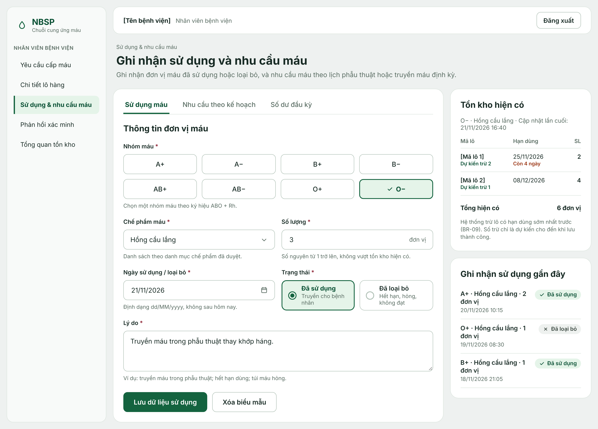
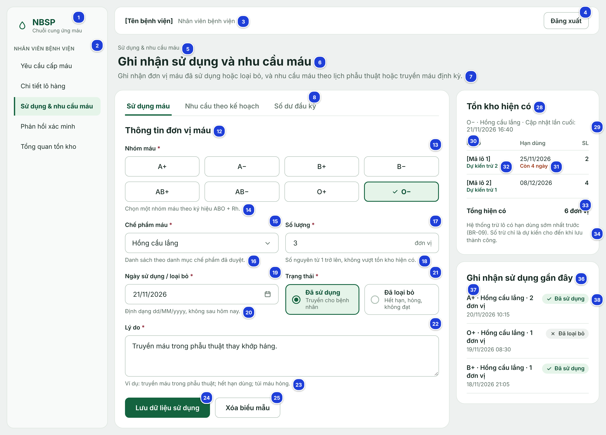
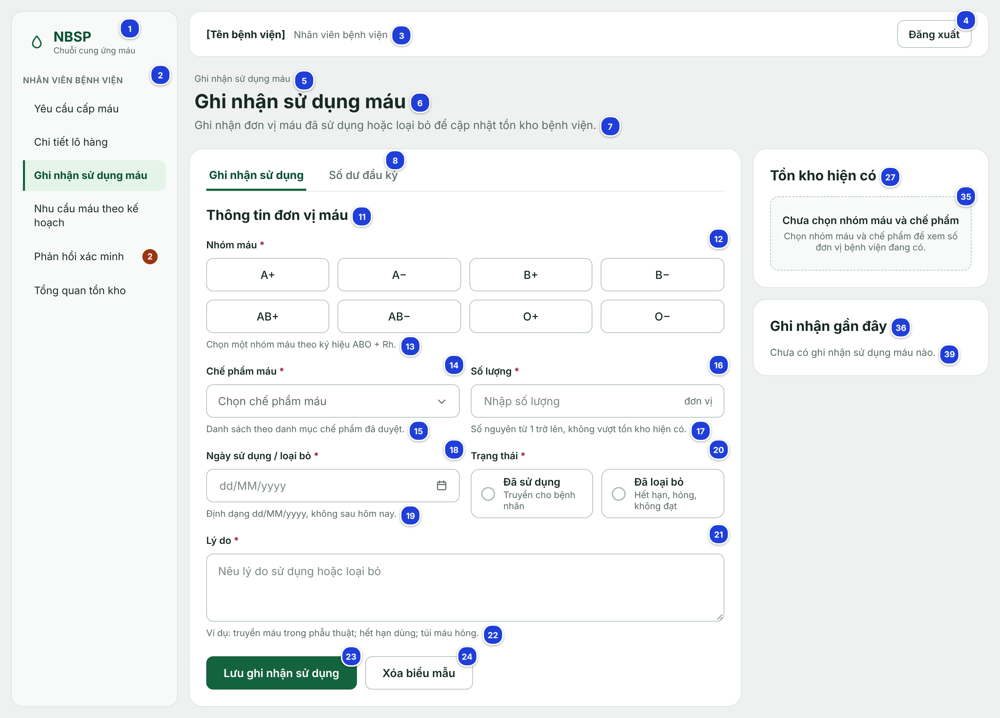
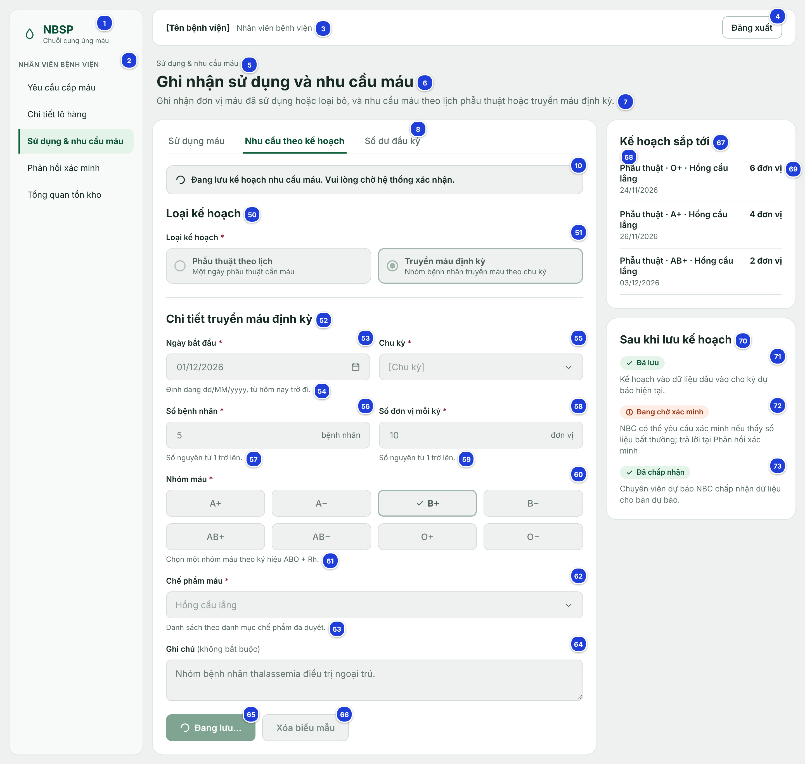
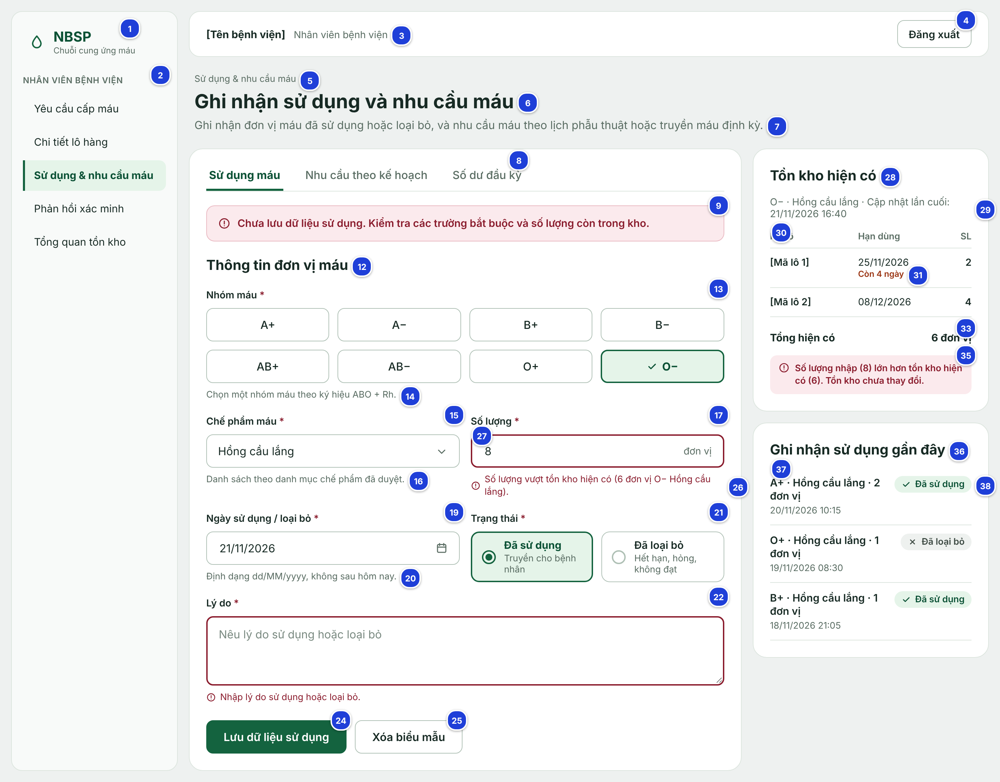
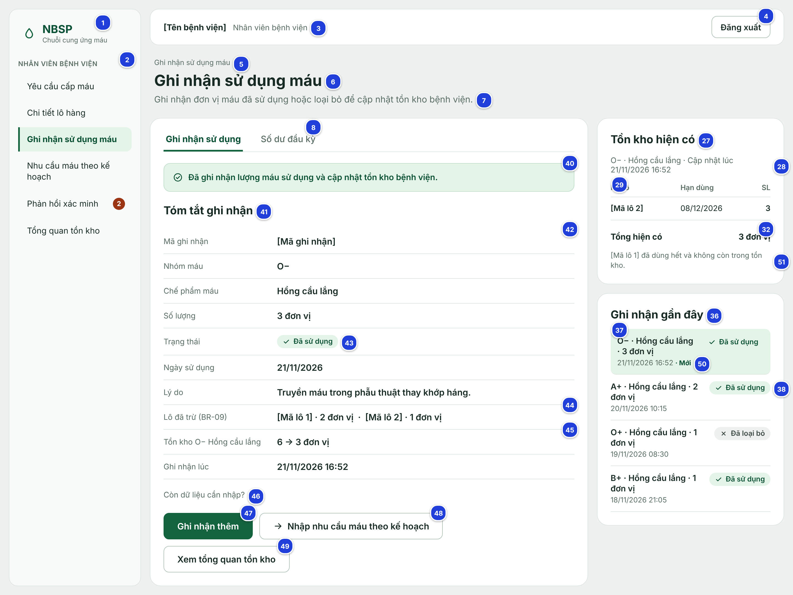
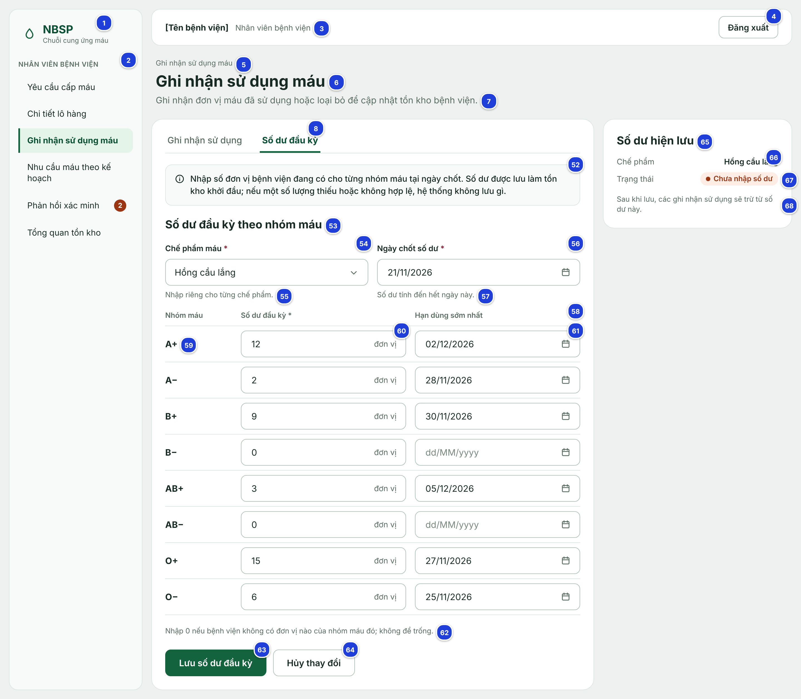

# Screen Spec: S-F02-01 Blood usage record

| Field | Value |
|---|---|
| Screen ID | S-F02-01 |
| Screen name | Blood usage record (Vietnamese UI title: "Ghi nhận sử dụng máu") |
| Actor | Hospital Staff |
| Priority | Must (`screen-list.md`). Effective priorities in W4: FR-02-01 Must, FR-02-06 Should (R2), FR-02-07 Should (R2) |
| Feature | F-02 Inventory Monitoring & Usage |
| Use cases / FRs | UC-04 · FR-02-01, FR-02-06, FR-02-07 (opening balance tab) (as in `screen-list.md`) |
| Activity diagrams | AD-UC-04 (v0.2) |
| Sequence diagrams | SD-UC-04 |
| Usage flow | Hospital Staff Flow 2 "Record blood usage and planned blood demand" (`usage-flow.md` v2.3): S-F04-01 → **S-F02-01** ⇄ S-F03-01 |
| Mockup images | `img/s-f02-01-default.png`, `img/s-f02-01-empty.png`, `img/s-f02-01-loading.png`, `img/s-f02-01-error.png`, `img/s-f02-01-success.png`, `img/s-f02-01-opening-balance.png`; numbered: the same six names ending in `-numbered.png` (section 2) |
| Frame size | 1440 px wide (desktop, UI conventions v2.0 §2.1). Height grows with the content: 1035 px (default, empty), 1107 px (loading), 1127 px (error), 1080 px (success), 1258 px (opening balance tab); the page scrolls vertically |
| Figma frame | Not yet in Figma. Draft frames on the design canvas https://claude.ai/artifact/BF77VmyRjL3vdqqTiHCMYU (frames "S-F02-01 · Ghi nhận sử dụng máu · 1 to 5" and "S-F02-01 · Tab Số dư đầu kỳ") |
| Version | v1.0, 21/11/2026 |
| Status | Draft |

## 1. Purpose

**Shown when:** Hospital Staff have used blood units for a patient or discarded them (expired, damaged, failed check) and must record it so the hospital inventory stays correct (UC-04). They choose the blood type and product, enter the quantity, the date, the status Used or Discarded and a reason, then save. NBSP deducts the units from the hospital lots, earliest expiry first (BR-09), and appends the transaction to the usage history (FR-02-01). The second tab, "Số dư đầu kỳ", records the hospital's opening inventory per blood type before the first usage record (FR-02-07).

**The user leaves this screen when:** the record is saved and the user presses "Nhập nhu cầu máu theo kế hoạch" (to S-F03-01) or "Xem tổng quan tồn kho" (to S-F02-02), opens another menu item, or signs out. "Ghi nhận thêm" stays on this screen with an empty form.

**Entry points** (`screen-list.md`): menu item "Ghi nhận sử dụng máu"; success state of S-F03-01 ("Ghi nhận sử dụng máu").

## 2. Mockup

**Layout (all states):** sidebar on the left (brand, role group, menu for Hospital Staff); top bar (hospital name, role, Sign out); breadcrumb, title and subtitle; main card on the left of the content area, with the two tabs at the top (the usage form, the record summary in the success state, or the opening balance form); on the right, the card "Tồn kho hiện có" and the card "Ghi nhận gần đây" (usage tab), or the card "Số dư hiện lưu" (opening balance tab).

**Numbered images:** each number is the # in the element inventory (section 3). One number covers a field's label, control and helper text. Element 9 (error banner) appears only in the error state and element 10 (saving banner) only in the loading state. Elements 20, 21 and 23 appear only in the error state; on the error image elements 20 and 21 are numbered once, on the Quantity field. Elements 25 to 30 appear only in the success state, where they replace elements 11 to 19 in the main card. Elements 31 to 39 appear only on the opening balance tab, where they replace elements 11 to 24.

| State | Numbered image | Numbers shown |
|---|---|---|
| Default |  | 1–8, 11–19, 22, 24 |
| Empty |  | 1–8, 11–19, 22, 24 |
| Loading |  | 1–8, 10–19, 22, 24 |
| Error |  | 1–9, 11–24 |
| Success |  | 1–8, 22, 24–30 |
| Opening balance tab |  | 1–8, 31–39 |

| State | Image | What it shows |
|---|---|---|
| Default (with data) | `img/s-f02-01-default.png` | All fields filled (O−, Hồng cầu lắng, 3 đơn vị, 21/11/2026, Đã sử dụng, reason); stock card with the lots and the expected FEFO deduction; Save enabled |
| Empty | `img/s-f02-01-empty.png` | No value, placeholders and hints under the fields; stock card asks the user to choose a blood type and product; no recent record |
| Loading | `img/s-f02-01-loading.png` | Saving banner, fields disabled, Save with spinner |
| Error | `img/s-f02-01-error.png` | Quantity above the stock (8 > 6) and missing reason (FR-02-06): banner, a message under each invalid field, a notice in the stock card; values kept. The uncertain-result error is described in section 4 only |
| Success | `img/s-f02-01-success.png` | Success banner, record summary with the lots deducted and the stock before and after, status "Đã sử dụng"; stock and recent cards updated |
| Opening balance tab | `img/s-f02-01-opening-balance.png` | Opening balance form for one blood product: cut-off date and one row per blood type; status "Chưa nhập số dư". Its loading, error and success states are described in section 4 only |

All colours, fonts and corners come from the design tokens in the UI conventions v2.0, section 6 ([ui-conventions.md](../ui-conventions.md#6-design-tokens)), except the colours listed in open question 8.

## 3. Element inventory

Vietnamese labels are written as they appear in the mockup.

### 3.1 Page frame (all states)

| # | Element | Type | Content / data source | Required | Validation |
|---|---|---|---|---|---|
| 1 | Brand | Logo and text | static: "NBSP", "Chuỗi cung ứng máu" | Yes | none |
| 2 | Menu | Navigation | static; role group "NHÂN VIÊN BỆNH VIỆN" and the items allowed for Hospital Staff (FR-04-03): "Yêu cầu cấp máu", "Chi tiết lô hàng", "Ghi nhận sử dụng máu" (current, marked by background, left bar and bold text), "Nhu cầu máu theo kế hoạch", "Phản hồi xác minh", "Tổng quan tồn kho". "Phản hồi xác minh" shows a count badge: number of Open verification requests of the hospital (D-20, in-app badge) | Yes | badge hidden when the count is 0 |
| 3 | Account info | Text | `hospital.name` ("[Tên bệnh viện]") and the role "Nhân viên bệnh viện", from the session | Yes | none |
| 4 | Sign out | Secondary button | label "Đăng xuất" | Yes | none |
| 5 | Breadcrumb | Text | static: "Ghi nhận sử dụng máu" | Yes | none |
| 6 | Title | Header | static: "Ghi nhận sử dụng máu" | Yes | none |
| 7 | Subtitle | Text | static: "Ghi nhận đơn vị máu đã sử dụng hoặc loại bỏ để cập nhật tồn kho bệnh viện." | Yes | none |
| 8 | Tabs | Tab list (2 tabs) | static: "Ghi nhận sử dụng" (selected by default), "Số dư đầu kỳ"; the selected tab has a bold label and an underline | Yes | none |

### 3.2 Usage form (default, empty, loading and error states)

| # | Element | Type | Content / data source | Required | Validation |
|---|---|---|---|---|---|
| 9 | Error banner | Banner (`role="alert"`) | static: "Chưa lưu dữ liệu sử dụng. Kiểm tra các trường bắt buộc và số lượng còn trong kho." (UI conventions §4.2) | No | shown only after a rejected save, at the top of the form card |
| 10 | Saving banner | Banner (`role="status"`) | static: "Đang lưu ghi nhận sử dụng máu. Vui lòng chờ hệ thống xác nhận." with a spinner | No | shown only in the loading state, at the top of the form card |
| 11 | Section title | Header | static: "Thông tin đơn vị máu" | Yes | none |
| 12 | Blood type | Single-choice chips (8, two rows of 4) | label "Nhóm máu *"; `usage.blood_type`: A+, A−, B+, B−, AB+, AB−, O+, O−; the selected chip has a tick, a thicker border and a light background; hint "Chọn một nhóm máu theo ký hiệu ABO + Rh." | Yes | exactly one of the 8 valid types (BR-01) |
| 13 | Blood product | Select | label "Chế phẩm máu *"; `usage.blood_product`, list of the enabled products (release 1: red blood cells only, BR-01); placeholder "Chọn chế phẩm máu"; sample value "Hồng cầu lắng"; hint "Danh sách theo danh mục chế phẩm đã duyệt." | Yes | one value of the list |
| 14 | Quantity | Number input with unit | label "Số lượng *"; `usage.quantity`; placeholder "Nhập số lượng"; unit "đơn vị" inside the field; hint "Số nguyên từ 1 trở lên, không vượt tồn kho hiện có." | Yes | whole number of 1 or more; not more than the hospital stock of the chosen blood type and product (FR-02-06) |
| 15 | Usage date | Date input with calendar icon | label "Ngày sử dụng / loại bỏ *"; `usage.usage_date`; placeholder "dd/MM/yyyy"; hint "Định dạng dd/MM/yyyy, không sau hôm nay." | Yes | valid date dd/MM/yyyy; not after today (Vietnam time); earliest allowed date [TBD, open question 2] |
| 16 | Status | Single-choice cards (2) | label "Trạng thái *"; `usage.status`: Used "Đã sử dụng" (Truyền cho bệnh nhân), Discarded "Đã loại bỏ" (Hết hạn, hỏng, không đạt); the selected card has a filled radio, a thicker border and a light background | Yes | exactly one value |
| 17 | Reason | Multi-line text | label "Lý do *"; `usage.reason`; placeholder "Nêu lý do sử dụng hoặc loại bỏ"; hint "Ví dụ: truyền máu trong phẫu thuật; hết hạn dùng; túi máu hỏng." | Yes (default, open question 1) | not empty; maximum length [TBD] |
| 18 | Save | Primary button | label "Lưu ghi nhận sử dụng"; in the loading state a spinner and "Đang lưu…" | Yes | disabled while the record is being saved |
| 19 | Clear form | Secondary button | label "Xóa biểu mẫu" | No | disabled while the record is being saved |
| 20 | Field error messages | Inline text with error icon | one message under each invalid field (texts in section 4, Error) | No | shown only after a rejected save |
| 21 | Invalid field marker | Border | red border on each invalid field, together with element 20 | No | shown only after a rejected save |

### 3.3 Right column, usage tab (all usage-tab states)

| # | Element | Type | Content / data source | Required | Validation |
|---|---|---|---|---|---|
| 22 | Stock card | Card, read-only | title "Tồn kho hiện có"; line "`blood_type` · `blood_product` · Cập nhật lúc `inventory.updated_at`"; table "Mã lô / Hạn dùng / SL" with one row per hospital lot of the chosen type and product (`hospital_lot.code`, `hospital_lot.expiry_date`, `hospital_lot.quantity`), sorted by expiry; "Còn N ngày" under a lot that is close to expiry [window: configuration, D-19]; total "Tổng hiện có" (sum of the lots, + " đơn vị"). Default state: under each lot, the expected deduction "Dự kiến trừ N" computed from the quantity entered (BR-09), and the note "Hệ thống trừ lô có hạn dùng sớm nhất trước (BR-09). Số trừ chỉ là dự kiến cho đến khi lưu thành công." Empty state: "Chưa chọn nhóm máu và chế phẩm" and "Chọn nhóm máu và chế phẩm để xem số đơn vị bệnh viện đang có." Success state: the lots after the deduction and a note for each lot used up | Yes | read-only; shows only the signed-in hospital's lots (BR-06) |
| 23 | Over-quantity notice | Notice inside the stock card | "Số lượng nhập (`usage.quantity`) lớn hơn tồn kho hiện có (`total`). Tồn kho chưa thay đổi." | No | shown only when the save is rejected because the quantity is above the stock |
| 24 | Recent records card | Card, read-only list | title "Ghi nhận gần đây"; the latest [3, open question 6] usage records of the hospital, newest first: "`blood_type` · `blood_product` · `quantity` đơn vị", `created_at` (dd/MM/yyyy HH:mm), status chip "Đã sử dụng" (tick) or "Đã loại bỏ" (cross). In the success state the new record is first, on a light green background, with "· Mới". Empty state: "Chưa có ghi nhận sử dụng máu nào." | Yes | read-only |

### 3.4 Record summary (success state only)

| # | Element | Type | Content / data source | Required | Validation |
|---|---|---|---|---|---|
| 25 | Success banner | Banner (`role="status"`) with tick icon | static: "Đã ghi nhận lượng máu sử dụng và cập nhật tồn kho bệnh viện." (UI conventions §4.2) | No | shown only after the server confirms |
| 26 | Record summary | Title "Tóm tắt ghi nhận" and a list of label–value rows | "Mã ghi nhận" `usage.id`; "Nhóm máu" `usage.blood_type`; "Chế phẩm máu" `usage.blood_product`; "Số lượng" `usage.quantity` + " đơn vị"; "Ngày sử dụng" `usage.usage_date`; "Lý do" `usage.reason`; "Lô đã trừ (BR-09)" `usage.deducted_lots[]` as "`lot.code` · `n` đơn vị"; "Tồn kho `blood_type` `blood_product`" stock before → after + " đơn vị"; "Ghi nhận lúc" `usage.created_at` (dd/MM/yyyy HH:mm) | No | read-only |
| 27 | Status chip | Chip, in the row "Trạng thái" | `usage.status`: "Đã sử dụng" (tick) or "Đã loại bỏ" (cross) | No | read-only |
| 28 | Record more | Primary button | label "Ghi nhận thêm" (with the question "Còn dữ liệu cần nhập?") | No | none |
| 29 | Log blood demand | Secondary button with arrow icon | label "Nhập nhu cầu máu theo kế hoạch" | No | none |
| 30 | View inventory | Secondary button | label "Xem tổng quan tồn kho" | No | none |

### 3.5 Opening balance tab (FR-02-07)

| # | Element | Type | Content / data source | Required | Validation |
|---|---|---|---|---|---|
| 31 | Info banner | Banner (note) with info icon | static: "Nhập số đơn vị bệnh viện đang có cho từng nhóm máu tại ngày chốt. Số dư được lưu làm tồn kho khởi đầu; nếu một số lượng thiếu hoặc không hợp lệ, hệ thống không lưu gì." | Yes | none |
| 32 | Section title | Header | static: "Số dư đầu kỳ theo nhóm máu" | Yes | none |
| 33 | Blood product | Select | label "Chế phẩm máu *"; `opening_balance.blood_product`; sample "Hồng cầu lắng"; hint "Nhập riêng cho từng chế phẩm." | Yes | one value of the enabled list (BR-01) |
| 34 | Cut-off date | Date input with calendar icon | label "Ngày chốt số dư *"; `opening_balance.cutoff_date`; hint "Số dư tính đến hết ngày này." | Yes | valid date dd/MM/yyyy; not after today |
| 35 | Balance table | Table of 8 rows (one per blood type) with two inputs per row | header "Nhóm máu / Số dư đầu kỳ * / Hạn dùng sớm nhất"; per row: the blood type, `opening_balance.lines[type].quantity` (unit "đơn vị"), `opening_balance.lines[type].earliest_expiry` (dd/MM/yyyy, calendar icon) | Yes | quantity: whole number of 0 or more, never empty; earliest expiry: valid date, required when quantity > 0 [open question 3] |
| 36 | Table hint | Helper text | static: "Nhập 0 nếu bệnh viện không có đơn vị nào của nhóm máu đó; không để trống." | Yes | none |
| 37 | Save opening balance | Primary button | label "Lưu số dư đầu kỳ" | Yes | disabled while saving |
| 38 | Cancel changes | Secondary button | label "Hủy thay đổi" | No | none |
| 39 | Stored balance card | Card, read-only | title "Số dư hiện lưu"; "Chế phẩm" `opening_balance.blood_product`; "Trạng thái" chip: "Chưa nhập số dư" (no balance stored) or "Đã lưu số dư · `saved_at`" (stored); note "Sau khi lưu, các ghi nhận sử dụng sẽ trừ từ số dư này." | Yes | read-only |

## 4. States

| State | What the user sees | Trigger |
|---|---|---|
| Default (with data) | Usage tab. Form filled with a valid record (example: O−, Hồng cầu lắng, 3 đơn vị, 21/11/2026, Đã sử dụng, "Truyền máu trong phẫu thuật thay khớp háng."); hints under the fields; stock card with 2 lots (2 units expiring 25/11/2026, 4 units expiring 08/12/2026, total 6) and the expected deduction 2 + 1; recent records card with 3 records; Save and Clear form enabled | The user has entered all required values |
| Empty (no data) | No blood type, product, status or text; placeholders in every field; hints under the fields; stock card asks the user to choose a blood type and product; recent card "Chưa có ghi nhận sử dụng máu nào."; Save enabled (pressing it shows the error state) | Screen opened from the menu, or after "Ghi nhận thêm" or "Xóa biểu mẫu" |
| Loading | Saving banner (element 10) at the top of the form card; every field, chip and status card disabled (grey background) and keeps its value; Save shows a spinner and "Đang lưu…"; Clear form disabled; the stock card keeps its last values | The user pressed Save and the server has not answered |
| Error | Error banner (element 9) at the top of the form card. Under each invalid field, a red border, an error icon and the message that replaces the hint: "Chọn nhóm máu.", "Chọn chế phẩm máu.", "Nhập số đơn vị là số nguyên từ 1 trở lên.", "Số lượng vượt tồn kho hiện có (`total` đơn vị `blood_type` `blood_product`).", "Nhập ngày theo dd/MM/yyyy.", "Ngày sử dụng không được sau hôm nay.", "Chọn trạng thái.", "Nhập lý do sử dụng hoặc loại bỏ.". When the quantity is above the stock, the stock card also shows element 23. Valid fields keep their hint and normal border. Neither the inventory nor the usage history changes, and every value already entered is kept, including invalid ones such as "8" (FR-02-06). **Uncertain result** (no image): banner "Chưa xác định được kết quả thao tác. Hãy tải lại trạng thái hiện tại trước khi thử lại."; the form keeps its values and nothing is shown as saved | The server rejects the record (incomplete, invalid value, or quantity above the stock); or the connection is lost before the server answers |
| Success / confirmation | The form is replaced by the success banner, the record summary with the status chip, and the buttons "Ghi nhận thêm", "Nhập nhu cầu máu theo kế hoạch" and "Xem tổng quan tồn kho". The tabs stay at the top. The stock card shows the lots after the deduction (example: 3 units of [Mã lô 2]; [Mã lô 1] used up); the recent card shows the new record first, marked "Mới" | The server deducted the units earliest expiry first and appended the usage history (FR-02-01, BR-09) |
| Opening balance tab: default | Tab "Số dư đầu kỳ" selected; info banner; product, cut-off date, the 8-row table filled; Save opening balance and Cancel changes enabled; card "Số dư hiện lưu" with status "Chưa nhập số dư" | The user selects the tab "Số dư đầu kỳ" |
| Opening balance tab: loading (no image) | Banner "Đang lưu số dư đầu kỳ. Vui lòng chờ hệ thống xác nhận."; inputs and buttons disabled | The user pressed Save opening balance |
| Opening balance tab: error (no image) | Error banner "Chưa lưu số dư đầu kỳ. Vui lòng sửa các số lượng được đánh dấu và lưu lại." (proposed copy, open question 9); red border and message under each invalid quantity ("Nhập số nguyên từ 0 trở lên.") or date; nothing is stored and the values are kept (FR-02-07) | A quantity is missing or invalid |
| Opening balance tab: success (no image) | Success banner "Đã lưu số dư đầu kỳ. Số dư được dùng làm tồn kho khởi đầu của bệnh viện." (proposed copy); the card "Số dư hiện lưu" shows "Đã lưu số dư · `saved_at`" | The server stored the opening balance (FR-02-07) |

## 5. Interactions and navigation

| # | Element | User action | System response | Goes to screen |
|---|---|---|---|---|
| 1 | Tab "Ghi nhận sử dụng" / "Số dư đầu kỳ" | click | Shows the usage form or the opening balance form; values typed in the other tab are kept until the user leaves the screen | stays |
| 2 | Blood type chip | click | Selects that type and shows the tick; any other selected type is cleared; clears the blood type error; reloads the stock card for the type and product | stays |
| 3 | Blood product | choose | Stores the value; clears its error; reloads the stock card | stays |
| 4 | Quantity, Usage date, Status, Reason | enter or choose | Stores the value in the form; clears the error message and red border of that field; Quantity also updates the expected FEFO deduction in the stock card | stays |
| 5 | Save | click, or Enter in the form | Shows the loading state and sends the record. If valid and the stock is enough: deducts the lots earliest expiry first, appends the usage history (FR-02-01, BR-09) and shows the success state. If not: changes nothing and shows the error state (FR-02-06) | stays (loading, then success or error state) |
| 6 | Clear form | click | Empties every field, the blood type, the status and every message; shows the empty state | stays |
| 7 | Ghi nhận thêm | click (success state) | Shows the empty form | stays |
| 8 | Nhập nhu cầu máu theo kế hoạch | click (success state) | Opens the demand log ("More to record?" = yes, Flow 2) | S-F03-01 |
| 9 | Xem tổng quan tồn kho | click (success state) | Opens the inventory dashboard | S-F02-02 |
| 10 | Save opening balance | click | Validates all 8 rows; stores all or nothing (FR-02-07); shows the result in the tab | stays |
| 11 | Cancel changes | click | Restores the stored opening balance, or empty rows if none is stored | stays |
| 12 | Menu item "Yêu cầu cấp máu" | click | Opens the blood request form | S-F01-01 |
| 13 | Menu item "Chi tiết lô hàng" | click | Opens the shipment screen | S-F01-02 |
| 14 | Menu item "Ghi nhận sử dụng máu" | click | Current screen; opens the empty usage form if the success state is shown | stays |
| 15 | Menu item "Nhu cầu máu theo kế hoạch" | click | Opens the demand log | S-F03-01 |
| 16 | Menu item "Phản hồi xác minh" | click | Opens the verification response | S-F03-03 |
| 17 | Menu item "Tổng quan tồn kho" | click | Opens the inventory dashboard | S-F02-02 |
| 18 | Sign out | click | Ends the session | S-F04-01 |

Leaving the screen with unsaved values discards them; no confirmation dialog is shown (no modal for this screen in `screen-list.md`).

## 6. Screen-level rules

| Rule ID | Rule | Source |
|---|---|---|
| SR-001 | A usage record is saved only if blood type, product, quantity, usage date, status and reason are all valid and the quantity is not more than the hospital stock of that type and product; otherwise neither the inventory nor the usage history changes. | FR-02-01, FR-02-06, BR-01 |
| SR-002 | After a rejected save every value already entered stays in the form. | FR-02-06 |
| SR-003 | Units are deducted from the hospital lots earliest expiry first, for Used and Discarded alike. The "Dự kiến trừ" figures in the stock card are only a preview; the server decides the lots, and the summary shows the lots actually deducted. | BR-09, D-13 |
| SR-004 | The screen shows "success" only after the server confirms the record; while it waits, the fields and buttons are disabled so the record cannot be saved twice. If the result is unknown, the screen does not say that the record was saved or rejected. | UI conventions v2.0 §3, §4.1 |
| SR-005 | Hospital Staff see and change only their own hospital's inventory and usage history; the hospital comes from the session and is not a field of the form. | BR-06, FR-04-03 |
| SR-006 | The opening balance is stored for all 8 blood types at once or not at all; an empty quantity is invalid (0 must be typed). | FR-02-07 |
| SR-007 | State is never shown by colour alone: a selected blood type has a tick and a border, a selected status has a filled radio, an error has an icon and text, a status chip has a marker and a word. | UI conventions v2.0 §5 |

## 7. Linked requirements

| FR ID | What this screen does for it |
|---|---|
| FR-02-01 | Provides the usage form and the Save action; shows the deducted lots, the updated stock and the new history entry in the success state |
| FR-02-06 | Shows the reason for each invalid field and for a quantity above the stock, changes nothing, and keeps the entered values so the user can correct and resubmit |
| FR-02-07 | Provides the opening balance tab: one quantity per blood type, stored as the starting hospital inventory, nothing stored if a quantity is missing or invalid |
| FR-04-03 | Shows only the menu items and the hospital data allowed for the signed-in Hospital Staff |
| BR-09 | Stock card and summary show the earliest-expiry-first deduction |

## 8. Responsive and accessibility notes

- The mockups are drawn at 1440 px wide only, as the UI conventions v2.0 require. A narrow window and mobile are out of scope for this release (UI conventions §2.1); if they are added later, the two-column fields stack and the right column moves under the form.
- Every field has a visible label that stays when a value is entered; placeholders never replace labels. Required fields are marked with *.
- Error messages sit directly under their field and are linked to it (`aria-invalid`, `aria-describedby`); the error banner announces the failure (`role="alert"`); the saving and success banners use `role="status"`.
- The tabs use `role="tablist"` / `role="tab"` with `aria-selected`; the status cards are a `radiogroup`; the blood type chips are toggle buttons with `aria-pressed`.
- Keyboard: Tab follows the reading order (tabs, blood type chips, product, quantity, date, status, reason, Save, Clear); arrow keys move between tabs, between chips and between the two status cards; a focus outline is visible; Enter on Save saves the record.
- Body text contrast at least 4.5:1; borders of inputs, chips and cards at least 3:1. Disabled fields in the loading state keep their values readable.
- The lot table keeps the lot code, expiry date and quantity on one row; "Còn N ngày" is text, not only colour.
- Body text 14–16 px; helper and error text 13 px.

## 9. Mockup corrections

Differences between the six images and this spec. Fix them in Figma when the frames are rebuilt there.

| # | Image | Problem | Fix |
|---|---|---|---|
| 1 | All | The frames exist only on the design canvas, not in the team's Figma file | Rebuild them in Figma as frames "S-F02-01 · Ghi nhận sử dụng máu · 1 to 5" and "S-F02-01 · Tab Số dư đầu kỳ", then export again |
| 2 | Opening balance tab | Only the default state is drawn | Add the loading, error and success states of the tab if the team wants images for them (section 4 describes them) |
| 3 | All | The menu badge "2" on "Phản hồi xác minh" is sample data | Keep it as an example of the in-app badge (D-20), or hide it if open question 7 removes the badge |

## 10. Open questions

| # | Question | Blocking? | Status |
|---|---|---|---|
| 1 | [NEEDS CLARIFICATION: is the reason mandatory, and is it free text or chosen from a list? (AD-UC-04 Q2)] | Yes | Open. Default: mandatory free text. |
| 2 | [NEEDS CLARIFICATION: how far in the past may the usage date be? Must it be on or after the opening balance cut-off date?] | No | Open. Default: not after today; no lower limit. |
| 3 | [NEEDS CLARIFICATION: FR-02-07 stores one quantity per blood type, but the hospital inventory is kept per lot (D-13) and FEFO needs an expiry date (BR-09). Is the "Hạn dùng sớm nhất" column enough, or must the opening balance be entered per lot (lot code, expiry, quantity)?] | Yes | Open. The mockup shows one earliest expiry per blood type. |
| 4 | [NEEDS CLARIFICATION: W4 names FR-02-07 "Record opening balance and stock adjustment", W1 only "opening inventory balance". Can the opening balance be changed after it is saved, and where is a later stock adjustment recorded?] | No | Open. The tab shows only the first entry. |
| 5 | [NEEDS CLARIFICATION: the expected deduction "Dự kiến trừ" in the stock card is a screen aid that no FR asks for. Keep it?] | No | Open. Default: keep, labelled as a preview (SR-003). |
| 6 | [NEEDS CLARIFICATION: how many records does "Ghi nhận gần đây" show, and is a full usage history screen planned? None is in `screen-list.md`, so the card has no "Xem tất cả" link.] | No | Open. Default: 3 latest records. |
| 7 | [NEEDS CLARIFICATION: the count badge on the menu item "Phản hồi xác minh" follows D-20 (in-app badge). Confirm it is shown on every Hospital Staff screen.] | No | Open. |
| 8 | Colours in the mockup that are proposed and not yet in the UI conventions v2.0 §6: border-strong `#AFC0B5` (input, chip and card borders), warning-bg `#FDEDE4` ("Còn N ngày", "Chưa nhập số dư"), error-bg `#FBEAED` (error banner and notice), disabled/loading grey `#EEF1EF`, and text-secondary `#5A6D63` (darker than the token `#62756B`, for 4.5:1 on white). | No | Open. Add them to the tokens or replace them with existing tokens. |
| 9 | The UI conventions §4.2 have no copy for the opening balance banners (loading, error, success). Add the texts proposed in section 4. | No | Open. |
| 10 | UI conventions §3.2 lists S-F02-01 with FR-02-01 and FR-02-06 only. Add FR-02-07 (opening balance tab), as in `screen-list.md`. | No | Open. |

---

## Completion checklist

- [x] The mockup images are separate files, named with the Screen ID, at the frame width. *(six images: five usage states and the opening balance tab)*
- [x] The numbered images exist, and their numbers match the # column of the element inventory.
- [x] Every visible element in the mockup appears in the element inventory.
- [ ] Every colour in the mockup is a design token from the UI conventions. *(five proposed colours, see question 8)*
- [x] Every input element has a validation rule or an explicit "none".
- [x] All five states are filled in. *(plus the opening balance tab states)*
- [x] Every navigation target is a Screen ID that exists in the Screen List.
- [x] Every element that displays data names the field it displays.
- [x] Every linked FR exists in the Function List, and every action of this screen in AD-UC-04 is covered by an interaction row. *(AD-UC-04: record → interaction 5; reject and show reason → Error state; correct and resubmit → interactions 2–5; deduct and append history → Success state)*
