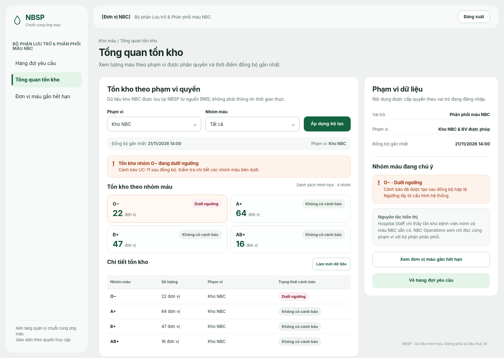
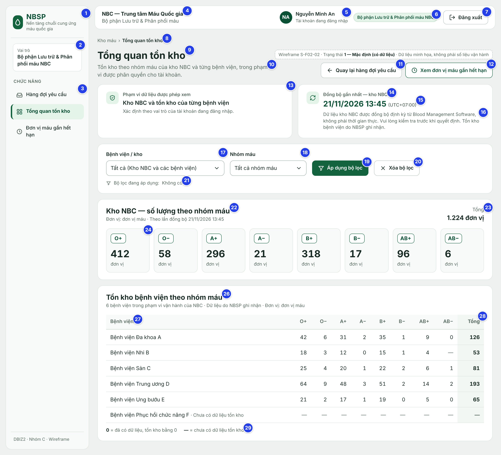
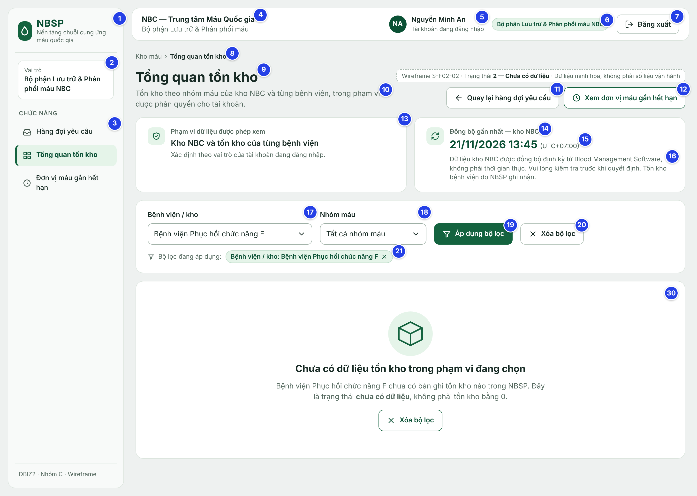
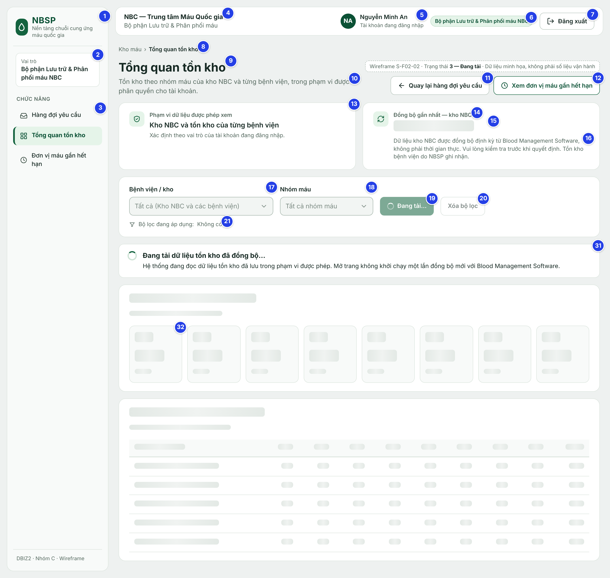
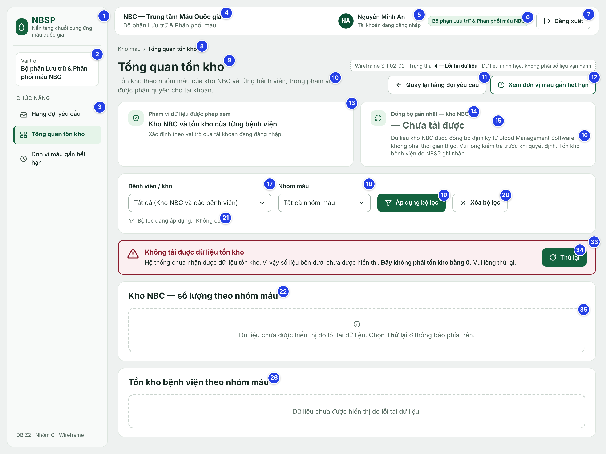
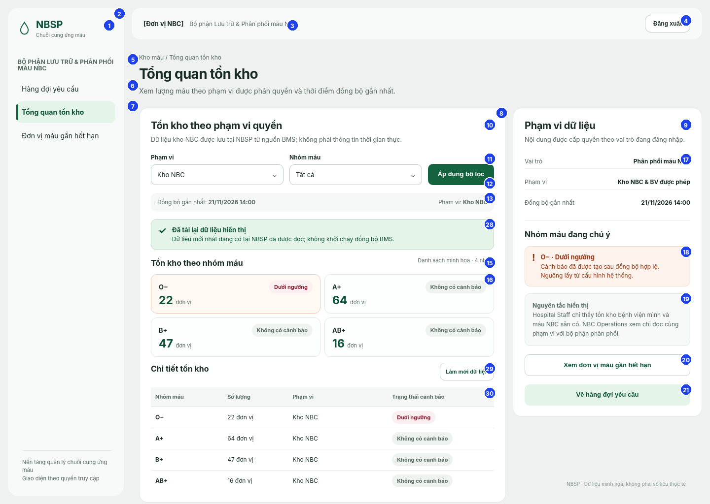

# Screen Spec: S-F02-02 Inventory dashboard

> DBIZ2 Group C, NBSP. Documentation in English; every user-facing text quoted in this spec is the Vietnamese UI copy.

| Field | Value |
|---|---|
| Screen ID | S-F02-02 |
| Screen name | Inventory dashboard (UI title "Tổng quan tồn kho") |
| Actor | Hospital Staff; NBC Blood Storage and Distribution Department; NBC Operations (read-only, same data scope as the Dept) |
| Priority | Should |
| Feature | F-02 Inventory Monitoring & Usage |
| Activity diagrams | AD-UC-09 not drawn yet ("later", usage-flow v2.3); related: AD-UC-11 (alert shown here), AD-UC-17 (snapshot and timestamp read here) |
| Mockup images | 8 frames, each with a numbered version (section 2): 5 states for the Dept, Error (permission denied), Hospital Staff and NBC Operations variants |
| Frame width | 1440px (desktop, exported at 1x). Height grows with content, minimum 1024px; Default is 1440 × 1296 |
| Figma frame | [NBSP – S-F02-02 Tổng quan tồn kho (wireframe v1.2)](https://www.figma.com/design/N6HhnBVAxExLAYNgn8tQML). The file exists; the v1.2 frames still need to be imported into it (see Changes in v1.2). Tokens still proposed, UI Conventions OQ-08 |
| Status | Reviewed draft (v1.2, 22/11/2026, wireframes redrawn; open questions in section 9) |

## 1. Purpose

**Shown when:** a signed-in user checks the blood stock position (UC-09). The content depends on the role:

- **NBC Blood Storage and Distribution Department:** Dept Flow 1, optional step between the request queue (S-F01-03) and approve and dispatch (S-F01-04); Dept Flow 2, at the start of a shift or after a below-threshold alert email (UC-11).
- **NBC Operations:** Ops Flow 2, when it wants the stock position or after a below-threshold alert email. Read-only, same data scope as the Dept.
- **Hospital Staff:** from its menu or the success state of S-F02-01 ("View inventory"); sees only its own hospital inventory and NBC available stock.

The dashboard reads the inventory snapshot stored by UC-17 (synchronisation with the Blood Management Software). It never triggers a sync itself.

**The user leaves this screen when:** the Dept opens the near-expiry list (S-F02-03) or goes back to the request queue (S-F01-03); NBC Operations opens the published forecast (S-F03-05) from its menu; Hospital Staff opens another screen of its own menu; or any user signs out (S-F04-01).

## 2. Mockup

The five state images show the **NBC Dept variant**. The permission-denied error is drawn for **Hospital Staff** (the role that can reach a forbidden scope by URL). Hospital Staff and NBC Operations each have their own Default image (section 4, role variants). All values in the images are synthetic.

**Numbered:** each number is the # of the element inventory in section 3. The badge sits to the left of the element it marks (inside the top-right corner for the sidebar), so it never covers text. Elements that appear only in one state are numbered on that state's image.

| Frame | Role | Numbered image | Element numbers shown |
|---|---|---|---|
| Default | Dept |  | 1–21, 29, 30 |
| Empty | Dept |  | 1–13, 19–21, 25, 27, 31 |
| Loading | Dept |  | 1–13, 19–23, 31 |
| Error (read failed) | Dept |  | 1–13, 19–21, 24–26, 31 |
| Error (permission denied) | Hospital Staff |  | 1–13, 19, 24, 25, 31 |
| Success | Dept |  | 1–21, 28–30 |
| Default | Hospital Staff |  | 1–13, 15–17, 19, 29, 30 |
| Default | NBC Operations |  | 1–19, 29, 30 |

| Frame | Image |
|---|---|
| Default | `img/s-f02-02-default.png` |
| Empty | `img/s-f02-02-empty.png` |
| Loading | `img/s-f02-02-loading.png` |
| Error (read failed) | `img/s-f02-02-error.png` |
| Error (permission denied) | `img/s-f02-02-error-permission.png` |
| Success | `img/s-f02-02-success.png` |
| Hospital Staff, Default | `img/s-f02-02-hospital-default.png` |
| NBC Operations, Default | `img/s-f02-02-ops-default.png` |

All colours, fonts and corners come from the design tokens in
[ui-conventions.md](../../ui-conventions.md#6-design-tokens-and-visual-conventions--proposed-for-figma).

## 3. Element inventory

| # | Element | Type | Content / data source | Required | Validation |
|---|---|---|---|---|---|
| 1 | NBSP brand | Logo | static: "NBSP", "Chuỗi cung ứng máu" | Yes | none |
| 2 | Sidebar | Navigation | role group label (for example "Bộ phận Lưu trữ & Phân phối máu NBC"), menu items for `session.role`, footer "Nền tảng quản lý chuỗi cung ứng máu / Giao diện theo quyền truy cập" | Yes | only authorised items; current item = background + left marker + bold text; no alert badge (UI Conventions OQ-03) |
| 3 | Account header | Text | `session.organisation` in brackets ("[Đơn vị NBC]" or "[Bệnh viện]") + `session.role` (Vietnamese label) | Yes | never shows another hospital |
| 4 | Đăng xuất | Secondary button | static | Yes | none |
| 5 | Breadcrumb | Text | static: "Kho máu / Tổng quan tồn kho" | Yes | "Kho máu" is a group label, not a link; links only to screens in the Screen List |
| 6 | Title | Header | static: "Tổng quan tồn kho" | Yes | |
| 7 | Subtitle | Text | static: "Xem lượng máu theo phạm vi được phân quyền và thời điểm đồng bộ gần nhất." | Yes | |
| 8 | Primary task card | Card | container for elements 10–16, 22–30 | Yes | |
| 9 | Supporting card | Card | heading "Phạm vi dữ liệu" (+ chip "Chỉ đọc" for NBC Operations); container for elements 17–21, 31 | Yes | |
| 10 | Section heading | Text | static: "Tồn kho theo phạm vi quyền" + caveat "Dữ liệu được lưu tại NBSP từ phần mềm quản lý máu (BMS); không phải thông tin thời gian thực." | Yes | |
| 11 | Phạm vi / Nhóm máu | Select (×2) | `scope` options from the role (Dept, Ops: "Kho NBC" and permitted hospitals; Hospital Staff: own hospital and "Kho NBC (sẵn có)"); `blood_group`: "Tất cả" + 8 ABO/Rh groups | Yes | options never wider than the role's scope (FR-04-03); scope select hidden only when the role has a single scope; disabled while loading |
| 12 | Áp dụng bộ lọc | Primary button | static | Yes | disabled while loading |
| 13 | Đồng bộ gần nhất | Text (bar) | left: `snapshot.source_synced_at` (`dd/MM/yyyy HH:mm`); right: current scope, or the state label ("Không có bản ghi phù hợp bộ lọc", "Phạm vi truy vấn: không xác định", "Phạm vi truy vấn: ngoài quyền truy cập") | Yes | "—" when unknown; skeleton while loading; never "thời gian thực" (FR-02-05) |
| 14 | Below-threshold banner | Banner | one per Open alert in scope: "Tồn kho nhóm máu [Nhóm máu] đang thấp hơn ngưỡng quy định." + "Kiểm tra chi tiết các nhóm máu bên dưới." | No (Dept and Ops, when an Open alert exists; also in Success) | threshold value never shown or hard-coded |
| 15 | Tồn kho theo nhóm máu | Text | static heading + count "[n] nhóm máu" | Yes when data exists | |
| 16 | Blood-type tiles | List of tiles | one tile per blood group in the result (8 when "Tất cả"): `inventory.blood_group`, `inventory.quantity`; Dept and Ops: chip "Dưới ngưỡng" (Open alert) or "Không có cảnh báo" | Yes when data exists | quantity = whole number ≥ 0 + "đơn vị"; a real 0 from data is shown as 0; chip has text, colour only supports it; no chip for Hospital Staff |
| 17 | Phạm vi dữ liệu | Text (key/value) | "Vai trò" = `session.role`; "Phạm vi" = permitted scope; "Đồng bộ gần nhất" = `snapshot.source_synced_at` | Yes (Default, Success) | |
| 18 | Alert detail | Text | heading "Nhóm máu đang chú ý"; per Open alert: "[Nhóm máu] · Dưới ngưỡng" + "Cảnh báo đang mở từ lần đồng bộ [Ngày giờ]. Ngưỡng do cấu hình hệ thống quy định." | No (Dept and Ops, when an alert applies) | no acknowledge action, no alert centre; no threshold value |
| 19 | Role-scope note | Text | heading "Nguyên tắc hiển thị" + static text per role (see below) | Yes | |
| 20 | Xem đơn vị máu gần hết hạn | Secondary button | static | Dept only, all states | hidden for Hospital Staff and NBC Operations (UC-10 is Dept only) |
| 21 | Về hàng đợi yêu cầu | Tonal button | static | Dept only, all states | other roles see their own menu instead |
| 22 | Skeleton | Placeholder | static grey tiles (8) and table rows | No (Loading only) | no numbers or alert status while pending |
| 23 | Loading banner | Banner (`role="status"`) | "Đang tải dữ liệu tồn kho" + "Hệ thống đang đọc dữ liệu đã lưu và kiểm tra phạm vi truy cập." | No (Loading only) | |
| 24 | Error banner | Banner (`role="alert"`) | read failed: "Không tải được dữ liệu tồn kho" + "Không xác định được kết quả truy vấn. Không hiển thị 0 thay cho dữ liệu chưa tải."; permission denied: "Tài khoản không có quyền truy cập nội dung này." + "Phạm vi được yêu cầu nằm ngoài quyền của vai trò đang đăng nhập." | No (Error only) | never shown as 0 stock |
| 25 | Result panel | Text + icon | Empty: "Không có dữ liệu phù hợp với bộ lọc hiện tại." + "Hãy thay đổi bộ lọc hoặc thử lại. Kết quả trống không có nghĩa là tồn kho bằng 0."; Error: "Chưa thể hiển thị tồn kho" + "Truy vấn dữ liệu đã lưu bị lỗi. Bản đồng bộ từ BMS không bị thay đổi; vui lòng thử tải lại."; permission denied: "Không hiển thị dữ liệu" + "Hãy chọn một phạm vi trong quyền của bạn ở bộ lọc phía trên." | No (Empty, Error) | Empty and Error use different text |
| 26 | Thử tải lại | Primary button | static | No (Error read failed only) | re-reads the stored snapshot, not a BMS sync; not shown for permission denied |
| 27 | Xóa bộ lọc | Secondary button | static | No (Empty only) | resets to the role's default scope only |
| 28 | Re-query success banner | Banner (`role="status"`) | "Đã tải lại dữ liệu hiển thị" + "Đã đọc lại bản lưu mới nhất trên NBSP; không khởi chạy đồng bộ BMS." | No (Success only) | shown only after the read completes |
| 29 | Làm mới dữ liệu | Secondary button | static | Yes (Default, Success) | re-reads the stored snapshot, not a BMS sync; hidden in Loading, Empty and Error |
| 30 | Chi tiết tồn kho | Table | heading "Chi tiết tồn kho"; columns "Nhóm máu", "Số lượng", "Phạm vi", "Trạng thái cảnh báo" | Yes when data exists | unit "đơn vị"; read-only rows; alert column hidden for Hospital Staff |
| 31 | State note | Text (supporting card) | replaces 17–18 when there is no data: Loading "Đang đọc dữ liệu tồn kho đã lưu trên NBSP; không gọi đồng bộ BMS."; Empty "Không tìm thấy bản ghi phù hợp bộ lọc. Thay đổi phạm vi hoặc nhóm máu để kiểm tra."; Error "Chưa hiển thị tồn kho vì truy vấn thất bại. Không suy luận giá trị 0 từ lỗi tải dữ liệu."; permission denied "Không hiển thị dữ liệu ngoài phạm vi quyền của tài khoản." | No (Loading, Empty, Error) | |

**Element 19 text per role:**

- Dept: "Bạn xem kho NBC và tồn kho các bệnh viện được cấp quyền. Số liệu là bản đồng bộ gần nhất, không phải thời gian thực."
- NBC Operations: "Chế độ chỉ đọc: cùng phạm vi dữ liệu với Bộ phận Phân phối, không có thao tác xử lý hay chuyển sang danh sách gần hết hạn."
- Hospital Staff: "Bạn chỉ xem tồn kho của bệnh viện mình và lượng máu NBC sẵn có; không xem được bệnh viện khác."

## 4. States

| State | What the user sees | Trigger |
|---|---|---|
| Default | Tiles (one per blood group) and table for the role's scope, "Đồng bộ gần nhất" timestamp; for NBC roles, the below-threshold banner, a "Dưới ngưỡng" chip on the affected tile and row, and the alert detail. The mockup shows the Dept with an Open alert on O−. | Screen opened, authorised query returned data |
| Empty (no data) | "Không có dữ liệu phù hợp với bộ lọc hiện tại." with "Xóa bộ lọc"; latest known timestamp still shown; no tiles and no 0 values; state note in the supporting card | Filtered query succeeded with no matching records |
| Loading | Loading banner, skeleton tiles and rows; selects and "Áp dụng bộ lọc" disabled; "Làm mới dữ liệu" hidden; Dept navigation buttons stay available | Query pending |
| Error | Read failed: "Không tải được dữ liệu tồn kho" with "Thử tải lại"; timestamp "—"; no values, never a false 0. Permission denied: "Tài khoản không có quyền truy cập nội dung này." with no data and no retry; the user picks a permitted scope from the filter (FR-04-03) | Read query failed, or the role has no access to the requested scope |
| Success / confirmation | Updated tiles and table, "Đã tải lại dữ liệu hiển thị"; the below-threshold banner stays while the alert is Open; timestamp stays the snapshot time | "Làm mới dữ liệu" or "Thử tải lại" read completed |

**Role variants (same Screen ID, not new screens):**

- **Hospital Staff** (`img/s-f02-02-hospital-default.png`): own hospital inventory, or NBC available stock through the scope select ("Kho NBC (sẵn có)"); never another hospital; no below-threshold banner, chip, alert column or alert detail (UC-11 goes to the Dept and NBC Operations only); no elements 20–21.
- **NBC Operations** (`img/s-f02-02-ops-default.png`): same data as the Dept, read-only ("Chỉ đọc" chip on the supporting card); banner and chips shown; no elements 20–21; menu "Tổng quan tồn kho", "Dự báo đã duyệt".
- **Failed BMS sync:** not a dashboard error. UC-17 keeps the previous snapshot; the screen may show "Dữ liệu tồn kho được đồng bộ gần nhất lúc [Ngày giờ]. Vui lòng kiểm tra trước khi quyết định." (no image yet).

## 5. Interactions and navigation

| # | Element | User action | System response | Goes to screen |
|---|---|---|---|---|
| 1 | Menu item or alert email link | open | Checks session and role, queries the permitted scope (Loading, then Default, Empty or Error) | stays; S-F04-01 first if not signed in |
| 2 | Phạm vi / Nhóm máu + Áp dụng bộ lọc | select, tap | Re-queries inside the role's scope | stays (Loading, then Default, Empty or Error) |
| 3 | Làm mới dữ liệu | tap | Re-reads the stored snapshot; no BMS sync | stays (Loading, then Success, Empty or Error) |
| 4 | Thử tải lại | tap (Error, read failed) | Re-runs the same query | stays (Loading, then Success, Empty or Error) |
| 5 | Xóa bộ lọc | tap (Empty state) | Restores the role's default filters and re-queries | stays |
| 6 | Below-threshold banner or "Dưới ngưỡng" chip | read | Nothing; no acknowledge action | stays |
| 7 | Xem đơn vị máu gần hết hạn | tap (Dept) | Opens the near-expiry list | S-F02-03 |
| 8 | Về hàng đợi yêu cầu | tap (Dept) | Opens the request queue | S-F01-03 |
| 9 | Menu "Dự báo đã duyệt" | tap (NBC Operations) | Opens the published forecast | S-F03-05 |
| 10 | Menu items | tap (Hospital Staff) | Opens the chosen screen | S-F01-01, S-F01-02, S-F02-01, S-F03-01 or S-F03-03 |
| 11 | Đăng xuất | tap | Ends the session | S-F04-01 |

## 6. Screen-level rules

| Rule ID | Rule | Source |
|---|---|---|
| SR-001 | Three roles share S-F02-02; data, filters and actions depend on the signed-in role. The NBC Forecasting Analyst has no access. | Use Case Diagram (UC-09); UI Conventions §0, OQ-02 |
| SR-002 | Hospital Staff sees only its own hospital and NBC available stock, never another hospital; the backend enforces this, also on direct URL or API calls (permission-denied error). | FR-04-03; BR-06 |
| SR-003 | NBC Operations is read-only with the Dept's data scope and has no link to S-F02-03. | UI Conventions OQ-02; Use Case Diagram (UC-10 = Dept) |
| SR-004 | The screen shows the source sync time of the stored snapshot and never claims real-time data. | FR-02-02; FR-02-05; UI Conventions §3 |
| SR-005 | "Làm mới dữ liệu" and "Thử tải lại" only re-read the stored snapshot; they never start a BMS sync (UC-17 runs on a schedule). | FR-02-05; Usage Flow (UC-17 started by Time) |
| SR-006 | The UC-11 alert reaches the Dept and NBC Operations by email; inside NBSP it shows only as the banner, the "Dưới ngưỡng" chip and the alert detail here, with no menu badge and no alert screen. The banner stays in Success while the alert is Open. | UI Conventions OQ-03; FR-02-04 |
| SR-007 | One Open alert per below-threshold episode; it resolves when stock recovers. The threshold is set at deployment and never shown or edited here. | AD-UC-11; UI Conventions OQ-07 |
| SR-008 | Empty is not zero stock, Error is not Empty, and Success is shown only after the read completes. A real quantity of 0 returned by the query is shown as "0 đơn vị". | UI Conventions §2.2, §3.1, §4.1 |

## 7. Linked requirements

| FR ID | What this screen does for it |
|---|---|
| FR-02-02 | Displays the role-scoped inventory with filters and the latest sync time |
| FR-02-04 | Displays the Open below-threshold alert as a banner, a "Dưới ngưỡng" chip and the alert detail (email is sent outside this screen) |
| FR-02-05 | Reads the stored snapshot and its source timestamp; does not change the scheduled sync |
| FR-04-03 | Shows only data and actions allowed for the signed-in role; refuses out-of-scope requests |

## 8. Responsive and accessibility notes

- Standard frame width 1440 px; minimum height 1024 px, longer content scrolls vertically; no mobile design in release 1 (UI Conventions §2.1).
- Tab order: menu → Đăng xuất → Phạm vi → Nhóm máu → Áp dụng bộ lọc → state action (Xóa bộ lọc or Thử tải lại) → Làm mới dữ liệu → table → Dept-only actions. Tiles are read-only and not focusable.
- Below-threshold state uses text ("Dưới ngưỡng") plus colour, never colour alone; quantities always carry "đơn vị".
- Error banner `role="alert"`; loading and re-query success `role="status"`.
- Body text contrast at least 4.5:1; targets at least 24 × 24 px, buttons 40–44 px.

## 9. Open questions

| # | Question | Blocking? | Status |
|---|---|---|---|
| 1 | [NEEDS CLARIFICATION: which backend fields separate NBC available stock from hospital stock, and what is the role-scoped aggregation schema?] | For coding | Open. Logical names used in section 3 until the API contract exists. |
| 2 | [NEEDS CLARIFICATION: Screen List says Should, W1 FR-02-02 says Must. Which one sets release scope?] | Scope planning | Open. Kept as Should (Screen List). |
| 3 | [NEEDS CLARIFICATION: is there an approved age after which the snapshot is shown as out of date?] | No | Open. Default: show the timestamp only. |
| 4 | [NEEDS CLARIFICATION: default selection and pagination when the Dept can see many hospitals?] | No | Open. Mockup default: "Kho NBC". |
| 5 | [NEEDS CLARIFICATION: which fields are in the Open-alert payload for the banner and alert detail?] | For coding | Open. Do not show a threshold value. |
| 6 | usage-flow v2.3 still says the UC-11 channel is "to confirm" and lists only the Dept as recipient under "Use cases without a flow". | No | Open. UI Conventions OQ-03 (email to Dept and NBC Operations) is followed here; update usage-flow. |
| 7 | usage-flow v2.3 says Hospital Staff "has no dashboard flow of its own yet". | No | Open. Entry for Hospital Staff taken from the Screen List (menu, S-F02-01 success). |
| 8 | The second line of banners, the result panels and element 31 are new helper copy, and the banner drops "Xem tổng quan tồn kho." (an email link, pointless on this screen). | No | Open. Images v1.2 use the UI Conventions §4.2 primary messages; add the helper lines to the message library or shorten them. |
| 9 | The Hospital Staff sidebar labels in `s-f02-02-hospital-default.png` ("Tạo yêu cầu máu", "Yêu cầu của bệnh viện", "Ghi nhận sử dụng máu", "Dữ liệu dự báo", "Kết quả dự báo") are working names. | No | Open. Check against the Screen List names of S-F01-01, S-F01-02, S-F02-01, S-F03-01, S-F03-03. |

## Changes in v1.2 (22/11/2026)

- Wireframes redrawn: 8 frames + 8 numbered versions. Added the permission-denied error and the Hospital Staff and NBC Operations variants, which had no image before.
- Numbered badges moved beside the elements, so they no longer cover "Đăng xuất", the account header or the sync bar; title (6) and subtitle (7) are now numbered on the right lines.
- Tiles and table show all 8 ABO/Rh groups, not 4.
- Success keeps the below-threshold banner while the alert is Open (it disappeared before, against SR-006).
- Element 20 now stays visible in Loading and Error for the Dept (navigation does not need inventory data); "Áp dụng bộ lọc" and the selects are drawn disabled while loading.
- Internal ID "UC-11" removed from the UI copy; Empty and Error texts aligned with the message library (OQ-8 updated).
- New element 31 (state note in the supporting card), which was visible in the old images but missing from the inventory; breadcrumb, subtitle and element 19 text made explicit.
- Figma file created and linked. The Figma MCP Starter-plan call limit was reached right after the file was created, so the frames are not inside it yet: drag the 16 PNGs from `img/` into the file (one frame per image, named as the file) or rebuild them when the limit resets.

---

## Completion checklist

- [x] The mockup is a separate cropped image file, named with the Screen ID, at the frame width.
- [x] The numbered image exists, and its numbers match the # column of the element inventory.
- [x] Every visible element in the mockup appears in the element inventory.
- [ ] Every colour in the mockup is a design token from ui-conventions.md. *(Tokens are still proposed, UI Conventions OQ-08.)*
- [x] Every input element has a validation rule or an explicit "none".
- [x] All five states are filled in.
- [x] Every navigation target is a Screen ID that exists in the Screen List.
- [ ] Every element that displays data names the field it displays. *(Logical names only, open question 1.)*
- [ ] Every linked FR exists in the Function List, and every action of this screen in AD-UC-09 is
      covered by an interaction row. *(AD-UC-09 is not drawn yet; recheck when it exists.)*
- [ ] The Figma file holds the v1.2 frames. *(File linked; frames still to import.)*
