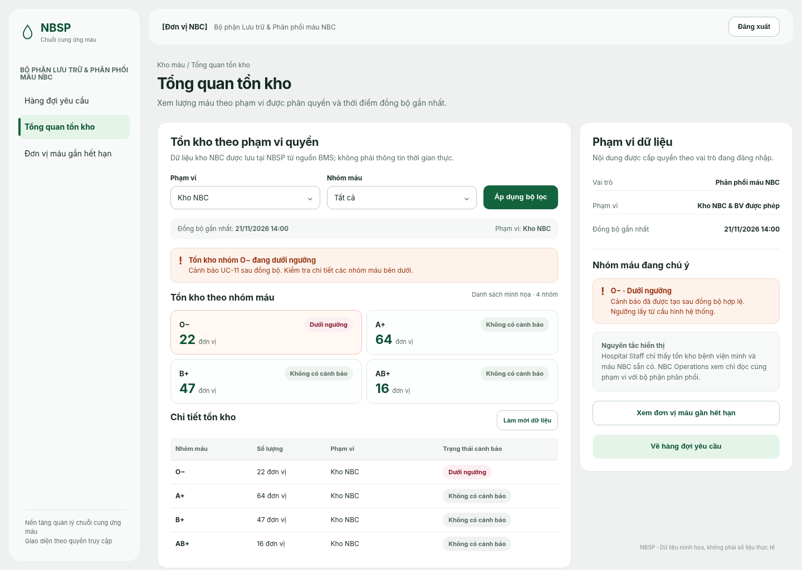
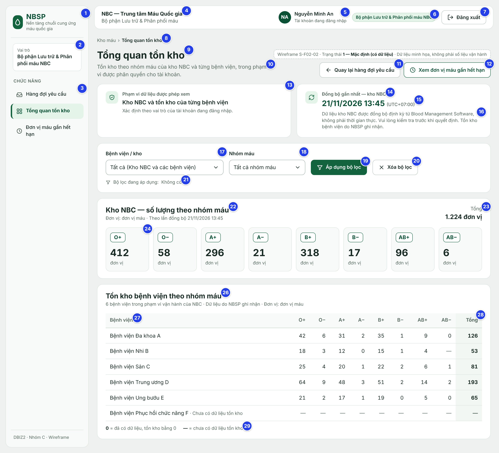
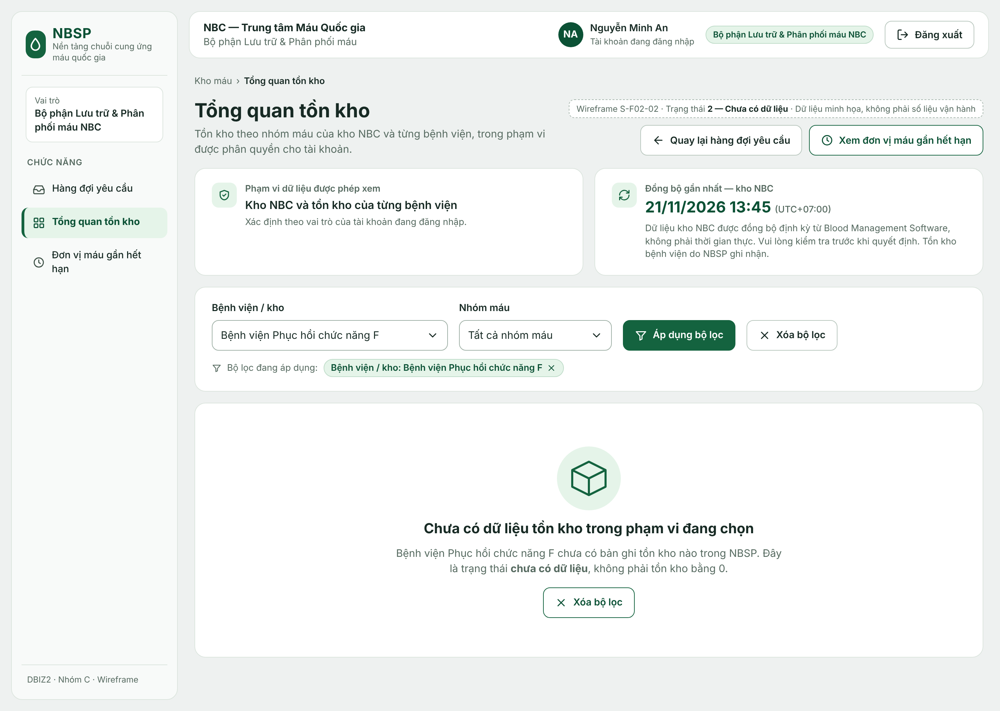
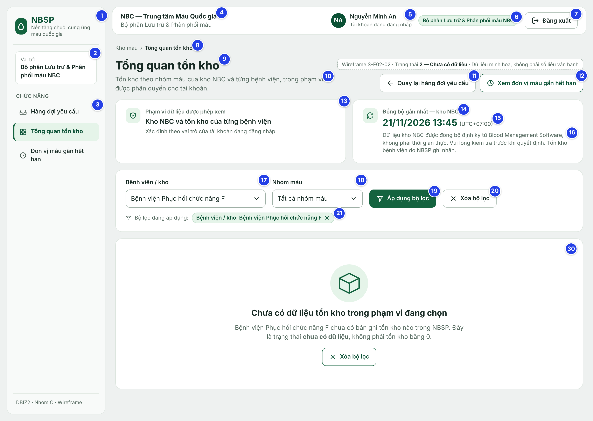
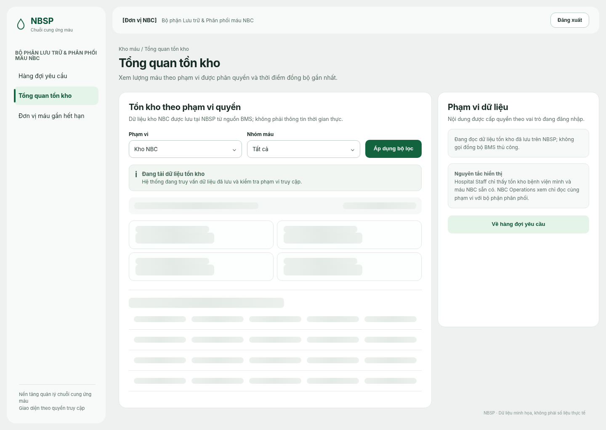
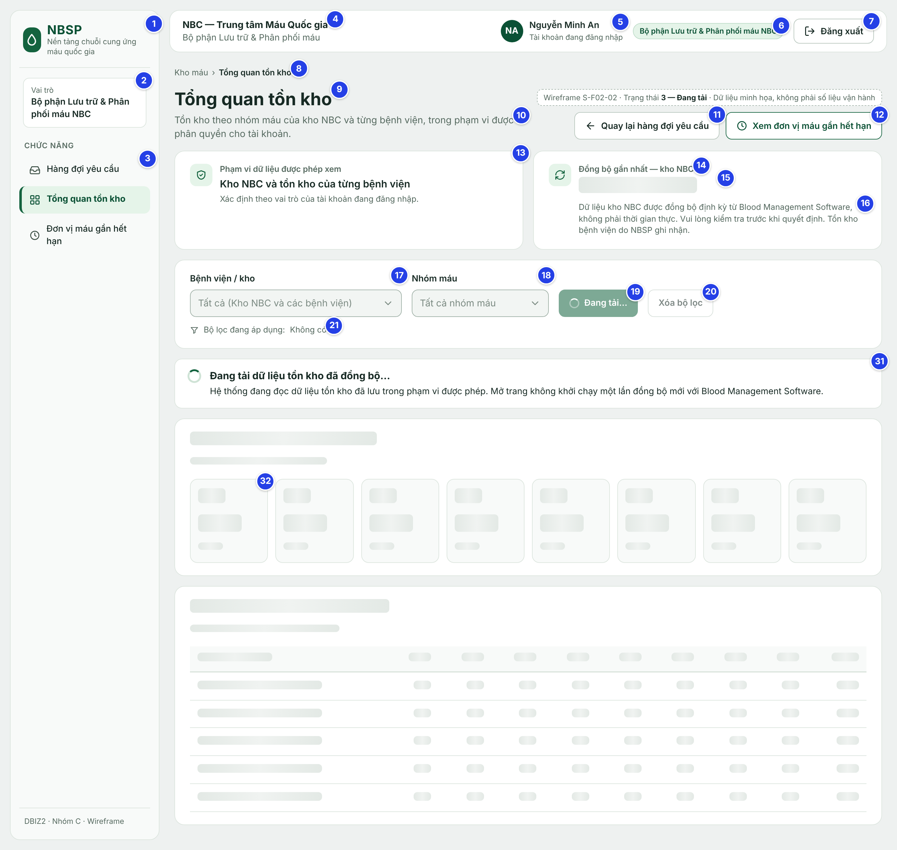
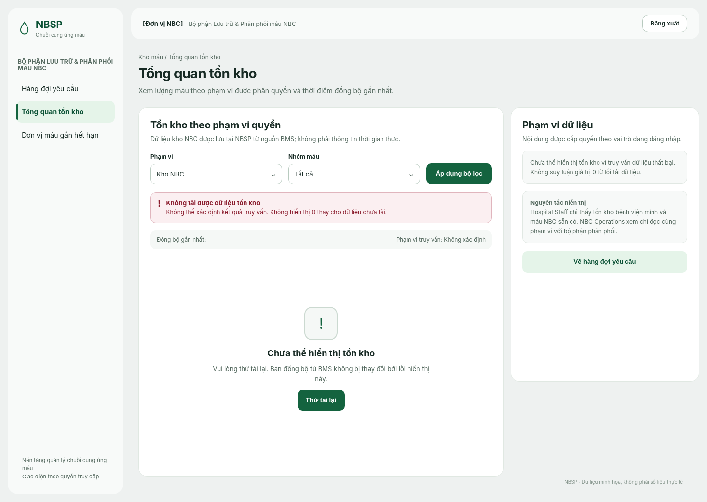
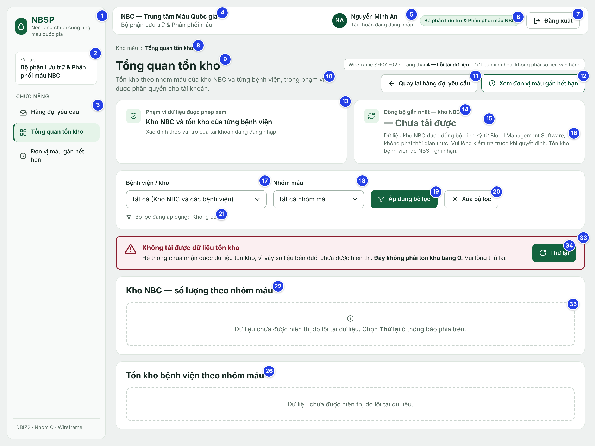
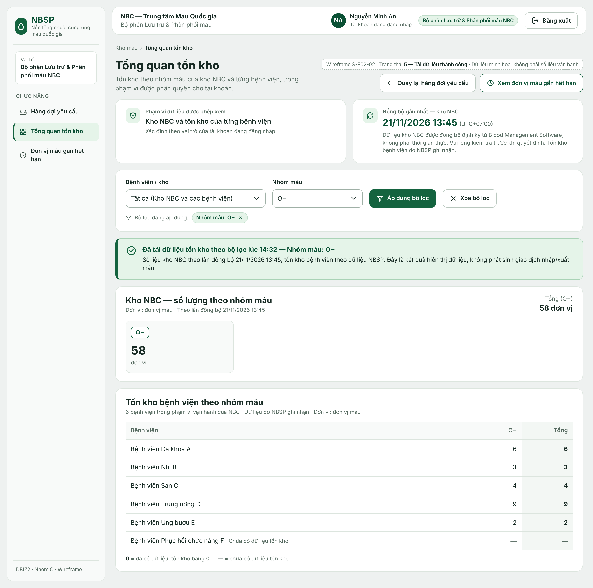
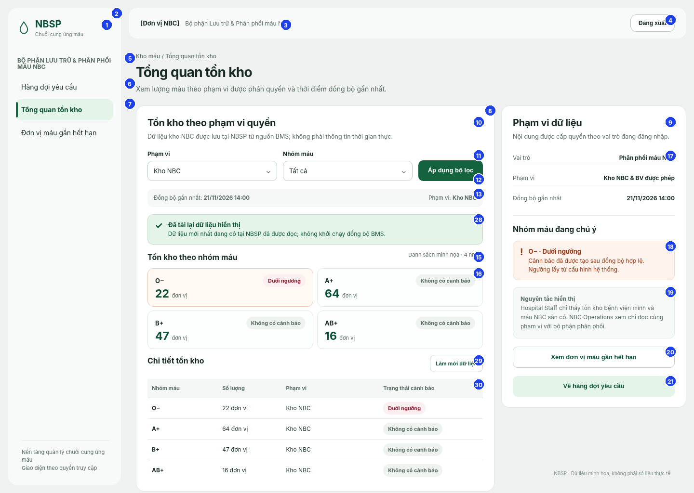

# Screen Spec: S-F02-02 Inventory Dashboard

| Field | Value |
|---|---|
| Screen ID | `S-F02-02` |
| Screen name | Inventory Dashboard (Vietnamese UI title: **“Tổng quan tồn kho”**) |
| Actor | Hospital Staff; NBC Blood Storage and Distribution Department; NBC Operations |
| Priority | **Should** (Screen List; function priorities are kept separate) |
| Feature | F-02 Inventory Monitoring & Usage |
| Use cases / FRs | UC-09 · FR-02-02; UC-11/FR-02-04 alert display; supporting FR-02-05 and FR-04-03 |
| Activity / sequence | [`SD-UC-09`](../../../use-case/SD-UC-09.md), [`SD-UC-11`](../../../use-case/SD-UC-11.md), [`SD-UC-17`](../../../use-case/SD-UC-17.md), [`AD-UC-11`](../../../activity/AD-UC-11.md), [`AD-UC-17`](../../../activity/AD-UC-17.md) |
| Usage flow | Hospital menu / Hospital Flow 2; NBC Dept Flow 1 or 2; NBC Operations Flow 2; [`usage-flow.md`](../usage-flow.md) v2.3 |
| Design references | [UI Conventions](../../ui-conventions.md) · canonical [S-F01-01](../s-f01-01/screen-spec-s-f01-01.md) (layout only) |
| Screen List | [`screen-list.md`](../../screen-list.md) |
| Frame size | **1440 × 1024 px**, desktop, 1×; additional content scrolls vertically in implementation |
| Language | **Documentation: English; user-facing application/UI copy: Vietnamese** |
| Artefacts | **5 normal PNG + 5 numbered PNG**, `img/s-f02-02-*.png` |
| Version / status | **v1.0, 21/11/2026 — Reviewed draft**, pending listed Open Questions |
## 1. Purpose

**Shown when:** an authorised Hospital Staff, NBC Blood Storage and Distribution Department, or NBC Operations user opens the shared dashboard (`UC-09`). NBSP checks role and scope before querying/aggregating stored inventory (FR-02-02, SD-UC-09). The illustrated five PNGs show **NBC Dept** as the reference variant; other roles use **the same Screen ID with their own scoped content/menu**, not new screens.

**Role differences:** Hospital Staff may see **only their own hospital inventory and NBC available stock**; other hospitals must never appear. NBC Dept sees NBC inventory plus authorised hospital inventories. NBC Operations sees the **same inventory data scope as the Dept, read-only**; it cannot access UC-10 via this role. Backend enforces these rules even on direct URL/API access (FR-04-03, BR-06).

**Alert + freshness:** UC-17 periodically reads BMS inventory and stores a snapshot with source timestamp; a failed sync keeps the previous snapshot (FR-02-05). After successful sync, UC-11 compares configured thresholds and sends **email** to NBC Dept and NBC Operations. In NBSP, the dashboard shows a **banner and “Dưới ngưỡng” label on affected blood-type tiles**, with **no badge on the navigation menu** (project UI Conventions OQ-03). One Open alert per low-stock episode; recovery resolves it. A dashboard “Làm mới dữ liệu” action **re-queries the stored NBSP snapshot**, not an on-demand BMS sync.

**Exit:** NBC Dept can use “Xem đơn vị máu gần hết hạn” → `S-F02-03`, “Về hàng đợi yêu cầu” → `S-F01-03`, or sign out. NBC Operations navigates to its forecast screen `S-F03-05`; Hospital Staff navigates through its own menu, never to Dept-only screens.

## 2. Mockup

**Layout:** same NBSP outer shell as S-F01-01: left role-scoped sidebar, NBSP identity, account + sign-out top bar, breadcrumb, Vietnamese heading and subtitle, two white task/support cards. Business contents are intentionally screen-specific. **No HuyếtMạch rebrand, analytics KPI strip, invented global search, avatar card or extra Screen ID.** The numbers on the blue circles map directly to the Element Inventory below. The frame contains synthetic display values only.

| State | Original image | Numbered image | Element numbers shown |
|---|---|---|---|
| **Default** |  |  | 2,1,3,4,5,6,7,8,10,11,12,13,14,15,16,29,30,9,17,18,19,20,21 |
| **Empty** |  |  | 2,1,3,4,5,6,7,8,10,11,12,13,25,27,9,19,20,21 |
| **Loading** |  |  | 2,1,3,4,5,6,7,8,10,11,12,23,13,22,9,19,21 |
| **Error** |  |  | 2,1,3,4,5,6,7,8,10,11,12,24,13,25,26,9,19,21 |
| **Success** |  |  | 2,1,3,4,5,6,7,8,10,11,12,13,28,15,16,29,30,9,17,18,19,20,21 |

**State intent:** **Default** — NBC Dept inventory, open O− below-threshold banner and per-blood-type badge · **Empty** — authorised filter succeeds with no matching data; not zero stock · **Loading** — snapshot query pending, with skeletons and no unverified totals · **Error** — inventory read fails; no false zero and a Retry action · **Success** — re-query succeeded against the stored NBSP snapshot, not a manual BMS sync.

## 3. Element inventory

### 3.1. Shared page frame (all states)

| # | Element | Type | Content / source | Required | Behaviour / validation |
|---:|---|---|---|---|---|
| 1 | NBSP brand | Logo and name | “NBSP”, “Chuỗi cung ứng máu” | Yes | Same brand and proportions as `S-F01-01`. |
| 2 | Role-aware sidebar | Navigation | Only the menu items authorised for the current actor | Yes | Active item has background, left indicator, bold text; no alert badge on the menu. |
| 3 | Account header | Session summary | Organisation from session and Vietnamese role | Yes | Never reveal another hospital's identity or data. |
| 4 | Đăng xuất | Secondary button | Sign-out action | Yes | Ends session → `S-F04-01`. |
| 5 | Breadcrumb | Text / authorised links | Vietnamese hierarchy; links only to existing screens | Yes | No fabricated home screen. |
| 6 | Screen heading | H1 | Vietnamese UI title | Yes | Corresponds to the Screen List. |
| 7 | Screen subtitle | Description | One sentence describing the current task | Yes | No premature confirmation of an action. |
| 8 | Primary task card | Rounded white card | List/table and controls for the current use case | Yes | Reuses the visual shell, typography and spacing of `S-F01-01`. |
| 9 | Supporting card | Rounded white card | Details, guidance or related action | Yes | Relevant to actor; may have contextual placeholders. |

### 3.2. Dashboard elements (illustrated NBC Dept role)

| # | Element | Type | UI copy / logical source | Required | Behaviour / validation |
|---:|---|---|---|---|---|
| 10 | “Tồn kho theo phạm vi quyền” | Heading + description | Authorised NBC/hospital data, snapshot caveat | Yes | Dashboard is read-only; no manual BMS write. |
| 11 | Phạm vi / Nhóm máu | Select filters | `scope`, `blood_group` (logical names; API TBD) | If authorised | Scope options constrained by role; filtering never broadens access. |
| 12 | Áp dụng bộ lọc | Query button | Applies chosen view/scope | Yes | Loading/Empty/Error based on response; does not modify inventory. |
| 13 | Đồng bộ gần nhất strip | Read-only | BMS source timestamp from stored snapshot | When data returned | Distinguish source sync time from web query time; “—” when unknown. |
| 14 | Dưới-ngưỡng banner | Warning banner | “Tồn kho nhóm O− đang dưới ngưỡng”; triggered alert payload | If Open alert in scope | Shown to Dept/Ops, no menu badge; threshold not hard-coded. |
| 15 | Tồn kho theo nhóm máu title | Section heading | Summary by blood type | If data exists | Only the selected role/data scope. |
| 16 | Blood-type tiles | Data summary tiles + chip | ABO/Rh + stock quantity + “Dưới ngưỡng” on affected type | If data exists | Values are illustrative; chips have text and colour. Do not invent threshold value. |
| 17 | Phạm vi dữ liệu details | Support card | Current role, permitted data scope, latest sync | Default/Success | Explicit role permission; not a separate role settings screen. |
| 18 | Alert detail in support card | Warning note | Open alert for O− from UC-11 | If alert applies | Shows Open condition; not an alert centre or acknowledgement. |
| 19 | Role-scoping explanation | Support text | Hospital own inventory only; NBC Ops read-only | All states | Supports UX only; backend must enforce permissions. |
| 20 | Xem đơn vị máu gần hết hạn | Navigation button | Opens `S-F02-03` | **NBC Dept only** | Hide for Hospital Staff / NBC Operations (UC-10 limited to Dept). |
| 21 | Về hàng đợi yêu cầu | Navigation | Opens `S-F01-03` | **NBC Dept only** | In other roles replace with their authorised menu. |
| 22 | Inventory skeleton tiles | Skeleton | Loading placeholders | Loading | No fabricated number/alert status during pending query. |
| 23 | Loading banner | `role="status"` | “Đang tải dữ liệu tồn kho” | Loading | Query pending; filters disabled if needed. |
| 24 | Loading failure banner | `role="alert"` | “Không tải được dữ liệu tồn kho” | Error | Never interpret this as 0 stock. |
| 25 | Empty / error result area | State-specific panel | Empty has no matching filtered records; error has no reliable result | Empty / Error | Different explanatory text and action. |
| 26 | Thử tải lại | Primary button | Retry current authorised query | Error | Re-query NBSP snapshot, not UC-17 BMS synchronisation. |
| 27 | Xóa bộ lọc | Secondary button | Reset allowed filters | Empty | Show broader *authorised* scope only. |
| 28 | Re-query success banner | `role="status"` | “Đã tải lại dữ liệu hiển thị” | Success | Successful read only; no inventory mutation. |
| 29 | Làm mới dữ liệu | Secondary button | Re-fetch currently stored snapshot | Default/Success | No fresh sync trigger. |
| 30 | Chi tiết tồn kho table | Read-only table | Blood group, quantity, scope, Open-alert label | Default/Success | Units in `đơn vị`, complete labels, no mutating rows. |

## 4. States

| State | Trigger | Displayed result | Data effect |
|---|---|---|---|
| Default | Authorised query returns records, one blood type has an Open below-threshold alert | Tiles, table, latest sync timestamp, warning banner and matching “Dưới ngưỡng” badge | None; snapshot read only. |
| Empty | Filtered query succeeds with no matching records | “Không có dữ liệu tồn kho phù hợp” and “Xóa bộ lọc”; latest known source timestamp shown | None; **no inference of zero stock**. |
| Loading | Authorised query is pending | Skeleton values and disabled/blocked data-dependent actions | None. |
| Error | Read query fails or permissions are denied | No inventory values; no fabricated zero, reason and retry if retryable | None; background BMS snapshot not modified. |
| Success | “Làm mới dữ liệu” re-query completed | Updated view and “Đã tải lại dữ liệu hiển thị”; source timestamp remains tied to snapshot | None; **not** UC-17 synchronisation. |

**Alternates within the same Screen ID:** a Hospital variant displays its own inventory plus NBC available stock only; an NBC Operations variant has Dept-equivalent data, read-only, and **no** Dept-only UC-10 navigation. A source BMS sync failure is **not automatically a dashboard-read failure**: UC-17 preserves the previous snapshot and timestamp; an out-of-date warning can be shown. Uncertainty around a view query is not a stock value.

## 5. Interactions and navigation

| # | Action | System response | Target |
|---:|---|---|---|
| 1 | Open from authorised menu / UC-11 email link | Check session and role; query permitted scope; display source timestamp | `S-F02-02`, otherwise `S-F04-01` first |
| 2 | Change Phạm vi / Nhóm máu, press “Áp dụng bộ lọc” | Re-query within role boundary | Stays (`Loading` → `Default`/`Empty`/`Error`) |
| 3 | “Làm mới dữ liệu” or “Thử tải lại” | Re-read NBSP stored data, not BMS API | Stays (`Loading` → `Success`/`Empty`/`Error`) |
| 4 | “Xóa bộ lọc” | Restore authorised default values | Stays |
| 5 | Read “Dưới ngưỡng” tile/banner | Display active alert in scope; no acknowledgement or alert-centre action | Stays |
| 6 | NBC Dept “Xem đơn vị máu gần hết hạn” | Open near-expiry list | `S-F02-03` |
| 7 | NBC Dept “Về hàng đợi yêu cầu” | Return to queue | `S-F01-03` |
| 8 | NBC Operations “Dự báo đã duyệt” | View published forecast | `S-F03-05` |
| 9 | Hospital own navigation | Authorised menu routes | `S-F01-01`, `S-F01-02`, `S-F02-01`, `S-F03-01`, `S-F03-03` |
| 10 | Sign out | Clear session | `S-F04-01` |

## 6. Screen-level rules

| ID | Rule | Source |
|---|---|---|
| SR-09-01 | Three roles share `S-F02-02`; filters, data and navigation depend on actor and backend scope. | Screen List; FR-02-02; FR-04-03; SD-UC-09 |
| SR-09-02 | Hospital Staff: only own hospital + NBC available stock, never another hospital. | SD-UC-09; BR-06 |
| SR-09-03 | NBC Operations is read-only with Dept-equivalent inventory scope; no UC-10 link. | UI Conventions OQ-02; UC-10 actor |
| SR-09-04 | Show latest **source sync timestamp** for NBC BMS snapshot; no “real time” claim. | FR-02-02; FR-02-05 |
| SR-09-05 | An invalid BMS sync preserves old snapshot and does not trigger threshold recheck. | FR-02-05; AD-UC-17 |
| SR-09-06 | UC-11 sends email to Dept and Ops; in-app only banner + per-type “Dưới ngưỡng” badge, no menu badge. | UI Conventions OQ-03; FR-02-04 |
| SR-09-07 | One Open alert per below-threshold episode; recovered stock resolves it; threshold configured at deployment. | AD-UC-11; W0 scope |
| SR-09-08 | Query refresh is read-only and **does not initiate BMS sync**. | FR-02-05 (scheduled only); UI affordance |
| SR-09-09 | Empty ≠ zero inventory; Error ≠ empty; Success requires completed read query. | UI Conventions §2–4 |

## 7. Linked requirements

| Requirement | Screen responsibility |
|---|---|
| FR-02-02 | Role-authorised inventory query, scope/blood-group filters, latest sync timestamp. |
| FR-02-04 / UC-11 | Display banner plus per-type badge for Open alert; email is delivered outside this screen. |
| FR-02-05 / UC-17 | Consume stored snapshot/timestamp; background synchronisation unchanged by dashboard query. |
| FR-04-03 / BR-06 | Protect hospital, Dept and NBC Operations scopes. |
| UC-10 | Dept-only navigational handoff to S-F02-03; no near-expiry calculation here. |

## 8. Desktop and accessibility notes

- 1440 × 1024 px PNGs, same NBSP shell as S-F01-01; vertical overflow scrolls in production.
- Focus: menu → filters → query → tiles/table → Dept-only related actions → sign out. Use accessible data table headings, source-time labels and `đơn vị` suffix.
- Error `role="alert"`; loading/re-query success `role="status"`. All below-threshold states use **text plus coloured badge**, never colour alone. Standard text contrast ≥4.5:1; target sizes ≥24 px, preferably 40–44 px.
- UI screenshots are the **NBC Dept variant** only, because a full five-state gallery for all three roles would be separate actor variants of the same screen. The Screen Spec remains explicit about Hospital/Ops differences.

## 9. Mockup corrections and source consistency

| Finding | Applied correction |
|---|---|
| Repository `main` has no `screens/s-f02-02` directory at review time | Created canonical folder and screen spec as planned in Screen List. |
| Past inventory sketches placed search/KPI header unlike S-F01-01 | Uses the same two white business cards, sidebar, account bar and breadcrumb; no fake global search. |
| Some W1/AD texts say “in-app badge” | Interpreted using **current project UI Conventions**: banner + affected blood-type tile label; **no navigation badge**. |
| BMS freshness conflated with Reload button | Re-query vs periodic external sync now explicit. |
| Hospital and Ops were mistakenly omitted in old designs | Listed both, with role-specific data and read-only limitations; no new Screen ID. |

## 10. Open questions

| ID | Question | Blocking? | Status |
|---|---|---|---|
| OQ-09-01 | Which backend inventory fields correspond to NBC available stock vs hospital stock; exact role-scoped aggregation schema? | For coding | Contract TBD; UI does not fabricate hospital access. |
| OQ-09-02 | Screen List priority `Should` vs W1 FR-02-02 priority `Must` — which controls release scope? | Scope planning | **Unresolved conflict**, kept without editing sources. |
| OQ-09-03 | How is stale-snapshot age displayed, and is there any approved freshness threshold? | No | Show timestamp only; do not hardcode staleness threshold. |
| OQ-09-04 | Default selection / list pagination when NBC can see many hospitals? | No | UX/backend implementation to confirm. |
| OQ-09-05 | Which fields are present in the Open-alert payload for tile/banner details? | For binding | Do not invent numerical alert thresholds. |

### Implementation invariants (all states)

- **Server authority:** database records and status transitions are controlled by the backend, not a badge, button, ETA, filter or mockup.
- **Confidentiality:** scoped data must be enforced by the backend (`FR-04-03`, BR-06), not by frontend menu hiding alone.
- **Message discipline:** distinguish Empty (successful query with no data), Error (unavailable/invalid operation), Loading (pending response) and Success (server-confirmed result). If a mutation response is uncertain, do not claim success or retry without checking the server state first.
- **Visual standard:** Vietnamese visible labels, date `dd/MM/yyyy`, date/time `dd/MM/yyyy HH:mm`, ABO+Rh notation, text+icon/shape status; no state inferred from colour alone.

## Completion checklist

- [x] Five normal + five numbered PNGs, 1440 × 1024 px, English spec / Vietnamese UI.
- [x] Same NBSP shell as S-F01-01; no fake global search or extra screen.
- [x] Hospital / Dept / NBC Operations roles documented and scoped.
- [x] UC-11 alert channel and on-screen placement aligned with UI Conventions.
- [x] Distinguish stored snapshot, query refresh, failed BMS sync, and empty/error results.
- [ ] Reconcile Screen List priority with FR-02-02 and confirm backend scope payload.
