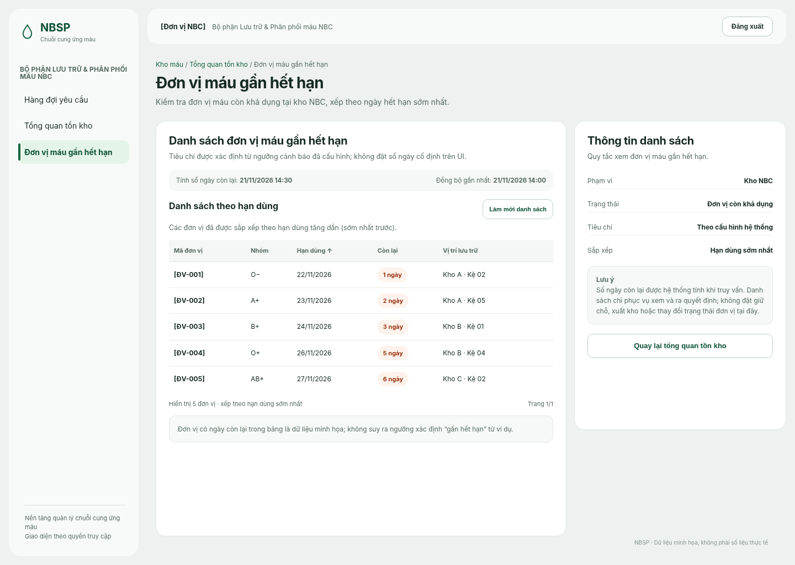
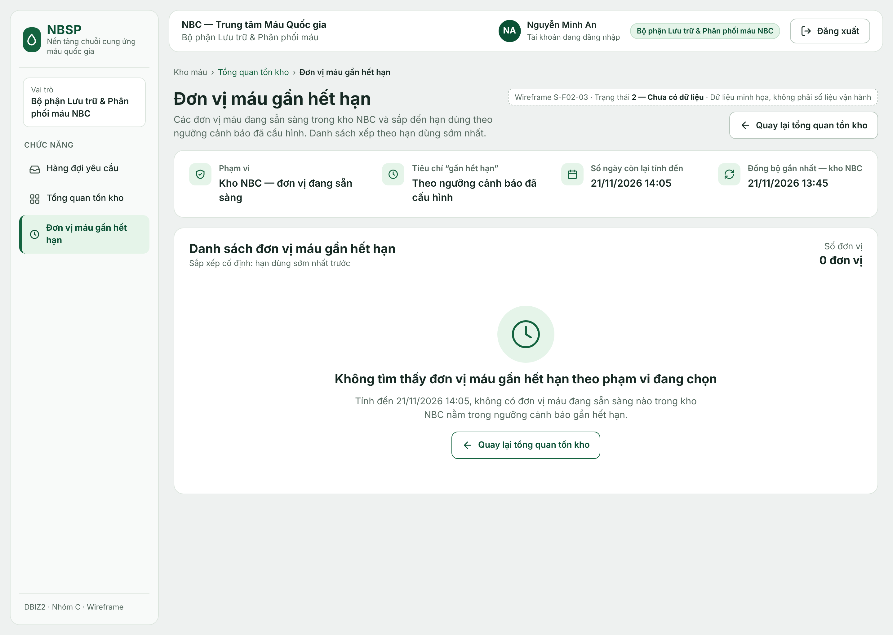
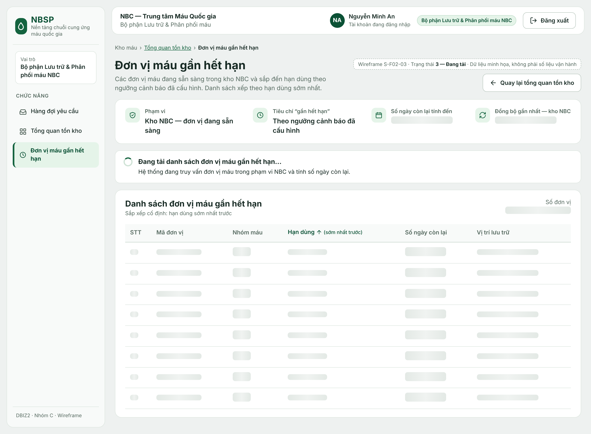
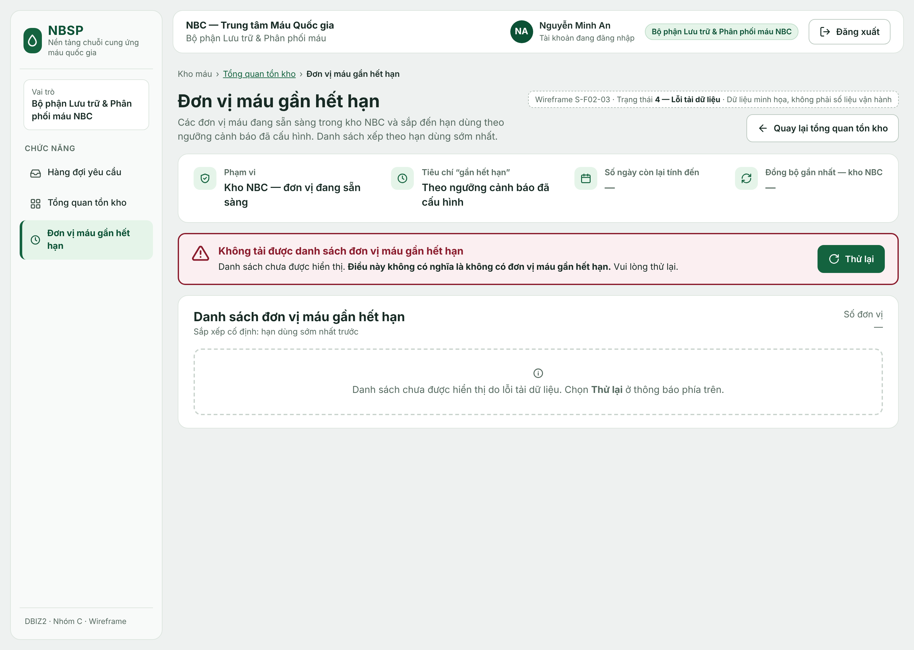
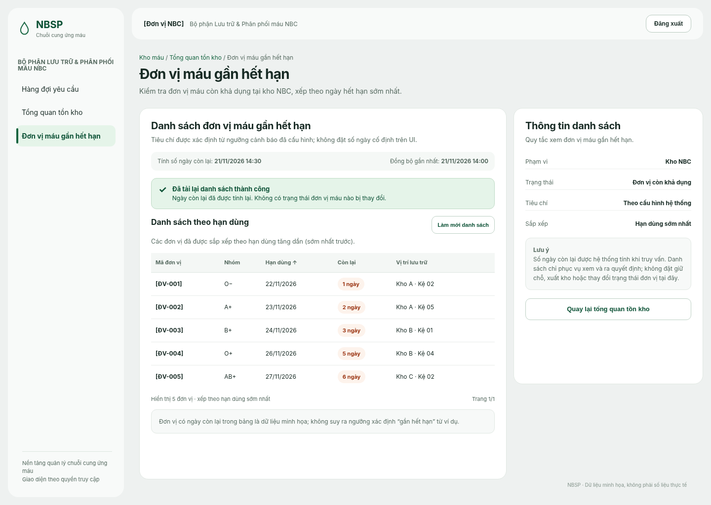

# Screen Specification — S-F02-03 Near-expiry units (Đơn vị máu gần hết hạn)

> DBIZ2 — Group C · NBSP · Draft v0.1 · 21/11/2026
> Structure follows the Screen Specification template described in the master prompt §7. The reference file `screen-spec-s-f01-01.md` was **not** supplied with this batch (see OQ-14).
> UI copy is Vietnamese (UI Conventions §1). Codes stay in English.

---

## 1. Screen metadata

| Field | Value |
|---|---|
| Screen ID | `S-F02-03` |
| Screen name | Near-expiry units — UI title **Đơn vị máu gần hết hạn** |
| Actor | NBC Blood Storage and Distribution Department ("NBC Staff" in UC-10 / FR-02-03) |
| Priority | **Could** (Screen List). Function List FR-02-03 initial priority **Should** — conflict, see OQ-01 |
| Feature | F-02 |
| Linked UC / FR | UC-10 View Near-Expiry Blood Units · FR-02-03 View near-expiry blood units |
| Sequence / activity diagrams | SD UC-10 (Mid-term Report): NBC Staff opens near-expiry list → NBC Portal requests near-expiry units → NBSP System queries blood units **within NBC scope** → filters units **within warning threshold** → calculates remaining days → `alt` [near-expiry units found] returns *Unit ID, blood type, expiry date, storage location, days left* → portal displays list; staff reviews and decides on allocation · `alt` [no units found] empty list → "No near-expiry units" message. No activity diagram supplied. |
| Usage flow | NBC Dept Flow 2: S-F04-01 → S-F02-02 → "Near-expiry units" → S-F02-03 → back to S-F02-02, or menu "Requests" → S-F01-03 (screen-transition-2.md §2) |
| Mockup images | `img/s-f02-03-default.png` · `img/s-f02-03-empty.png` · `img/s-f02-03-loading.png` · `img/s-f02-03-error.png` · `img/s-f02-03-success.png` |
| Frame dimensions | Width 1440 px (all states). Height: Default 1225, Empty 1024, Loading 1059, Error 1024, Success 1321 px. PNGs exported at 2× (2880 px wide). |
| Figma | File **NBSP — S-F02-02 & S-F02-03 (5 UI states)** — https://www.figma.com/design/3OinFn4dX034IiohmTAYJ3 · Frames: `S-F02-03 — Default` (node 6-2), `S-F02-03 — Empty` (2-2), `S-F02-03 — Loading` (6-359), `S-F02-03 — Error` (3-267), `S-F02-03 — Success` (6-572) |
| Version | v0.1 |
| Status | Draft — for team review. Blocking questions: OQ-02, OQ-03 |

---

## 2. Purpose

**Why the screen exists.** NBC staff review available blood units that are approaching their expiry date, see how many days each has left, earliest first, so they can decide on allocation (decision made outside this screen — SD UC-10 "Review list and decide on allocation").

**When it is shown.** When the Dept user opens it from S-F02-02 or from the NBC menu (Screen List entry points).

**How the user enters.**

| Entry point | Source |
|---|---|
| S-F02-02 → "Xem đơn vị máu gần hết hạn" | Screen List; transition §2 |
| Menu (NBC Dept) "Đơn vị máu gần hết hạn" | Screen List |
| Breadcrumb from — | (none) |

**Where the user goes next.** S-F02-02 ("Quay lại tổng quan tồn kho", breadcrumb, menu), S-F01-03 (menu "Hàng đợi yêu cầu"), Sign out.

**Read-only.** The screen lists units; it does not reserve, discard, transfer or change any unit status.

---

## 3. Mockup

### 3.1 Shared layout (all states)

Same application shell as S-F02-02 (sidebar 240 px · main 1152 px · topbar 68 px · UI Conventions §2.1), NBC Dept menu with "Đơn vị máu gần hết hạn" highlighted.

1. **Page header** — breadcrumb "Kho máu › Tổng quan tồn kho › Đơn vị máu gần hết hạn" (middle item is a link to S-F02-02), H1, subtitle, review tag, "Quay lại tổng quan tồn kho".
2. **Context card** — 4 items: Phạm vi · Tiêu chí "gần hết hạn" · Số ngày còn lại tính đến · Đồng bộ gần nhất — kho NBC.
3. **Status region** — state-dependent banner (empty in Default).
4. **List card** — title, fixed sort note, unit count, table (or empty / skeleton / placeholder), footer count.

The review tag is a wireframe annotation, not production UI. Unit codes (`U-MH-xxxx`, "MH" = minh họa), storage locations, dates and counts are **illustrative**; the real unit-code format is whatever NBSP/BMS issues (UI Conventions §2.2).

Sample "days remaining" values 1–6 are illustrative only and **do not define the warning threshold** (OQ-02).

### 3.2 State images

| State | Image | What visibly differs from Default |
|---|---|---|
| 1 Default |  | Baseline: 12 units sorted by expiry ascending, "Còn N ngày" badges, storage location, count "12 đơn vị". |
| 2 Empty |  | Table replaced by clock illustration, "Không tìm thấy đơn vị máu gần hết hạn theo phạm vi đang chọn", explanation with the calculation time, "Quay lại tổng quan tồn kho". Count "0 đơn vị". |
| 3 Loading |  | Loading banner (spinner + text); skeleton rows under real column headers; skeleton count, calculation time and sync time. |
| 4 Error |  | ⚠ bordered banner "Không tải được danh sách đơn vị máu gần hết hạn" + "Điều này không có nghĩa là không có đơn vị máu gần hết hạn" + "Thử lại"; context values "—"; dashed placeholder instead of table; count "—". |
| 5 Success |  | Same list as Default plus green status banner "Đã tải lại danh sách lúc 14:32 — 12 đơn vị, xếp theo hạn dùng sớm nhất" and "Số ngày còn lại đã được tính lại tại thời điểm tải… không thay đổi trạng thái đơn vị máu"; calculation time updated to 14:32. |

---

## 4. Element inventory

Field names are not defined in W0/W1; sources are logical, field names **TBD** (OQ-10).

| # | Element | Type | Content / Data source | Required | Validation |
|---|---|---|---|---|---|
| E01–E07 | App shell (brand, role card, menu, organisation, user, role chip, Đăng xuất) | Shared components | As S-F02-02 E01–E07, NBC Dept role. Menu: Hàng đợi yêu cầu (S-F01-03), Tổng quan tồn kho (S-F02-02), **Đơn vị máu gần hết hạn** (current) | Yes | Role must be NBC Dept (FR-04-03) |
| E08 | Breadcrumb | Text + link | "Kho máu › **Tổng quan tồn kho** (link) › Đơn vị máu gần hết hạn" | Yes | Link target S-F02-02 |
| E09 | Page title | H1 | "Đơn vị máu gần hết hạn" | Yes | — |
| E10 | Subtitle | Text | "Các đơn vị máu đang sẵn sàng trong kho NBC và sắp đến hạn dùng theo ngưỡng cảnh báo đã cấu hình. Danh sách xếp theo hạn dùng sớm nhất." | Yes | Must not state a number of days |
| E11 | "Quay lại tổng quan tồn kho" | Secondary button | Static | Yes | — |
| E12 | Context — Phạm vi | Info item | "Kho NBC — đơn vị đang sẵn sàng" (SD UC-10 "within NBC scope"; FR-02-03 "available units") | Yes | — |
| E13 | Context — Tiêu chí "gần hết hạn" | Info item | "Theo ngưỡng cảnh báo đã cấu hình" — threshold value **not displayed** because it is not defined (OQ-02) | Yes | When the value is confirmed, show "≤ [N] ngày" from configuration |
| E14 | Context — Số ngày còn lại tính đến | Info item | Server calculation time of the query, `dd/MM/yyyy HH:mm` | Yes | Loading: skeleton; Error: "—" |
| E15 | Context — Đồng bộ gần nhất — kho NBC | Info item | Latest NBC snapshot timestamp (FR-02-05) — **design assumption**, see OQ-07 | Recommended | Loading: skeleton; Error: "—" |
| E16 | List title + sort note | H2 + text | "Danh sách đơn vị máu gần hết hạn" · "Sắp xếp cố định: hạn dùng sớm nhất trước" | Yes | — |
| E17 | Unit count | Text | "[n] đơn vị" = number of rows returned | Yes | "0 đơn vị" in Empty; "—" in Error; skeleton in Loading |
| E18 | Table column "STT" | Number | Row position 1…n | Yes | — |
| E19 | Table column "Mã đơn vị" | Text (monospace) | Unit ID (SD UC-10 return field) | Yes | Shown in full, never truncated; copyable |
| E20 | Table column "Nhóm máu" | Badge with text | Blood type (SD UC-10) — ABO+Rh | Yes | One of 8 values |
| E21 | Table column "Hạn dùng" (sorted ↑) | Date | Expiry date (SD UC-10; FR-02-03) `dd/MM/yyyy`; header shows ↑ icon + "(sớm nhất trước)"; `aria-sort="ascending"` | Yes | Rows ordered ascending by expiry; ties TBD (OQ-05) |
| E22 | Table column "Số ngày còn lại" | Badge with clock icon + text | "Còn [N] ngày" — days left calculated by the system (FR-02-03; SD UC-10) | Yes | Integer ≥ 0; one neutral warning style for all rows (no colour tiers — tiers would imply thresholds); 0-day wording TBD (OQ-04) |
| E23 | Table column "Vị trí lưu trữ" | Text + pin icon | Storage location (SD UC-10 return field) | Yes | "—" if missing |
| E24 | Footer count | Text | "Hiển thị [n] đơn vị" | Yes | Paging TBD (OQ-08) |
| E25 | Empty-state block | Illustration + H3 + text + button | "Không tìm thấy đơn vị máu gần hết hạn theo phạm vi đang chọn." (UI Conventions §4.2) · "Tính đến [E14], không có đơn vị máu đang sẵn sàng nào trong kho NBC nằm trong ngưỡng cảnh báo gần hết hạn." · "Quay lại tổng quan tồn kho" | Empty state | — |
| E26 | Loading banner | Status (`role="status"`, polite) | Spinner + "Đang tải danh sách đơn vị máu gần hết hạn…" + "Hệ thống đang truy vấn đơn vị máu trong phạm vi NBC và tính số ngày còn lại." | Loading | Timeout **TBD** (OQ-09) |
| E27 | Skeleton rows | Placeholders | 8 rows under real headers | Loading | — |
| E28 | Error banner | Alert (`role="alert"`), 2 px `#8A1C2D` border, ⚠ icon | "Không tải được danh sách đơn vị máu gần hết hạn" · "Danh sách chưa được hiển thị. **Điều này không có nghĩa là không có đơn vị máu gần hết hạn.** Vui lòng thử lại." | Error | Icon + text + border |
| E29 | "Thử lại" | Primary button | Static | Error | Re-runs the query |
| E30 | Error placeholder | Dashed box | "Danh sách chưa được hiển thị do lỗi tải dữ liệu. Chọn Thử lại ở thông báo phía trên." | Error | No rows, no "0" |
| E31 | Success status banner | Status (`role="status"`), accent bar + ✓ | "Đã tải lại danh sách lúc [HH:mm] — [n] đơn vị, xếp theo hạn dùng sớm nhất" · "Số ngày còn lại đã được tính lại tại thời điểm tải. Đây là kết quả hiển thị dữ liệu, không thay đổi trạng thái đơn vị máu." | Success | Not a transaction confirmation |
| E32 | Review tag (wireframe only) | Dashed label | State + "Dữ liệu minh họa" | No | Not in production |

**Deliberately not on this screen** (OQ-11): filters (none in FR-02-03), user-changeable sort, row actions (reserve/discard/transfer), Ghi chú, Nhiệt độ bảo quản, chế phẩm column, Báo sự cố cho NBC, Tải biên bản, Tạo yêu cầu mới, threshold setting.

---

## 5. Five UI states

| State | What the user sees | Trigger |
|---|---|---|
| **1 Default** (`s-f02-03-default.png`) | Context card; list of available NBC units within the warning threshold with unit ID, blood type, expiry date, days remaining, storage location, sorted earliest expiry first; count. | User opens the screen and the query returns ≥ 1 unit (SD UC-10 `[near-expiry units found]`). |
| **2 Empty** (`s-f02-03-empty.png`) | Same header and context card; clock illustration and "Không tìm thấy đơn vị máu gần hết hạn…" with the calculation time; count "0 đơn vị"; button back to S-F02-02. | Query succeeds with no unit inside the threshold (SD UC-10 `[no units found]` → "No near-expiry units" message). |
| **3 Loading** (`s-f02-03-loading.png`) | Loading banner; column headers visible with skeleton rows; skeleton count / calculation time / sync time; navigation still usable. | Screen opened or "Thử lại" pressed, until response. Timeout **TBD**. |
| **4 Error** (`s-f02-03-error.png`) | ⚠ bordered banner stating the list could not be loaded and that this does **not** mean there are no near-expiry units; "Thử lại"; context values "—"; dashed placeholder; count "—". | Query fails (server/network). |
| **5 Success** (`s-f02-03-success.png`) | Same list as Default, still earliest-expiry-first with days remaining, plus a green status banner confirming the reload time and that days were recalculated; calculation time updated. | "Thử lại" (or any re-query) completes successfully. Data-load confirmation only — no unit status change. |

---

## 6. Interactions and navigation

| # | Element | User action | System response | Goes to screen |
|---|---|---|---|---|
| I01 | Page | Open (S-F02-02 button or menu) | Check NBC Dept permission (FR-04-03); deny → "Tài khoản không có quyền truy cập nội dung này." with no data. Else Loading → query available units in NBC scope → filter by configured warning threshold → calculate days remaining → sort by expiry ascending → Default / Empty / Error | S-F02-03 |
| I02 | E29 Thử lại | Click | Loading → re-run I01 query → Success / Empty / Error | — |
| I03 | E11 / E25 "Quay lại tổng quan tồn kho" | Click | Navigate | **S-F02-02** |
| I04 | E08 breadcrumb "Tổng quan tồn kho" | Click | Navigate | **S-F02-02** |
| I05 | Menu "Hàng đợi yêu cầu" | Click | Navigate (transition §2 "Menu: Requests") | **S-F01-03** |
| I06 | Menu "Tổng quan tồn kho" | Click | Navigate | **S-F02-02** |
| I07 | Đăng xuất | Click | End session | **S-F04-01** |
| I08 | Table row / unit ID | Click | **No action** — no unit-detail screen exists in the Screen List | TBD (OQ-12) |
| I09 | Column headers | Click | **No action** — sort is fixed by FR-02-03 | — |

All targets exist in `screen-list-2.md`.

---

## 7. Screen-level rules

| # | Rule | Source |
|---|---|---|
| R1 | **Role-based access.** NBC Blood Storage and Distribution Department only. Hospital Staff and NBC Operations do not see the menu item or the S-F02-02 link and are denied if they open the URL. | Screen List; UC-10; FR-04-03 |
| R2 | **Data scope.** Only units within NBC scope and in an *available* state; hospital-held units are not listed. | FR-02-03 ("available units"); SD UC-10 ("within NBC scope") |
| R3 | **Near-expiry criterion.** Units inside the configured warning threshold. The threshold value is **not defined** in any source and is not invented in UI copy or sample data semantics. | SD UC-10 ("warning threshold"); UI Conventions §2.2, OQ-04 |
| R4 | **Days remaining.** Calculated by the system for every row and displayed as "Còn [N] ngày"; calculation time shown (E14). | FR-02-03; SD UC-10 |
| R5 | **Sorting.** Earliest expiry first, fixed; not user-changeable. | FR-02-03 ("order them by earliest expiry") |
| R6 | **Read-only.** No reservation, discard or status change; allocation decision happens outside the screen (S-F01-04 flow). | FR-02-03 (EO); SD UC-10 note |
| R7 | **Not all units are near-expiry.** The list is a filtered subset; Empty is a valid outcome. | Prompt §3.6; SD UC-10 alt |
| R8 | **Empty ≠ error.** Error never shows "0 đơn vị" or the empty message. | UI Conventions §2.2, §4.1 |
| R9 | **Data freshness.** Days are recalculated at each load; NBC snapshot timestamp shown (assumption, OQ-07); no "real-time" wording. | FR-02-05; UI Conventions §3 |
| R10 | **State communication.** Polite live region for loading/success, `role="alert"` for error; icon + text, not colour alone. | UI Conventions §5 |

---

## 8. Linked requirements

| FR ID | What this screen does for it |
|---|---|
| FR-02-03 | Displays available units approaching expiry (FE: list), shows calculated days remaining (FE: days-remaining display), keeps earliest-expiry-first order; consumes BE query that selects eligible units, calculates remaining days and sorts by expiry. |
| FR-04-03 | Restricts the screen and menu item to the NBC Dept role. |
| FR-02-05 | Consumer only — sync timestamp displayed for context (assumption OQ-07). |

---

## 9. Responsive and accessibility notes

- Desktop 1440 px; vertical scroll; mobile out of scope.
- Table: `<caption>` "Danh sách đơn vị máu gần hết hạn, xếp theo hạn dùng sớm nhất"; `<th scope="col">`; sorted column has `aria-sort="ascending"` and a visible ↑ icon + text "(sớm nhất trước)".
- Unit ID, blood type, expiry date and days remaining are never truncated (UI Conventions §5).
- Days-remaining badge = clock icon + full text "Còn N ngày"; same style for every row, so no meaning depends on colour.
- Keyboard: Tab order sidebar → topbar → breadcrumb link → back button → (banner button) → table; focus ring 2 px `#14633F`.
- Contrast (measured): warning badge text `#9A3412` on `#FDF3EC` 6.7:1; error `#8A1C2D` on `#FBEFF1` 8.2:1; secondary text `#566A60` 5.8:1 on white / 5.1:1 on page background; white on primary button 7.3:1.
- Font sizes: table 15 px, unit ID 14 px monospace, labels 13–14 px, H1 28 px.

---

## 10. Open questions

| # | Question | Blocking? | Status |
|---|---|---|---|
| OQ-01 | Priority conflict: Screen List **Could** vs Function List FR-02-03 **Should**. | No | Open — W4 owner |
| OQ-02 | What is the warning threshold (number of days, per blood type or per component?) and who configures it? UC-10, FR-02-03 and UI Conventions OQ-04 leave it undefined; SD UC-10 only says "warning threshold". | **Yes** (BE) | Open — W1 FR-02-03 owner. UI impact: E13 will show "≤ N ngày" |
| OQ-03 | Definition of "available" unit: does it exclude units reserved by UC-08 / already dispatched? Is the source the synced BMS snapshot or a live BMS call? | **Yes** (BE) | Open |
| OQ-04 | Days-remaining rule: calendar days vs 24-hour periods, time zone UTC+07:00, wording for 0 days ("Hết hạn hôm nay"?), and whether expired units (negative) are excluded. | No | **TBD** |
| OQ-05 | Tie-break order for units with the same expiry date (unit ID? blood type? location?). | No | **TBD** |
| OQ-06 | Columns follow SD UC-10 return fields. Is blood component (chế phẩm) or volume needed? Not added. | No | Open |
| OQ-07 | Showing "Đồng bộ gần nhất — kho NBC" on this screen is a design recommendation (data freshness), not stated in FR-02-03. Keep? | No | Assumption |
| OQ-08 | Paging or max rows when the list is long. | No | **TBD** |
| OQ-09 | Maximum loading time before Error. | No | **TBD** |
| OQ-10 | Data field names (unit ID, blood type, expiry, storage location, days left). | No | **TBD** — data model |
| OQ-11 | Team-raised items checked against Screen List, UC-10, FR-02-03, SD UC-10: **Ghi chú** — no source; **Nhiệt độ bảo quản** — not among SD UC-10 return fields (only "storage location" is); **Báo sự cố** — no use case/workflow/actor; **Tải biên bản** — no report/export function; **Tạo yêu cầu mới** — not an NBC near-expiry function (UC-01 is Hospital). None implemented. | No | Not implemented — update W0/W1/Screen List if wanted |
| OQ-12 | No unit-detail screen exists; rows are not clickable. Confirm. | No | Open |
| OQ-13 | Empty-state copy "theo phạm vi đang chọn" comes from the UI Conventions message library although this screen has no filter. Keep or shorten to "Không tìm thấy đơn vị máu gần hết hạn."? | No | Open |
| OQ-14 | Reference `screen-spec-s-f01-01.md`, login screenshot and five-state reference image were not supplied; re-check structure/visuals when available. | No | Open |

---

## Completion checklist

- [x] All five mockups exist (`img/s-f02-03-{default,empty,loading,error,success}.png`).
- [x] All five states documented (§5).
- [x] Every visible UI element is in the element inventory (E01–E32).
- [x] Every data element has a source (SD UC-10 return fields / FR-02-03; field names TBD).
- [x] Every interaction has a defined response (I01–I09).
- [x] Every navigation target exists in the Screen List (S-F01-03, S-F02-02, S-F04-01).
- [x] FR-02-03 supported: available units, days remaining, earliest-expiry-first.
- [x] Role permissions respected: NBC Dept only.
- [x] No expiry threshold invented; sample values labelled illustrative.
- [x] Open questions recorded (OQ-01 – OQ-14). Blocking: OQ-02, OQ-03.
- [x] Figma frames created and named per convention.
