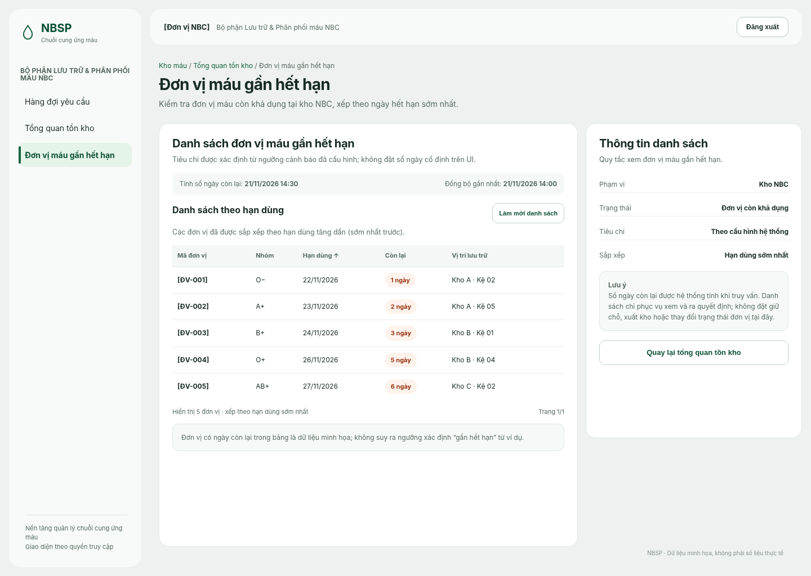
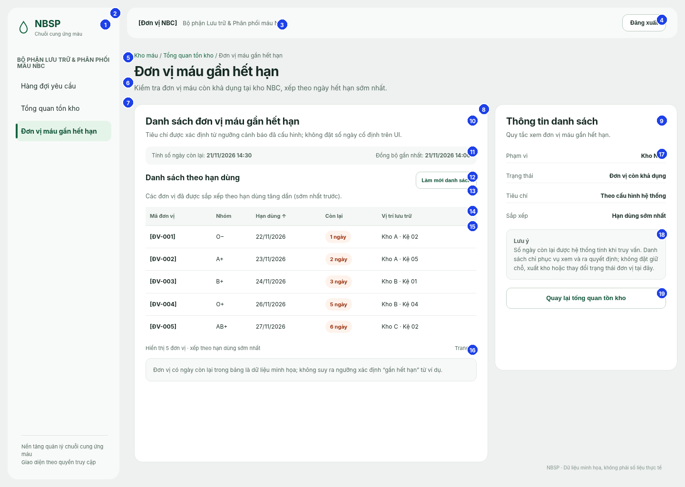
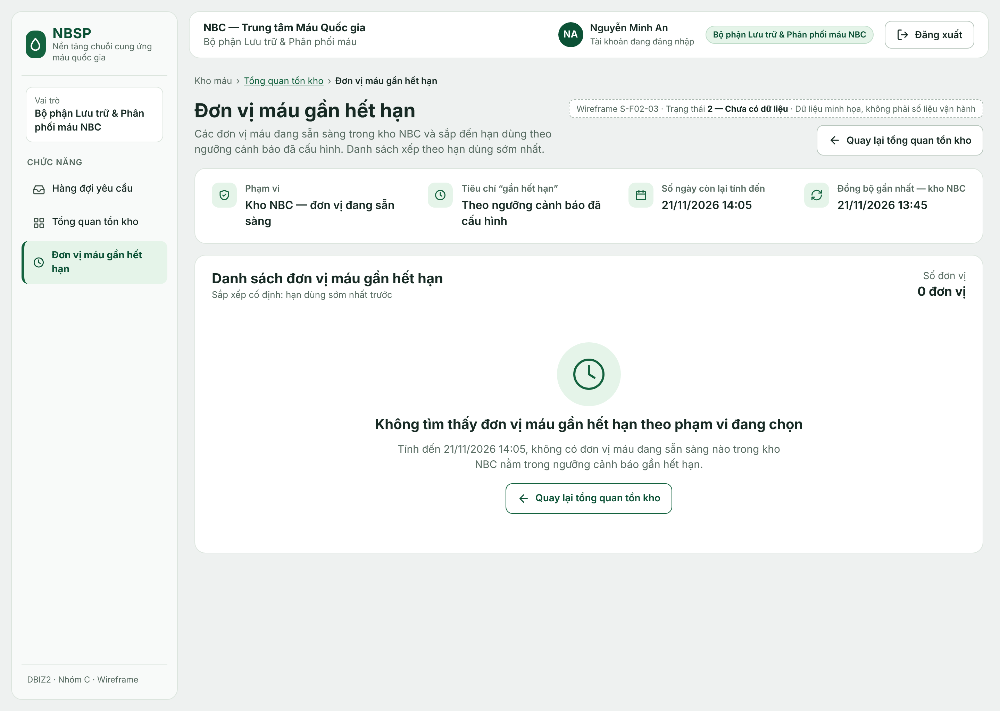
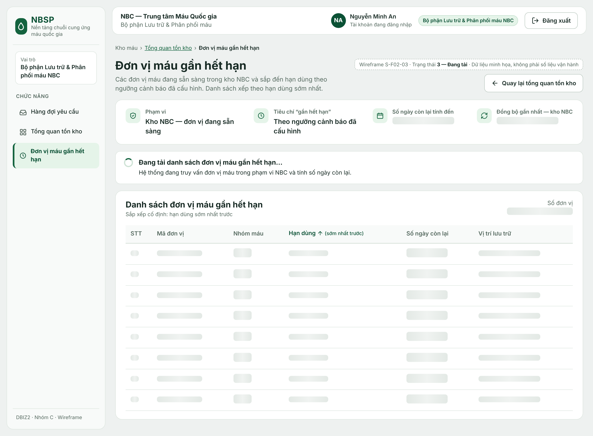
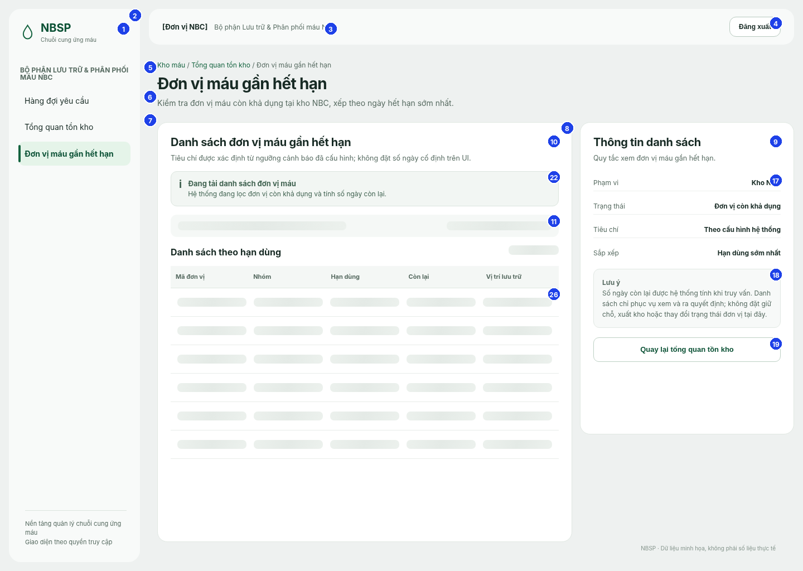
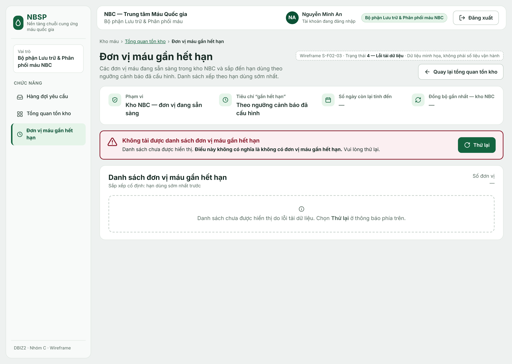
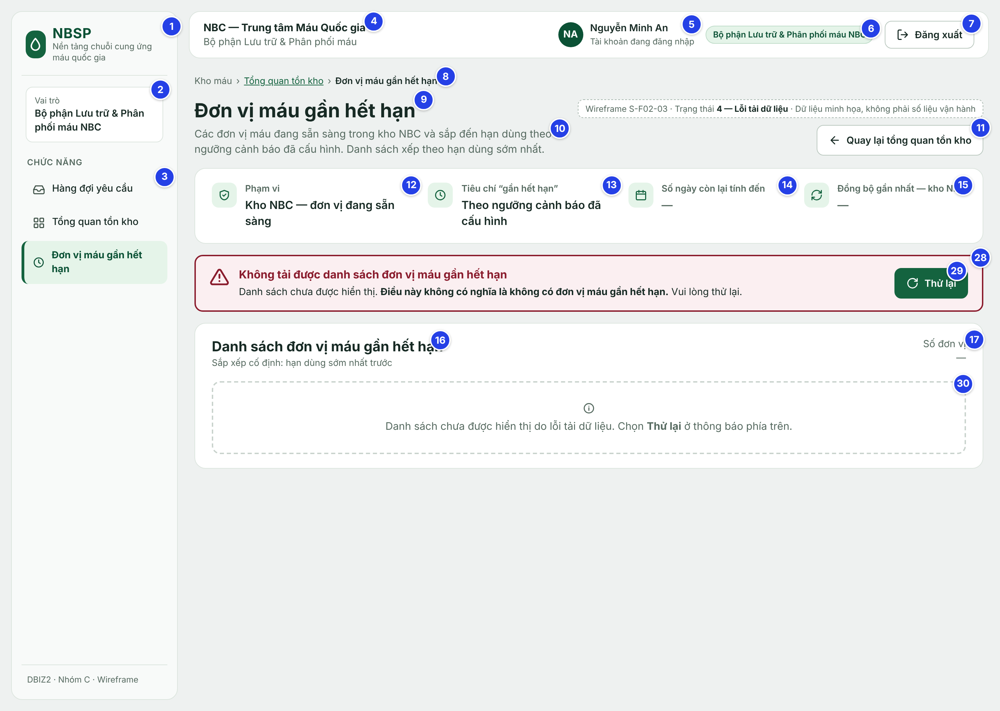
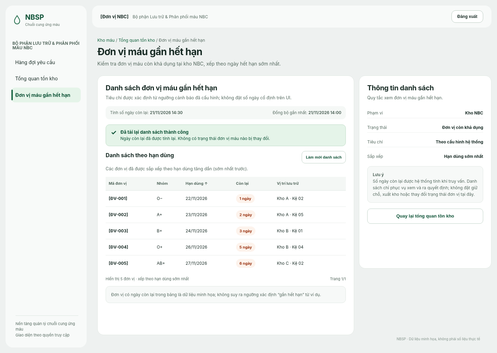
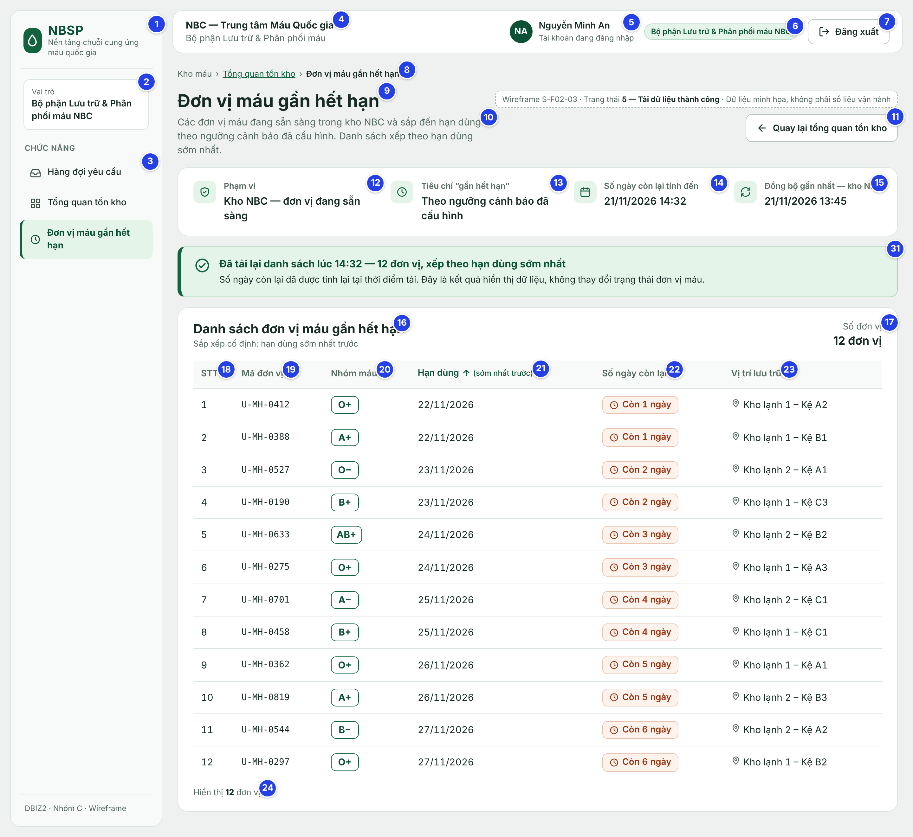

# Screen Spec: S-F02-03 Near-Expiry Blood Units

| Field | Value |
|---|---|
| Screen ID | `S-F02-03` |
| Screen name | Near-Expiry Blood Units (Vietnamese UI title: **“Đơn vị máu gần hết hạn”**) |
| Actor | NBC Blood Storage and Distribution Department — Bộ phận Lưu trữ & Phân phối máu NBC **only** |
| Priority | **Could** (Screen List; function priorities are kept separate) |
| Feature | F-02 Inventory Monitoring & Usage |
| Use cases / FRs | UC-10 · FR-02-03; supporting FR-04-03, FR-02-05 |
| Activity / sequence | [`SD-UC-10`](../../../use-case/SD-UC-10.md); upstream [`SD-UC-09`](../../../use-case/SD-UC-09.md) |
| Usage flow | NBC Dept Flow 2: `S-F04-01 → S-F02-02 → S-F02-03` (optional); [`usage-flow.md`](../usage-flow.md) v2.3 |
| Design references | [UI Conventions](../../ui-conventions.md) · canonical [S-F01-01](../s-f01-01/screen-spec-s-f01-01.md) (layout only) |
| Screen List | [`screen-list.md`](../../screen-list.md) |
| Frame size | **1440 × 1024 px**, desktop, 1×; additional content scrolls vertically in implementation |
| Version / status | **v1.0, 21/11/2026 — Reviewed draft**, pending listed Open Questions |
## 1. Purpose

**Shown when:** an authorised NBC Blood Storage and Distribution Department user opens the near-expiry unit list from `S-F02-02` or the Dept navigation menu (UC-10). The backend selects **available units in NBC scope**, filters units approaching expiry using a **configured warning threshold**, calculates days remaining and sorts by **earliest expiry first** (FR-02-03; SD-UC-10). This is **read-only**; the decision to allocate units takes place elsewhere in the order/dispatch workflow, not here.

**Scope:** Hospital Staff and NBC Operations **cannot** open this screen, even though they can access their role's view of S-F02-02. Unit IDs, ABO/Rh, expiry date, storage location and days left are the data returned by SD-UC-10. The threshold value and its configuration dimensions are not fixed by current W1; this screen displays “Theo cấu hình hệ thống” rather than inventing a day count.

**Exit:** return to `S-F02-02` with the link/button; use the Dept menu to go to `S-F01-03` or sign out. No unit detail/edit/discard/transfer screen is created.

## 2. Mockup

**Layout:** same NBSP outer shell as S-F01-01: left role-scoped sidebar, NBSP identity, account + sign-out top bar, breadcrumb, Vietnamese heading and subtitle, two white task/support cards. Business contents are intentionally screen-specific. **No HuyếtMạch rebrand, analytics KPI strip, invented global search, avatar card or extra Screen ID.** The numbers on the blue circles map directly to the Element Inventory below. The frame contains synthetic display values only.

| State | Original image | Numbered image | Element numbers shown |
|---|---|---|---|
| **Default** |  |  | 2,1,3,4,5,6,7,8,10,11,12,13,14,15,16,9,17,18,19 |
| **Empty** |  |  | 2,1,3,4,5,6,7,8,10,11,24,19,9,17,18 |
| **Loading** |  |  | 2,1,3,4,5,6,7,8,10,22,11,26,9,17,18,19 |
| **Error** |  |  | 2,1,3,4,5,6,7,8,10,23,11,24,25,9,18,19 |
| **Success** |  |  | 2,1,3,4,5,6,7,8,10,11,27,12,13,14,15,16,9,17,18,19 |

**State intent:** **Default** — available NBC blood units within the configured near-expiry window, earliest expiry first · **Empty** — successful query with no eligible units in the configured range · **Loading** — query/filter/days calculation pending; skeleton list · **Error** — no reliable list because the query failed; do not show zero · **Success** — successful re-query of the list, with days recalculated and no unit status changed.

## 3. Element inventory

### 3.1. Shared page frame (all states)

| # | Element | Type | Content / source | Required | Behaviour / validation |
|---:|---|---|---|---|---|
| 1 | NBSP brand | Logo and name | “NBSP”, “Chuỗi cung ứng máu” | Yes | Same brand and proportions as `S-F01-01`. |
| 2 | Role-aware sidebar | Navigation | Only the menu items authorised for the current actor | Yes | Active item has background, left indicator, bold text; no alert badge on the menu. |
| 3 | Account header | Session summary | Organisation from session and Vietnamese role | Yes | Never reveal another hospital's identity or data. |
| 4 | Đăng xuất | Secondary button | Sign-out action | Yes | Ends session → `S-F04-01`. |
| 5 | Breadcrumb | Text / authorised links | Vietnamese hierarchy; links only to existing screens | Yes | No fabricated home screen. |
| 6 | Screen heading | H1 | Vietnamese UI title | Yes | Corresponds to the Screen List. |
| 7 | Screen subtitle | Description | One sentence describing the current task | Yes | No premature confirmation of an action. |
| 8 | Primary task card | Rounded white card | List/table and controls for the current use case | Yes | Reuses the visual shell, typography and spacing of `S-F01-01`. |
| 9 | Supporting card | Rounded white card | Details, guidance or related action | Yes | Relevant to actor; may have contextual placeholders. |

### 3.2. Near-expiry list elements

| # | Element | Type | Displayed content / logical source | Required | Validation / behaviour |
|---:|---|---|---|---|---|
| 10 | Danh sách đơn vị máu gần hết hạn | Main heading + helper | Available NBC units approaching expiry, configured criterion | Yes | No literal threshold N invented. |
| 11 | Data-freshness strip | Read-only | Days calculated at `dd/MM/yyyy HH:mm`; NBC sync source timestamp | Recommended | Calculation time separate from external sync time; Unknown = “—”. |
| 12 | Danh sách theo hạn dùng | Section heading | Near-expiry list title | If loaded | Earliest expiry ascending. |
| 13 | Làm mới danh sách | Secondary query button | Re-read available near-expiry list | Default / Success | Recalculates days from backend query; never changes unit status. |
| 14 | Fixed-sort note | Text | “Hạn dùng tăng dần (sớm nhất trước)” | Default / Success | Sorting is fixed by FR-02-03; headers are not user-sort controls. |
| 15 | Blood-unit table | Read-only table | Unit ID, blood group, expiry date, days left, location | If records | Actual identifiers must be shown complete; all displayed codes are synthetic placeholders. |
| 16 | Result count / footer | Text | Number of units in displayed result set | Default / Success | No claim of total inventory size; pagination TBD. |
| 17 | Scope / criterion panel | Key/value list | Kho NBC, available units, configured criterion, expiry ordering | If known | No allocation/threshold-change controls. |
| 18 | Read-only scope note | Supporting info | No reservation, dispatch, transfer, discard in this view | Yes | Other use cases own mutations. |
| 19 | Quay lại tổng quan tồn kho | Navigation button | Back to S-F02-02 | Yes | Available also in Empty. |
| 22 | Loading banner | `role="status"` | “Đang tải danh sách đơn vị máu” | Loading | No counts while query pending. |
| 23 | List-query error banner | `role="alert"` | “Không tải được danh sách…” | Error | **Cannot infer** the result is empty or zero. |
| 24 | Empty/error placeholder | State panel | Empty has 0 matches; Error has unknown result | Empty / Error | Different text and meaning for each. |
| 25 | Thử lại | Primary query button | Re-run near-expiry query | Error | Retry only; no unit modification. |
| 26 | Loading skeleton rows | Skeleton | Placeholder unit list rows | Loading | No invented IDs/dates while loading. |
| 27 | Successful reload status | `role="status"` | “Đã tải lại danh sách thành công” | Success | A read/recalculation success, **not** an inventory update. |

## 4. States

| State | Trigger | Visible result | Data effect |
|---|---|---|---|
| Default | Authorised query returns one or more eligible units | Earliest expiry sorted unit table with unit IDs, blood type, expiry, days left, storage location | None; read-only. |
| Empty | Query succeeds with zero eligible near-expiry units | “Không tìm thấy đơn vị máu gần hết hạn”, 0 matching results | None; not an error. |
| Loading | Query pending | “Đang tải...” and skeleton rows; result count not shown as numeric | None. |
| Error | Server/network query failure | Alert, no unit data and no false 0, “Thử lại” | None; not equivalent to Empty. |
| Success | Manual re-query or successful retry returns records | Updated calculation time, result list and successful reload banner | None; no unit/lot allocation or DB status change. |

**The five states are UI presentation states, not five unit lifecycle states.** The sample dates and days are illustrative only; no configured near-expiry threshold is derived from them.

## 5. Interactions and navigation

| # | Action | System response | Target |
|---:|---|---|---|
| 1 | Open from `S-F02-02`, direct authorised menu or route | Backend verifies Dept role, queries available NBC units, filters by configured warning window, calculates days and sorts ascending | `S-F02-03` (`Loading` → `Default` / `Empty` / `Error`) |
| 2 | “Làm mới danh sách” / “Thử lại” | Re-read same authorised list and recalculate days | Stays (`Loading` → `Success` / `Empty` / `Error`) |
| 3 | “Quay lại tổng quan tồn kho” / breadcrumb | Navigate back | `S-F02-02` |
| 4 | Dept menu “Hàng đợi yêu cầu” | Navigate to request queue | `S-F01-03` |
| 5 | Sign out | End authenticated session | `S-F04-01` |
| 6 | Select row / click unit code | **No mutation / no navigation defined** in Screen List | Stays |
| 7 | Click expiry column | **No user sorting action**; order is fixed | Stays |

## 6. Screen-level rules

| ID | Rule | Source |
|---|---|---|
| SR-10-01 | Only NBC Dept is authorised; never show this menu/action for Hospital or NBC Operations. | Screen List; FR-02-03; FR-04-03 |
| SR-10-02 | Units must be in NBC scope, available and approaching expiry; hospital-held units excluded. | FR-02-03; SD-UC-10 |
| SR-10-03 | The near-expiry window is configurable; no UI-coded threshold value or separate setup screen. | W0 scope; UI Conventions OQ-04 |
| SR-10-04 | Backend calculates remaining days per unit; display value text with date in `dd/MM/yyyy`. | FR-02-03; SD-UC-10 |
| SR-10-05 | Order by **expiry date ascending**, not chosen by user. | FR-02-03 |
| SR-10-06 | Read-only: no reserve, transfer, allocate, discard, threshold-configure or incident-report action. | UC-10; Screen List; W1 scope |
| SR-10-07 | Empty is a successful zero-result query; Error leaves result count unknown. | UI Conventions §2–4 |
| SR-10-08 | Show source timestamp as context only; query reload does **not** trigger UC-17 BMS sync. | FR-02-05; UI recommendation |

## 7. Linked requirements

| Requirement | Screen responsibility |
|---|---|
| FR-02-03 | Read and display eligible units, expiry dates, days left and earliest-expiry-first ordering. |
| FR-04-03 | Role and data-scope restrictions for NBC Dept. |
| FR-02-05 / UC-17 (context) | Optionally display latest NBC snapshot source timestamp; no BMS write or sync action. |
| UC-09 | Entry/return via inventory dashboard `S-F02-02`, not duplicated here. |

## 8. Desktop and accessibility notes

- Images 1440 × 1024 px (1×); controlled vertical scrolling where a larger unit list requires it. Rows keep unit code, blood type, expiry, remaining days and location legible; no truncated IDs.
- Table has accessible heading, column headers, expiry column `aria-sort="ascending"` and an explicit visible “sớm nhất trước” note. No clickable header unless a sorting function is added to W1.
- “Còn N ngày”/“N ngày” badges include text; colour is supplemental. Loading uses polite status, Error an assertive alert; Empty shows action to return.
- Dates from configured time zone; do not interpret display-only sample day values as a business-rule threshold.

## 9. Mockup corrections and source consistency

| Prior source issue | Resolution |
|---|---|
| GitHub `s-f02-03` used filename **`screen-specs-s-f02-03.md`** (plural), not the canonical Screen List path | This package uses **`screen-spec-s-f02-03.md`** and correct `img/...` links. On GitHub **rename/delete the old plural file** to avoid two competing specs. |
| Previous version linked images via `../img` even though the source spec lives alongside `img/` | Corrected all images to `img/...`. |
| Old mockups had varied heights and 2× 2880-width exports | Unified 5× normal and 5× numbered **1440 × 1024 px** screenshots, preserving desktop visual shell. |
| Old spec said canonical S-F01-01 unavailable | Reopened S-F01-01 and matched NBSP shell directly; no Hospital-specific business functions copied. |
| Previous design used a “review tag” in production UI | Replaced by unobtrusive “Dữ liệu minh họa” note; no non-production state tag in layout. |

## 10. Open questions

| ID | Question | Blocking? | Status |
|---|---|---|---|
| OQ-10-01 | Exact near-expiry warning window per blood product and configuration payload? | Backend | **Open**, never hardcode from sample rows. |
| OQ-10-02 | Definition of available unit when UC-08 reservations are in progress (exclude reserved and already dispatched?) | Backend | **Open**, source says only “available”; needs data-model rule. |
| OQ-10-03 | How are partial-day, zero-day and expired-unit cases calculated and labelled? | For calculation | **Open**; UI samples are day-level only. |
| OQ-10-04 | Paging and tie-break for units with equal expiry, unit ID source/schema? | No | Pending backend/display decision. |
| OQ-10-05 | Screen List `Could` vs W1 FR-02-03 `Should`: which controls deliverable scope? | Scope planning | **Open**; not silently changed. |
| OQ-10-06 | Whether the source sync time should be shown on this list (not required by FR-02-03)? | No | Display as **proposed freshness context** only. |
| OQ-10-07 | Must the old Figma frames be replaced with these corrected wireframes? | No | Existing Figma URL belongs to earlier draft and does not automatically reflect this PNG package. |

### Implementation invariants (all states)

- **Server authority:** database records and status transitions are controlled by the backend, not a badge, button, ETA, filter or mockup.
- **Confidentiality:** scoped data must be enforced by the backend (`FR-04-03`, BR-06), not by frontend menu hiding alone.
- **Message discipline:** distinguish Empty (successful query with no data), Error (unavailable/invalid operation), Loading (pending response) and Success (server-confirmed result). If a mutation response is uncertain, do not claim success or retry without checking the server state first.
- **Visual standard:** Vietnamese visible labels, date `dd/MM/yyyy`, date/time `dd/MM/yyyy HH:mm`, ABO+Rh notation, text+icon/shape status; no state inferred from colour alone.

## Completion checklist

- [x] Five normal + five numbered PNGs, 1440 × 1024 px, English spec and Vietnamese UI.
- [x] NBC Dept only; near-expiry threshold remains configurable and undefined.
- [x] All required SD-UC-10 unit fields shown, earliest-expiry-first, read-only.
- [x] Empty vs Error distinguished; no false zero, no added unit-management function.
- [x] Canonical filenames and image links corrected from older plural-file draft.
- [ ] Resolve available-unit definition and threshold calculation; replace old plural spec on GitHub.
