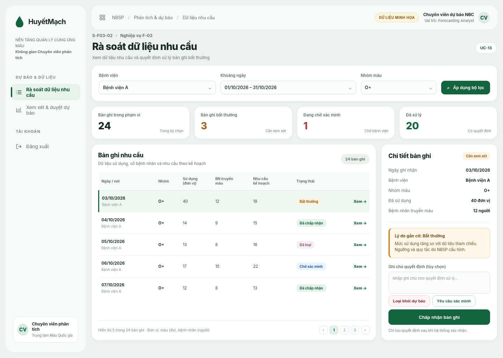
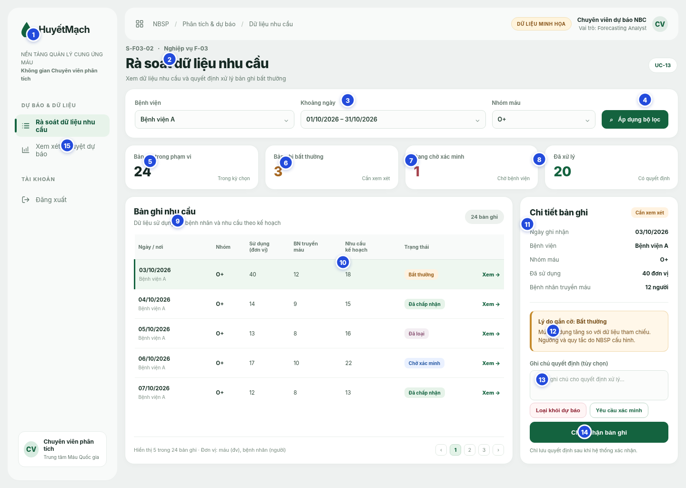
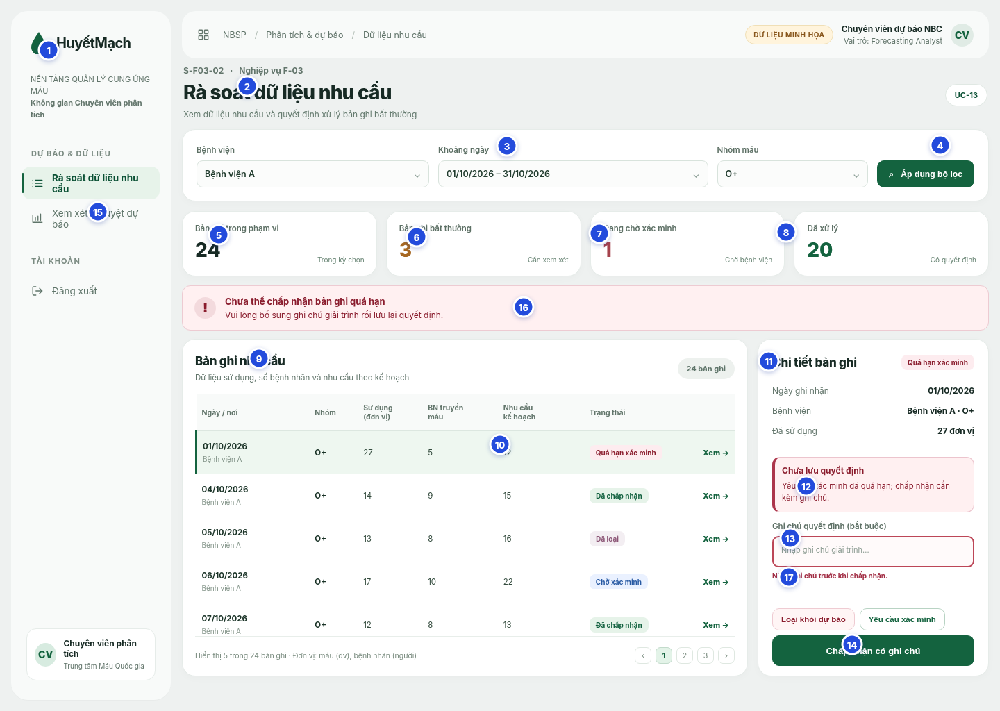

# Screen Specification: S-F03-02 — Rà soát dữ liệu nhu cầu

> **NBSP / HuyếtMạch · DBIZ2 Group C · Draft v1.0 · 20/11/2026**  
> **Phạm vi:** màn hình nghiệp vụ của **Chuyên viên phân tích dự báo NBC**; tài liệu và UI tiếng Việt, giữ mã FR/UC/Screen bằng tiếng Anh.  
> **Dữ liệu trong ảnh là dữ liệu mô phỏng để thuyết minh UI, không phải số liệu bệnh viện thật hoặc thông số nghiệp vụ đã chốt.**

| Trường | Giá trị |
|---|---|
| Screen ID | `S-F03-02` |
| Tên trong Screen List | Demand data review |
| Tiêu đề giao diện | **Rà soát dữ liệu nhu cầu** |
| Actor | NBC Forecasting Analyst |
| Feature / UC | `F-03 Clinical Demand & Forecasting` / **`UC-13 Validate Clinical Demand Data`** |
| Quyền đăng nhập | `UC-12` và `FR-04-03` |
| Độ ưu tiên Screen List | **Should** (ưu tiên của màn hình; không thay đổi priority các FR trong W1) |
| AD / SD nguồn | `activity/AD-UC-13.md` · `use-case/SD-UC-13.md` |
| FR chính | `FR-03-02`, `FR-03-03`; liên quan `FR-03-08`, `FR-04-03`, `FR-04-04`; UC-14 là bước xử lý của Hospital Staff |
| Kích thước wireframe | **1440 × 1024 px**, desktop, xuất PNG 1× |
| Quy chuẩn | `external-design/NBSP_UI_Conventions_Project_Wide_VI_v2.0.md` |
| Trạng thái tài liệu | **Draft — cần review nghiệp vụ; chưa coi là spec API** |

## 1. Purpose — Mục đích

**Hiển thị khi:** Chuyên viên phân tích đã đăng nhập (`S-F04-01`) và cần xem dữ liệu nhu cầu máu bệnh viện trong phạm vi **bệnh viện – khoảng thời gian – nhóm máu** để đánh giá các dấu hiệu bất thường theo những rule đã cấu hình (`FR-03-02`). Có thể mở từ menu vai trò Analyst hoặc sau khi nhận thông báo yêu cầu xác minh quá hạn.

**Mục tiêu người dùng:** Xem dữ liệu sử dụng máu, số bệnh nhân truyền máu, nhu cầu đã lập lịch; đọc lý do cờ bất thường; ra quyết định **Chấp nhận**, **Loại khỏi dự báo**, hoặc **Yêu cầu bệnh viện xác minh** đối với từng bản ghi được gắn cờ (`FR-03-03`). Với yêu cầu xác minh quá hạn, chỉ có thể **Chấp nhận kèm ghi chú** hoặc **Loại** theo W1.

**Rời màn hình khi:** người dùng chọn mục “Xem xét & duyệt dự báo” (`S-F03-04`), đăng xuất (`S-F04-01`) hoặc chuyển qua màn hình được phân quyền khác. **UC-13 không tự động chuyển sang UC-15:** đóng kỳ (`FR-03-08`) và sinh bản nháp (`FR-03-05`) là các xử lý hệ thống độc lập.

## 2. Mockup — 7 ảnh PNG

**Default:**

**Hai ảnh có số thứ tự thành phần:**

| Default — numbered | Error — numbered |
|---|---|
|  |  |

| State | PNG | Ý nghĩa |
|---|---|---|
| Default / Có dữ liệu | [`S-F03-02-default.png`](img/S-F03-02-default.png) | Có bản ghi và bản ghi bất thường đang được chọn |
| Empty / Không có dữ liệu | [`S-F03-02-empty.png`](img/S-F03-02-empty.png) | Không có bản ghi phù hợp bộ lọc |
| Loading / Đang tải | [`S-F03-02-loading.png`](img/S-F03-02-loading.png) | Đang truy vấn/tổng hợp/chạy rule |
| Error / Không hợp lệ | [`S-F03-02-error.png`](img/S-F03-02-error.png) | Analyst chọn **Chấp nhận** yêu cầu quá hạn nhưng bỏ trống ghi chú bắt buộc |
| Success / Đã ghi nhận | [`S-F03-02-success.png`](img/S-F03-02-success.png) | Yêu cầu xác minh đã lưu, bản ghi chuyển `Pending Verification` |
| Default đánh số | [`S-F03-02-default-numbered.png`](img/S-F03-02-default-numbered.png) | Đối chiếu Element Inventory |
| Error đánh số | [`S-F03-02-error-numbered.png`](img/S-F03-02-error-numbered.png) | Đối chiếu Element Inventory và vùng lỗi |

**Quy ước hình:** số liệu “24”, “3”, “40 đơn vị”, tên “Bệnh viện A”, kỳ tháng 10/2026, ngưỡng bất thường và lý do tăng đột biến trong ảnh chỉ là **mock data**; không được sao chép làm giá trị mặc định của hệ thống thật. Mỗi trạng thái là cùng **một Screen ID**, không phát sinh màn hình mới.

## 3. Element Inventory — Danh sách thành phần

Các số **1–15** là vị trí trong ảnh Default-numbered; **16–17** chỉ xuất hiện trong ảnh Error-numbered. Những giá trị hiển thị thuộc dữ liệu đã được quyền truy cập, không được tin là hợp lệ chỉ từ UI.

| # | Thành phần | Loại | Nội dung/nguồn dữ liệu | Bắt buộc | Validation / hiển thị |
|---:|---|---|---|---|---|
| 1 | Sidebar HuyếtMạch | Navigation | Role `NBC Forecasting Analyst` theo session | Có | Chỉ hiện các mục Analyst được phép (`FR-04-03`) |
| 2 | Screen ID, tiêu đề và mô tả | Heading | `S-F03-02`, tên UI cố định | Có | Đúng Screen List; chỉ rõ chức năng “rà soát” |
| 3 | Bộ lọc nghiệp vụ | 3 controls | `hospital_id`, `date_from`, `date_to`, `blood_group` | Có | Bệnh viện/kỳ/nhóm máu hợp lệ, trong data scope, khoảng ngày hợp lệ |
| 4 | Áp dụng bộ lọc | Button | Tác vụ gọi `FR-03-02` | Có | Chỉ gửi filter hợp lệ; chờ phản hồi thì khóa quyết định |
| 5 | Tổng bản ghi | KPI card | Tổng `demand_record` trong scope | Có | Nguồn server; `0` khác không có response |
| 6 | Số bản ghi bất thường | KPI card | Tổng bản ghi đang được gắn cờ | Có | Không đồng nghĩa cả kỳ chưa được xử lý |
| 7 | Số đang chờ xác minh | KPI card | Tổng `record.status = Pending Verification` | Có | Đây là **record status**, không phải UI loading |
| 8 | Số đã được xử lý | KPI card | Tổng các bản ghi đã có quyết định | Có | Phải cùng bộ lọc/KPI snapshot |
| 9 | Bảng dữ liệu nhu cầu | Table | Ngày, bệnh viện, nhóm máu, số đơn vị sử dụng, số bệnh nhân, nhu cầu kế hoạch, status | Có | `FR-03-02`; số có đơn vị; không hiển thị ngoài quyền |
| 10 | Hàng bản ghi và thao tác xem | Table row / action | `record_id` (dùng nội bộ), trạng thái, cờ và nút Xem | Có khi có dữ liệu | Chọn 1 bản ghi; giữ ID để lưu quyết định; hàng đã lưu không tự sửa âm thầm |
| 11 | Panel chi tiết bản ghi | Read-only card | `record.date`, `hospital`, `blood_group`, số liệu, status | Có khi chọn bản ghi | Panel gắn với đúng record đang chọn |
| 12 | Lý do gắn cờ / nhắc quá hạn | Banner / notice | `anomaly_reason`, `verification.status`, deadline | Khi có cờ | Lý do từ rule server; không hardcode ngưỡng |
| 13 | Ghi chú quyết định | Textarea | `decision.note` | Tùy tình huống | **Bắt buộc khi Accepted từ Overdue**; với Accept thường có thể để trống (W1) |
| 14 | Nhóm hành động trên bản ghi | Buttons | “Chấp nhận bản ghi”, “Loại khỏi dự báo”, “Yêu cầu xác minh” | Có khi có Flagged record | Gắn đúng record; disabled khi saving, khi không có quyền hoặc trạng thái không phù hợp |
| 15 | Menu chọn nghiệp vụ | Navigation | `S-F03-02`, `S-F03-04` | Có | Chuyển đúng ID, không tự chuyển sau khi xử lý 1 record |
| 16 | Thông báo lỗi tổng | Alert banner | Lỗi chưa nhập ghi chú bắt buộc cho bản ghi quá hạn | Khi lỗi | Giữ dữ liệu đã nhập, mô tả cách sửa; không ghi decision |
| 17 | Lỗi dưới trường ghi chú | Inline validation | Thông báo “Nhập ghi chú trước khi chấp nhận.” | Khi lỗi | Nối với textarea bằng `aria-describedby` |

### Dữ liệu tối thiểu (data contract đề xuất cho FE/BE)

`filters = { hospital_id, date_from, date_to, blood_group }`, `record = { id, hospital_id, date, blood_group, blood_usage_units, transfusion_patient_count, scheduled_demand_units, status, anomaly_flag, anomaly_reason, verification_status, verification_deadline }`, `decision = { record_id, action, note }`.

Đây là **tên trường gợi ý để mapping frontend**, không áp đặt schema database. Cụ thể danh sách rule và kiểu dữ liệu trả về phải được FE–BE chốt với W1 trước khi lập trình.

## 4. States — 5 trạng thái wireframe

| State | Trình bày | Kích hoạt | Next step |
|---|---|---|---|
| **Default** | Bộ lọc; KPI; bảng; chi tiết bản ghi Flagged, lý do bất thường; ba lựa chọn quyết định | Mở màn hình, query thành công và có dữ liệu | Chọn record và xử lý một bản ghi |
| **Empty** | KPI bằng 0; không có hàng nào; panel chi tiết ở dạng chưa chọn; “Xóa bộ lọc” | Không có record phù hợp phạm vi bộ lọc | Đổi filter / mở kỳ khác |
| **Loading** | Skeleton bảng/KPI/panel; không cho lưu quyết định | Áp dụng filter, truy vấn đang xử lý | Server trả về Default / Empty / Error kỹ thuật |
| **Error** | Banner đỏ + lỗi cạnh ghi chú; bản ghi quá hạn vẫn chưa Accepted; textarea được giữ | Nhấn Chấp nhận bản ghi quá hạn nhưng thiếu `note` (`FR-03-03`) | Nhập ghi chú rồi thử lại, hoặc Loại theo W1 |
| **Success** | Banner xanh, selected row `Pending Verification`; hiển thị đã gửi yêu cầu xác minh, không coi là Hospital đã phản hồi | NBSP lưu yêu cầu thành công và gửi notification (`FR-03-03`) | Chọn bản ghi khác; chờ UC-14 phản hồi, có thể quay lại review sau |

**Các biến thể nằm trong cùng screen, không bắt buộc thêm PNG:** thành công khi lưu `Accepted`/`Excluded`; verification response đã đến; bản ghi Overdue cho phép Accept kèm ghi chú hoặc Exclude; lỗi mạng/không chắc kết quả yêu cầu người dùng làm mới server state trước khi thử lại; không có bản ghi Flagged thì không cần bấm quyết định.

## 5. Interactions & Navigation — Tương tác

| # | Thành phần | Tác vụ của Analyst | Phản hồi hệ thống | Điều hướng |
|---:|---|---|---|---|
| 1 | Menu “Rà soát dữ liệu nhu cầu” | Chọn | Mở màn hình review | `S-F03-02` |
| 2 | Menu “Xem xét & duyệt dự báo” | Chọn | Mở workspace draft forecast (nếu được phân quyền) | `S-F03-04` |
| 3 | Bộ lọc | Chọn bệnh viện, ngày, nhóm máu | Cập nhật giá trị filter chưa áp dụng | Giữ màn |
| 4 | “Áp dụng bộ lọc” | Nhấn | Truy vấn dữ liệu, chạy rule bất thường, trả flags/reasons | Giữ màn: Loading → Default/Empty |
| 5 | Chọn “Xem” ở một hàng | Nhấn | Hiện chi tiết đúng record, trạng thái và lý do | Giữ màn |
| 6 | “Chấp nhận bản ghi” | Nhấn | Kiểm tra điều kiện và lưu `Accepted`, ghi audit | Giữ màn: Success của thao tác |
| 7 | “Loại khỏi dự báo” | Nhấn | Lưu `Excluded`, ghi audit; dữ liệu không được sử dụng trong forecast | Giữ màn |
| 8 | “Yêu cầu xác minh” | Nhấn | Tạo verification request, ghi `Pending Verification`, thông báo cho Hospital, audit | Giữ màn: Success; Hospital thao tác ở UC-14/S-F03-03 |
| 9 | “Chấp nhận có ghi chú” (Overdue) | Nhấn | Thiếu ghi chú → Error; hợp lệ → lưu Accepted + note | Giữ màn |
| 10 | “Xóa bộ lọc” (Empty) | Nhấn | Khôi phục phạm vi mặc định (phải chốt) và làm mới | Giữ màn |
| 11 | Phân trang bảng | Chọn trang | Truy vấn/hỗ trợ dữ liệu trang tương ứng | Giữ màn |
| 12 | Đăng xuất | Nhấn | Kết thúc phiên | `S-F04-01` |

## 6. Screen-level Rules

| Rule | Quy định | Trace |
|---|---|---|
| SR-13-01 | Chỉ Forecasting Analyst có quyền truy vấn và quyết định trong data scope; FE ẩn menu ngoài quyền nhưng BE kiểm tra độc lập. | `FR-04-03`, `UC-12` |
| SR-13-02 | Dữ liệu hiển thị gồm usage, transfusion-patient counts và scheduled demand; lý do bất thường do rule engine trả về, không hardcode ở UI. | `FR-03-02` |
| SR-13-03 | Quyết định chỉ áp dụng cho record được chọn; không tự xử lý tất cả các record khi xem bảng. | `FR-03-03`, `AD-UC-13` |
| SR-13-04 | Accept có thể kèm ghi chú; khi verification Overdue, Accept **phải có ghi chú**, Exclude là phương án còn lại. | `FR-03-03` |
| SR-13-05 | Request Verification lưu `Pending Verification` và thông báo Hospital; Hospital trả lời ở `UC-14` chứ không có nút phản hồi Hospital trên màn Analyst. | `FR-03-03`, `UC-14` |
| SR-13-06 | Mỗi quyết định lưu `actor, timestamp, prior value, final value/status, note` vào audit append-only; không ghi thành công trước khi server xác nhận. | `FR-04-04` |
| SR-13-07 | Khi kỳ dữ liệu được Finalised, cắt bỏ dữ liệu unresolved theo `FR-03-08`; đây là tác vụ nền, không thêm CTA “Tạo dự báo”. | `FR-03-08`, `FR-03-05` |
| SR-13-08 | Error/Empty/Loading/Success là UI state, không phải data statuses mới; `Flagged`, `Accepted`, `Excluded`, `Pending Verification` giữ nguyên catalogue D-23. | Decision Log D-23 |
| SR-13-09 | Lỗi mạng khi gửi quyết định phải kiểm tra trạng thái mới nhất trước khi retry, tránh ghi quyết định trùng hoặc trái với record đã được người khác xử lý (proposal kỹ thuật). | UI convention; **đề xuất** |

## 7. Linked Requirements

| Requirement | Vai trò tại màn hình |
|---|---|
| **FR-03-02** | Nhận filters; hiển thị dữ liệu nhu cầu, trạng thái flag và lý do |
| **FR-03-03** | Lưu Accepted / Excluded / Pending Verification; xử lý quyết định quá hạn |
| **FR-03-08** | Trạng thái đóng kỳ và loại unresolved ở forecast cut-off (**nền**, không thêm screen/action) |
| **FR-04-03** | Giới hạn dữ liệu/nhóm người dùng và endpoint theo role |
| **FR-04-04** | Ghi dấu vết quyết định |
| **FR-03-04 (liên kết)** | Bệnh viện phản hồi yêu cầu xác minh trong `UC-14`, **không** phải thao tác trên màn này |

## 8. Desktop & Accessibility

- **Frame chuẩn 1440 × 1024 px**, layout sidebar trái + topbar + vùng bảng + panel chi tiết; chỉ thiết kế desktop. Mọi screenshot trong `img/` là ảnh PNG **1440 × 1024 px**. Trên browser hẹp hơn, cho phép cuộn/thu gọn bảng thay vì làm mất mã bản ghi; chưa mặc định thêm breakpoint mobile.
- Font Inter / Arial; nhãn tiếng Việt, định dạng `dd/MM/yyyy`, nhóm máu `ABO + Rh`, số liệu có đơn vị. Màu từ UI Conventions v2.0 (primary `#14633F`, background `#EEF1F0`, text `#172A24`).
- Không chỉ dùng màu để phân biệt bản ghi: kèm nhãn *Bất thường*, *Đang chờ xác minh*, *Đã chấp nhận*, *Đã loại*, *Quá hạn xác minh*. Thứ tự bàn phím: sidebar → filters → bảng → panel quyết định.
- Nhãn filter luôn hiển thị. Thông báo Error dùng `role="alert"` và inline error liên kết field; Success dùng `role="status"`; focus-visible rõ ràng; contrast chữ ≥ 4.5:1, control meaningful ≥ 3:1 (kiểm tra lại từng màu ở code triển khai).
- Nếu row được chọn chưa đủ dữ liệu/thiếu quyền/đang Loading, không cho lưu và hiển thị lý do.

## 9. Open Questions / Quyết định chưa chốt

| # | Câu hỏi | Tác động | Tình trạng |
|---:|---|---|---|
| 1 | **Rule/threshold** bất thường cụ thể và kiểu reason code là gì? | Logic nhận diện, label, test case | **Open — W5, AD-UC-13** |
| 2 | Số **transfusion patients thực tế** đến từ nguồn nào? | Data contract, không nên hiển thị sai dữ liệu | **Open — AD-UC-13** |
| 3 | Deadline xác minh do ai cấu hình và theo timezone nào? | Overdue UI, thông báo | **Open — W5** |
| 4 | Có cho phép người dùng sửa nhiều bản ghi song song / 2 Analyst cùng quyết định không? | Cơ chế refresh/conflict, khóa lưu | **Open — đề xuất UX/kỹ thuật** |
| 5 | Dữ liệu `Pending Verification` sau khi bệnh viện trả lời trở lại hàng Flagged bằng quy tắc nào? | Sorting và re-review | **Cần thống nhất với AD-UC-13/14** |
| 6 | Quy định giới hạn thời gian và thời điểm cut-off từng kỳ? | UI chỉ đọc trạng thái kỳ, tránh suy diễn cut-off | **Open — FR-03-08/W5** |
| 7 | Ngôn ngữ label “Quá hạn xác minh” là request `Overdue`, không phải state mới của demand record. | Label/UI mapping | **Cần review với catalogue D-23** |

## Completion Checklist

- [x] 5 state PNG đã có, desktop 1440 × 1024 px.
- [x] Hai bản đánh số Default/Error đã có; số đối chiếu Element Inventory.
- [x] Mọi nút có nhãn tiếng Việt và trace đúng các FR hiện hữu; không thêm screen mới.
- [x] Mỗi state có trigger và expected UI; không đánh đồng Success với hoàn thành kỳ dự báo.
- [x] Đường dẫn hình ảnh là đường dẫn tương đối nằm trong cùng thư mục screen.
- [x] Scope/actor/screen ID khớp Screen List và Screen Transition của ZIP.
- [ ] Người phụ trách xác nhận các câu hỏi còn mở và nghiệp vụ backend trước coding.
- [ ] Team reviewer đối chiếu screenshot với bản Figma chung và chốt visual tokens.
