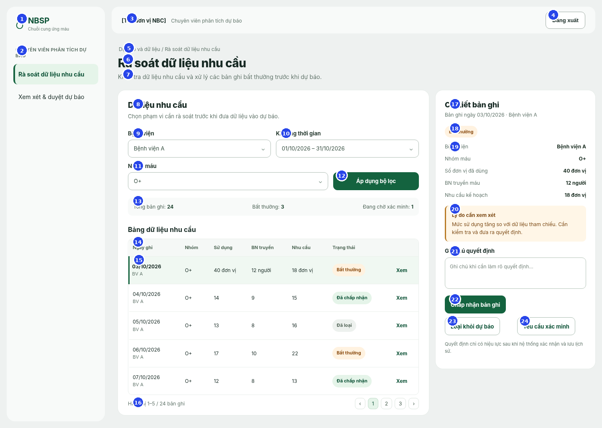
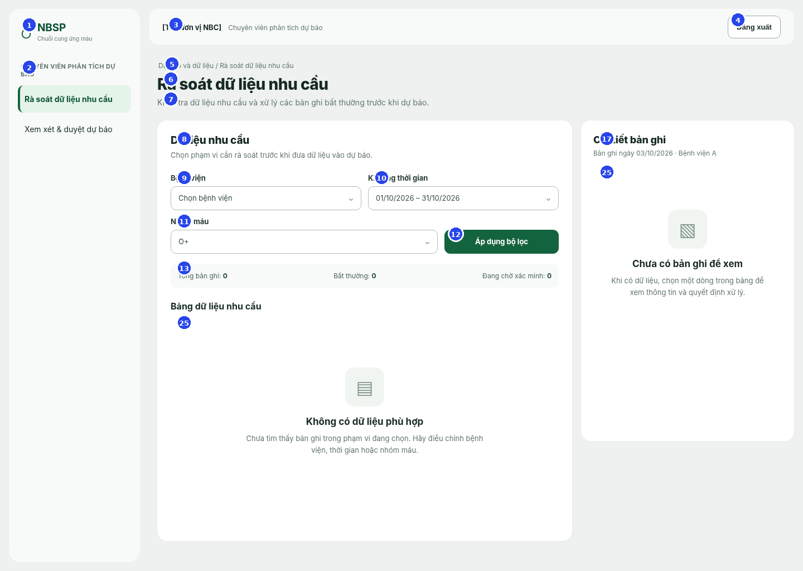
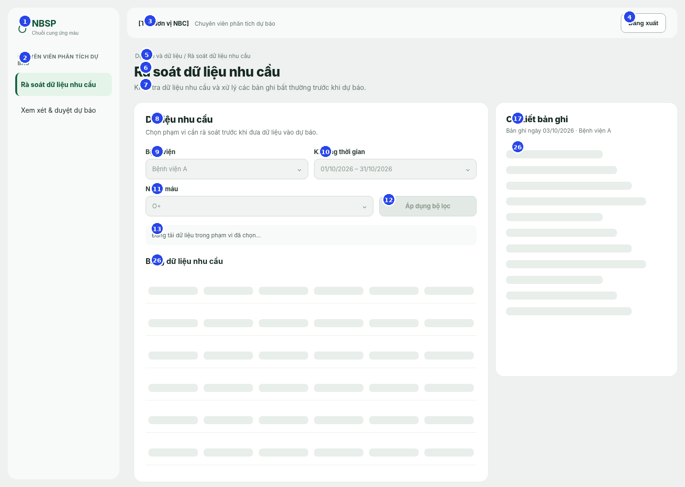
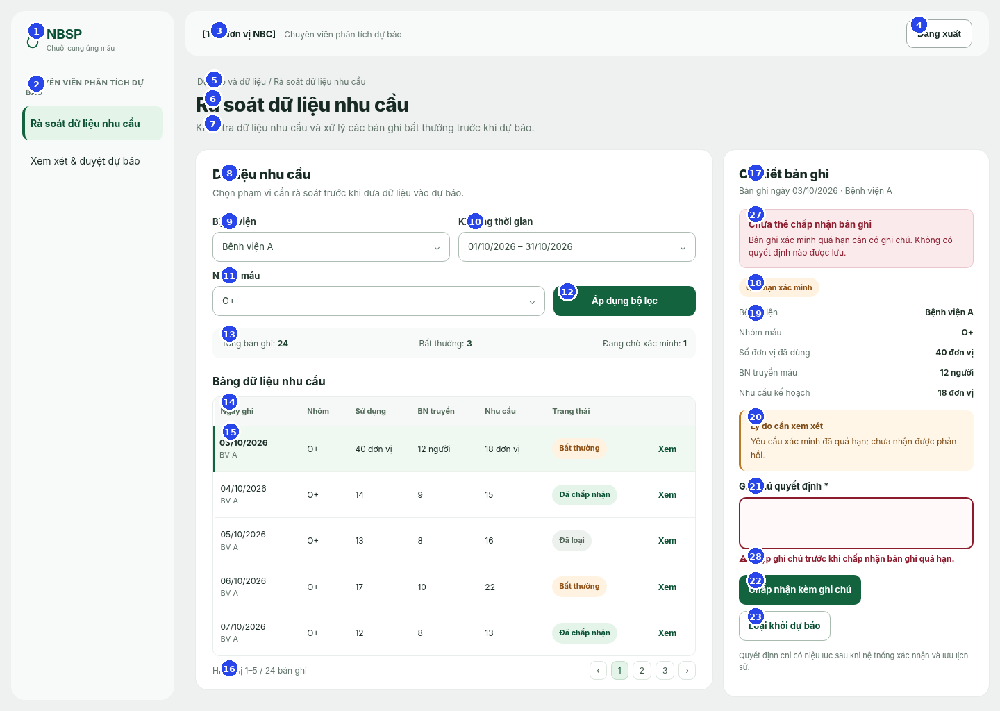

# Screen Spec: S-F03-02 Demand Data Review

| Field | Value |
|---|---|
| Screen ID | `S-F03-02` |
| Screen name | Demand Data Review (UI title: **“Rà soát dữ liệu nhu cầu”**) |
| Actor | NBC Forecasting Analyst — Chuyên viên phân tích dự báo NBC |
| Priority | Should (per Screen List; does not change any FR priorities) |
| Feature | F-03 Clinical Demand & Forecasting |
| Use cases / FRs | UC-13 · FR-03-02, FR-03-03; related FR-03-04, FR-03-08, FR-04-03, FR-04-04 |
| Activity / Sequence | [`AD-UC-13`](../../../activity/AD-UC-13.md) · [`SD-UC-13`](../../../use-case/SD-UC-13.md) |
| Usage Flow | NBC Forecasting Analyst Flow 1, [`usage-flow-total.md`](../../usage-flow/usage-flow-total.md) |
| Frame size | **1440 × 1024 px**, desktop, 1× (no mobile mockup) |
| Mockup images | `img/s-f03-02-{default,empty,loading,error,success}.png` and each corresponding `-numbered.png` (10 PNG) |
| Design reference | **Canonical screen `external-design/screens/s-f01-01`** (same outer layout); project UI Conventions v2.0 |
| Version | v3.0 · 21/11/2026 |
| Status | Draft — pending group review |

## 1. Purpose

**Shown when:** an authorised NBC Forecasting Analyst opens the clinical demand review workspace through the common sign-in (`S-F04-01`) or Analyst menu. The analyst selects a hospital, date range and blood group. NBSP loads usage quantities, transfusion-patient counts, scheduled demand, flags and their reasons (`FR-03-02`).

**Main task:** choose a flagged record and **Chấp nhận bản ghi**, **Loại khỏi dự báo**, or **Yêu cầu xác minh**. A verification request becomes `Pending Verification` and is handed off to Hospital Staff on UC-14; it is **not** an instant successful verification. When a verification is `Overdue`, acceptance requires a note; exclusion remains possible (`FR-03-03`). The server appends the decision history (`FR-04-04`).

**Leaves this screen when:** the user explicitly selects “Xem xét & duyệt dự báo” (`S-F03-04`) from the sidebar or logs out to `S-F04-01`. Completing UC-13 does **not** immediately navigate to UC-15: closing the demand period and generating a forecast draft are background processes (`FR-03-08`, `FR-03-05`).

## 2. Mockup

**Shared NBSP layout:** the same role-aware left sidebar, NBSP brand, 64px account/logout bar, breadcrumb, page heading, subtitle, white rounded cards, form controls, typography, colors, spacing and desktop margins used by the group's **S-F01-01** reference. The only structural difference is the business content: a demand/forecast table in the primary (left) card and its record-review panel in the supporting (right) card. **No alternate HuyếtMạch logo, top-bar global search, analytics KPI card row, or bottom account avatar.**

**Numbered images:** the blue numbers in each image refer directly to the element IDs in §3. **Five original + five numbered** images are provided, following the sample S-F01-01's exact naming convention.

| State | Numbered image | Numbers visible |
|---|---|---|
| **Default** |  | 1, 2, 3, 4, 5, 6, 7, 8, 9, 10, 11, 12, 13, 14, 15, 16, 17, 18, 19, 20, 21, 22, 23, 24 |
| **Empty** |  | 1, 2, 3, 4, 5, 6, 7, 8, 9, 10, 11, 12, 13, 17, 25 |
| **Loading** |  | 1, 2, 3, 4, 5, 6, 7, 8, 9, 10, 11, 12, 13, 17, 26 |
| **Error** |  | 1, 2, 3, 4, 5, 6, 7, 8, 9, 10, 11, 12, 13, 14, 15, 16, 17, 18, 19, 20, 21, 22, 23, 27, 28 |
| **Success** |  | 1, 2, 3, 4, 5, 6, 7, 8, 9, 10, 11, 12, 13, 14, 15, 16, 17, 18, 19, 29, 30 |

| State | Original PNG |
|---|---|
| **Default** | [`img/s-f03-02-default.png`](img/s-f03-02-default.png) |
| **Empty** | [`img/s-f03-02-empty.png`](img/s-f03-02-empty.png) |
| **Loading** | [`img/s-f03-02-loading.png`](img/s-f03-02-loading.png) |
| **Error** | [`img/s-f03-02-error.png`](img/s-f03-02-error.png) |
| **Success** | [`img/s-f03-02-success.png`](img/s-f03-02-success.png) |

All UI labels are Vietnamese. The output is a **1440 × 1024 px desktop image**, using the tokens in [UI Conventions v2.0](../../NBSP_UI_Conventions_Project_Wide_VI_v2.0.md). Representative values are test data, not real hospital records or new business thresholds.

## 3. Element inventory

Every number refers to a visible element or UI group; English terms in the spec are for engineering traceability, while labels rendered in the images are Vietnamese.

### 3.1. Page frame — all states

| # | Element | Type | Content / data source | Required | Validation and behaviour |
|---:|---|---|---|---|---|
| 1 | Brand | Logo + text | `NBSP`; “Chuỗi cung ứng máu” | Yes | Exact structure/position as S-F01-01; no actor-specific rebranding. |
| 2 | Menu for Forecasting Analyst | Role-based navigation | “Rà soát dữ liệu nhu cầu”, “Xem xét & duyệt dự báo”; active item highlighted | Yes | Only screens authorised to Analyst are displayed (FR-04-03). |
| 3 | Account header | Read-only session text | `nbc_unit.name`; role “Chuyên viên phân tích dự báo” | Yes | No unrelated account or simulated personal name. |
| 4 | Đăng xuất | Secondary button | Static action label | Yes | Ends session; navigates to `S-F04-01`. |
| 5 | Breadcrumb | Read-only navigation context | “Dự báo và dữ liệu / [Tên màn hình]” | Yes | Text contextual only; does not create a new screen/route. |
| 6 | Page title | Heading | Screen title in Vietnamese | Yes | Must equal UI Conventions and Screen List. |
| 7 | Subtitle | Supporting text | One short description of business task | Yes | No claim that the system has completed a task prematurely. |

### 3.2. Demand data and review controls

| # | Element | Type | Content / data source | Required | Validation and behaviour |
|---:|---|---|---|---|---|
| 8 | Dữ liệu nhu cầu heading | Card title + description | Section title and purpose | Yes | Left main card is aligned with S-F01-01 primary card. |
| 9 | Bệnh viện | Select | `filter.hospital_id` — sample “Bệnh viện A” | Yes | Authorised hospital only, required for filtered query. |
| 10 | Khoảng thời gian | Date-range select | `filter.date_from`, `date_to`, `dd/MM/yyyy` | Yes | Start ≤ end; dates are not invented by the UI. |
| 11 | Nhóm máu | Select | `filter.blood_group`: example O+ | Yes | Only configured ABO+Rh values; may change before query. |
| 12 | Áp dụng bộ lọc | Primary button | Run demand-data query | Yes | Disabled while query is loading. |
| 13 | Phạm vi / số liệu tổng | Read-only summary strip | Response counts: all records, flagged, Pending Verification | If loaded | Numbers refer to same filter and returned dataset. 24/3/1 are mock values. |
| 14 | Bảng dữ liệu nhu cầu | Table | `record.date`, `hospital`, `blood_group`, `usage_units`, `patient_count`, `scheduled_demand_units`, `record.status` | If records | One row per record; clinic counts labelled; no fabricated hospital privacy scope. |
| 15 | Dòng đang chọn | Selected table row | `record.id`, highlighted first row with “Xem” action | If selected | Panel must reference exactly this record; highlight uses green bar + background. |
| 16 | Phân trang | Pagination | Current page, total records | If multiple records | Shown 1–5/24 only as mock data; number of rows configurable. |
| 17 | Chi tiết bản ghi | Support card | Record context: hospital, day, blood group | Yes | Right card reuses form/card style of S-F01-01. |
| 18 | Trạng thái bản ghi | Status chip | `flagged` / `Overdue` / `Pending Verification` | If record | Always text + colour; not a new database status. |
| 19 | Các chỉ số bản ghi | Read-only key/value | Hospital, blood group, used units, patient count, planned demand | If selected | Must match selected `record.id`. |
| 20 | Lý do cần xem xét | Warning notice | `flag_reason` or overdue explanation supplied by system | If flagged | Does not invent anomaly threshold. |
| 21 | Ghi chú quyết định | Textarea | `decision.note` | Conditional | Required for Overdue acceptance; otherwise per W1. |
| 22 | Chấp nhận bản ghi | Primary button | `decision.action=accept` | If eligible | Overdue branch requires non-empty note; no save when validation fails. |
| 23 | Loại khỏi dự báo | Secondary button | `decision.action=exclude` | If eligible | Store Excluded + audit; no automatic forecast publish. |
| 24 | Yêu cầu xác minh | Secondary button | `decision.action=request_verification` | If eligible | Create request, mark Pending Verification and notify Hospital. |

### 3.3. State-specific elements

| # | Element | Type | Content / data source | Required | Validation and behaviour |
|---:|---|---|---|---|---|
| 25 | Empty placeholder | Info state | “Không có dữ liệu phù hợp”; adjust filters | Empty | Means current query is empty, not necessarily that the full dataset is empty. |
| 26 | Loading skeleton | Placeholder | Demand table and selected-record panel while retrieving | Loading | No record decision can be submitted while loading. |
| 27 | Error banner | Alert | “Chưa thể chấp nhận bản ghi”; overdue note required | Error | Server record remains unchanged. |
| 28 | Inline note error | Validation text | “Nhập ghi chú trước khi chấp nhận bản ghi quá hạn.” | Error | Displayed beneath textarea; error not conveyed by color alone. |
| 29 | Success banner | Status message | “Đã ghi nhận yêu cầu xác minh…” | Success | Shown after verified server response. |
| 30 | Pending Verification information | Read-only notice | Record now waiting for Hospital UC-14 | Success | Not confused with Accepted/verified. |

## 4. States

| State | What the user sees | Trigger |
|---|---|---|
| **Default** | Shared NBSP shell; demand filter, slim summary (not separate analytics cards), result table and selected-record detail on right. Analyst chooses Accept/Exclude/Request Verification. | Valid query returns at least one record. |
| **Empty** | Filter controls remain; left table area shows “Không có dữ liệu phù hợp”; right card explains no record is selected; no decision actions. | Filtered query returns zero rows. |
| **Loading** | Filter values persist but action is disabled; table and detail become skeletons, no success message. | Initial load or filter submission before server responds. |
| **Error** | Right panel shows overdue verification, missing-note banner and inline error. Existing values and selected row are preserved. | Analyst attempts Accept on Overdue without a note. No decision is stored. |
| **Success** | Right panel shows verified creation of a verification request; selected record shows “Đang chờ xác minh”. | Server records request and reports success; Hospital response is still outstanding. |

**Other supported behaviours not illustrated as separate PNGs:** Accepted/Excluded confirmation messages, verification response review, uncertain network result, and deadline/cut-off background rule. Each uses this same Screen ID and is described in AD/SD.

## 5. Interactions and navigation

| # | Element | User action | System response | Screen |
|---:|---|---|---|---|
| 1 | Sidebar review | Click | Retains or reopens current workspace. | `S-F03-02` |
| 2 | Sidebar forecast | Click | Opens draft-review workspace; does not create draft. | `S-F03-04` |
| 3 | Filters | Select hospital, dates, blood group | Updates temporary selections; validates scope. | Stays |
| 4 | Áp dụng bộ lọc | Click | Retrieve demand data / flags for selected scope; Loading → Default or Empty. | Stays |
| 5 | Table row “Xem” | Click | Loads matching record into right card. | Stays |
| 6 | Chấp nhận bản ghi | Click | Stores Accepted + audit if conditions met; missing overdue note → Error. | Stays |
| 7 | Loại khỏi dự báo | Click | Stores Excluded + audit; record excluded from forecast inputs. | Stays |
| 8 | Yêu cầu xác minh | Click | Saves request and marks Pending Verification; display Success after server confirms. | Stays |
| 9 | Pagination | Click | Returns next page of authorised filtered data. | Stays |
| 10 | Đăng xuất | Click | Ends the session. | `S-F04-01` |

## 6. Screen-level rules

| ID | Rule | Source |
|---|---|---|
| SR-13-01 | Actor must be NBC Forecasting Analyst; menu/data/action scope verified by backend. | FR-04-03 |
| SR-13-02 | Display usage, patient counts, planned demand, flags and reasons; do not define thresholds in the frontend. | FR-03-02 |
| SR-13-03 | Decisions apply to exactly one selected flagged record. | FR-03-03, AD-UC-13 |
| SR-13-04 | Overdue verification can be accepted **only with note**, or excluded. | FR-03-03 v3 |
| SR-13-05 | Sending verification leaves record Pending Verification; Hospital answers later in UC-14. | FR-03-03, FR-03-04 |
| SR-13-06 | Save action, actor, timestamp and prior/next values in audit log. | FR-04-04 |
| SR-13-07 | Closing a period / generating Draft happens in background, not through UC-13 screen. | FR-03-08, FR-03-05 |
| SR-13-08 | Error/Loading/Success are UI states, not new business-object statuses. | UI Conventions §3 |

## 7. Linked requirements

| Requirement | Coverage on this screen |
|---|---|
| FR-03-02 | Filter scope, retrieve demand records and show anomaly flags/reasons. |
| FR-03-03 | Record Accepted/Excluded/Pending Verification; require a note for Overdue acceptance. |
| FR-04-03 | Actor-scoped data and actions. |
| FR-04-04 | Append decision audit entries. |
| FR-03-04 / UC-14 | Hospital response is outside this screen; returning to review after verification. |
| FR-03-08 | Forecast cut-off runs independently; no extra button. |

## 8. Desktop and accessibility notes

- **1440 × 1024 px** rendered at 1×; desktop only. The frame uses the exact S-F01-01 visual shell (16px outer margin, 235–240px sidebar, 64px topbar, 2 rounded white content cards).
- Sidebar only contains role-authorised screens; there is no invented global search or user avatar card. `S-F04-01` remains the shared login, not a workspace.
- Table headers and numerical units remain visible. Long content should scroll/paginate at implementation; never shrink to illegibility.
- Each input keeps a persistent label; error messages appear next to related fields and are announced (`role="alert"`), while Success uses `role="status"`.
- Keyboard order: menu → filters → table → detail → note → actions. Focus visible. Minimum meaningful control contrast and text contrast follow UI Conventions §5.

## 9. Corrections from previous S-F03-02 design

| Issue in earlier file | Correction in this version |
|---|---|
| HuyếtMạch branding, account avatar and independent sidebar language | Replaced with **NBSP / Chuỗi cung ứng máu** and shared Analyst-role sidebar matching S-F01-01. |
| Topbar had different navigation and badges | Replaced with account title and outlined “Đăng xuất” button. |
| Multiple standalone KPI cards made it look like a different product | Replaced with a compact summary strip inside the main business card. |
| Data grid and controls floated across multiple dashboard panels | Consolidated under one left white card, with one supporting review card on the right. |
| 5 numbered files were incomplete or did not use current reference style | Exported all 5 numbered screenshots using blue element IDs matching §3. |
| Error/Success semantics risked changing the record too early | Error keeps record unchanged; Success confirms verification request only, not hospital response. |

## 10. Open questions

| # | Question | Blocking? | Status |
|---|---|---|---|
| 1 | What precise anomaly rules/thresholds are configured by the client? | Yes | Open; illustrated reason is only an example. |
| 2 | What deadline applies to a hospital verification request? | No | Open; overdue branch uses system-provided flag. |
| 3 | What are the backend record IDs, sorting and page-size rules? | No | Open; only proposed presentation in mock. |
| 4 | Should supplementary light warning/status backgrounds be formalized as UI color tokens? | No | Open; no new business behaviour. |

---

## Completion checklist

- [x] 5 original PNG + 5 numbered PNG, lower-case and in this screen's `img/` folder.
- [x] All screenshots **1440 × 1024 px** and aligned to reference S-F01-01.
- [x] Every numbered bubble corresponds to §3; each state contains only its relevant numbers.
- [x] UI copy is Vietnamese; labels/values use formats from UI Conventions.
- [x] Every action traces to the listed UC/FR or an open question.
- [x] Navigation targets exist in Screen List; no extra screen for error/success.
- [x] Error and Success show server-state distinctions clearly.
- [ ] Actual anomaly thresholds and deadlines to be agreed before code handoff.

## Changes in v3.0 (21/11/2026)

- Rebuilt layout to match group's **S-F01-01** visually; did not import unrelated LabDesk content.
- Removed analytics-dashboard chrome and independent branding from all five states.
- Regenerated 10 PNG images; updated numbered element mapping and screen-level details.
