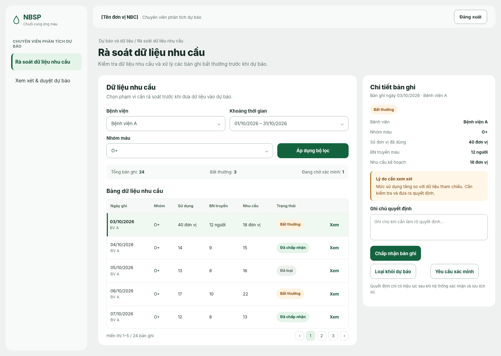
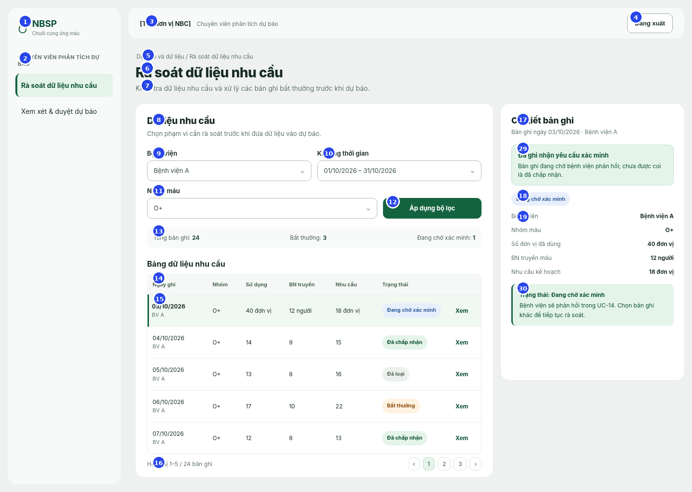

# Screen Spec: S-F03-02 Demand data review

| Field | Value |
|---|---|
| Screen ID | **S-F03-02** |
| Screen name | Demand data review (Vietnamese UI title: **“Rà soát dữ liệu nhu cầu”**) |
| Actor | **NBC Forecasting Analyst** (Chuyên viên phân tích dự báo NBC) |
| Priority | **Should** (theo Screen List; không sửa mức ưu tiên của FR) |
| Feature | **F-03 Clinical Demand & Forecasting** |
| Use cases / FRs | **UC-13** · `FR-03-02`, `FR-03-03`; cross-cutting `FR-04-03`, `FR-04-04`; background `FR-03-08`; cross-actor `FR-03-04` / UC-14 |
| Activity / sequence | [AD-UC-13](../../../activity/AD-UC-13.md) · [SD-UC-13](../../../use-case/SD-UC-13.md) |
| Usage flow | NBC Forecasting Analyst — Flow 1 ([Usage Flow](../../usage-flow/usage-flow-total.md)); mở từ `S-F04-01` sau đăng nhập hoặc qua menu |
| Mockup images | **10 PNG**: 5 state images + 5 numbered images; dùng tên viết thường `img/s-f03-02-<state>[\-numbered].png` |
| Frame size | **1440 × 1024 px** (desktop, 1×); nội dung dài hơn cần cuộn dọc ở phiên bản triển khai |
| UI conventions | [NBSP project-wide UI Conventions v2.0](../../NBSP_UI_Conventions_Project_Wide_VI_v2.0.md) |
| Version / status | **v2.0 · 21/11/2026 · Draft for group review** |

## 1. Purpose

**Shown when:** Analyst đã đăng nhập qua `UC-12` và cần kiểm tra dữ liệu nhu cầu theo **bệnh viện, từ ngày, đến ngày và nhóm máu**. NBSP cung cấp dữ liệu sử dụng máu, số bệnh nhân truyền máu, nhu cầu theo kế hoạch, những bản ghi vi phạm quy tắc và lý do bị gắn cờ (`FR-03-02`).

**Main task:** Với một bản ghi được gắn cờ, Analyst xem chi tiết và chọn **Chấp nhận bản ghi**, **Loại khỏi dự báo** hoặc **Yêu cầu xác minh** (`FR-03-03`). Nếu yêu cầu xác minh **Overdue**, Analyst chỉ được **Chấp nhận kèm ghi chú** hoặc **Loại**. Hệ thống lưu quyết định kèm dấu vết kiểm toán (`FR-04-04`).

**Leaves this screen:** Analyst chủ động chọn `S-F03-04` từ menu hoặc đăng xuất về `S-F04-01`. **Không** có chuyển màn tự động UC-13 → UC-15: đóng kỳ và sinh Draft là bước nền của `FR-03-08` và `FR-03-05`.

## 2. Mockup

**Numbered images:** mỗi hình có cùng số thứ tự với mục **Element Inventory §3**. Điểm khác bản cũ: **cả năm trạng thái đều có bản đánh số**, như chuẩn đã duyệt của `S-F01-01` trên GitHub; trạng thái nào không có một thành phần thì không hiển thị số đó.

| State | Numbered image | Numbers appearing |
|---|---|---|
| Default |  | 1–13, 14–20 |
| Empty |  | 1–13, 25 |
| Loading |  | 1–9, 26 |
| Error |  | 1–13, 14–22 (các thành phần phù hợp state) |
| Success |  | 1–13, 14–17, 23–24 |

| State | Original PNG | What the image communicates |
|---|---|---|
| **Default (with data)** | [`img/s-f03-02-default.png`](img/s-f03-02-default.png) | Bộ lọc, 4 KPI, bảng dữ liệu, 1 record bất thường đang chọn và 3 lựa chọn quyết định. |
| **Empty** | [`img/s-f03-02-empty.png`](img/s-f03-02-empty.png) | Không có bản ghi phù hợp điều kiện lọc; không khẳng định kho dữ liệu chung trống. |
| **Loading** | [`img/s-f03-02-loading.png`](img/s-f03-02-loading.png) | KPI, bảng và chi tiết hiển thị skeleton; không lưu quyết định khi chưa có phản hồi. |
| **Error** | [`img/s-f03-02-error.png`](img/s-f03-02-error.png) | Yêu cầu xác minh đã quá hạn; chọn Chấp nhận nhưng thiếu ghi chú bắt buộc. Không lưu quyết định. |
| **Success** | [`img/s-f03-02-success.png`](img/s-f03-02-success.png) | Server xác nhận đã tạo yêu cầu xác minh; record chuyển sang `Pending Verification`, **chưa** được bệnh viện trả lời. |

**Layout:** sidebar NBSP + role Analyst; topbar tài khoản/Đăng xuất; breadcrumb; tiêu đề; filter; KPI; bảng dữ liệu bên trái và panel một bản ghi bên phải. Thông báo lỗi/thành công là **state cùng Screen ID**, không tạo màn hình độc lập. Hình sử dụng dữ liệu giả lập; mọi số, tên bệnh viện, ngày và lý do phát hiện bất thường là ví dụ, **không** định nghĩa ngưỡng thực tế.

## 3. Element Inventory

Các nhãn dưới đây được ghi bằng **tiếng Việt đúng như wireframe**. `Required` nghĩa là thành phần cần có khi state tương ứng xuất hiện; không có nghĩa tất cả trường đều bắt buộc nhập.

### 3.1. Page frame — all states

| # | Element | Type | Content / data source | Required | Validation / visibility |
|---:|---|---|---|---|---|
| 1 | Nhận diện NBSP | Brand | “NBSP”, “Chuỗi cung ứng máu” | Yes | Text/logo dùng chung với `S-F01-01`; không có hành động nghiệp vụ. |
| 2 | Menu Analyst | Navigation | “Rà soát dữ liệu nhu cầu” (current), “Xem xét & duyệt dự báo” | Yes | Chỉ các màn Analyst được phân quyền (`FR-04-03`); không mở màn NBC Operations. |
| 3 | Thông tin tài khoản | Header text | Role NBC Forecasting Analyst, tenant NBC lấy từ session | Yes | Read-only; không lấy bệnh viện khác làm tài khoản. |
| 4 | Đăng xuất | Secondary button | “Đăng xuất” | Yes | Kết thúc session, về `S-F04-01`. |
| 5 | Breadcrumb | Navigation text | `NBSP › Dự báo › Rà soát dữ liệu nhu cầu` | Yes | Không làm Screen ID mới. |
| 6 | Tiêu đề | Heading | “Rà soát dữ liệu nhu cầu” | Yes | Đúng Screen List. |
| 7 | Mô tả | Text | “Kiểm tra số liệu và giải quyết các bản ghi bất thường trước khi dự báo.” | Yes | Thông tin tĩnh, không diễn giải là kỳ đã Finalised. |
| 8 | Bộ lọc | Filter card | `hospital_id`, `date_from`, `date_to`, `blood_group` | Yes | Ngày `dd/MM/yyyy`; `from ≤ to`; hospital/scope hợp lệ; blood group theo danh mục. |
| 9 | Áp dụng bộ lọc | Primary button | “Áp dụng bộ lọc” | Yes | Kiểm tra bộ lọc rồi gọi `FR-03-02`; hiển thị Loading. |
| 10 | Tổng bản ghi | KPI | Tổng số bản ghi trong tập đã truy vấn | Yes, except Loading | Lấy từ response của cùng filter/snapshot. |
| 11 | Bản ghi bất thường | KPI | Số bản ghi bị gắn cờ theo rules | Yes, except Loading | Không cố định ngưỡng. |
| 12 | Đang chờ xác minh | KPI | Số record ở `Pending Verification` | Yes, except Loading | Trạng thái dữ liệu, không phải UI Loading. |
| 13 | Đã xử lý | KPI | Số record đã có quyết định hợp lệ | Yes, except Loading | Thống kê cùng query; số trong PNG là mock. |

### 3.2. Data grid and decision panel — Default / Error / Success

| # | Element | Type | Content / data source | Required | Validation / visibility |
|---:|---|---|---|---|---|
| 14 | Bảng dữ liệu nhu cầu | Table | `record.date`, `hospital`, `blood_group`, `blood_usage_units`, `transfusion_patient_count`, `scheduled_demand_units`, `record_status` | Yes if data | Ngày, số, nhóm máu đọc được; dòng nằm trong quyền; không hiển thị dữ liệu ngoài phạm vi. |
| 15 | Dòng đang chọn | Table row + “Xem” | `record_id`, các cột của đúng record | Yes if record chosen | Giữ ID để quyết định không rơi vào bản ghi khác. |
| 16 | Phân trang | Table controls | `page`, `page_size`, `total` | If multiple records | “1–6 / 24 bản ghi” là mock, không có page size cố định trong FR. |
| 17 | Chi tiết bản ghi | Read-only card | Hospital, date, blood group, used units, patients, plan, status của selected record | If selected | Một panel gắn duy nhất với `record_id`. |
| 18 | Lý do bất thường / quá hạn | Notice | `anomaly_reason`, verification status/deadline | If flagged/overdue | Lý do từ hệ thống; không tự tính thresholds trên FE. |
| 19 | Ghi chú quyết định | Textarea | `decision.note` | Conditional | **Bắt buộc khi chấp nhận record có yêu cầu xác minh Overdue**; các trường hợp khác theo W1. |
| 20 | Nhóm hành động quyết định | Action buttons | “Chấp nhận bản ghi”, “Loại khỏi dự báo”, “Yêu cầu xác minh”; khi overdue là “Chấp nhận kèm ghi chú” / “Loại khỏi dự báo” | Conditional | Kiểm tra role, record state, note; khóa khi đang lưu; không lưu khi lỗi. |

### 3.3. State-specific UI elements

| # | Element | Type | Content / data source | Required | Validation / visibility |
|---:|---|---|---|---|---|
| 21 | Banner lỗi | Alert (`role="alert"`) | “Chưa thể chấp nhận bản ghi quá hạn. Nhập ghi chú bắt buộc…” | Error | Không hiện success; record chưa đổi. |
| 22 | Inline error ghi chú | Field validation | “Nhập ghi chú trước khi chấp nhận yêu cầu quá hạn.” | Error | Gắn với textarea; focus đúng trường. |
| 23 | Banner thành công | Status (`role="status"`) | “Đã gửi yêu cầu xác minh tới bệnh viện.” | Success | Chỉ sau response thành công từ NBSP. |
| 24 | Trạng thái chờ xác minh | Notice/status | `Pending Verification`, hướng tới Hospital UC-14 (`S-F03-03`) | Success | Không hiển thị như “Đã chấp nhận” hoặc “Bệnh viện đã phản hồi”. |
| 25 | Empty state | Placeholder | “Không có dữ liệu phù hợp”; hướng đổi bộ lọc | Empty | Có kết quả truy vấn hợp lệ nhưng danh sách rỗng. |
| 26 | Loading skeleton | Placeholder | Thanh/khối chờ cho KPI, bảng, detail | Loading | Không để người dùng thao tác lên dữ liệu chưa tải. |

**FE/BE naming suggestion (not official DB schema):** `filter{hospital_id,date_from,date_to,blood_group}`, `demandRecord{id,date,hospital_id,blood_group,usage_units,patient_count,scheduled_demand_units,flag_reason,status}`, `decision{record_id,action,note}`. Các key phải xác nhận từ API; tuyệt đối không biến mô phỏng thành requirement mới.

## 4. States

| State | What the user sees | Trigger | Expected behavior |
|---|---|---|---|
| Default | Bản ghi đã được load; KPI + danh sách + panel selected; có 3 hướng quyết định | Filter hợp lệ, query có dữ liệu | Chọn từng record, nhập ghi chú nếu cần và ghi 1 quyết định. |
| Empty | Table không có hàng; panel “Chưa chọn bản ghi”; có gợi ý đổi filter | Filter hợp lệ, server trả tập rỗng | Không có quyết định nào được ghi. |
| Loading | Skeleton và vùng lựa chọn không khả dụng | Mở màn / nhấn Áp dụng bộ lọc | Đợi response; chuyển Default / Empty / lỗi kỹ thuật. |
| Error | Banner + ghi chú trống có viền lỗi, selected record vẫn “Quá hạn xác minh” | Nhấn “Chấp nhận kèm ghi chú” khi `note` trống | Giữ lựa chọn, yêu cầu bổ sung note; **không** ghi `Accepted`. |
| Success | Banner “Đã gửi yêu cầu xác minh”; selected record chuyển `Pending Verification` | Server lưu verification request và notify Hospital thành công | Chọn record khác hoặc chờ UC-14; **không** giả định đã hoàn tất xác minh. |

**Additional non-picture branches:** `Accepted`/`Excluded` thành công có thông báo tương ứng tại cùng màn hình; phản hồi Hospital từ UC-14 rồi Analyst review lại; overdue notification; lỗi mạng/không rõ kết quả thì phải tra lại server state trước khi gửi lại; khi cut-off, hệ thống tự xử lý FR-03-08 và **không** thêm CTA cho Analyst. Các nhánh này là hành vi theo requirement/khuyến nghị, không tạo Screen ID mới.

## 5. Interactions and navigation

| # | Element | User action | System response | Goes to screen |
|---:|---|---|---|---|
| 1 | Menu “Rà soát dữ liệu nhu cầu” | Click | Giữ workspace UC-13, tải phạm vi mới khi cần | `S-F03-02` (stays) |
| 2 | Menu “Xem xét & duyệt dự báo” | Click | Mở workspace dự báo (không tự sinh Draft) | `S-F03-04` |
| 3 | Bộ lọc | Chọn bệnh viện, ngày, nhóm máu | Lưu lựa chọn tạm, kiểm tra định dạng | stays |
| 4 | Áp dụng bộ lọc | Click | Query và flag record theo rules (FR-03-02) | stays (Loading → Default/Empty) |
| 5 | “Xem” dòng | Click | Panel hiển thị đúng `record_id` | stays |
| 6 | Chấp nhận bản ghi | Click | Lưu `Accepted`, quyết định và audit khi hợp lệ | stays (success feedback) |
| 7 | Loại khỏi dự báo | Click | Lưu `Excluded`, không đưa record vào nguồn dự báo | stays |
| 8 | Yêu cầu xác minh | Click | Tạo yêu cầu xác minh, record `Pending Verification`, thông báo bệnh viện | stays (Success) |
| 9 | Chấp nhận record overdue | Click | Kiểm tra note; thiếu → Error; đủ → `Accepted` + note | stays |
| 10 | Đổi bộ lọc sau Empty | Click | Đặt lại/chỉnh bộ lọc, tải lại khi áp dụng | stays |
| 11 | Phân trang | Click | Nạp trang mới trong phạm vi quyền | stays |
| 12 | Đăng xuất | Click | Kết thúc session | `S-F04-01` |

## 6. Screen-level rules

| Rule ID | Rule | Source |
|---|---|---|
| SR-13-01 | Chỉ NBC Forecasting Analyst được quyết định; query và mutation luôn kiểm tra phân quyền tại BE. | FR-04-03, UC-12 |
| SR-13-02 | Hiển thị usage, transfusion-patient counts, scheduled demand và lý do flag từ quy tắc cấu hình. | FR-03-02 |
| SR-13-03 | Mỗi quyết định gắn một record được chọn; không duyệt hàng loạt record bất thường do xem bảng. | FR-03-03, AD-UC-13 |
| SR-13-04 | Với verification request Overdue: chỉ **Accept kèm note** hoặc **Exclude**. | FR-03-03 (EARS v3) |
| SR-13-05 | Request Verification chỉ làm record thành Pending Verification; Hospital Staff xử lý ở UC-14. | FR-03-03, FR-03-04 |
| SR-13-06 | Quyết định và trạng thái trước/sau phải được ghi audit append-only. | FR-04-04 |
| SR-13-07 | Đóng kỳ Finalised/cut-off là xử lý nền, không tạo nút “Tạo dự báo” hoặc “Đóng kỳ”. | FR-03-08, FR-03-05 |
| SR-13-08 | Success/Empty/Loading/Error là **UI states**, không phải trạng thái nghiệp vụ mới. | UI Conventions v2.0, Decision Log D-23 |
| SR-13-09 | Chỉ báo thành công khi server xác nhận; nếu mất kết nối với kết quả không chắc chắn thì tra lại trước khi retry. | UI Conventions v2.0 (đề xuất kỹ thuật) |

## 7. Linked requirements

| ID | Screen coverage |
|---|---|
| FR-03-02 | Bộ lọc, dữ liệu usage/patients/scheduled demand, flags + reasons. |
| FR-03-03 | Quyết định Accept/Exclude/Request Verification, xử lý overdue, record status. |
| FR-04-03 | Scope/role của menu, read và write endpoints. |
| FR-04-04 | Audit lịch sử các quyết định. |
| FR-03-08 | Cut-off/Finalised background dependency, **không phải nút trên screen**. |
| FR-03-04 / UC-14 | Cross-actor: Hospital phản hồi xác minh tại `S-F03-03`. |

## 8. Responsive and accessibility notes

- **Chỉ thiết kế desktop 1440 × 1024 px** theo UI Conventions; các PNG xuất ở 1×. Khi số dòng lớn, bảng cần cuộn/phân trang ở triển khai; mobile chưa trong phạm vi wireframe.
- Label và đơn vị được giữ cạnh dữ liệu; date `dd/MM/yyyy`, nhóm máu ABO + Rh; chữ trạng thái luôn đi cùng màu. Nội dung y khoa không được biểu đạt chỉ bằng màu.
- Hỗ trợ Tab theo menu → filters → bảng → note → actions; hiển thị focus; read-only cell không giả dạng input. Lỗi nhập ghi chú được gắn `aria-describedby`; banner Error là `role="alert"`, Success là `role="status"`.
- Mục tiêu WCAG: chữ thường ≥ 4.5:1, viền/biểu tượng có ý nghĩa ≥ 3:1; font/body/spacing dùng token của UI Conventions. Các contrast cụ thể của trình duyệt cần audit trước coding.

## 9. Mockup corrections compared with previous S-F03-02 delivery

| # | Previous problem / mismatch | Correction in v2.0 |
|---:|---|---|
| 1 | **Chỉ có 7 ảnh**: thiếu Empty, Loading, Success **numbered**. | Đã tạo đủ **5 ảnh gốc + 5 ảnh numbered** cho chính từng state. |
| 2 | Tên ảnh/Screen Spec chưa đồng bộ convention mới nhất của GitHub. | Tên file **chữ thường** `s-f03-02-*.png` và `screen-spec-s-f03-02.md`. |
| 3 | Màn hình dùng thương hiệu/khung khác với mẫu Screen Spec `S-F01-01`. | Chuẩn hóa **NBSP / Chuỗi cung ứng máu**, sidebar theo role, topbar, breadcrumb, card, các màu token v2.0. |
| 4 | Các ảnh numbered không bao phủ thành phần của mỗi state. | Element numbers riêng theo state; trang có thể thiếu element không hiện tại state đó. |
| 5 | Chưa phân biệt rõ lỗi overdue và kết quả verification request. | Error = thiếu note → không lưu Accepted; Success = **Pending Verification** sau server response. |
| 6 | Cấu trúc spec mức chi tiết thấp hơn mẫu nhóm. | Tách Page Frame / Data Grid / State-Specific; thêm data source, validation, interactions, linked FR, check và change notes. |

## 10. Open questions

| # | Question | Blocking? | Status |
|---:|---|---|---|
| 1 | Quy tắc/threshold bất thường cụ thể nào đã được phê duyệt? | Yes (logic) | Open, W5 / AD-UC-13. |
| 2 | Nguồn số bệnh nhân truyền máu thực tế (`transfusion_patient_count`) là gì? | Yes (data contract) | Open, W5. |
| 3 | Deadline xác minh bệnh viện lấy từ cấu hình nào? | No (UI structure) | Open. |
| 4 | Khi Hospital phản hồi UC-14, `Pending Verification` trở lại luồng review như thế nào? | No | Open; cần chốt với AD-UC-13/14. |
| 5 | Khi nhiều Analyst thao tác đồng thời, xử lý record conflict ra sao? | No | Open (engineering decision). |
| 6 | Ngưỡng quyền dữ liệu theo bệnh viện/bộ phận và giới hạn phân trang cụ thể? | No | Open, FR-04-03. |

---

## Completion checklist

- [x] **10 PNG**: 5 base images + 5 numbered images, tên viết thường theo `S-F01-01` reference.
- [x] Mỗi PNG độc lập kích thước **1440 × 1024 px**; không dùng ảnh LabDesk.
- [x] Numbered labels đối chiếu đúng số trong Element Inventory.
- [x] Mọi thành phần quan trọng có data source, validation hoặc ghi rõ conditional.
- [x] Các state Error/Success không tự thay đổi nghiệp vụ trước khi NBSP xác nhận.
- [x] FR IDs, Screen IDs, actor và UI terminology khớp các nguồn đã đọc.
- [x] Image paths tương đối nằm cùng thư mục `img/`.
- [ ] Quy tắc và nguồn dữ liệu open question được nhóm chốt trước coding.
- [ ] Nhóm kiểm duyệt cuối sự phù hợp với Figma đang triển khai (wireframe này hiện là PNG tĩnh).

### Changes in v2.0 (21/11/2026)

Mở rộng 7→10 PNG; dựng lại bố cục theo NBSP `S-F01-01` chuẩn, thống nhất tên ảnh/đường dẫn; đánh số lại inventory; tách rõ Overdue error, Pending Verification success và trigger/handoff qua UC-14; bổ sung quy định về việc không tạo liên kết trực tiếp UC-13 → UC-15 và checklist đối chiếu màn/FR.
