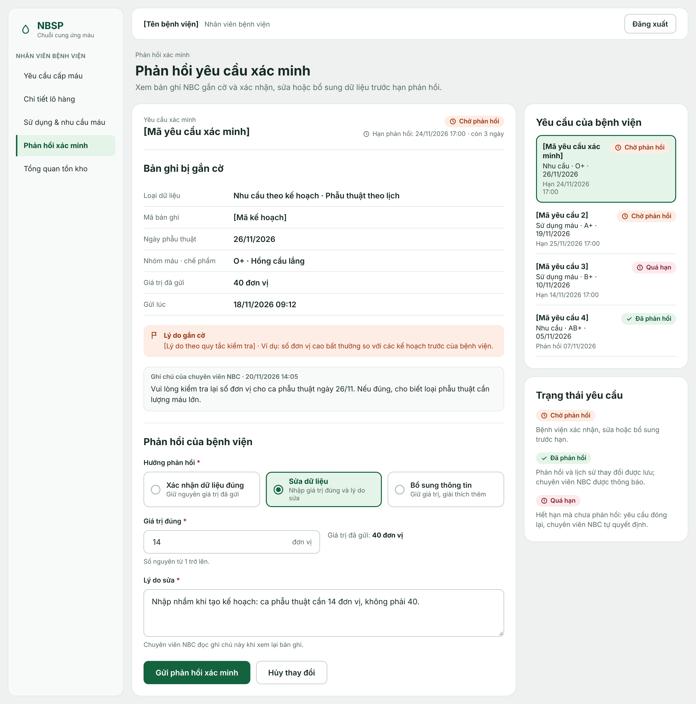
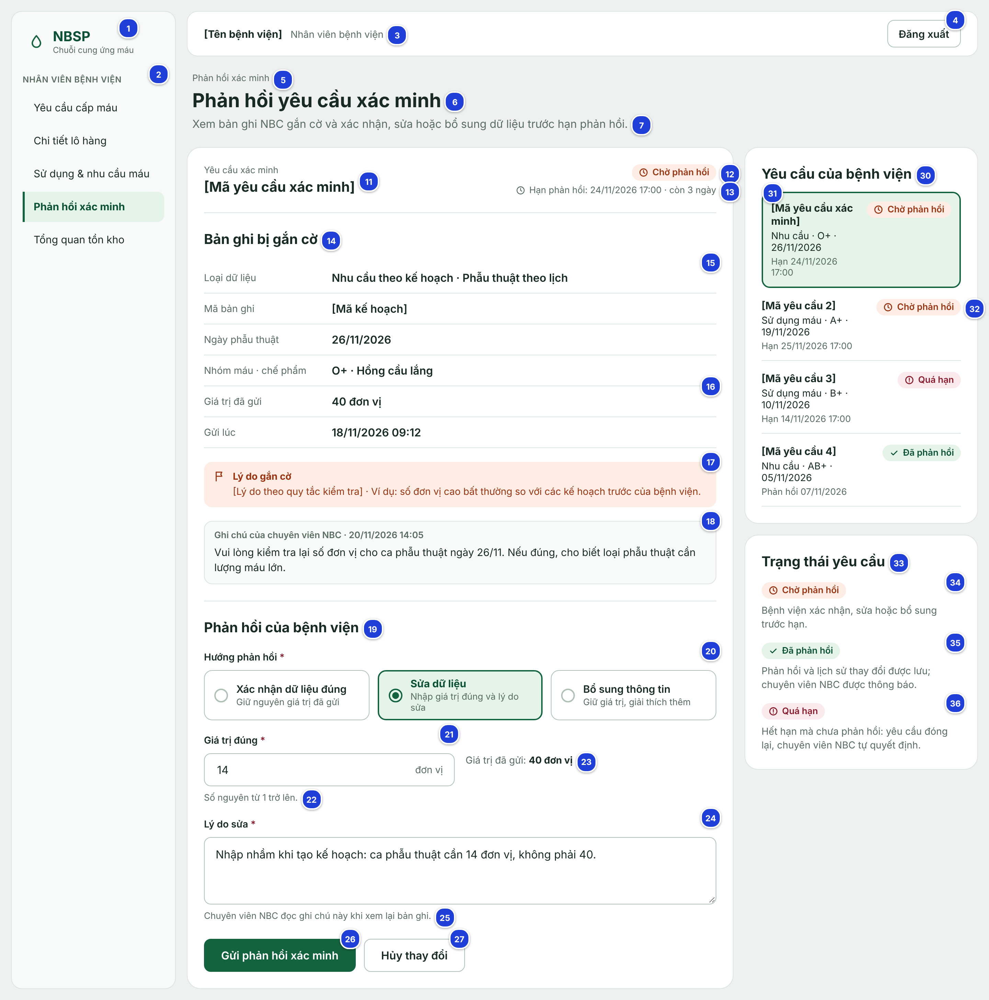
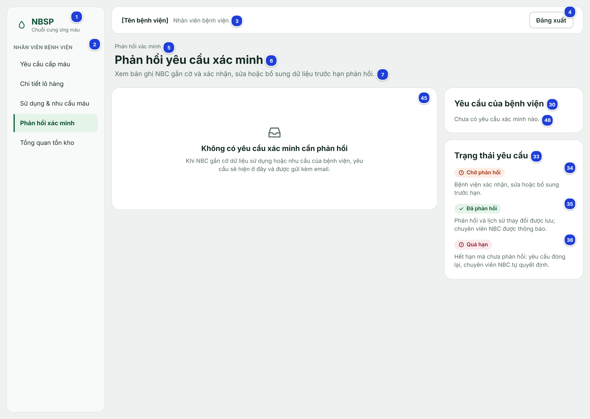
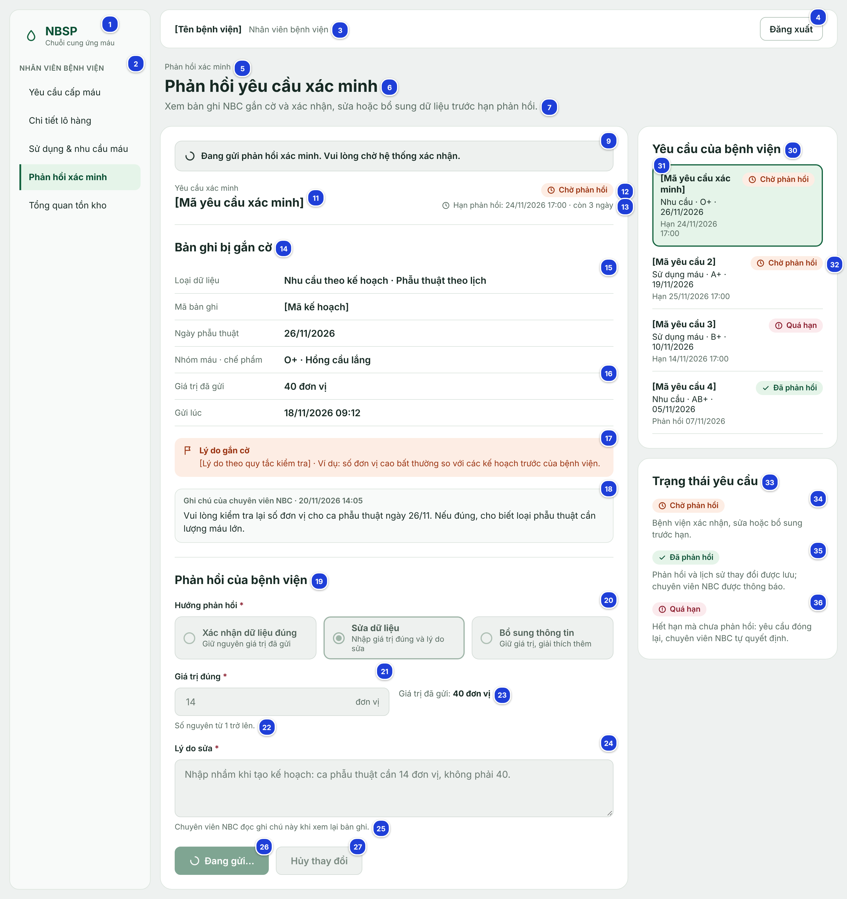
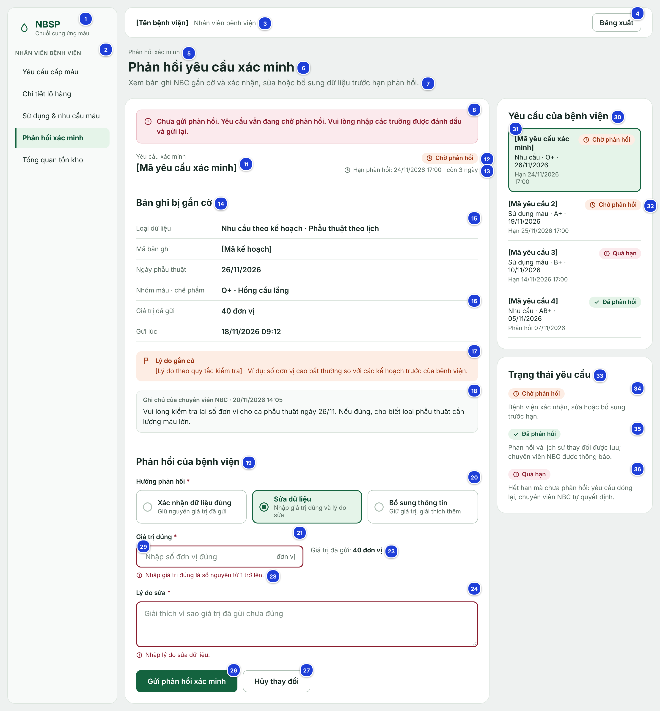
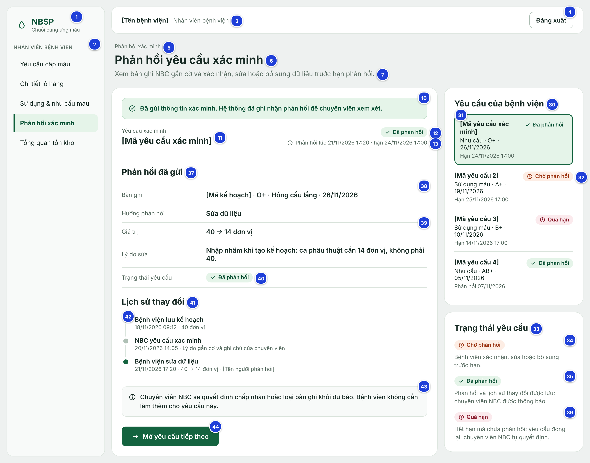

# Screen Spec: S-F03-03 Verification response

| Field | Value |
|---|---|
| Screen ID | S-F03-03 |
| Screen name | Verification response, "Verification Respond" (Vietnamese UI title: "Phản hồi yêu cầu xác minh"; menu label and breadcrumb "Phản hồi xác minh") |
| Actor | Hospital Staff |
| Priority | Could (`screen-list.md`; W4 effective priority of FR-03-04: Could, release R3) |
| Feature | F-03 Clinical Demand & Forecasting |
| Use cases / FRs | UC-14 · FR-03-04 (as in `screen-list.md`); supporting: FR-04-04 (change history) |
| Activity diagrams | AD-UC-14 (v1.0) |
| Sequence diagrams | SD-UC-14 |
| Usage flow | Hospital Staff Flow 3 "Respond to a data verification request" (`usage-flow.md` v2.3): verification email from NBC → S-F04-01 (if signed out) → **S-F03-03** |
| Mockup images | `img/s-f03-03-default.png`, `img/s-f03-03-empty.png`, `img/s-f03-03-loading.png`, `img/s-f03-03-error.png`, `img/s-f03-03-success.png`; numbered: the same five names ending in `-numbered.png` (section 2) |
| Frame size | 1440 px wide (desktop, UI conventions v2.0 §2.1), exported at 2x (2880 px). Height grows with the content: 1455 px (default), 1024 px (empty), 1527 px (loading), 1551 px (error), 1131 px (success); the page scrolls vertically |
| Figma frame | Not yet in Figma. Draft frames on the design canvas https://claude.ai/artifact/BF77VmyRjL3vdqqTiHCMYU (frames "S-F03-03 · Phản hồi xác minh · 1 to 5") |
| Version | v2.0, 21/11/2026 (changes at the end of this file) |
| Status | Draft |

## 1. Purpose

**Shown when:** an NBC Forecasting Analyst has flagged a demand record of the hospital (a usage record or a planned demand, both recorded on S-F02-01) and sent a verification request (UC-13, FR-03-03). The hospital receives an email. Hospital Staff open the request from the email link or from the menu, read the flagged record, the reason it was flagged and the analyst's note, then answer before the deadline in one of three ways: confirm the data is correct, correct it (new value and a reason), or supplement it (more information) (UC-14). NBSP saves the response and the change history, sets the request Responded and notifies the analyst (FR-03-04, FR-04-04).

**The user leaves this screen when:** the response is sent and the user opens the next request, opens another menu item, or signs out. The screen has no other way out (`screen-transition.md`: S-F03-03 ends its task and is left through the menu).

**Entry points** (`screen-list.md`, `screen-transition.md`): link in the verification email from NBC (through S-F04-01 when signed out, then back to the request); menu item "Phản hồi xác minh". There is no in-app badge or notification centre.

## 2. Mockup

**Layout (all states):** sidebar on the left (brand, role group, menu for Hospital Staff); top bar (hospital name, role, Sign out); breadcrumb, title and subtitle; main card on the left of the content area (request header, flagged record, then the response form, or the response summary in the success state); on the right, the card "Yêu cầu của bệnh viện" (the hospital's verification requests, the open one highlighted) and the card "Trạng thái yêu cầu".

**Numbered images:** each number is the # in the element inventory (section 3), placed at the top-right corner of the element (at the left edge for elements 29, 31 and 42, at the end of the text for one-line texts). Every visible element has its own number: a field's label and control are one element, its helper text is a separate element, and each part of a card is numbered separately. A repeated element (a list row, a status chip in a list) is numbered once, on its first occurrence. Elements 28 and 29 are numbered once, on the "Giá trị đúng" field; 28 replaces the helper texts 22 and 25 in the error image.

| State | Numbered image | Numbers shown |
|---|---|---|
| Default |  | 1–7, 11–27, 30–36 |
| Empty |  | 1–7, 30, 33–36, 45–46 |
| Loading |  | 1–7, 9, 11–27, 30–36 |
| Error |  | 1–8, 11–21, 23–24, 26–36 |
| Success |  | 1–7, 10–13, 30–44 |

| State | Image | What it shows |
|---|---|---|
| Default (with data) | `img/s-f03-03-default.png` | Open request for a planned demand of 40 đơn vị O+; "Sửa dữ liệu" chosen, new value 14 and a reason; Send enabled |
| Empty | `img/s-f03-03-empty.png` | The hospital has no verification request |
| Loading | `img/s-f03-03-loading.png` | Sending banner, response cards and fields disabled, Send with spinner |
| Error | `img/s-f03-03-error.png` | "Sửa dữ liệu" chosen with no new value and no reason (AD-UC-14 d2 [incomplete]): banner and a message under each missing field; the request stays Open |
| Success | `img/s-f03-03-success.png` | Success banner, request now "Đã phản hồi", response summary, change history, next request |

The Overdue and Responded views of a request have no image; they are described in section 4. An Overdue request appears in the list of every image.

All colours, fonts and corners come from the design tokens in the UI conventions v2.0, section 6 ([ui-conventions.md](../ui-conventions.md#6-design-tokens)), except the colours listed in open question 8.

## 3. Element inventory

Vietnamese labels are written as they appear in the mockup.

### 3.1 Page frame and banners (all states)

| # | Element | Type | Content / data source | Required | Validation |
|---|---|---|---|---|---|
| 1 | Brand | Logo and text | static: "NBSP", "Chuỗi cung ứng máu" | Yes | none |
| 2 | Menu | Navigation | static; role group "NHÂN VIÊN BỆNH VIỆN" and the items allowed for Hospital Staff (FR-04-03): "Yêu cầu cấp máu", "Chi tiết lô hàng", "Sử dụng & nhu cầu máu", "Phản hồi xác minh" (current, marked by background, left bar and bold text), "Tổng quan tồn kho". No count badge on any item (`screen-list.md`, UI conventions OQ-03) | Yes | none |
| 3 | Account info | Text | `hospital.name` ("[Tên bệnh viện]") and the role "Nhân viên bệnh viện", from the session | Yes | none |
| 4 | Sign out | Secondary button | label "Đăng xuất" | Yes | none |
| 5 | Breadcrumb | Text | static: "Phản hồi xác minh" | Yes | none |
| 6 | Title | Header | static: "Phản hồi yêu cầu xác minh" | Yes | none |
| 7 | Subtitle | Text | static: "Xem bản ghi NBC gắn cờ và xác nhận, sửa hoặc bổ sung dữ liệu trước hạn phản hồi." | Yes | none |
| 8 | Error banner | Banner (`role="alert"`) | static: "Chưa gửi phản hồi. Yêu cầu vẫn đang chờ phản hồi. Vui lòng nhập các trường được đánh dấu và gửi lại." (proposed copy, open question 9) | No | shown only after an incomplete response |
| 9 | Sending banner | Banner (`role="status"`) with spinner | static: "Đang gửi phản hồi xác minh. Vui lòng chờ hệ thống xác nhận." | No | shown only while the server has not answered |
| 10 | Success banner | Banner (`role="status"`) with tick icon | static: "Đã gửi thông tin xác minh. Hệ thống đã ghi nhận phản hồi để chuyên viên xem xét." (UI conventions §4.2) | No | shown only after the server confirms |

### 3.2 Request and flagged record (default, loading, error and success states)

| # | Element | Type | Content / data source | Required | Validation |
|---|---|---|---|---|---|
| 11 | Request label and code | Text | "Yêu cầu xác minh" and `verification.id` ("[Mã yêu cầu xác minh]") | Yes | read-only |
| 12 | Request status chip | Chip | `verification.status`: Open "Chờ phản hồi" (clock), Responded "Đã phản hồi" (tick), Overdue "Quá hạn" (alert) | Yes | read-only |
| 13 | Deadline line | Text with clock icon | Open: "Hạn phản hồi: `verification.deadline` · còn N ngày"; Responded: "Phản hồi lúc `verification.responded_at` · hạn `verification.deadline`"; Overdue: "Đã quá hạn lúc `verification.deadline`" | Yes | deadline from configuration (D-19) |
| 14 | Flagged record title | Header | static: "Bản ghi bị gắn cờ" | Yes | none |
| 15 | Flagged record rows | Label–value rows | "Loại dữ liệu" `record.kind` (Sử dụng máu · Đã sử dụng/Đã loại bỏ, or Nhu cầu theo kế hoạch · Phẫu thuật theo lịch/Truyền máu định kỳ); "Mã bản ghi" `record.id`; the record date ("Ngày sử dụng", "Ngày phẫu thuật" or "Ngày bắt đầu"); "Nhóm máu · chế phẩm"; row 16; "Gửi lúc" `record.created_at` | Yes | read-only |
| 16 | Sent value row | Label–value row | "Giá trị đã gửi" `record.flagged_value` + unit | Yes | read-only |
| 17 | Flag reason | Notice with flag icon | title "Lý do gắn cờ"; `verification.flag_reason`, the reason produced by the configured validation rule (FR-03-02); the mockup shows "[Lý do theo quy tắc kiểm tra] · Ví dụ: …" | Yes | read-only; the screen does not invent a threshold |
| 18 | Analyst note | Note box | "Ghi chú của chuyên viên NBC · `verification.created_at`"; `verification.analyst_note` | No | read-only; hidden when empty |

### 3.3 Response form (default, loading and error states)

| # | Element | Type | Content / data source | Required | Validation |
|---|---|---|---|---|---|
| 19 | Response title | Header | static: "Phản hồi của bệnh viện" | Yes | none |
| 20 | Response type | Label and single-choice cards (3) | label "Hướng phản hồi *"; `response.type`: "Xác nhận dữ liệu đúng" (Giữ nguyên giá trị đã gửi), "Sửa dữ liệu" (Nhập giá trị đúng và lý do sửa), "Bổ sung thông tin" (Giữ giá trị, giải thích thêm) | Yes | exactly one value (FR-03-04) |
| 21 | Corrected value | Label and number input with unit | shown only for "Sửa dữ liệu"; "Giá trị đúng *"; `response.corrected_value`; placeholder "Nhập số đơn vị đúng"; unit of the flagged field | Yes for Correct | whole number of 1 or more [0 allowed? open question 4]; different from the sent value |
| 22 | Corrected value hint | Helper text | static: "Số nguyên từ 1 trở lên." | Yes for Correct | replaced by the error message when invalid |
| 23 | Sent value reminder | Text beside element 21 | "Giá trị đã gửi: `record.flagged_value`" | Yes for Correct | read-only |
| 24 | Response text | Label and multi-line text | label by type: "Ghi chú (không bắt buộc)" for Confirm, "Lý do sửa *" for Correct, "Thông tin bổ sung *" for Supplement; `response.note` | Yes for Correct and Supplement | not empty for Correct and Supplement (AD-UC-14 d2); maximum length [TBD] |
| 25 | Response text hint | Helper text | static: "Chuyên viên NBC đọc ghi chú này khi xem lại bản ghi." | Yes | replaced by the error message when invalid |
| 26 | Send response | Primary button | label "Gửi phản hồi xác minh"; while sending a spinner and "Đang gửi…" | Yes | disabled while sending; hidden when the request is not Open |
| 27 | Cancel changes | Secondary button | label "Hủy thay đổi" | No | disabled while sending |
| 28 | Field error messages | Inline text with error icon | one message under each missing or invalid field, in place of its helper text (texts in section 4) | No | shown only after an incomplete response |
| 29 | Invalid field marker | Border | red 2 px border on each invalid field, together with element 28 | No | shown only after an incomplete response |

### 3.4 Right column (all states)

| # | Element | Type | Content / data source | Required | Validation |
|---|---|---|---|---|---|
| 30 | Request list title | Header | static: "Yêu cầu của bệnh viện" | Yes | none |
| 31 | Request list | List of links | the hospital's verification requests, Open first then by deadline; each row: `verification.id`, the record ("Nhu cầu" or "Sử dụng máu" · `blood_type` · record date), "Hạn `deadline`" or "Phản hồi `responded_at`"; the request shown in the main card has a green border and background (`aria-current`) | Yes | only the signed-in hospital's requests (BR-06, FR-04-03) |
| 32 | Row status chip | Chip in each row | "Chờ phản hồi", "Đã phản hồi" or "Quá hạn" | Yes | read-only |
| 33 | Status guide title | Header | static: "Trạng thái yêu cầu" | Yes | none |
| 34 | Step "Chờ phản hồi" | Status chip and one line | static: "Bệnh viện xác nhận, sửa hoặc bổ sung trước hạn." | Yes | none |
| 35 | Step "Đã phản hồi" | Status chip and one line | static: "Phản hồi và lịch sử thay đổi được lưu; chuyên viên NBC được thông báo." | Yes | none |
| 36 | Step "Quá hạn" | Status chip and one line | static: "Hết hạn mà chưa phản hồi: yêu cầu đóng lại, chuyên viên NBC tự quyết định." | Yes | none |

### 3.5 Response summary (success state)

| # | Element | Type | Content / data source | Required | Validation |
|---|---|---|---|---|---|
| 37 | Summary title | Header | static: "Phản hồi đã gửi" | No | none |
| 38 | Response summary | Label–value rows | "Bản ghi" `record.id` · `blood_type` · `blood_product` · record date; "Hướng phản hồi" `response.type`; row 39; "Lý do sửa" / "Thông tin bổ sung" / "Ghi chú" `response.note` ("—" when empty); "Trạng thái yêu cầu" (element 40) | No | read-only |
| 39 | Value change row | Label–value row | "Giá trị": `record.flagged_value` → `response.corrected_value` (Correct only) | No | read-only |
| 40 | Status chip | Chip | `verification.status` = Responded, "Đã phản hồi" | No | read-only |
| 41 | History title | Header | static: "Lịch sử thay đổi" | No | none |
| 42 | Change history | Timeline | entries of the audit trail for this record, oldest first: `audit.at`, the action ("Bệnh viện lưu kế hoạch", "NBC yêu cầu xác minh", "Bệnh viện sửa dữ liệu"), prior and final value, `audit.actor`; the newest entry has a filled green dot (FR-04-04) | No | read-only, append-only |
| 43 | Next-step note | Banner (note) with info icon | static: "Chuyên viên NBC sẽ quyết định chấp nhận hoặc loại bản ghi khỏi dự báo. Bệnh viện không cần làm thêm cho yêu cầu này." | No | none |
| 44 | Open next request | Primary button with arrow icon | label "Mở yêu cầu tiếp theo" | No | hidden when no other request is Open |

### 3.6 Empty state

| # | Element | Type | Content / data source | Required | Validation |
|---|---|---|---|---|---|
| 45 | Empty message | Empty-state panel with inbox icon | static: "Không có yêu cầu xác minh cần phản hồi" and "Khi NBC gắn cờ dữ liệu sử dụng hoặc nhu cầu của bệnh viện, yêu cầu sẽ hiện ở đây và được gửi kèm email." | No | shown only when the hospital has no verification request, in place of 11 to 29 |
| 46 | List empty message | Text | static: "Chưa có yêu cầu xác minh nào." | No | in place of element 31 |

## 4. States

| State | What the user sees | Trigger |
|---|---|---|
| Default (with data) | Request "[Mã yêu cầu xác minh]", status "Chờ phản hồi", deadline 24/11/2026 17:00 (còn 3 ngày). Flagged record: planned demand, scheduled surgery 26/11/2026, O+ · Hồng cầu lắng, 40 đơn vị, sent 18/11/2026 09:12; flag reason; analyst note of 20/11/2026 14:05. Response "Sửa dữ liệu" chosen, "Giá trị đúng" 14, "Lý do sửa" filled. Send and Cancel enabled. The list shows 4 requests (2 Open, 1 Overdue, 1 Responded), the first highlighted | The user opens an Open request from the email link or the list |
| Empty (no data) | The main card shows only the empty message (element 45); the list says "Chưa có yêu cầu xác minh nào."; the status guide stays | The hospital has no verification request |
| Loading | Sending banner (element 9) at the top of the main card; response cards and fields disabled (grey) and keep their values; Send shows a spinner and "Đang gửi…"; Cancel disabled | The user pressed Send and the server has not answered |
| Error | Error banner (element 8). Under each missing or invalid field, a red border, an error icon and the message that replaces the hint: "Chọn hướng phản hồi.", "Nhập giá trị đúng là số nguyên từ 1 trở lên.", "Giá trị đúng phải khác giá trị đã gửi.", "Nhập lý do sửa dữ liệu.", "Nhập thông tin bổ sung.". Nothing is saved, the request stays Open and every value already entered is kept (AD-UC-14 s1). **Uncertain result** (no image): banner "Chưa xác định được kết quả thao tác. Hãy tải lại trạng thái hiện tại trước khi thử lại."; values kept, nothing shown as sent. **Deadline passed while the form is open** (no image): the server refuses the response; banner "Yêu cầu xác minh đã quá hạn. Phản hồi không được ghi nhận; chuyên viên NBC sẽ quyết định với bản ghi." (proposed copy); the request becomes "Quá hạn" | Correct or Supplement without its value or text; or the connection is lost; or the deadline passed before the server received the response |
| Success / confirmation | The form is replaced by the success banner, the request header with "Đã phản hồi" and the response time, the response summary, the change history, the next-step note and "Mở yêu cầu tiếp theo". In the list the request shows "Đã phản hồi" | The server saved the response and the change history, set the request Responded and notified the analyst (FR-03-04, FR-04-04) |
| Overdue request (no image) | Header with "Quá hạn" and "Đã quá hạn lúc `deadline`"; the flagged record, reason and note read-only; no response form and no Send button; warning banner "Yêu cầu đã quá hạn phản hồi. Chuyên viên NBC sẽ quyết định chấp nhận hoặc loại bản ghi." (proposed copy) | The user opens a request whose deadline has passed (AD-UC-14 t1, open question 2) |
| Responded request (no image) | Same as the success state without the success banner and without "Mở yêu cầu tiếp theo" | The user opens a request already answered |

## 5. Interactions and navigation

| # | Element | User action | System response | Goes to screen |
|---|---|---|---|---|
| 1 | Request in the list (31) | click | Shows that request in the main card: the form for an Open request, the read-only view for a Responded or Overdue one; unsent values of the previous request are discarded | stays |
| 2 | Response type (20) | click | Selects that type; shows "Giá trị đúng" only for "Sửa dữ liệu"; changes the label and required mark of the response text; clears the related errors | stays |
| 3 | Corrected value (21), response text (24) | enter | Stores the value; clears its error message and red border | stays |
| 4 | Gửi phản hồi xác minh (26) | click, or Enter | Loading, then: if complete, saves the response and the change history, sets the request Responded, notifies the analyst (FR-03-04, FR-04-04), success state; if incomplete, saves nothing, error state, the request stays Open | stays |
| 5 | Hủy thay đổi (27) | click | Clears the response type, value, text and messages; the request stays Open | stays |
| 6 | Mở yêu cầu tiếp theo (44) | click | Shows the next Open request of the list | stays |
| 7 | Link in the verification email | open | After sign-in if needed, opens this screen with that request selected | S-F03-03 (through S-F04-01 when signed out) |
| 8 | Menu item "Yêu cầu cấp máu" | click | Opens the blood request form | S-F01-01 |
| 9 | Menu item "Chi tiết lô hàng" | click | Opens the shipment screen | S-F01-02 |
| 10 | Menu item "Sử dụng & nhu cầu máu" | click | Opens the blood usage and demand record | S-F02-01 |
| 11 | Menu item "Phản hồi xác minh" | click | Current screen; selects the first Open request | stays |
| 12 | Menu item "Tổng quan tồn kho" | click | Opens the inventory dashboard | S-F02-02 |
| 13 | Sign out | click | Ends the session | S-F04-01 |

Leaving the screen with unsent values discards them; no confirmation dialog is shown (no modal for this screen in `screen-list.md`).

## 6. Screen-level rules

| Rule ID | Rule | Source |
|---|---|---|
| SR-001 | A response is saved only if a type is chosen and, for "Sửa dữ liệu", the new value and the reason are filled, or, for "Bổ sung thông tin", the information is filled; otherwise nothing is saved and the request stays Open. | FR-03-04, AD-UC-14 d2 |
| SR-002 | After an incomplete response every value already entered stays in the form. | AD-UC-14 s1, UI conventions §4.1 |
| SR-003 | Only an Open request can be answered, and only once. A Responded or Overdue request is shown read-only. | AD-UC-14 (states Open, Responded, Overdue, D-23), open question 2 |
| SR-004 | Each response appends the actor, time, prior value, final value and note to the change history; earlier entries are never overwritten. | FR-03-04, FR-04-04 |
| SR-005 | The response does not decide the record: after a correction the analyst still accepts or excludes it in UC-13. The screen never shows the record as Accepted or verified. | AD-UC-14 reading note, FR-03-03 |
| SR-006 | "Success" is shown only after the server confirms; while it waits, the fields and buttons are disabled so the response cannot be sent twice. If the result is unknown, the screen does not say that it was sent or failed. | UI conventions v2.0 §3, §4.1 |
| SR-007 | Hospital Staff see and answer only their own hospital's verification requests. | BR-06, FR-04-03 |
| SR-008 | A request still unanswered at the forecast cut-off is excluded from the forecast; the screen does not promise otherwise. | BR-08, FR-03-08 |
| SR-009 | No count badge is shown on the menu: verification requests reach the hospital by email, and the menu item leads to them. | `screen-list.md`, `screen-transition.md`, UI conventions OQ-03 |
| SR-010 | State is never shown by colour alone: a selected response type has a filled radio and a border, an error an icon and text, a status chip a marker and a word. | UI conventions v2.0 §5 |

## 7. Linked requirements

| FR ID | What this screen does for it |
|---|---|
| FR-03-04 | Shows the flagged record, the reason and the analyst note; provides the confirm, correct and supplement response and the Send action; shows Responded after the save; shows Overdue requests read-only |
| FR-04-04 | Shows the change history of the record in the success state; every response adds an entry |
| FR-04-03 | Shows only the menu items and the verification requests allowed for the signed-in Hospital Staff |

## 8. Responsive and accessibility notes

- The mockups are drawn at 1440 px wide only (UI conventions §2.1). If a narrow window is added later, the request list moves above the main card.
- Every field has a visible label that stays when a value is entered; placeholders never replace labels. Required fields are marked with *, and an optional note says "(không bắt buộc)".
- The response type cards are a `radiogroup`; arrow keys move between them. When the type changes, the change of fields is announced (`aria-live="polite"`) and focus stays on the card.
- Error messages sit under their field and are linked to it (`aria-invalid`, `aria-describedby`); the error banner uses `role="alert"`, the sending and success banners `role="status"`.
- The request list is a list of links; the selected request has `aria-current="true"` as well as its green border.
- Keyboard: Tab follows the reading order (request list, then response type, value, text, Send, Cancel); a focus outline is visible; Enter on Send sends the response.
- Body text contrast at least 4.5:1; borders of inputs and cards at least 3:1. Disabled fields in the loading state keep their values readable.
- The deadline is written as a date and time and "còn N ngày", not shown by colour alone.
- Body text 14–16 px; helper and error text 13 px.

## 9. Mockup corrections

| # | Image | Problem | Fix |
|---|---|---|---|
| 1 | All | The frames exist only on the design canvas, not in the team's Figma file | Rebuild them in Figma as frames "S-F03-03 · Phản hồi xác minh · 1 to 5", then export again |
| 2 | — | No image for the Overdue and Responded views, nor for the response types "Xác nhận dữ liệu đúng" and "Bổ sung thông tin" | Add frames if the team wants them; section 4 describes them |
| 3 | Default, loading, error | The flag reason is a placeholder with a sample sentence | Replace with the real rule text once the anomaly rules are configured (W0 Table 3, D-19) |

## 10. Open questions

| # | Question | Blocking? | Status |
|---|---|---|---|
| 1 | [NEEDS CLARIFICATION: what response deadline does the hospital get? (AD-UC-14 Q1, W5 Q2)] | No | Open. Configurable (D-19); the mockup shows 24/11/2026 17:00. |
| 2 | [NEEDS CLARIFICATION: can the hospital still respond after the request is Overdue? (AD-UC-14 Q2)] | No | Open. Default: no; read-only, the analyst decides in UC-13. |
| 3 | [NEEDS CLARIFICATION: when the flagged record is a usage record, does a correction change the hospital inventory and lots, or only the demand data for the forecast?] | Yes | Open. The mockup uses a planned demand, so no stock is involved. |
| 4 | [NEEDS CLARIFICATION: which fields of a record can be corrected (quantity only, or also date, blood type, product, number of patients)? May the corrected value be 0?] | Yes | Open. Default: only the flagged numeric value, 1 or more. |
| 5 | [NEEDS CLARIFICATION: is the note required for "Xác nhận dữ liệu đúng"?] | No | Open. Default: optional. |
| 6 | Can one request concern several records? | No | Closed (AD-UC-14): one record per request. |
| 7 | [NEEDS CLARIFICATION: no FR asks for the list of requests (element 31). Keep it?] | No | Open. Default: keep, read-only; it is the way to reach a request from the menu. |
| 8 | Colours in the mockup that are proposed and not yet in the UI conventions v2.0 §6: border-strong `#AFC0B5`, warning-bg `#FDEDE4` (flag reason, chip "Chờ phản hồi"), error-bg `#FBEAED` (chip "Quá hạn", error banner), disabled/loading grey `#EEF1EF`, text-secondary `#5A6D63`. | No | Open. Same list as S-F02-01. |
| 9 | The UI conventions §4.2 have only the success copy for S-F03-03. Add the error, sending, overdue and deadline-passed texts used here. | No | Open. |

---

## Completion checklist

- [x] The mockup images are separate files, named with the Screen ID, at the frame width. *(five images, 2x)*
- [x] The numbered images exist, and their numbers match the # column of the element inventory.
- [x] Every visible element in the mockup appears in the element inventory.
- [ ] Every colour in the mockup is a design token from the UI conventions. *(five proposed colours, see question 8)*
- [x] Every input element has a validation rule or an explicit "none".
- [x] All five states are filled in. *(plus the Overdue and Responded views, without images)*
- [x] Every navigation target is a Screen ID that exists in the Screen List.
- [x] Every element that displays data names the field it displays.
- [x] Every linked FR exists in the Function List, and every action of this screen in AD-UC-14 is covered by an interaction row. *(open → 1, 7; review → elements 11–18; confirm/correct/supplement → 2–3; complete → 4 and Success; incomplete → Error; deadline → Overdue view)*

## Changes in v2.0 (21/11/2026)

- Same frame as S-F02-01 v2.0: the menu has five items, with "Sử dụng & nhu cầu máu" in place of the two former items; no count badge (SR-009). Entry points are the email link and the menu only.
- The flagged record can come from either tab of S-F02-01 (usage or planned demand); labels "Sử dụng máu" / "Nhu cầu theo kế hoạch".
- Element inventory renumbered 1 to 46 in the detailed style of the S-F02-02 numbered images (v1.0 had 29): request label, status chip and deadline, record rows, sent value, helper texts, list chip and each status step have their own number.
- Images exported again at 2x (2880 px wide).
