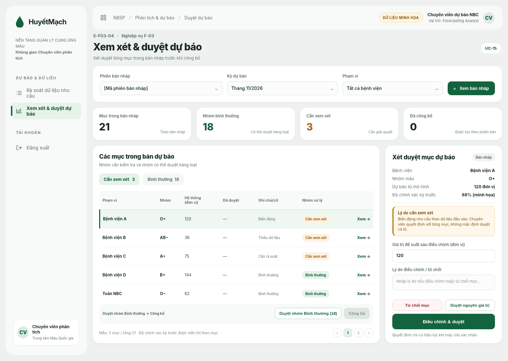
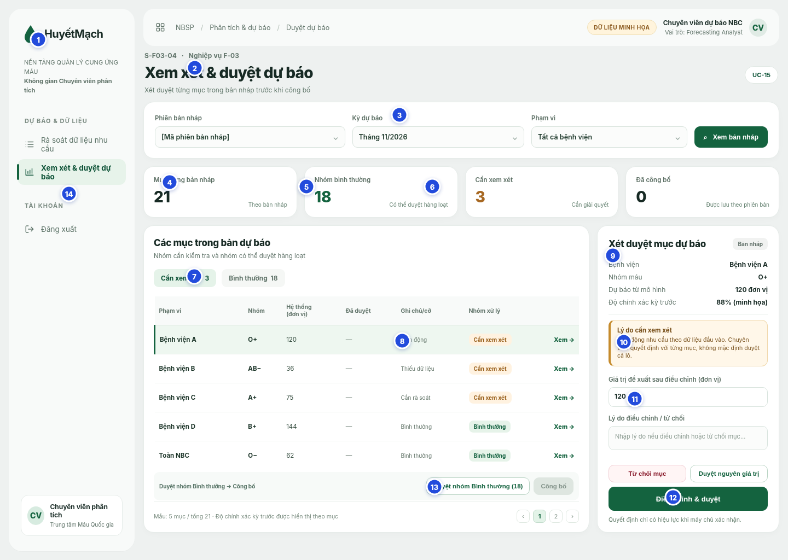
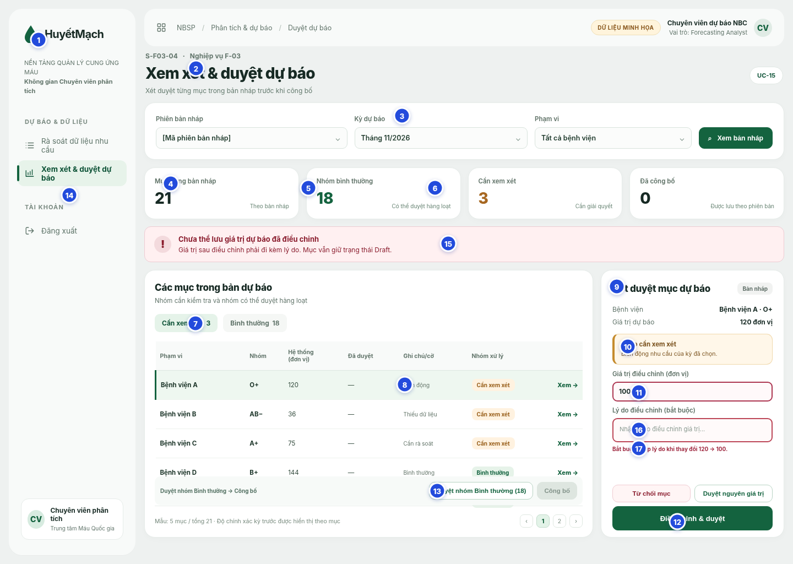

# Screen Specification: S-F03-04 — Xem xét & duyệt dự báo

> **NBSP / HuyếtMạch · DBIZ2 Group C · Draft v1.0 · 20/11/2026**  
> **Phạm vi:** Chuyên viên phân tích dự báo NBC (NBC Forecasting Analyst), không phải NBC Operations.  
> **Toàn bộ tên bệnh viện, giá trị, độ chính xác và số lượng trong PNG chỉ là mock data dùng để minh họa bố cục**, không phải kết quả thật hoặc yêu cầu số liệu cố định.

| Trường | Giá trị |
|---|---|
| Screen ID | `S-F03-04` |
| Tên trong Screen List | Forecast review and approval |
| Tiêu đề giao diện | **Xem xét & duyệt dự báo** |
| Actor | **NBC Forecasting Analyst** |
| Feature / UC | `F-03 Clinical Demand & Forecasting` / **`UC-15 Review and Approve Blood Forecast`** |
| Độ ưu tiên Screen List | **Must** |
| Điều kiện trước | Analyst đã đăng nhập (`UC-12`), có phiên bản `Draft` được sinh tự động khi dữ liệu kỳ `Finalised` |
| AD / SD | `activity/AD-UC-15.md` · `use-case/SD-UC-15.md` |
| FR chính | `FR-03-05` (**trigger hệ thống**), `FR-03-06`; hỗ trợ `FR-04-03`, `FR-04-04` |
| Frame | **1440 × 1024 px** (desktop, PNG 1×) |
| Quy chuẩn | `external-design/NBSP_UI_Conventions_Project_Wide_VI_v2.0.md` |
| Status | **Draft — cần xác nhận micro-interactions trước coding** |

## 1. Purpose — Mục đích

**Hiển thị khi:** Dữ liệu kỳ dự báo đã được hoàn tất (`FR-03-08`), NBSP chạy mô hình đang triển khai và tạo **bản nháp Draft** theo `FR-03-05`; Analyst nhận thông báo hoặc vào menu “Xem xét & duyệt dự báo”. Bản nháp gồm các forecast items trong phạm vi NBC và các bệnh viện, nhóm máu và khoảng thời gian, có nhóm **Normal / Needs Review**, lý do flag và độ chính xác kỳ trước (`SD-UC-15`).

**Mục tiêu người dùng:** (1) xử lý **từng** item “Cần xem xét” bằng duyệt nguyên giá trị, **điều chỉnh kèm lý do rồi duyệt**, hoặc **từ chối kèm lý do**; (2) duyệt hàng loạt nhóm Normal; (3) **công bố chỉ các item đã được duyệt** dưới dạng **một phiên bản không ghi đè** (`FR-03-06`, Decision Log D-21/D-23). Không tự tạo lại dự báo bị từ chối trong release 1.

**Rời màn hình:** người dùng chuyển menu sang `S-F03-02`, đăng xuất `S-F04-01` hoặc chọn kỳ dự báo khác; không tự điều hướng sang màn xem dự báo đã duyệt `S-F03-05` vì màn này thuộc **NBC Operations** trong Screen List.

## 2. Mockup — 7 ảnh PNG

**Default:**

| Default — numbered | Error — numbered |
|---|---|
|  |  |

| State | PNG | Nội dung |
|---|---|---|
| Default | [`S-F03-04-default.png`](img/S-F03-04-default.png) | Bản nháp có nhóm Normal và Needs Review; từng mục có panel xét duyệt |
| Empty | [`S-F03-04-empty.png`](img/S-F03-04-empty.png) | Không có Draft forecast ở kỳ chọn; không tự thêm nút Generate |
| Loading | [`S-F03-04-loading.png`](img/S-F03-04-loading.png) | Đang tải các items/chỉ số; CTA chưa sẵn sàng |
| Error | [`S-F03-04-error.png`](img/S-F03-04-error.png) | Đã đổi 120 → 100 nhưng chưa nhập lý do; không lưu/duyệt |
| Success | [`S-F03-04-success.png`](img/S-F03-04-success.png) | Phiên bản mới `Published`, chỉ gồm 19 mục Approved, loại 2 mục Rejected (mock) |
| Default numbered | [`S-F03-04-default-numbered.png`](img/S-F03-04-default-numbered.png) | Đánh số các thành phần căn bản |
| Error numbered | [`S-F03-04-error-numbered.png`](img/S-F03-04-error-numbered.png) | Đánh số các thành phần và báo lỗi |

**Số liệu ví dụ:** 21 forecast items (18 Normal, 3 Needs Review); sau xét duyệt giả lập 19 Approved, 2 Rejected, 0 Draft. Việc có thể công bố ngay khi vẫn có item Draft hay không **chưa nên suy diễn từ số liệu mock**, cần đối chiếu chính sách `FR-03-06` và AD-UC-15.

## 3. Element Inventory — Danh sách thành phần

Các số **1–14** xuất hiện trong ảnh Default-numbered; số **15–17** thêm ở Error-numbered. Cùng một số phải tham chiếu cùng một loại thành phần trên cả hai ảnh.

| # | Element | Type | Dữ liệu/nguồn | Bắt buộc | Validation / điều kiện |
|---:|---|---|---|---|---|
| 1 | Sidebar cho Analyst | Navigation | Role/department từ session; menu data review + forecast review | Có | FR-04-03 kiểm tra ở BE; không tạo menu cho Operations |
| 2 | Tiêu đề/Screen ID | Heading | `S-F03-04`, “Xem xét & duyệt dự báo” | Có | Giữ ID đúng Screen List |
| 3 | Bộ lọc Draft | Select controls | `forecast_batch_id`, forecast period, phạm vi bệnh viện/NBC | Có | Bản nháp tồn tại và thuộc phạm vi quyền; period hợp lệ |
| 4 | Tổng item trong batch | KPI | Số item thuộc draft batch hiện tại | Có | Đồng bộ snapshot server |
| 5 | Nhóm Normal | KPI | Số item Normal | Có | Normal không tự được duyệt nếu chưa có quyết định bulk |
| 6 | Nhóm Needs Review | KPI | Số item cần review | Có | Flag reason theo cấu hình/backend |
| 7 | Nhóm tabs | Tabs | “Cần xem xét” / “Bình thường” | Có khi có items | Không thay đổi trạng thái item khi đổi tab |
| 8 | Bảng forecast items | Table | `hospital_id`, `blood_group`, `system_forecast_units`, `approved_value`, flag/category, status | Có khi có items | Từng row được chọn để review, read-only trước khi lưu |
| 9 | Panel xét duyệt item | Detail card | Dữ liệu item được chọn, state Draft, độ chính xác kỳ trước | Có khi chọn row | Một panel luôn gắn với 1 `forecast_item_id` |
| 10 | Lý do cần xem xét | Notice | `review_flag_reason`; đặc biệt cho nhóm Needs Review | Có với flagged item | Nhận từ server; không hardcode lý do rule |
| 11 | Giá trị dự báo điều chỉnh | Numeric input | `adjusted_value_units`, ban đầu = `system_forecast_units` | Khi điều chỉnh | Giá trị phải hợp lệ theo chính sách; **nếu thay đổi phải nhập lý do** |
| 12 | Nhóm nút quyết định item | Actions | “Từ chối mục”, “Duyệt nguyên giá trị”, “Điều chỉnh & duyệt” | Có với Draft item | Từ chối/điều chỉnh phải có lý do; saving disabled để tránh nhấn lặp |
| 13 | Duyệt nhóm Normal / Công bố | Buttons | Bulk approve Normal, publish approved version | Có khi batch có item | Công bố chỉ item Approved; chưa đủ điều kiện thì disabled và nêu lý do |
| 14 | Menu/điều hướng | Navigation | 2 màn Analyst và đăng xuất | Có | Đúng Screen ID, không chuyển UC-13 → UC-15 tức thời |
| 15 | Banner lỗi | Alert | Chưa lưu quyết định vì thiếu lý do điều chỉnh | Khi lỗi | Không đánh dấu item Approved/Published |
| 16 | Lý do điều chỉnh / từ chối | Textarea | `decision.reason` | **Bắt buộc khi điều chỉnh hoặc từ chối** | Không trống trong hai action này; liên kết lỗi inline |
| 17 | Lỗi dưới trường lý do | Inline validation | “Bắt buộc nhập lý do khi thay đổi 120 → 100.” | Khi lỗi | Focus vào ô lý do; giữ giá trị điều chỉnh |

**Thành phần dùng ở Loading/Success nhưng không cần số riêng ở Default:** skeleton dữ liệu; banner xác nhận Published; thống kê Approved/Rejected/Draft; mã phiên bản, reviewer và thời điểm phát hành. Không đưa nội dung các component này thành FR mới.

### Data contract minh họa cho FE/BE

`batch = { id, period, model_version, status, generated_at, totals, skipped_hospitals }`, `item = { id, batch_id, scope, hospital_id, blood_group, time_horizon, system_value_units, adjusted_value_units, approved_value_units, previous_accuracy, review_group, review_flag_reason, decision_status }`, `decision = { item_id, action, reason, reviewer_id, timestamp }`, `published_version = { id, source_batch_id, published_items, published_at }`.

Những field trên là **gợi ý định tuyến frontend**, chưa xác nhận là schema chính thức; các `skipped_hospitals` chỉ hiển thị nếu backend trả về (SD-UC-15), không giả định có data mới.

## 4. States — 5 trạng thái

| State | User thấy gì | Trigger / nghiệp vụ | Next step |
|---|---|---|---|
| **Default** | Nháp chưa công bố; Normal và Needs Review; bảng items; panel chi tiết 1 item; nút quyết định | Nhận thông báo có draft hoặc mở draft được phép xem; tải thành công | Duyệt/điều chỉnh/từ chối từng item, sau đó duyệt nhóm Normal |
| **Empty** | Không có bản dự báo nháp tương ứng kỳ đang chọn; CTA “Làm mới danh sách” | Backend trả về danh sách draft trống | Chọn kỳ khác hoặc chờ `FR-03-05` tự sinh draft |
| **Loading** | Skeleton KPI, bảng, panel; ẩn/khóa action khi đang truy vấn | Đang tải bản nháp/item, đang đồng bộ dữ liệu | Phản hồi Default/Empty/Error kỹ thuật |
| **Error** | Banner đỏ, ô giá trị điều chỉnh 100 và ô lý do trống, lỗi inline; item vẫn Draft | Chọn “Điều chỉnh & duyệt” nhưng giá trị khác 120 và thiếu lý do | Bổ sung lý do và gửi lại, không tự động duyệt |
| **Success** | Banner công bố, thống kê Approved/Rejected/Draft, `Published`, mã phiên bản và dấu vết | Server ghi quyết định, bulk approve và publish thành công | Xem tóm tắt phiên bản; NBC Operations đọc phiên bản qua UC-16 |

**Các trường hợp cần xử lý dù không dành PNG riêng:** lưu Approved 1 item thành công mà batch chưa được công bố; từ chối 1 item và ghi lý do; lỗi mạng chưa biết kết quả; 2 Analyst cùng thao tác 1 batch; danh sách bệnh viện bị bỏ qua do thiếu dữ liệu; không thể công bố vì chưa hoàn tất review/bulk approval (nếu team chốt rule như AD).

## 5. Interactions & Navigation

| # | Thành phần | User action | System response | Goes to screen |
|---:|---|---|---|---|
| 1 | Menu “Xem xét & duyệt dự báo” | Chọn | Mở workspace UC-15 | `S-F03-04` |
| 2 | Menu “Rà soát dữ liệu nhu cầu” | Chọn | Chuyển sang UC-13 | `S-F03-02` |
| 3 | Bộ lọc kỳ/phạm vi | Chọn | Đổi draft batch trong quyền của user | stays |
| 4 | “Xem bản nháp” | Nhấn | Truy xuất draft, Normal/Needs Review, flag reasons, previous accuracy | stays, Loading → Default/Empty |
| 5 | Tab Normal/Needs Review | Chọn | Lọc nhóm, không làm thay đổi trạng thái | stays |
| 6 | “Xem” ở một item | Nhấn | Nạp panel xét duyệt đúng item ID | stays |
| 7 | “Duyệt nguyên giá trị” | Nhấn | Lưu Approved = system value; ghi audit | stays (item Approved) |
| 8 | “Điều chỉnh & duyệt” | Nhập value mới + reason rồi nhấn | Kiểm tra reason, lưu system/adjusted/approved values + Approved | stays (item Approved hoặc Error) |
| 9 | “Từ chối mục” | Nhập reason rồi nhấn | Lưu Rejected + reason; item không được publish | stays (item Rejected) |
| 10 | “Duyệt nhóm Bình thường” | Nhấn | Đánh dấu các Normal items được phép là Approved (bulk) | stays |
| 11 | “Công bố” | Nhấn khi đủ điều kiện | Chỉ Approved items vào phiên bản mới immutable; bảo toàn phiên bản cũ và audit | stays (Success) |
| 12 | “Xem tóm tắt phiên bản” | Nhấn (Success) | Hiện read-only summary cùng màn | stays |
| 13 | Đăng xuất | Nhấn | Hủy phiên đăng nhập | `S-F04-01` |

## 6. Screen-level Rules

| Rule ID | Quy tắc | Trace |
|---|---|---|
| SR-15-01 | Chỉ Analyst được quyền review draft theo vai trò; việc NBC Operations xem Published ở UC-16 không cấp quyền duyệt. | `FR-04-03`, UC-15/16 |
| SR-15-02 | Draft được NBSP tạo khi kỳ demand Finalised; UI không có nút train/retrain model hoặc tạo lại bản bị từ chối. | `FR-03-05`, Decision Log D-21 |
| SR-15-03 | Review từng **forecast item** (không duyệt batch bất phân biệt); có Normal / Needs Review với lý do Flagged và previous accuracy. | `FR-03-06`, `SD-UC-15`, `AD-UC-15` |
| SR-15-04 | Điều chỉnh phải lưu **giá trị hệ thống**, **giá trị điều chỉnh/được duyệt** và **lý do**; từ chối phải lưu **lý do**. | `FR-03-06`, `FR-04-04`, Decision Log D-21 |
| SR-15-05 | Nhóm Normal chỉ được duyệt bằng hành động có chủ ý của Analyst, không suy luận mặc định là Approved. | `FR-03-06`, `AD-UC-15` |
| SR-15-06 | **Publish chỉ Approved**, loại Rejected và Draft; tạo Published version mới immutable, giữ lịch sử trước đó; không ghi đè. | `FR-03-06`, BR-07/D-23 |
| SR-15-07 | Chỉ thông báo Success sau khi server xác nhận publish; khi lỗi mạng phải kiểm tra trạng thái phiên bản trước khi retry. | UI Conventions; đề xuất kỹ thuật |
| SR-15-08 | Audit quyết định có actor, thời điểm, prior/final value/status, note; không xóa lịch sử cũ. | `FR-04-04` |
| SR-15-09 | Success/Loading/Error/Empty là **UI states**, `Draft/Approved/Rejected` là forecast-item states, `Published` là forecast-version state. Không thay thế lẫn nhau. | Decision Log D-23 |
| SR-15-10 | Danh sách nhóm và giá trị trên ảnh là **mock**, không tạo yêu cầu ngưỡng/gộp bản nháp cố định cho 21 mục hoặc cố định 88%. | Giới hạn nguồn và UI conventions |

## 7. Linked Requirements

| FR / nguồn | Mục được thực hiện |
|---|---|
| **FR-03-05** | Trigger và nguồn dữ liệu tạo bản nháp, không phải thao tác thủ công tại UI |
| **FR-03-06** | Review từng mục, điều chỉnh/duyệt/từ chối, bulk approve Normal, publish immutable approved-only version |
| **FR-04-03** | Kiểm tra role/permission, nhất là Analyst vs Operations |
| **FR-04-04** | Audit review decisions và historical values |
| **FR-03-08** | Chỉ kỳ demand Finalised mới kích hoạt draft generation; không tạo “đóng kỳ” trên màn review |
| `UC-16` / `FR-03-07` | NBC Operations đọc phiên bản Published ở `S-F03-05`; **không** là lối đi mặc định của Analyst |

## 8. Desktop & Accessibility

- **1440 × 1024 px**, mỗi state một PNG độc lập. Layout desktop: sidebar 230px, main 1162px, bảng và panel chi tiết phải đọc được mã/giá trị/đơn vị; cuộn hoặc phân trang khi dữ liệu nhiều.
- UI bằng tiếng Việt. Date `dd/MM/yyyy`, kỳ dự báo ghi rõ tháng/năm, đơn vị dự báo là **đơn vị máu**; không tự quy định tỉ lệ %, horizon, điều kiện validation không có trong FR.
- Điều hướng bàn phím: menu → lọc bản nháp → tabs → row → form review → bulk/publish; nhấn Tab/Enter/Space phù hợp. Focus-visible, label không ẩn; disabled có chú thích điều kiện.
- Mỗi badge dùng **chữ và màu**; độ tương phản kiểm tra theo WCAG (chữ mục tiêu ≥ 4.5:1, control meaningful ≥ 3:1). Lỗi từ chối/điều chỉnh được hiển thị sát trường và `role="alert"`.
- Với hành động publish có hệ quả phát hành immutable, cần xác nhận phù hợp trước khi gọi API; modal là **overlay trong `S-F03-04`**, không phải Screen ID mới (mẫu modal và wording cần team duyệt).

## 9. Open Questions / Cần chốt

| # | Câu hỏi | Vì sao cần chốt | Trạng thái |
|---:|---|---|---|
| 1 | Có cho phép **công bố một tập Approved khi vẫn còn Draft items**? W1 nói exclude Draft; AD-UC-15 mô tả review hết Needs Review rồi approve Normal mới publish. | Điều kiện enable nút “Công bố” cần có guard rõ, ảnh đang dùng hướng thận trọng theo AD. | **Open — xung đột mức chi tiết nguồn** |
| 2 | Quy tắc valid của giá trị điều chỉnh (min/max, số nguyên, không âm) đã chốt chưa? | FE form validation/API | **Open** |
| 3 | Có hiển thị model version, forecast previous accuracy, skipped hospitals bằng dữ liệu từ API nào? | Mapping FE/BE và không làm lộ data ngoài scope | **Open — SD-UC-15 có nêu, W1 không chi tiết** |
| 4 | Khi hai Analyst review cùng một batch, conflict strategy nào được chốt? | Bảo toàn immutable decision/audit | **Open — AD-UC-15 áp dụng mặc định Last Saved Wins, cần review** |
| 5 | Lý do Từ chối có bắt buộc theo mẫu category hay tự do? | Data model và UI validation | **Open — chỉ xác nhận có reason, chưa có danh mục** |
| 6 | Các Draft tạo khi bệnh viện thiếu dữ liệu có loại bỏ bệnh viện nào và hiện banner nào? | SD-UC-15 cho phép skipped hospitals, số lượng không chốt | **Open** |

## Completion Checklist

- [x] Có 5 PNG (Default, Empty, Loading, Error, Success) ở 1440 × 1024 px và 2 ảnh numbered.
- [x] Dùng đúng ID `S-F03-04`, actor Analyst và scope F-03.
- [x] Luồng xử lý per-item/bulk/publish đúng FR-03-06; Success không gán quyền UC-16 cho Analyst.
- [x] Element inventory, states, interactions và linked FR đều có.
- [x] Path ảnh trong Markdown tương đối, có thể hiển thị khi đặt cùng folder trên GitHub.
- [ ] Nhóm quyết định quy tắc publish khi còn Draft items (OQ-01).
- [ ] FE/BE thống nhất validation numeric, conflict và API data shape.
- [ ] Nhóm duyệt lần cuối giao diện trên Figma trước khi bàn giao lập trình.
