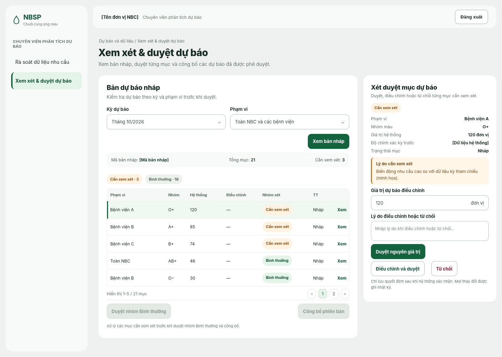
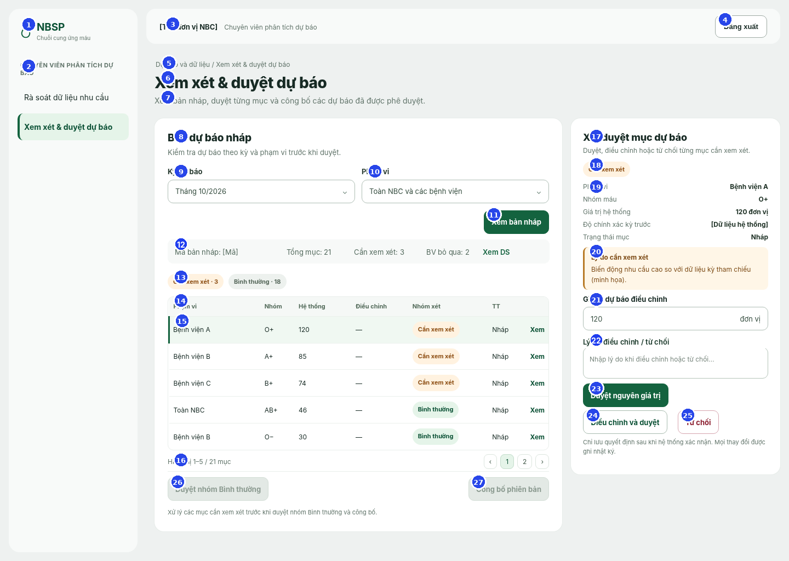
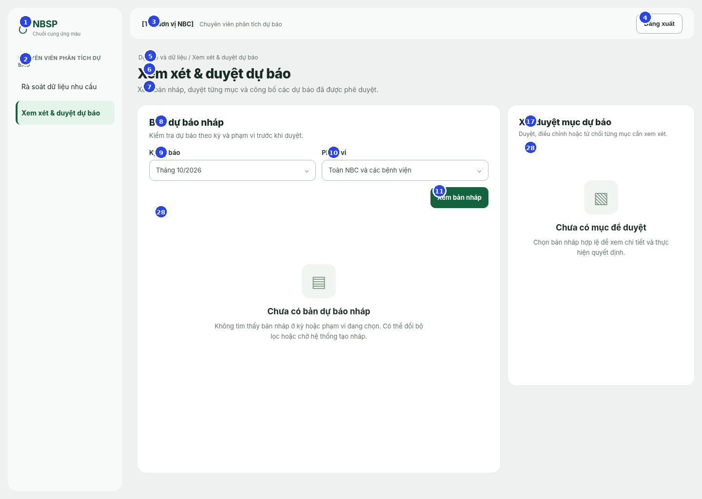
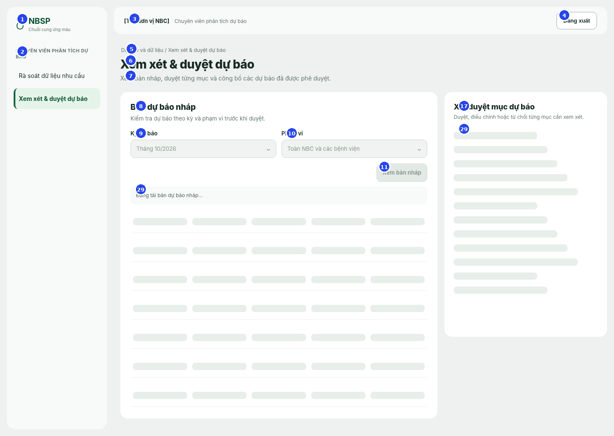
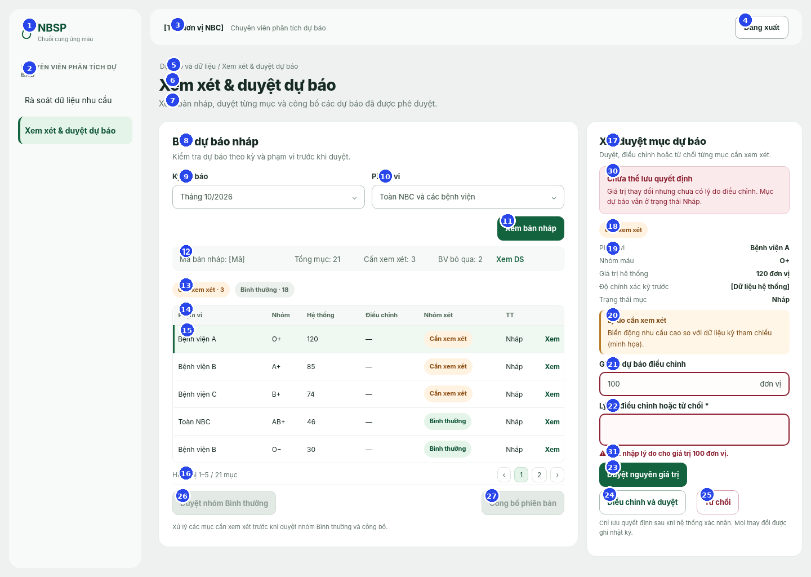
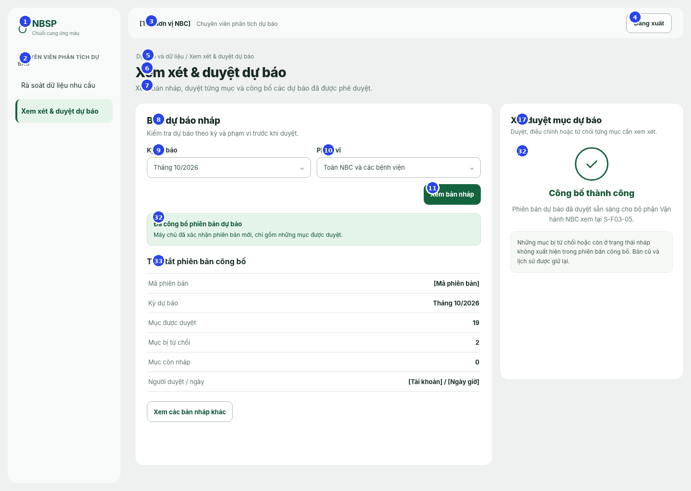

# Screen Spec: S-F03-04 Forecast Review and Approval

| Field | Value |
|---|---|
| Screen ID | `S-F03-04` |
| Screen name | Forecast Review and Approval (UI title: **“Xem xét & duyệt dự báo”**) |
| Actor | NBC Forecasting Analyst — Chuyên viên phân tích dự báo NBC |
| Priority | Must (Screen List) |
| Feature | F-03 Clinical Demand & Forecasting |
| Use cases / FRs | UC-15 · FR-03-06; upstream FR-03-05 and FR-03-08; FR-04-03 and FR-04-04 |
| Activity / Sequence | [`AD-UC-15`](../../../activity/AD-UC-15.md) · [`SD-UC-15`](../../../use-case/SD-UC-15.md) |
| Usage Flow | NBC Forecasting Analyst Flow 2, [`usage-flow.md`](../usage-flow.md) |
| Frame size | **1440 × 1024 px**, desktop, 1× |
| Mockup images | `img/s-f03-04-{default,empty,loading,error,success}.png` + five `-numbered.png` equivalents |
| Design reference | Canonical **S-F01-01** outer visual shell; [UI Conventions v2.0](../../ui-conventions.md) |
| Version | v3.1 · 21/11/2026 |
| Status | Draft for review |

## 1. Purpose

**Shown when:** the period data is `Finalised`, the system creates a Draft through the active model (FR-03-05), and the Forecasting Analyst opens a notified or selected draft batch. This is not an automatic transition from the end of UC-13.

**Main task:** review items grouped into **Cần xem xét** and **Bình thường**, including flag reasons and previous forecast accuracy. For each Needs Review item choose **Duyệt nguyên giá trị**, **Điều chỉnh và duyệt** (with a reason), or **Từ chối** (with a reason). Then intentionally bulk-approve the Normal group. When eligible, publish **only Approved items** as a new version and retain the earlier versions and decision audit (`FR-03-06`, `FR-04-04`, BR-07).

**Leaves this screen when:** user selects the review-demand menu (`S-F03-02`) or logs out (`S-F04-01`). Publication does not force navigation to `S-F03-05`: that is NBC Operations' read-only UC-16 screen.

## 2. Mockup

**Shared NBSP layout:** the same role-aware left sidebar, NBSP brand, 64px account/logout bar, breadcrumb, page heading, subtitle, white rounded cards, form controls, typography, colors, spacing and desktop margins used by the group's **S-F01-01** reference. The only structural difference is the business content: a demand/forecast table in the primary (left) card and its record-review panel in the supporting (right) card. **No alternate HuyếtMạch logo, top-bar global search, analytics KPI card row, or bottom account avatar.**

**Numbered images:** the blue numbers in each image refer directly to the element IDs in §3. **Five original + five numbered** images are provided, following the sample S-F01-01's exact naming convention.

| State | Numbered image | Numbers visible |
|---|---|---|
| **Default** |  | 1, 2, 3, 4, 5, 6, 7, 8, 9, 10, 11, 12, 13, 14, 15, 16, 17, 18, 19, 20, 21, 22, 23, 24, 25, 26, 27 |
| **Empty** |  | 1, 2, 3, 4, 5, 6, 7, 8, 9, 10, 11, 17, 28 |
| **Loading** |  | 1, 2, 3, 4, 5, 6, 7, 8, 9, 10, 11, 17, 29 |
| **Error** |  | 1, 2, 3, 4, 5, 6, 7, 8, 9, 10, 11, 12, 13, 14, 15, 16, 17, 18, 19, 20, 21, 22, 23, 24, 25, 26, 27, 30, 31 |
| **Success** |  | 1, 2, 3, 4, 5, 6, 7, 8, 9, 10, 11, 17, 32, 33 |

| State | Original PNG |
|---|---|
| **Default** | [`img/s-f03-04-default.png`](img/s-f03-04-default.png) |
| **Empty** | [`img/s-f03-04-empty.png`](img/s-f03-04-empty.png) |
| **Loading** | [`img/s-f03-04-loading.png`](img/s-f03-04-loading.png) |
| **Error** | [`img/s-f03-04-error.png`](img/s-f03-04-error.png) |
| **Success** | [`img/s-f03-04-success.png`](img/s-f03-04-success.png) |

All UI labels are Vietnamese. The output is a **1440 × 1024 px desktop image**, using the tokens in [UI Conventions v2.0](../../ui-conventions.md). Representative values are test data, not real hospital records or new business thresholds.

## 3. Element inventory

### 3.1. Page frame — all states

| # | Element | Type | Content / data source | Required | Validation and behaviour |
|---:|---|---|---|---|---|
| 1 | Brand | Logo + text | `NBSP`; “Chuỗi cung ứng máu” | Yes | Exact structure/position as S-F01-01; no actor-specific rebranding. |
| 2 | Menu for Forecasting Analyst | Role-based navigation | “Rà soát dữ liệu nhu cầu”, “Xem xét & duyệt dự báo”; active item highlighted | Yes | Only screens authorised to Analyst are displayed (FR-04-03). |
| 3 | Account header | Read-only session text | NBC unit/account display name from the authenticated session (exact API field pending); role “Chuyên viên phân tích dự báo” | Yes | No unrelated account or simulated personal name. |
| 4 | Đăng xuất | Secondary button | Static action label | Yes | Ends session; navigates to `S-F04-01`. |
| 5 | Breadcrumb | Read-only navigation context | “Dự báo và dữ liệu / [Tên màn hình]” | Yes | Text contextual only; does not create a new screen/route. |
| 6 | Page title | Heading | Screen title in Vietnamese | Yes | Must equal UI Conventions and Screen List. |
| 7 | Subtitle | Supporting text | One short description of business task | Yes | No claim that the system has completed a task prematurely. |

### 3.2. Draft and decision controls

| # | Element | Type | Content / data source | Required | Validation and behaviour |
|---:|---|---|---|---|---|
| 8 | Bản dự báo nháp | Main card title | Forecast draft workspace description | Yes | Same primary card as S-F01-01; does not run model/training. |
| 9 | Kỳ dự báo | Select | `filter.period` — “Tháng 10/2026” (mock) | Yes | Must be an existing configured period. |
| 10 | Phạm vi | Select | `filter.scope` — NBC-wide/per-hospital | Yes | Scope constrained by analyst authorisation. |
| 11 | Xem bản nháp | Button | Load selected draft batch | Yes | Query only; cannot generate draft from this action. |
| 12 | Thông tin bản nháp | Summary strip + in-place expandable list | Draft ID, total items, Needs Review count, and a count and `Xem DS` (view list) for skipped hospitals (insufficient data) | If draft exists | Mock values: 21 items, 3 Needs Review, 2 skipped hospitals. The skipped hospitals list comes from FR-03-05 draft-generation output (AD-UC-15, SD-UC-15), not a new filtering rule. |
| 13 | Nhóm dự báo | Tabs | “Cần xem xét” and “Bình thường” | If draft exists | Changing tab only changes view, no implicit approvals. |
| 14 | Danh sách các mục dự báo | Table | Scope, blood group, system forecast, adjusted value, review group, decision state | If data exists | Item IDs are used for decisions; status Draft/Approved/Rejected. |
| 15 | Mục đang chọn | Highlighted table row | Selected `forecast_item_id`, “Xem” | If selected | Detail panel binds to exactly one item. |
| 16 | Phân trang | Pagination | Current page and total items | If multiple items | 1–5/21 is sample only. |
| 17 | Xét duyệt mục dự báo | Right card title/description | Review selected draft item | Yes | Support card matches shared NBSP UI form style. |
| 18 | Nhãn cần xem xét | Status chip | `Needs Review` label | If selected | Meaning distinct from `Approved`/`Rejected` status. |
| 19 | Thông tin mục | Read-only key-values | Scope, blood group, system value, previous accuracy, decision status | If selected | System value remains 120 in Error mock until server confirms. |
| 20 | Lý do cần xem xét | Warning notice | Flag reason sent by forecasting service | If flagged | Example explanation; no hard-coded thresholds. |
| 21 | Giá trị dự báo điều chỉnh | Number input | `proposed_adjusted_units`: 120 default, 100 Error demo | If editing | For Adjust-and-Approve, the proposed value must be valid and changed; a non-empty reason is required. Approve-as-is uses the original system value. |
| 22 | Lý do điều chỉnh/từ chối | Textarea | `decision.reason` | Conditional | Required for adjustment or rejection; not required to approve the unmodified system value. Show the required marker on the active adjustment/rejection path only. |
| 23 | Duyệt nguyên giá trị | Primary button | Approve with original system units | If selected | Saves Approved only after server confirms. |
| 24 | Điều chỉnh và duyệt | Secondary button | Approve with changed value and reason | If selected | Error when reason missing. |
| 25 | Từ chối | Destructive secondary button | Reject current item with reason | If selected | Reject result never published. |
| 26 | Duyệt nhóm Bình thường | Secondary button | Approve Normal items intentionally | Default/Error | Shown but disabled in the illustrated Default state, because the Needs Review workflow in AD-UC-15 has not finished. Normal approval is always an explicit action, never implied by the label. |
| 27 | Công bố phiên bản | Primary button | Publish only Approved items as new version | When eligible | Disabled in depicted Default until the documented review sequence and explicit Normal-group approval complete. Exact handling of remaining Draft items is a backend publication guard to confirm, not inferred from the PNG. |

### 3.3. State-specific elements

| # | Element | Type | Content / data source | Required | Validation and behaviour |
|---:|---|---|---|---|---|
| 28 | No draft placeholder | Empty state | “Chưa có bản dự báo nháp”; change period / wait | Empty | No Generate/Train CTA. |
| 29 | Loading skeleton | Skeleton | Batch details/list/review panel loading | Loading | Review actions disabled until server response. |
| 30 | Validation error banner | Alert | “Chưa thể lưu quyết định”; adjustment has no reason | Error | Status remains Draft, no publish. |
| 31 | Inline reason error | Validation feedback | “Cần nhập lý do cho giá trị 100 đơn vị.” | Error | Retain unsaved value, avoid loss of input. |
| 32 | Publication success banner/mark | Status | “Đã công bố phiên bản dự báo”; right confirmation | Success | Only after server confirms version Published. |
| 33 | Version summary | Read-only card | Published ID, period, Approved/Rejected/Draft counts, reviewer/timestamp | Success | Only Approved items available to NBC Operations; counts here are mock. |

## 4. States

| State | What the user sees | Trigger |
|---|---|---|
| **Default** | Shared NBSP two-column card layout. Left card filters an existing Draft batch, shows Normal/Needs Review, the skipped-hospital count/list and the item table; right card has selected item, previous accuracy and review actions. Bulk Normal and Publish are visible but disabled at this illustrated point in the AD-UC-15 workflow; this does not define a new immutable database rule. | Analyst opens an existing draft. |
| **Empty** | Filters persist; left card explains no draft for period/scope; right card shows no item selected. | Query returns no draft. |
| **Loading** | Skeleton placeholders for batch/list/detail and unavailable review actions. | Draft fetch pending. |
| **Error** | Proposed 100-unit edit is present only in input; table's system value remains 120; red banner and missing-reason inline feedback. Nothing is approved or published. | User attempts “Điều chỉnh và duyệt” without mandatory reason. |
| **Success** | Server-confirmed Published version in the same screen; read-only summary of Approved/Rejected/Draft counts (mock 19/2/0). Only Approved items are published; previous versions remain available. | Backend confirms publication after per-item and Normal-group decisions. |

**Other flows:** successful item-level approval (without publication), Rejected item with reason, Normal bulk approval, unknown result from network failure, no Approved items → no publish. These are described in requirements, not new screens.

## 5. Interactions and navigation

| # | Element | User action | System response | Screen |
|---:|---|---|---|---|
| 1 | Sidebar demand review | Click | Navigate to separate UC-13 review. | `S-F03-02` |
| 2 | Sidebar forecast | Click | Keep workspace without creating draft. | `S-F03-04` |
| 3 | Period/Scope controls | Select | Update temporary filter values. | Stays |
| 3a | Xem DS (skipped hospitals in Draft summary) | Click | Expand the backend-provided list of hospitals omitted from the Draft because of insufficient data; read-only, no new Screen ID. | Stays |
| 4 | Xem bản nháp | Click | Fetch Draft items and review groups. | Stays → Loading/Default/Empty |
| 5 | Group tabs | Click | Filter shown items, no data mutation. | Stays |
| 6 | “Xem” row | Click | Display selected item details. | Stays |
| 7 | Duyệt nguyên giá trị | Click | Store item Approved with system forecast; audit. | Stays |
| 8 | Điều chỉnh và duyệt | Change value and enter reason | Store approved adjusted value; missing reason → Error without saving. | Stays |
| 9 | Từ chối | Enter reason, click | Store item Rejected with reason; exclude from publication. | Stays |
| 10 | Duyệt nhóm Bình thường | Click | Bulk approve Normal group deliberately; audit changes. | Stays |
| 11 | Công bố phiên bản | Click when eligible | Server writes new Published version with Approved items only; keeps prior versions. | Stays → Success |
| 12 | Đăng xuất | Click | Ends session. | `S-F04-01` |

## 6. Screen-level rules

| ID | Rule | Source |
|---|---|---|
| SR-15-01 | Show only Analyst-role functions and authorised scope. | FR-04-03 |
| SR-15-02 | Draft generation is automatic after Finalised period; screen never triggers model run. | FR-03-05, FR-03-08 |
| SR-15-03 | Support item-level Approved/Rejected and adjusted Approved values; reason required on edit/reject. | FR-03-06, AD-UC-15 |
| SR-15-04 | Normal group requires explicit bulk approval; Needs Review items are processed individually. | FR-03-06, SD-UC-15 |
| SR-15-05 | Publish **only Approved** items into a new version; retain prior versions, exclude Rejected/Draft. | FR-03-06, BR-07 |
| SR-15-06 | All decisions include actor/time, system value, adjusted/approved value and reason as applicable. | FR-04-04 |
| SR-15-07 | UI Error/Success do not by themselves change business status; wait for server confirmation. | UI Conventions v2.0 |
| SR-15-08 | The Draft includes the backend-provided omitted-hospital list; its summary `Xem DS` opens an in-place read-only view. The UI never decides that a hospital should be skipped. | FR-03-05, AD-UC-15, SD-UC-15 |

## 7. Linked requirements

| Requirement | Coverage |
|---|---|
| FR-03-05 | Automatically generated Draft; screen receives ready state, never creates model output. |
| FR-03-06 | Normal/Needs Review, per-item decision, bulk approval, Published version. |
| FR-04-03 | Analyst role and data scope. |
| FR-04-04 | Persistent decision audit. |
| FR-03-08 | Finalised period is upstream; not a button. |
| UC-16 / FR-03-07 | NBC Operations reads Published version at `S-F03-05` (other actor). |

## 8. Desktop and accessibility notes

- Strict **1440 × 1024 px** desktop wireframes, aligned to reference S-F01-01 global shell (matching sidebar, topbar, text hierarchy, card radii and relative content columns).
- Detailed business cards are taller than the source request form conceptually; this illustration keeps actions visible at the base desktop frame. Larger tables would paginate/scroll in the actual implementation.
- Inputs have persistent visible labels; adjustment/error includes inline warning in addition to coloured border. Use `role="alert"` for failures and `role="status"` for publication confirmations.
- Actions involving changed values or rejection are never implicitly saved by tab change. Use keyboard focus and effective labels; dynamic statuses announced for accessibility.

## 9. Mockup corrections and source consistency

| Previous mismatch | Correction |
|---|---|
| HuyếtMạch identity and custom sidebar/avatars | Replaced with **NBSP branding** + shared role-aware sidebar identical in structure to S-F01-01. |
| Header/breadcrumb placed differently than group's canonical sample | Reused account/logout topbar and page heading, aligned to exact shared margins. |
| Dashboard-style KPI cards displaced primary task | Removed free-floating KPI row; Draft counts are a compact strip within the main form card. |
| Multiple floating panels made the screen feel like a separate product | Consolidated left Draft table and right review form inside two white rounded business cards. |
| Success incorrectly suggested a full-batch unconditional publication | Clearly reports **only Approved items** published; rejected and undecided excluded. |
| Numbered PNGs did not cover all five states consistently | Exported 10 screenshots and rebuilt inventory/labels by state. |

## 10. Open questions

| # | Question | Blocking? | Status |
|---|---|---|---|
| 1 | Can two analysts review the same draft concurrently; what conflicts take precedence? | No | Open in AD-UC-15. |
| 2 | What exact backend predicate enables “Công bố phiên bản” when undecided Draft items remain? AD-UC-15 explicitly says Draft items are not published. | Yes | Use AD guard; do not infer it from image. |
| 3 | What non-negative/integer adjustment range and validation applies to forecast unit values? | Yes | Not settled by mock. |
| 4 | Does client approve warning/status supplementary colours as UI Conventions tokens? | No | Open for design-system owners. |
| 5 | Which hospitals were skipped by draft generation, and how is their list identified in the response payload? | Yes for data binding | Show a list/count from the backend; do not invent a cause or value from the wireframe. |

---

## Completion checklist

- [x] Five original and five numbered images, all **1440 × 1024 px**, named lowercase.
- [x] Same global visual chrome as S-F01-01; no mobile variant or HuyếtMạch overlay.
- [x] Every numbered bubble maps to §3 (by state), and every important control has a visible label.
- [x] Screen ID and actor match Screen List; only Analyst menu targets shown.
- [x] Per-item decision, group approval and publication depend on backend confirmation.
- [x] Error preserves unsaved value; Published success is server-confirmed.
- [ ] Open business rules (concurrent review/publish guards/ranges) require group confirmation before coding.

## Changes in v3.1 (21/11/2026)

- Fixed Usage Flow and UI Conventions links to their actual paths in the live repository.
- Surfaced the skipped-hospital count/expand link in the Draft summary strip (element 12), required by AD-UC-15 / SD-UC-15. The list is view-only and is not another screen.
- Clarified the optional reason on Approve-as-is versus mandatory reason on Adjust-and-Approve and Reject; the Default UI no longer displays an unconditional asterisk.
- Kept the publication guard conservative: only Approved items are included, no items are published when no approvals exist, and the exact eligibility predicate remains an open question (not a visual assumption).

- Rebuilt from the **project's S-F01-01 layout**, not a separate dashboard styling approach.
- Moved business summary into the same primary white card; adopted reference NBSP sidebar/topbar/heading.
- Produced the full 10-image numbered package and aligned document sections with S-F01-01.
