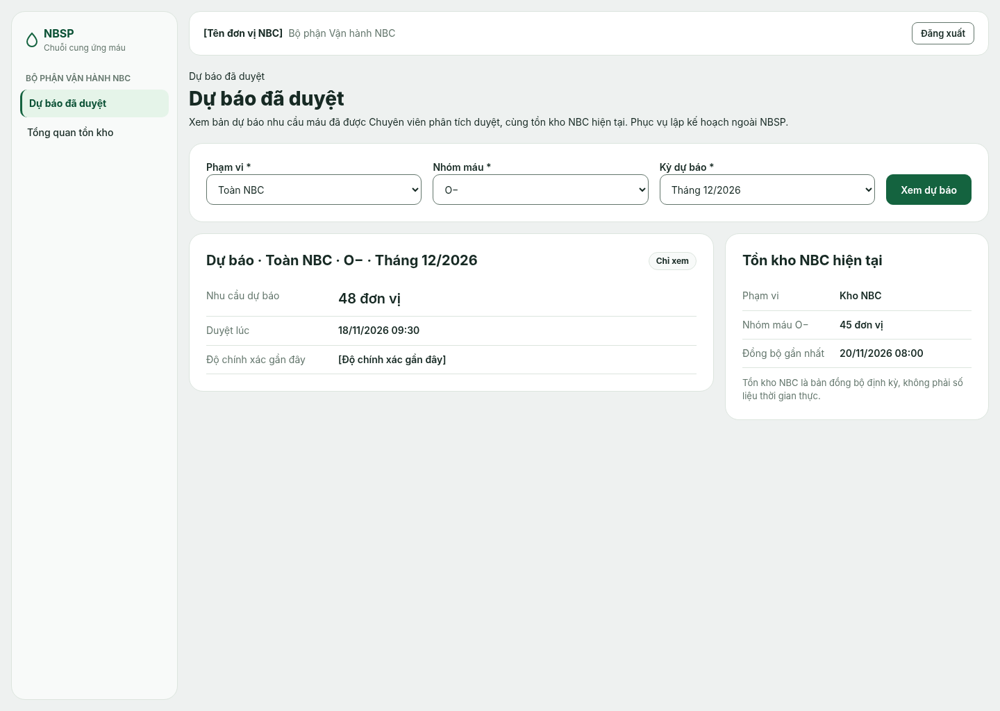
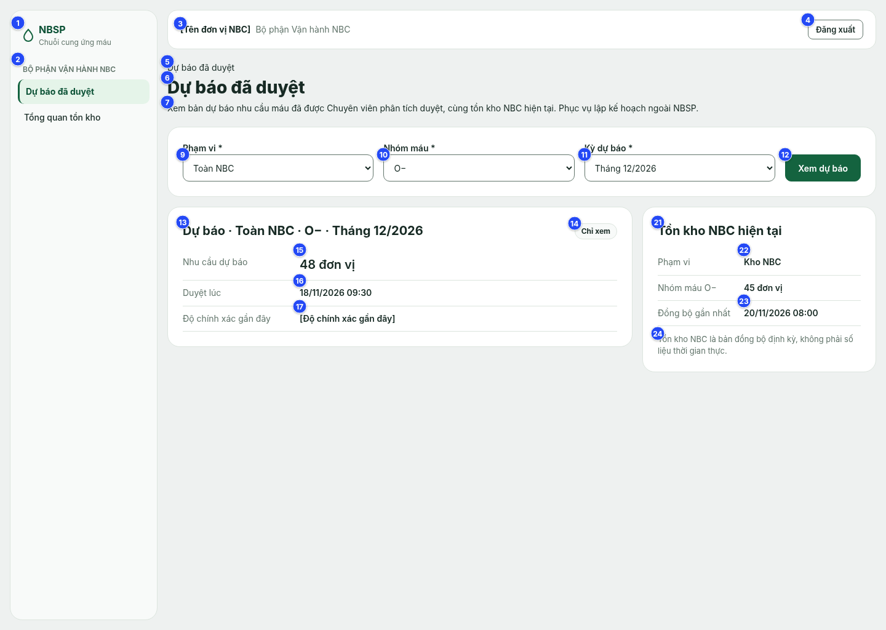
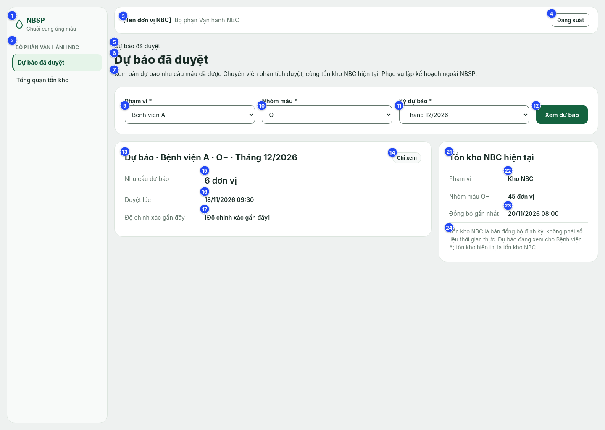
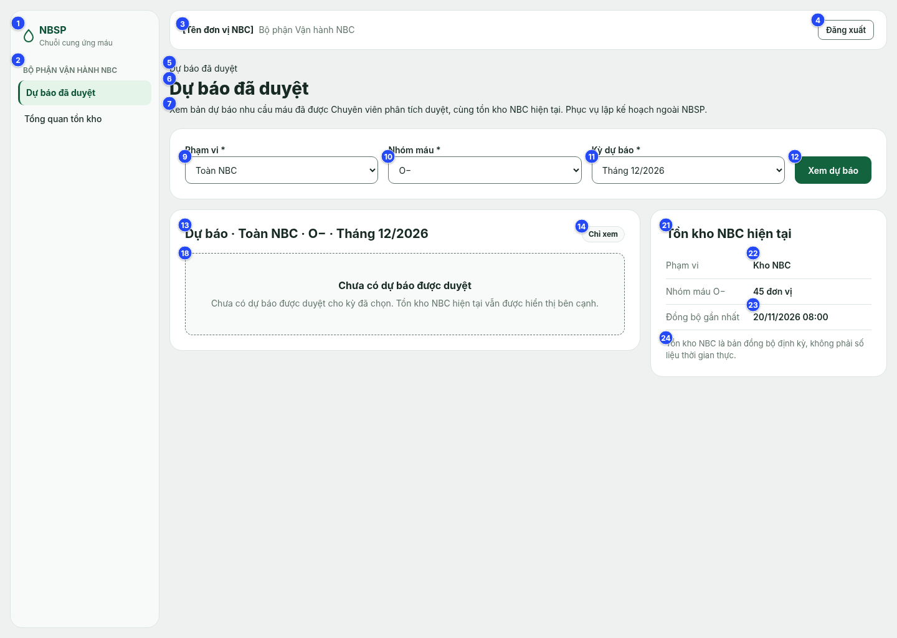
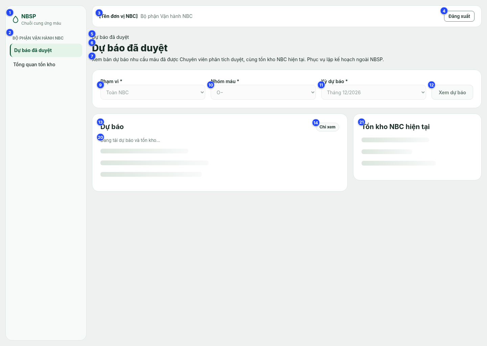
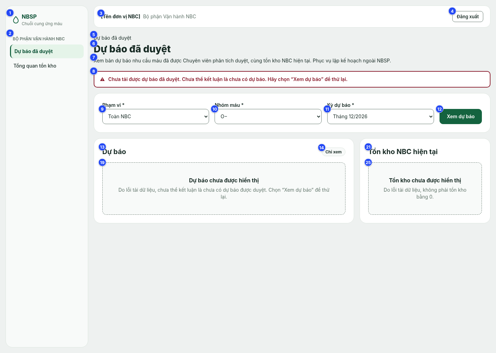

# Screen Spec: S-F03-05 Validated forecast

| Field | Value |
|---|---|
| Screen ID | S-F03-05 |
| Screen name | Validated forecast (Vietnamese UI title: "Dự báo đã duyệt") |
| Actor | NBC Operations |
| Priority | Must (screen-list.md; FR-03-07 is Must in W4) |
| Feature | F-03 Clinical Demand & Forecasting |
| Use cases / FRs | UC-16 · FR-03-07 (data: FR-02-05) |
| Activity diagrams | none: UC-16 is "not needed", a display step with no decision (`usage-flow.md` v2.3). Sequence: SD-UC-16 |
| Usage flow | NBC Operations Flow 1 "View the validated forecast" (`usage-flow.md` v2.3): S-F04-01 → **S-F03-05**; menu to S-F02-02 (Flow 2) |
| Mockup images | `img/s-f03-05-default.png`, `img/s-f03-05-default-hospital.png`, `img/s-f03-05-empty.png`, `img/s-f03-05-loading.png`, `img/s-f03-05-error.png`; numbered: the same names ending in `-numbered.png` (section 2) |
| Frame size | 1440 px wide (desktop, UI conventions v2.0 §2.1), 1024 px high in all states |
| Source of the mockup | `nbsp-ui-mockups.html` v3 (21/11/2026), tab "S-F03-05" (states Default, Một bệnh viện, Empty, Loading, Error) |
| Version | v2.0, 21/11/2026 (changes at the end of this file) |
| Status | Draft |

## 1. Purpose

**Shown when:** NBC Operations signed in (UC-12) need the approved blood forecast for one scope (NBC-wide or one hospital), one blood group and one forecast period, next to the current NBC inventory, to plan mobilisation and allocation outside NBSP (UC-16). It is the first screen after sign-in for NBC Operations (screen-list.md).

**The user leaves this screen when:** the user opens the inventory dashboard (S-F02-02) from the menu, or signs out.

## 2. Mockup

**Layout (all states):** same shell as S-F01-01 (sidebar with role group "BỘ PHẬN VẬN HÀNH NBC" and the NBC Operations menu; top bar with unit, role and "Đăng xuất"; breadcrumb, title, subtitle). Below: one filter card (three selects and the primary button), then the forecast card on the left and the NBC inventory card (380 px) on the right.

**Numbered images:** each number is the # in the element inventory (section 3). Element 8 appears only in the error state, 15 to 17 only when a forecast exists, 18 only in the empty state, 19 and 25 only in the error state, 20 only in the loading state.

| State | Numbered image | Numbers shown |
|---|---|---|
| Default (NBC-wide) |  | 1–7, 9–17, 21–24 |
| Default (one hospital) |  | 1–7, 9–17, 21–24 |
| Empty |  | 1–7, 9–14, 18, 21–24 |
| Loading |  | 1–7, 9–14, 20, 21 |
| Error |  | 1–14, 19, 21, 25 |
| Success | not applicable, see section 4 | — |

The forecast value, dates and the inventory figure are sample data. The period "Tháng 12/2026" is a sample in the format used by S-F03-04 ("Tháng 10/2026"); the accuracy value stays a placeholder `[Độ chính xác gần đây]` because no file defines it (question 2). Only the design tokens of UI conventions v2.0 §6 are used.

## 3. Element inventory

Data groups (W0 Table 4): **Forecast, review & version history** (ILF) and **NBC inventory snapshot** (EIF). Both are read-only here.

### 3.1 Page frame (all states)

| # | Element | Type | Content / data source | Required | Validation |
|---|---|---|---|---|---|
| 1 | Brand | Logo and text | static: "NBSP", "Chuỗi cung ứng máu" | Yes | none |
| 2 | Menu | Navigation (links, reachable with Tab) | static; role group "BỘ PHẬN VẬN HÀNH NBC" and the items allowed for NBC Operations (FR-04-03): "Dự báo đã duyệt" (current: background, left bar, bold text), "Tổng quan tồn kho" | Yes | none |
| 3 | Account info | Text | `user.department.name`, role "Bộ phận Vận hành NBC" from the session | Yes | none |
| 4 | Sign out | Secondary button | label "Đăng xuất" | Yes | none |
| 5 | Breadcrumb | Text | static: "Dự báo đã duyệt" (current page, not a link) | Yes | none |
| 6 | Title | Header | static: "Dự báo đã duyệt" | Yes | none |
| 7 | Subtitle | Text | static: "Xem bản dự báo nhu cầu máu đã được Chuyên viên phân tích duyệt, cùng tồn kho NBC hiện tại. Phục vụ lập kế hoạch ngoài NBSP." | Yes | none |
| 8 | Error banner | Banner (`role="alert"`) | static: "Chưa tải được dự báo đã duyệt. Chưa thể kết luận là chưa có dự báo. Hãy chọn “Xem dự báo” để thử lại." | No | shown only in the error state |

### 3.2 Filters

| # | Element | Type | Content / data source | Required | Validation |
|---|---|---|---|---|---|
| 9 | Scope | Select with label "Phạm vi *" | "Toàn NBC" or one hospital (`hospital.name`); maps to `forecast.scope` | Yes | one value of the list; disabled while loading |
| 10 | Blood group | Select with label "Nhóm máu *" | `forecast.blood_group`: one of the 8 valid types (A+, A−, B+, B−, AB+, AB−, O+, O−, BR-01) | Yes | one value of the list; disabled while loading |
| 11 | Forecast period | Select with label "Kỳ dự báo *" | `forecast.period`: the forecast periods that have a published version, newest first; same list and format as the period filter of S-F03-04 (sample "Tháng 12/2026") | Yes | one value of the list; disabled while loading |
| 12 | View forecast | Primary button | label "Xem dự báo" | Yes | disabled while loading |

### 3.3 Forecast card

| # | Element | Type | Content / data source | Required | Validation |
|---|---|---|---|---|---|
| 13 | Card title | Header | "Dự báo · [Phạm vi] · [Nhóm máu] · [Kỳ dự báo]" for the selection that was **loaded** (not the selects as changed since); "Dự báo" alone while loading and on error | Yes | read-only |
| 14 | Read-only tag | Chip | static: "Chỉ xem" | Yes | none |
| 15 | Forecast value | Row "Nhu cầu dự báo" | `forecast.value` + " đơn vị" (1 đơn vị = 1 túi 350 ml, BR-01, D-27) | Yes (when a forecast exists) | read-only; a missing value is "—", never 0 |
| 16 | Approval time | Row "Duyệt lúc" | `forecast.approved_at`, format dd/MM/yyyy HH:mm (see question 9) | Yes (when a forecast exists) | read-only |
| 17 | Recent accuracy | Row "Độ chính xác gần đây" | `forecast.recent_accuracy`, format [TBD] (question 2) | Yes (when a forecast exists) | read-only; "—" when not yet measurable |
| 18 | Empty message | Message block | static: "Chưa có dự báo được duyệt" + "Chưa có dự báo được duyệt cho kỳ đã chọn. Tồn kho NBC hiện tại vẫn được hiển thị bên cạnh." | No | shown only in the empty state |
| 19 | Forecast error block | Message block | static: "Dự báo chưa được hiển thị" + "Do lỗi tải dữ liệu, chưa thể kết luận là chưa có dự báo được duyệt. Chọn “Xem dự báo” để thử lại." | No | shown only in the error state; never shows the empty message |
| 20 | Loading status and skeleton | Text (`role="status"`) and skeleton rows in both cards | "Đang tải dự báo và tồn kho…" | No | shown only in the loading state |

### 3.4 NBC inventory card

| # | Element | Type | Content / data source | Required | Validation |
|---|---|---|---|---|---|
| 21 | Card title | Header | static: "Tồn kho NBC hiện tại" | Yes | none |
| 22 | Inventory rows | Card of rows | "Phạm vi" "Kho NBC"; "Nhóm máu [nhóm máu]" `inventory.quantity` of the loaded blood group + " đơn vị". Always the NBC stock, whatever scope is selected (SR-004) | Yes | read-only; missing value "—" |
| 23 | Last sync | Row "Đồng bộ gần nhất" | `inventory.last_sync_at`, format dd/MM/yyyy HH:mm | Yes (when the snapshot has a timestamp) | read-only |
| 24 | Snapshot note | Helper text | "Tồn kho NBC là bản đồng bộ định kỳ, không phải số liệu thời gian thực."; when one hospital is selected, followed by "Dự báo đang xem cho [Bệnh viện]; tồn kho hiển thị là tồn kho NBC." | Yes | none |
| 25 | Inventory error block | Message block | static: "Tồn kho chưa được hiển thị" + "Do lỗi tải dữ liệu, không phải tồn kho bằng 0." | No | shown only in the error state |

## 4. States

| State | What the user sees | Trigger |
|---|---|---|
| Default (with data) | Filters filled, card title with the loaded scope, blood group and period, "Chỉ xem" tag, forecast value, approval time and recent accuracy, next to the NBC inventory of that blood group with its last sync time. With one hospital selected the forecast is that hospital's, and the inventory card adds the scope note (24) | An approved, published forecast exists for the selection. On opening, the screen loads with "Toàn NBC", the newest period in the list and blood group A+ (first of BR-01, question 4) |
| Empty (no data) | Card title with the selection, the empty message (18) in place of the forecast; the NBC inventory and its last sync time are still shown | No approved forecast exists for the selection (FR-03-07, IF clause; SD-UC-16) |
| Loading | Status text and skeleton rows (20) in both cards; the three selects and "Xem dự báo" disabled, so the selects always match the result being loaded | Screen opened, or "Xem dự báo" pressed, and the server has not answered |
| Error | Error banner (8), error blocks (19, 25) in both cards; filters and "Xem dự báo" stay usable for a retry. No "no forecast" message and no "0" inventory is shown while the result is unknown | The query fails or the connection is lost before the server answers |
| Success / confirmation | **Not applicable:** the screen is read-only and has no action that changes data, so there is nothing to confirm (UI conventions §3.1 asks for the states that carry a risk on each screen). A loaded forecast is the Default state | none |

## 5. Interactions and navigation

| # | Element | User action | System response | Goes to screen |
|---|---|---|---|---|
| 1 | Scope, Blood group, Forecast period (9 to 11) | choose | Stores the choice in the filter; does not load until "Xem dự báo"; the card title keeps the loaded selection | stays |
| 2 | View forecast (12) | click | Loads the latest approved forecast for scope × blood group × period, its approval time, recent accuracy, the NBC inventory of that blood group and its last sync time (FR-03-07, SD-UC-16); shows the default, empty or error state | stays |
| 3 | Menu item "Tổng quan tồn kho" | click | Opens the inventory dashboard | S-F02-02 |
| 4 | Menu item "Dự báo đã duyệt" | click | Reloads this screen | stays |
| 5 | Sign out (4) | click | Ends the session | S-F04-01 |

## 6. Screen-level rules

| Rule ID | Rule | Source |
|---|---|---|
| SR-001 | Only an approved, published forecast is shown. A draft, rejected or undecided forecast item never appears here. | BR-07, FR-03-06 |
| SR-002 | The screen is read-only: no edit, approve, reject or export control. Allocation planning is done outside NBSP. | FR-03-07, W0 Table 3 |
| SR-003 | The inventory is a periodic snapshot; it is always shown with its last sync time and never called "real-time". | FR-02-05, ui-conventions §3 |
| SR-004 | The inventory shown is always the NBC stock of the selected blood group: FR-03-07 asks for the inventory with its last synchronisation time, which exists only for the NBC snapshot (FR-02-05); hospital stock is not synchronised and not used for alerts in release 1 (D-18). | FR-03-07, FR-02-05, W0 Table 3 |
| SR-005 | When no approved forecast exists, the screen says so and still shows the inventory with its sync time. | FR-03-07 |
| SR-006 | An unknown result (connection lost) is shown as an error, not as "no forecast" and not as zero stock. | ui-conventions §4.1 |
| SR-007 | Every figure names its scope, blood group, period and unit (card title and row labels); a missing value is shown as "—", never as 0. | ui-conventions §2.2 |
| SR-008 | State is never shown by colour alone. | ui-conventions §5 |
| SR-009 | Only NBC Operations open this screen (screen-list.md). Any other role gets "Tài khoản không có quyền truy cập nội dung này." and no data. | FR-04-03, ui-conventions §4.2 |

## 7. Linked requirements

| FR ID | What this screen does for it |
|---|---|
| FR-03-07 | Lets NBC Operations select hospital (or NBC-wide), blood group and forecast period, and shows the approved forecast with approval time, recent accuracy, current NBC inventory and last sync time; shows the no-forecast message when none exists |
| FR-02-05 | Supplies the synchronised NBC inventory snapshot and its timestamp (read-only) |
| FR-04-03 | Shows only the menu items and data allowed for NBC Operations |

## 8. Responsive and accessibility notes

- Smallest supported width: 1440 px (desktop only). The mockups are drawn at 1440 px wide, as UI conventions v2.0 §2.1 require; a narrower window and mobile are out of scope for this release (same wording as S-F01-01).
- Information never carried by colour alone: the read-only tag and the selected menu item have text; an error has an icon and text.
- Every filter has a visible label with * for required; selects are 44 px high with a #62756B border (4.9:1).
- Each value carries its unit ("48 đơn vị"); the card title names the loaded scope, blood group and period.
- Body text contrast at least 4.5:1 (secondary text #62756B only inside cards and on the sidebar); the primary button is 44 px high.
- The error banner uses `role="alert"`; the loading text uses `role="status"`. Menu items are reachable with Tab.

## 9. Open questions

| # | Question | Blocking? | Status |
|---|---|---|---|
| 1 | [NEEDS CLARIFICATION: which forecast periods exist (length, for example one month, and how many are listed)? FR-03-07 says "time horizon", SD-UC-16 "selected period", S-F03-04 uses a period filter ("Tháng 10/2026"). This spec reads the time horizon as one forecast period, as on S-F03-04.] | No | Open. Default: monthly periods with a published version, newest first. |
| 2 | [NEEDS CLARIFICATION: how is "recent forecast accuracy" measured and shown (percentage, error measure, which past periods)? Ask once together with the "previous accuracy" of S-F03-04, so both screens use one definition.] | Yes | Open |
| 3 | RESOLVED: the inventory is always the NBC stock (SR-004): FR-03-07 shows it with the last synchronisation time, which only the NBC snapshot has (FR-02-05), and hospital stock is out of the alert scope in release 1 (D-18). | No | Closed |
| 4 | [NEEDS CLARIFICATION: defaults on opening. Proposed: "Toàn NBC", the newest period, blood group A+ (first in BR-01), loaded at once.] | No | Open. Default applied as proposed. |
| 5 | RESOLVED: Success is not applicable on this read-only screen (section 4); UI conventions §3.1 asks only for the states that carry a risk. | No | Closed |
| 6 | [NEEDS CLARIFICATION: the Vietnamese text of the no-approved-forecast message is a proposal; FR-03-07 gives only the English meaning, and SD-UC-16 the sentence "No approved forecast is available for the selected period".] | No | Open |
| 7 | RESOLVED: menu labels are the Vietnamese UI names of the screens in ui-conventions §3.2 ("Dự báo đã duyệt", "Tổng quan tồn kho"), as on the Dept screens. | No | Closed |
| 8 | RESOLVED: the unit is "đơn vị", one bag of 350 ml, for every blood group (W0 BR-01, D-27); release 1 covers red blood cells only (D-12). | No | Closed |
| 9 | [NEEDS CLARIFICATION: FR-03-06 approves items one by one and then publishes a version. Is "Duyệt lúc" the time the item was approved or the time the version was published?] | No | Open. Default: the publication time of the version. |

---

## Completion checklist

- [x] The mockup images are separate files, named with the Screen ID, at the frame width. *(export from `nbsp-ui-mockups.html` v3)*
- [ ] The numbered images exist, and their numbers match the # column of the element inventory. *(to export from v3: numbering changed in v2.0)*
- [x] Every visible element in the mockup appears in the element inventory.
- [x] Every colour in the mockup is a design token from ui-conventions.md §6.
- [x] Every input element has a validation rule or an explicit "none".
- [x] All five states are filled in, or marked "not applicable" with a reason (Success).
- [x] Every navigation target is a Screen ID that exists in the Screen List.
- [x] Every element that displays data names the field it displays.
- [x] Every linked FR exists in the Function List. UC-16 has no activity diagram ("not needed"), so there is no action to cover.

## Changes in v2.0 (21/11/2026)

- Rewritten in the format of S-F01-03 / S-F01-04 v2: header with use cases, usage flow, mockup source, version and frame size; lowercase image names, one per state, `-numbered` files; reference to `usage-flow.md` (was `usage-flow-total.md`).
- Element inventory rebuilt from the mockup and renumbered 1 to 25: brand, role group, breadcrumb, subtitle, card titles, both error blocks and the loading status were missing.
- Texts aligned with the mockup: error banner, error blocks (the old "Không có dữ liệu để hiển thị" read like the empty state), empty message and snapshot note now name the NBC stock.
- One forecast = scope × blood group × one period (as on S-F03-04); the table of three placeholder periods is replaced by the value, approval time and accuracy. The card title shows the loaded selection (SR-007).
- Loading disables the selects too; the loading text is announced (`role="status"`).
- Questions 3, 5, 7, 8 closed from repo data (FR-02-05, D-18, ui-conventions §3.1 and §3.2, BR-01, D-27); question 9 colours removed (the mockup uses tokens only); question 1 made non-blocking; question 9 on the approval time added. SR-004 and SR-009 rewritten.
