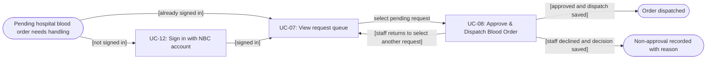
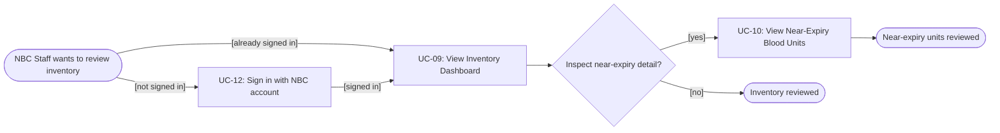
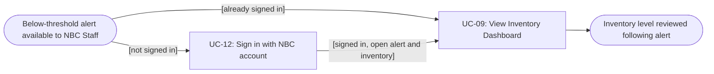

# Usage Flow: NBSP — NBC Operations

| Field | Value |
|---|---|
| Product | National Blood Supply Chain Platform (NBSP) |
| Version | v0.2 — group scope; UC-08 ownership retained |
| Date | 2026-11-07 |
| Actor | NBC Blood storage & Distribution (operations persona: NBC Staff) |
| Sources | W0 Table 1; W1 Function List; AD-UC-08 and SD-UC-08; `docs/external-design/screen-list.md`; Lesson 8 usage-flow template |

> **Notation:** each rectangular box is a **Use Case**, not a screen, click, status or technical operation. Rounded nodes indicate the situation or goal. **Dispatched** and **non-approval recorded** are two distinct business outcomes of UC-08. There is deliberately **no terminal outcome called `Blocked`**: a validation failure stops a *dispatch attempt*, not necessarily the entire user goal or the blood-order lifecycle.

## Before you draw: is Lesson 4 still true?

- [ ] **[TEAM CHECK]** Close or log findings in the `docs/activity/activity-index.md` Inputs check table; the team index was not supplied here.
- [ ] **[TEAM CHECK]** Agree one canonical NBC actor name in W0 / Context Diagram / SD.
- [x] No flow below includes architecture / DB / UI-click nodes.

## Flow A — NBC Operations: process a pending hospital blood order

| Step | Use case | Activity diagram | Screens | Owner / role |
|---|---|---|---|---|
| 1 (if no active session) | UC-12 — Sign in with NBC account | Another owner's AD / assessment | `S-F00-01` | Shared authentication. |
| 2 | UC-07 — View request queue | Another owner's AD / assessment | `S-F01-01` | Queue entry. |
| **3** | **UC-08 — Approve & Dispatch Blood Order** | **`AD-UC-08.md`** | **`S-F01-02`** | **This contributor**. |

### UC-08 branch details — logic **inside** the UC-08 box

| Branch order | Trigger / condition | Action or system outcome | Navigation / next work | FR |
|---|---|---|---|---|
| **1. Decline BEFORE dispatch submission** | After reviewing request, NBC Staff chooses not to approve. | Staff supplies reason → NBSP records non-approval → no allocation/dispatch. | Show recorded-decision confirmation on `S-F01-02`; staff chooses Back to Queue. | FR-01-09 |
| **2. Approve and dispatch** | Staff chooses approval, selects units, enters ETA and confirms. | NBSP checks Pending status/availability → reserves units via BMS → saves shipment and `Dispatched`. | Show dispatch-success state on `S-F01-02`; staff chooses Back to Queue. | FR-01-03 |
| **3a. Dispatch attempt blocked: insufficient units** | Final validation or BMS reservation finds insufficient eligible units. | Show reason; do **not** dispatch or change order/inventory due to failed attempt. | **Stay on `S-F01-02`**, allow staff to revise selection and retry only if request remains Pending/eligible, OR return to Queue. No terminal `Blocked` state. | FR-01-08 |
| **3b. Dispatch attempt blocked: invalid request** | Order is invalid or no longer Pending. | Show validation reason; do **not** dispatch. | **Stay on `S-F01-02`** to review error; disable dispatch for that request; return to Queue. | FR-01-03 |

**Important:** Re-selection and manual retry after shortage are proposed *screen interactions*, not automatic system retries. Every retry must revalidate eligibility. No business state named `Blocked` or `Rejected` is invented.

## Flow B — NBC Operations: monitor stock and near-expiry units

| Step | Use case | Activity diagram | Screens | Owner / role |
|---|---|---|---|---|
| 1 (conditional) | UC-12 — Sign in with NBC account | Shared / another owner | `S-F00-01` | Shared. |
| 2 | UC-09 — View Inventory Dashboard | Not provided; assess against Lesson 7 selection rules | `S-F02-01` | Other group member. |
| 3 (optional, Should priority) | UC-10 — View Near-Expiry Blood Units | Later (Should), as recorded in activity index if team agrees | `S-F02-02` | Other group member. |

## Flow C — NBC Operations: follow up a low-inventory alert

The **alert itself is system-triggered**, following an inventory synchronisation; opening the in-system alert is the human's entry situation. UC-11 does not appear as a manually started Use Case box, because the Lesson 8 template excludes time/external-system-triggered UCs from human-triggered Usage Flows. The staff can then use UC-09 to inspect inventory. Viewing near-expiry units (UC-10) is optional and not a required response to a shortage.

| Entry or step | Use case / event | Activity diagram | Screens | Remarks |
|---|---|---|---|---|
| **Event (not user-started)** | **UC-11 — Receive Below-Threshold Alert** | Owned by UC-11 group; see Activity Index | **`S-F02-03`** | A user can open the alert centre to inspect an alert created by the system; this does not manually trigger alert generation. |
| 1 (if necessary) | UC-12 — Sign in with NBC account | Shared | `S-F00-01` | Authenticate before protected screens. |
| 2 | UC-09 — View Inventory Dashboard | Other owner | `S-F02-01` | Investigate stock after receiving an alert. |

## Use cases without a human-initiated flow

| Use case | Started by | Described in |
|---|---|---|
| UC-11 — Receive Below-Threshold Alert | Inventory synchronisation / system comparison after latest stock data becomes available | UC-11 Activity/Sequence Diagram managed by its owner; FR-02-04 and `S-F02-03` cover notification viewing |
| UC-17 — Synchronise NBC inventory from Blood Management Software (**cross-feature dependency**) | Scheduled inventory synchronisation / external Blood Management Software | UC-17 Diagram or W1 FR-02-05 (owner to confirm); no NBC manual screen |

## Checks before you save

- [x] NBC Operations flows separated into meaningful goals rather than chaining unrelated UCs.
- [x] UC-07, UC-08, UC-09, UC-10, UC-12 are all covered as human-initiated steps; system-triggered UC-11 is explicitly listed and linked to `S-F02-03`.
- [x] UC-08 has separate legitimate endpoints for successful dispatch and saved non-approval.
- [x] A blocked attempt is recoverable or exits to a different request, **not** a third final order status.
- [x] Every screen in this group Screen List appears in a step or event entry.
- [x] Each diagram uses Use Cases as its rectangular process boxes; no UI or technical activity masquerades as UC.
- [ ] Team to confirm the actor canonical name and UC-11 trigger ownership in W0.
- [ ] Render each diagram on Mermaid Live and log findings from the Lesson 4/7 Inputs Check.
