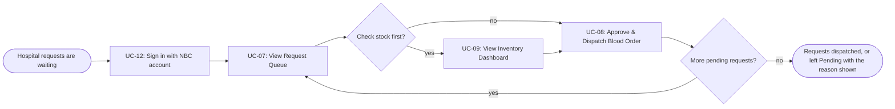
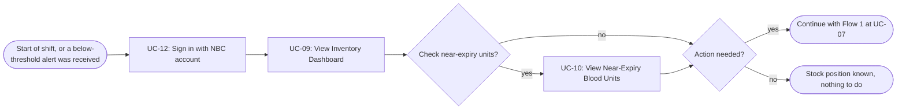

[usage-flow (1).md](https://github.com/user-attachments/files/34513793/usage-flow.1.md)
# Usage Flow: National Blood Supply Chain Platform (NBSP) — NBC Blood Storage and Distribution Department

| Field | Value |
|---|---|
| Product | NBSP (National Blood Supply Chain Platform) |
| Version | v0.4 (scope: actor NBC Blood Storage and Distribution Department; UC-07 to UC-12, UC-17) |
| Date | 06/11/2026 |
| Sources | W0 Table 1 (use case inventory); Use Case Diagram; W1 Function List (FR-01-02, FR-01-03, FR-02-02 to FR-02-05, FR-04-02); W4 effective priorities; AD-UC-08 (v0.4), AD-UC-11 (v0.8), AD-UC-17; `docs/activity/activity-index.md` |

Actor names, decided 2026-11-06: "NBC Staff" is split into **NBC Blood Storage and Distribution Department** (this file; short name "the Dept") and the **Operations (Forecast) side**: NBC Forecasting Analyst and NBC Operations. The flows of the Operations side belong to the other owner. Sign in (UC-12) is shared by all NBC users. NBC Operations also uses UC-09 and UC-11 (decided 2026-11-06), so the screens S-F02-02 and S-F02-04 are shared: they are owned in this file and the Operations list refers to them.

## Before you draw: is Lesson 4 still true?

- [ ] Every row of the Inputs check table has Status "Done", or is logged as an open question. *(activity-index.md not available: tick after checking.)*

| # | Finding | Fix in | Status |
|---|---|---|---|
| 1 | UC-17 Synchronise NBC Inventory (time, external system BMS) exists; UC-11 is called at its end. | This file | Done |
| 2 | "NBC Staff" is split. Texts that still say "NBC Staff": UC list rows UC-07 to UC-12; W1 EARS of FR-01-02, FR-01-03, FR-02-03, FR-02-04, FR-04-02. The AD files are fixed. | UC list, W1, Use Case Diagram, Context Diagram | Open (edit W0/W1) |
| 3 | Thresholds are loaded at deployment and never change (decided 2026-11-06): no use case, no screen. The Context Diagram still shows NBC Operations "configure thresholds": remove or reword it. Add the assumption to the UC list. | Context Diagram, UC list assumptions | Open (edit diagram) |
| 4 | NBC Operations also receives alerts (UC-11) and views the inventory dashboard (UC-09). UC-10 stays with the Dept. Update the UC list actors: UC-09 = Dept, NBC Operations, Hospital Staff; UC-11 = Dept, NBC Operations; EARS of FR-02-04 ("responsible NBC Staff"). | UC list, Use Case Diagram, FR-02-04 | Open (edit W0/W1) |
| 5 | AD-UC-08 revised to v0.4 (one approve-and-dispatch action, BMS lane, shortage blocks dispatch, no "not approved" branch). W1 FR-01-03 needs the two proposed IF clauses; FR-01-04 and UC-02 should say "dispatched", not "approved". | W1 FR-01-03, FR-01-04, UC-02 | Done in AD; W1 open |

## NBC Blood Storage and Distribution Department: Flow 1 — Fulfil hospital blood requests

A request that cannot be dispatched (stock shortage, or the stock service is unavailable) stays Pending and the reason is shown (AD-UC-08 v0.4). There is no "not approved" outcome in release 1.

| Step | Use case | Activity diagram | Screens |
|---|---|---|---|
| 1 | UC-12 Sign in with NBC account | "not needed": the same sign-in for every user in every flow; other ADs only state "signed in" as a precondition (lecturer's guidance) | S-F00-01 |
| 2 | UC-07 View Request Queue | "not needed" (suggested: one display step, no decision; confirm in activity-index) | S-F01-03 |
| 3 (optional) | UC-09 View Inventory Dashboard | "later" (Should) | S-F02-02 |
| 4 | UC-08 Approve & Dispatch Blood Order | `AD-UC-08.md` (v0.4) | S-F01-04 |

## NBC Blood Storage and Distribution Department: Flow 2 — Monitor stock and near-expiry units

| Step | Use case | Activity diagram | Screens |
|---|---|---|---|
| 1 | UC-12 Sign in with NBC account | "not needed" (as in Flow 1) | S-F00-01 |
| 2 | UC-09 View Inventory Dashboard | "later" (Should) | S-F02-02 |
| 3 (optional) | UC-10 View Near-Expiry Blood Units | "later" (Could) | S-F02-03 |
| 4 | Continue with Flow 1 (UC-07, UC-08) | see Flow 1 | S-F01-03, S-F01-04 |

When the person arrives because of an alert, the alert is shown on S-F02-04 (UC-11) and Flow 2 continues at step 2. NBC Operations sees the same alert and dashboard screens; its own flows are in the other owner's part.

## Use cases without a flow

| Use case | Started by | Described in |
|---|---|---|
| UC-17 Synchronise NBC Inventory | Time (every N minutes) / Blood Management Software | `AD-UC-17.md` |
| UC-11 Receive Below-Threshold Alert | Called at the end of UC-17 after a valid synchronisation; the Dept and NBC Operations receive the alert | `AD-UC-11.md` |

## Checks before you save

- [x] Every actor that starts a use case has at least one flow (NBC Blood Storage and Distribution Department: 2 flows; Operations side: other owner).
- [x] No flow has more than about 9 boxes (Flow 1: 8, Flow 2: 8).
- [x] Actor name matches the Use Case Diagram and Context Diagram ("NBC Blood Storage and Distribution Department"). *Check the UC list text.*
- [x] Coverage: UC-07, 08, 09, 10, 12 appear in a flow; UC-11 and UC-17 are under "Use cases without a flow".
- [x] No box is a click or a screen; no box tells two use cases.
- [ ] Every flow renders on mermaid.live.
- [x] Every step has at least one screen, and every screen of the Dept in the screen list appears in some step (S-F02-04 through the UC-11 note).

---
Template source: DBIZ2, VJCBI College - FTU, Lesson 8 (2026).
