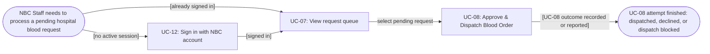

# Usage Flow: NBSP — NBC Operations (UC-08 contribution)

| Field | Value |
|---|---|
| Product | National Blood Supply Chain Platform (NBSP) |
| Version | v0.1 — UC-08 contribution to actor-wide flow |
| Date | 2026-11-07 |
| Actor in W0 | NBC Blood storage & Distribution |
| Operational user in SD | NBC Staff |
| Goal | Process a pending hospital blood request through review, approval and dispatch (or a recorded decline / blocked dispatch attempt) |
| Sources | W0 UC-07, UC-08, UC-12; W1 FR-01-02, FR-01-03, FR-01-08, FR-01-09, FR-04-02; `docs/activity/AD-UC-08.md`; SD-UC-08 |

## Before you draw: is Lesson 4 still true?

- [ ] **[NEEDS TEAM CHECK]** Verify that all findings in `docs/activity/activity-index.md` have status Done or are logged as open questions; team index is not available in this UC-08 contribution.
- [ ] **[NEEDS TEAM CHECK]** Verify canonical actor labels in the Use Case / Context Diagrams (W0 shows NBC Blood storage & Distribution; SD says NBC Staff).

## NBC Operations: process a pending blood order

A realistic actor workflow enters through sign-in (if not already authenticated), continues to the pending-request queue, and executes **UC-08** on one selected pending request. **UC-12 and UC-07 are cross-owner handoffs, not use cases assigned to this contributor.** The outcome of approve vs decline, invalid request and insufficient stock are branches *inside* UC-08 (described in AD-UC-08); they are not extra use-case boxes.

| Step | Use case | Activity diagram | Screens (filled after Screen List) | Contribution ownership |
|---|---|---|---|---|
| 1 (conditional) | UC-12 — Sign in with NBC account | Owned by UC-12 team; do not duplicate | `S-F00-01` **(proposed shared)** | Handoff / other member |
| 2 | UC-07 — View request queue | Owned by UC-07 team; do not duplicate | `S-F01-01` **(proposed shared)** | Handoff / other member |
| **3** | **UC-08 — Approve & Dispatch Blood Order** | **`AD-UC-08.md`** | **`S-F01-02` (owned)** | **This contribution** |

### UC-08 business outcome (detail belongs in AD, not Usage Flow boxes)

| Branch within UC-08 | Result | W1 trace |
|---|---|---|
| NBC Staff declines pending order | Non-approval decision and reason recorded; no dispatch | FR-01-09 |
| Request is invalid or no longer Pending | Dispatch blocked and reason displayed | FR-01-03 |
| Eligible units insufficient / unavailable for reservation | Dispatch blocked; shortage reason displayed; no order/inventory changes | FR-01-08 |
| Eligible units reserved and shipment saved | Blood Order / request reaches **Dispatched**, with ETA and assigned units | FR-01-03 |

**Business-success versus interaction-completion:** Only the final row is a successful dispatch. A decline or blocked attempt is a valid completion of the user interaction, **not** a successful shipment.

## Use cases without a flow (this contribution)

| Use case | Started by | Described in |
|---|---|---|
| None in this UC-08 contribution | — | Time-triggered / external-actor UCs elsewhere in NBSP must be assessed by the team integrator. |

## Integration into the full NBC actor flow

The **team-wide** `usage-flow.md` should show one connected actor flow for NBC Operations, not a disconnected UC-08 flow for each member. Merge this sequence into any existing NBC Operations usage flow as **`UC-07 → UC-08`**, after UC-12 as needed. Other NBC goals such as viewing inventory (UC-09), near-expiry units (UC-10) or alerts (UC-11) are intentionally **not** represented as mandatory steps of this blood-order dispatch goal; their owners should integrate those separate goals.

## Checks before you save

- [x] One actor/goal contribution, with correct UC IDs and names.
- [x] All diagram process boxes are Use Cases (not screens, button actions or database tasks).
- [x] The actor has a plausible trigger and an explicit terminal outcome.
- [x] UC-08 and required entry-path UC-12 / UC-07 each map to at least one screen.
- [x] UC-08's approval/decline/error choices stay within its Activity Diagram.
- [ ] Team-wide coverage of all NBC actor goals and all W0 Use Cases is checked by the integrator.
- [ ] Team has rendered the Mermaid diagram on its chosen Mermaid version.
