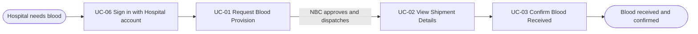
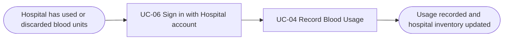
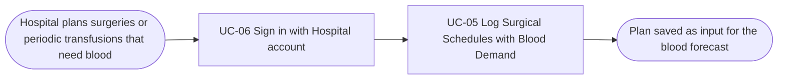
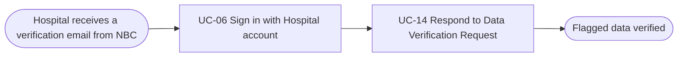
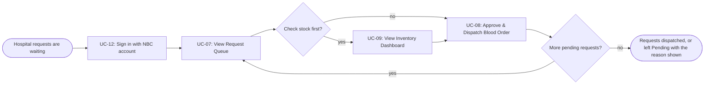
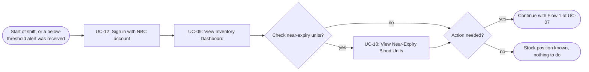

# Usage Flow: National Blood Supply Chain Platform (NBSP) — all actors

> DBIZ2 Group C. Merged draft of the usage flows of Hospital Staff and the NBC Blood Storage and Distribution Department. The flows of the Operations (Forecast) side (NBC Forecasting Analyst, NBC Operations) are not drawn yet.

| Field | Value |
|---|---|
| Product | NBSP (National Blood Supply Chain Platform) |
| Version | v2.0 (merged draft) |
| Date | 07/11/2026 |
| Sources | W0 Table 1 (use case inventory); Use Case Diagram; W1 Function List; W4 effective priorities; AD-UC-08 (v0.4), AD-UC-11 (v0.8), AD-UC-17; draft `screen-list.md`; `docs/activity/activity-index.md` |

Actor names, decided 2026-11-06: "NBC Staff" is split into the **NBC Blood Storage and Distribution Department** (short name "the Dept") and the **Operations (Forecast) side**: NBC Forecasting Analyst and NBC Operations. The flows of the Operations side belong to the other owner. Sign in (UC-06 for Hospital Staff, UC-12 for NBC users) is one shared screen, `S-F00-01`. NBC Operations also uses UC-09 and UC-11 (decided 2026-11-06), so the screens S-F02-02 and S-F02-04 are shared: they are owned in the Dept flows and the Operations list refers to them. Hospital Staff also uses UC-09 (S-F02-02).

## Before you draw: is Lesson 4 still true?

- [ ] Every row of the Inputs check table has Status "Done", or is logged as an open question. *(activity-index.md not available: tick after checking.)*

| # | Finding | Fix in | Status |
|---|---|---|---|
| 1 | UC-17 Synchronise NBC Inventory (time, external system BMS) exists; UC-11 is called at its end. | This file | Done |
| 2 | "NBC Staff" is split. Texts that still say "NBC Staff": UC list rows UC-07 to UC-12; W1 EARS of FR-01-02, FR-01-03, FR-02-03, FR-02-04, FR-04-02. The AD files are fixed. | UC list, W1, Use Case Diagram, Context Diagram | Open (edit W0/W1) |
| 3 | Thresholds are loaded at deployment and never change (decided 2026-11-06): no use case, no screen. The Context Diagram still shows NBC Operations "configure thresholds": remove or reword it. Add the assumption to the UC list. | Context Diagram, UC list assumptions | Open (edit diagram) |
| 4 | NBC Operations also receives alerts (UC-11) and views the inventory dashboard (UC-09). UC-10 stays with the Dept. Update the UC list actors: UC-09 = Dept, NBC Operations, Hospital Staff; UC-11 = Dept, NBC Operations; EARS of FR-02-04 ("responsible NBC Staff"). | UC list, Use Case Diagram, FR-02-04 | Open (edit W0/W1) |
| 5 | AD-UC-08 revised to v0.4 (one approve-and-dispatch action, BMS lane, shortage blocks dispatch, no "not approved" branch). W1 FR-01-03 needs the two proposed IF clauses; FR-01-04 and UC-02 should say "dispatched", not "approved". | W1 FR-01-03, FR-01-04, UC-02 | Done in AD; W1 open |

## Hospital Staff: order blood and receive it

| Step | Use case | Activity diagram | Screens |
|---|---|---|---|
| 1 | UC-06 Sign in with Hospital account | not needed (same sign-in as UC-12, see the NBC flows) | S-F00-01 |
| 2 | UC-01 Request Blood Provision | `AD-UC-01.md` | S-F01-01 |
| 3 | UC-02 View Shipment Details | not needed | S-F01-02 |
| 4 | UC-03 Confirm Blood Received | `AD-UC-03.md` | S-F01-02 |

UC-02 is only available once NBC has approved and dispatched the request (the NBC steps are in the NBC flow). If the request is invalid, Hospital Staff correct it and resubmit inside UC-01; that loop is drawn in `AD-UC-01.md`, not here.

## Hospital Staff: record blood usage

| Step | Use case | Activity diagram | Screens |
|---|---|---|---|
| 1 | UC-06 Sign in with Hospital account | not needed (as in the first Hospital Staff flow) | S-F00-01 |
| 2 | UC-04 Record Blood Usage | `AD-UC-04.md` | S-F02-01 (to confirm) |

If the usage record is incomplete or the quantity exceeds the hospital inventory, nothing is changed, the reason is shown, and Hospital Staff correct and resubmit inside UC-04 (FR-02-06); that loop is drawn in `AD-UC-04.md`, not here. The updated inventory can then be seen in UC-09 View Inventory Dashboard (S-F02-02), which is drawn in the NBC Dept flow 2; Hospital Staff has no dashboard flow of its own yet.

## Hospital Staff: log surgical schedules with blood demand

| Step | Use case | Activity diagram | Screens |
|---|---|---|---|
| 1 | UC-06 Sign in with Hospital account | not needed (as in the first Hospital Staff flow) | S-F00-01 |
| 2 | UC-05 Log Surgical Schedules with Blood Demand | `AD-UC-05.md` | S-F03-01 (to confirm) |

If the plan data is invalid, nothing is saved, the reason is shown, and Hospital Staff correct and resubmit inside UC-05 (FR-03-08, proposed); that loop is drawn in `AD-UC-05.md`, not here. How the forecast uses the saved plan belongs to the forecasting use cases, which have no flow yet.

## Hospital Staff: answer a data verification request

| Step | Use case | Activity diagram | Screens |
|---|---|---|---|
| 1 | UC-06 Sign in with Hospital account | not needed (as in the first Hospital Staff flow) | S-F00-01 |
| 2 | UC-14 Respond to Data Verification Request | `AD-UC-14.md` (to create) | S-F03-03 |

NBC checks the blood usage (UC-04) and the blood demand (UC-05) that the hospital submitted. When it finds a problem (for example an unusually high usage, a missing value or an invalid value), it flags the data and sends it back, and the hospital gets an email. UC-04, UC-05 and the NBC check itself are not boxes here: the first two happened earlier in their own Hospital Staff flows, and the check is done by NBC. The hospital answers on its own screen (S-F03-03), inside UC-14, so it does not go back to UC-04 or UC-05; how it answers each kind of problem is drawn in `AD-UC-14.md`.

## NBC Blood Storage and Distribution Department: Flow 1 — Fulfil hospital blood requests

A request that cannot be dispatched (stock shortage, or the stock service is unavailable) stays Pending and the reason is shown (AD-UC-08 v0.4). There is no "not approved" outcome in release 1.

| Step | Use case | Activity diagram | Screens |
|---|---|---|---|
| 1 | UC-12 Sign in with NBC account | "not needed": the same sign-in for every user in every flow; other ADs only state "signed in" as a precondition (lecturer's guidance) | S-F00-01 |
| 2 | UC-07 View Request Queue | "not needed" (suggested: one display step, no decision; confirm in activity-index) | S-F01-03 |
| 3 (optional) | UC-09 View Inventory Dashboard | "later" (Should) | S-F02-02 |
| 4 | UC-08 Approve & Dispatch Blood Order | `AD-UC-08.md` (v0.4) | S-F01-04 |

## NBC Blood Storage and Distribution Department: Flow 2 — Monitor stock and near-expiry units

| Step | Use case | Activity diagram | Screens |
|---|---|---|---|
| 1 | UC-12 Sign in with NBC account | "not needed" (as in Flow 1) | S-F00-01 |
| 2 | UC-09 View Inventory Dashboard | "later" (Should) | S-F02-02 |
| 3 (optional) | UC-10 View Near-Expiry Blood Units | "later" (Could) | S-F02-03 |
| 4 | Continue with Flow 1 (UC-07, UC-08) | see Flow 1 | S-F01-03, S-F01-04 |

When the person arrives because of an alert, the alert is shown on S-F02-04 (UC-11) and Flow 2 continues at step 2. NBC Operations sees the same alert and dashboard screens; its own flows are in the other owner's part.

## Use cases without a flow

| Use case | Started by | Described in |
|---|---|---|
| UC-17 Synchronise NBC Inventory | Time (every N minutes) / Blood Management Software | `AD-UC-17.md` |
| UC-11 Receive Below-Threshold Alert | Called at the end of UC-17 after a valid synchronisation; the Dept and NBC Operations receive the alert | `AD-UC-11.md` |
| UC-13 Validate Clinical Demand Data | NBC Forecasting Analyst | Operations (Forecast) side flow, not drawn yet (other owner) |
| UC-15 Review and Approve Blood Forecast | NBC Forecasting Analyst | Operations (Forecast) side flow, not drawn yet (other owner) |
| UC-16 View Validated Blood Forecast | NBC Operations | Operations (Forecast) side flow, not drawn yet (other owner) |

## Checks before you save

- [ ] Every actor that starts a use case has at least one flow (Hospital Staff: 4 flows; NBC Blood Storage and Distribution Department: 2 flows; NBC Forecasting Analyst and NBC Operations: not drawn yet).
- [x] No flow has more than about 9 boxes (the longest: Dept Flow 1 and Flow 2, 8 each).
- [x] Actor names match the Use Case Diagram and Context Diagram ("Hospital Staff", "NBC Blood Storage and Distribution Department"). *Check the UC list text (finding 2).*
- [ ] Coverage: UC-01 to UC-10, UC-12 and UC-14 appear in a flow; UC-11 and UC-17 are under "Use cases without a flow"; UC-13, UC-15 and UC-16 still need the Operations (Forecast) flows.
- [x] No box is a click or a screen; no box tells two use cases.
- [x] Every flow renders in Mermaid.
- [x] Every step has at least one screen (S-F02-01 for UC-04 and S-F03-01 for UC-05 are to confirm).
- [ ] Every screen in the screen list appears in some step. (The Operations (Forecast) screens are not covered yet.)

---
Template source: DBIZ2, VJCBI College - FTU, Lesson 8 (2026).
