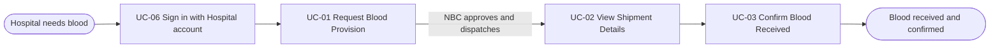
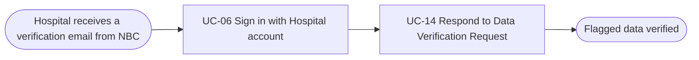

# Usage Flow: NBSP (National Blood Supply Chain Platform)

> DBIZ2 Group C. Draft with one flow only (Hospital Staff). The other actors' flows are not drawn yet.

| Field | Value |
|---|---|
| Product | NBSP (National Blood Supply Chain Platform) |
| Version | v1.0 (draft) |
| Sources | W0 Table 1 (use case inventory); Use Case Diagram; `docs/activity/activity-index.md` |

## Before you draw: is Lesson 4 still true?

- [ ] Every row of the Inputs check table in `docs/activity/activity-index.md` is "Done" or logged
      as an open question. (To confirm: `activity-index.md` was not available when drafting.)

## Hospital Staff: order blood and receive it

| Step | Use case | Activity diagram | Screens |
|---|---|---|---|
| 1 | UC-06 Sign in with Hospital account | not needed (to confirm) | S-F04-01 |
| 2 | UC-01 Request Blood Provision | `AD-UC-01.md` | S-F01-01 |
| 3 | UC-02 View Shipment Details | not needed | S-F01-02 |
| 4 | UC-03 Confirm Blood Received | `AD-UC-03.md` | S-F01-02 |

UC-02 is only available once NBC has approved and dispatched the request (the NBC steps are in the
NBC flow). If the request is invalid, Hospital Staff correct it and resubmit inside UC-01; that loop
is drawn in `AD-UC-01.md`, not here.

Hospital Staff of NBSP also come to record blood usage and log surgical schedules. Those goals get
their own flows (not drawn yet). This file so far has two Hospital Staff flows: ordering blood and
answering a data verification request.

## Hospital Staff: answer a data verification request

| Step | Use case | Activity diagram | Screens |
|---|---|---|---|
| 1 | UC-06 Sign in with Hospital account | not needed (to confirm) | S-F04-01 |
| 2 | UC-14 Respond to Data Verification Request | `AD-UC-14.md` (to create) | S-F03-03 |

NBC checks the blood usage (UC-04) and the blood demand (UC-05) that the hospital submitted. When it
finds a problem (for example an unusually high usage, a missing value or an invalid value), it flags
the data and sends it back, and the hospital gets an email. UC-04, UC-05 and the NBC check itself
are not boxes here: the first two happened earlier in their own Hospital Staff flows, and the check
is done by NBC. The hospital answers on its own screen (S-F03-03), inside UC-14, so it does not go
back to UC-04 or UC-05; how it answers each kind of problem is drawn in `AD-UC-14.md`.

## Use cases without a flow

| Use case | Started by | Described in |
|---|---|---|
| UC-04 Record Blood Usage | Hospital Staff | other Hospital Staff flow, not drawn yet |
| UC-05 Log Surgical Schedules with Blood Demand | Hospital Staff | other Hospital Staff flow, not drawn yet |
| UC-09 View Inventory Dashboard | Hospital Staff, NBC Blood storage & Distribution dept | not drawn yet |
| UC-17 Synchronise NBC Inventory | Blood Management Software (periodic sync) | `AD-UC-17.md` if one is made |

The NBC actors (UC-07, 08, 10, 11, 12, 13, 15, 16) have no flow yet.

## Checks before you save

- [ ] Every actor that starts a use case has at least one flow. (Only Hospital Staff so far, with two flows.)
- [x] No flow has more than about 9 boxes (the longest flow has 4 use cases).
- [x] Every actor name matches the W0 Table 1 inventory ("Hospital Staff").
- [x] The use cases in the flow use the same ID and name as W0 Table 1.
- [x] No box is a click or a screen; no box tells two use cases.
- [x] Every flow renders in Mermaid.
- [x] Every step has at least one screen (IDs from the draft `screen-list.md`).
- [ ] Every screen in `screen-list.md` appears in some step. (Only Hospital Staff's two flows are
      drawn so far.)
