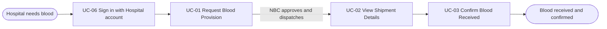
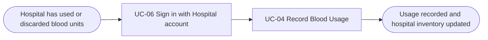

# Usage Flow: NBSP (National Blood Supply Chain Platform)

> DBIZ2 Group C. Draft with two flows (Hospital Staff: order blood and receive it; record blood usage). The other actors' flows are not drawn yet.

| Field | Value |
|---|---|
| Product | NBSP (National Blood Supply Chain Platform) |
| Version | v1.1 (draft) |
| Sources | W0 Table 1 (use case inventory); Use Case Diagram; `docs/activity/activity-index.md` |

## Before you draw: is Lesson 4 still true?

- [ ] Every row of the Inputs check table in `docs/activity/activity-index.md` is "Done" or logged
      as an open question. (To confirm: `activity-index.md` was not available when drafting.)

## Hospital Staff: order blood and receive it

| Step | Use case | Activity diagram | Screens |
|---|---|---|---|
| 1 | UC-06 Sign in with Hospital account | not needed (to confirm) | S-F04-01 |
| 2 | UC-01 Request Blood Provision | `AD-UC-01.md` | S-F01-01 |
| 3 | UC-02 View Shipment Details | not needed | S-F01-02 |
| 4 | UC-03 Confirm Blood Received | `AD-UC-03.md` | S-F01-02 |

UC-02 is only available once NBC has approved and dispatched the request (the NBC steps are in the
NBC flow). If the request is invalid, Hospital Staff correct it and resubmit inside UC-01; that loop
is drawn in `AD-UC-01.md`, not here.

## Hospital Staff: record blood usage

| Step | Use case | Activity diagram | Screens |
|---|---|---|---|
| 1 | UC-06 Sign in with Hospital account | not needed (to confirm) | S-F04-01 |
| 2 | UC-04 Record Blood Usage | `AD-UC-04.md` | S-F02-01 (to confirm) |

If the usage record is incomplete or the quantity exceeds the hospital inventory, nothing is changed,
the reason is shown, and Hospital Staff correct and resubmit inside UC-04 (FR-02-06); that loop is
drawn in `AD-UC-04.md`, not here. The updated inventory can then be seen in UC-09 View Inventory
Dashboard, which belongs to the dashboard flow (not drawn yet).

Hospital Staff of NBSP also come for other goals (log surgical schedules, answer data-verification
requests). Those goals get their own flows, so this file covers only the ordering and the usage goals.

## Use cases without a flow

| Use case | Started by | Described in |
|---|---|---|
| UC-05 Log Surgical Schedules with Blood Demand | Hospital Staff | other Hospital Staff flow, not drawn yet |
| UC-14 Respond to Data Verification Request | Hospital Staff | other Hospital Staff flow, not drawn yet |
| UC-09 View Inventory Dashboard | Hospital Staff, NBC Blood storage & Distribution dept | not drawn yet |
| UC-17 Synchronise NBC Inventory | Blood Management Software (periodic sync) | `AD-UC-17.md` if one is made |

The NBC actors (UC-07, 08, 10, 11, 12, 13, 15, 16) have no flow yet.

## Checks before you save

- [ ] Every actor that starts a use case has at least one flow. (Only Hospital Staff so far.)
- [x] No flow has more than about 9 boxes (the longest flow has 4 use cases).
- [x] Every actor name matches the W0 Table 1 inventory ("Hospital Staff").
- [x] The use cases in the flows use the same ID and name as W0 Table 1.
- [x] No box is a click or a screen; no box tells two use cases.
- [ ] Both flows render in Mermaid. (Check on GitHub or mermaid.live before saving.)
- [ ] Every step has at least one screen (IDs from the draft `screen-list.md`). (S-F02-01 for UC-04 is to confirm.)
- [ ] Every screen in `screen-list.md` appears in some step. (Only Hospital Staff's ordering and usage flows are
      drawn so far.)
