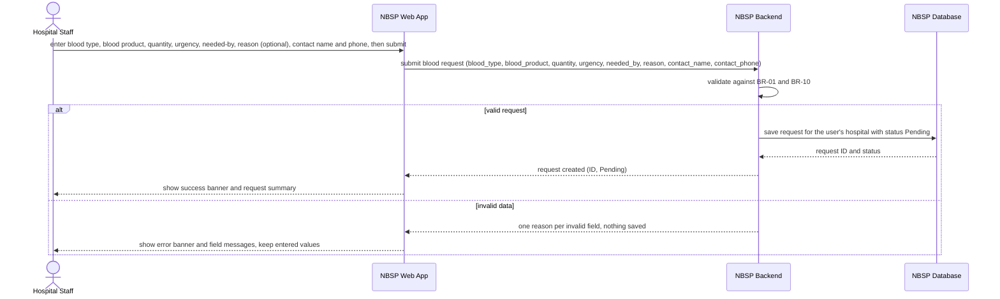

# Sequence Diagram: SD-UC-01 Request blood provision

Lesson 4, analysis level: how the parts of NBSP talk to each other when Hospital Staff submit a blood request. The lifelines are the elements of the
[physical design](../architecture/architecture.md). The user's own actions (what they choose or
type) are shown in the activity diagram [AD-UC-01](../activity/AD-UC-01.md), not here.

| Field | Value |
|---|---|
| Use case | UC-01 Request blood provision |
| Version | v2 (21/11/2026: payload matches screen S-F01-01; validation by BR-01 and BR-10) |
| FRs | FR-01-01, FR-01-06 |
| Business rules | BR-01, BR-10 |
| Screen | S-F01-01 |

The `alt` fragment is an outcome decided inside the system (validation), so it belongs in a
sequence diagram. FR-01-01 covers the valid branch; FR-01-06 covers the invalid branch (nothing is
saved, the user corrects and resubmits).

Notes:

- The payload fields are the `request.*` fields of the S-F01-01 element inventory. The hospital is not sent by the web app: the Backend takes it from the signed-in user's session (BR-06, FR-04-03).
- Valid values: blood type, product, urgency (Emergency, Urgent, Periodic) and quantity in 350 ml units by BR-01; needed-by, contact, reason and the maximum quantity by BR-10.
- The request is placed in the NBC request queue by being saved with status Pending; the queue (UC-07, FR-01-02) reads Pending requests ordered by BR-05.
- The success message is shown only after the Database returns the request ID, so the user is never told "sent" before the request exists.
