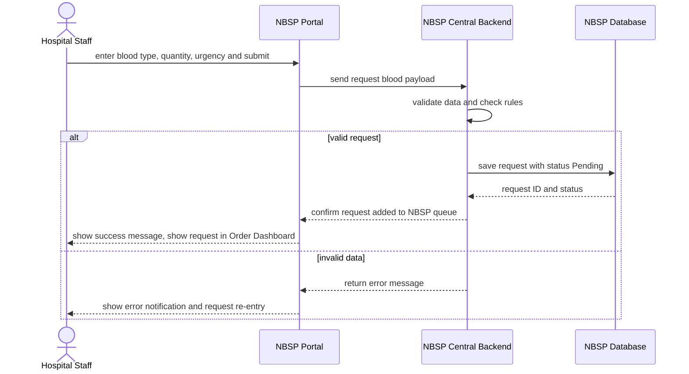

# Sequence Diagram: SD-UC-01 Request blood provision

Lesson 4, analysis level: how the parts of NBSP talk to each other when Hospital Staff submit a blood request. The lifelines are the elements of the
[physical design](../architecture/architecture.md). The user's own actions (what they choose or
type) are shown in the activity diagram [AD-UC-01](../activity/AD-UC-01.md), not here.

| Field | Value |
|---|---|
| Use case | UC-01 Request blood provision |
| Version | v1 |
| FRs | FR-01-01, FR-01-06 |

The `alt` fragment is an outcome decided inside the system (validation), so it belongs in a
sequence diagram. FR-01-01 covers the valid branch; FR-01-06 covers the invalid branch (nothing is
saved, the user corrects and resubmits).
