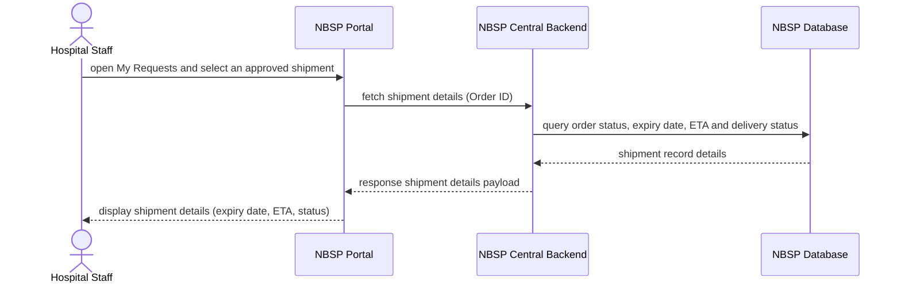

# Sequence Diagram: SD-UC-02 View shipment details

Lesson 4, analysis level: how the parts of NBSP talk to each other when Hospital Staff look up the shipment of an approved blood request. The exchange is read-only. The lifelines are the elements of the
[physical design](../architecture/architecture.md). The user's own actions (what they choose or
type) are shown in the activity diagram [AD-UC-02](../activity/AD-UC-02.md), not here.

| Field | Value |
|---|---|
| Use case | UC-02 View shipment details |
| Version | v1 |
| FRs | FR-01-04 |

There is no `alt` fragment: the exchange only reads data and changes nothing (FR-01-04).
