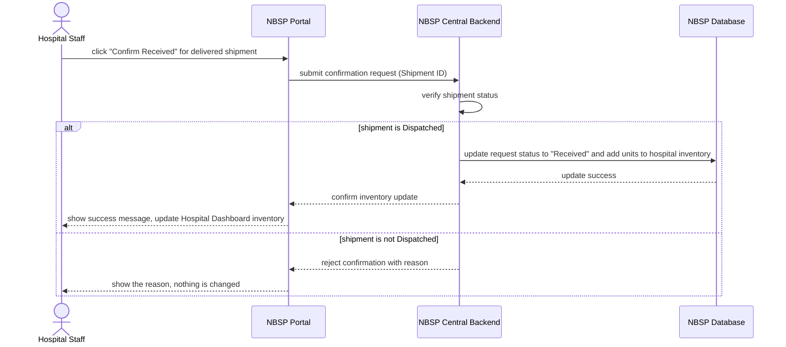

# Sequence Diagram: SD-UC-03 Confirm blood received

Lesson 4, analysis level: how the parts of NBSP talk to each other when Hospital Staff confirm that a delivered shipment has arrived. The lifelines are the elements of the
[physical design](../architecture/architecture.md). The user's own actions (what they choose or
type) are shown in the activity diagram [AD-UC-03](../activity/AD-UC-03.md), not here.

| Field | Value |
|---|---|
| Use case | UC-03 Confirm blood received |
| Version | v1 |
| FRs | FR-01-05, FR-01-07 |

The `alt` fragment is an outcome decided inside the system, so it belongs in a sequence diagram.
FR-01-05 covers the valid branch; FR-01-07 covers the error branch (nothing is changed).
