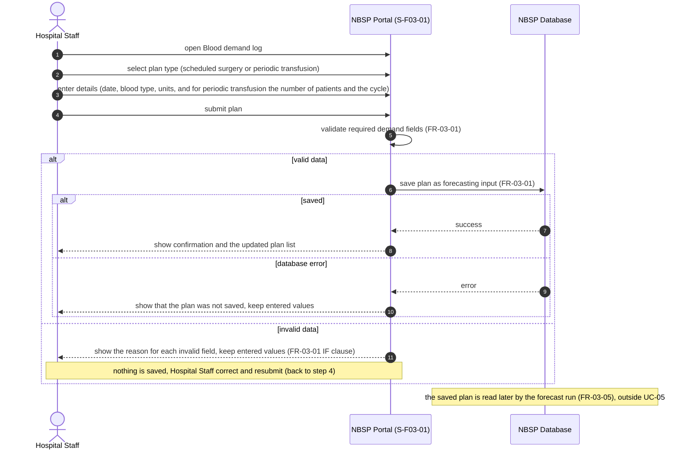

# Sequence Diagram: SD-UC-05 Log surgical schedules with blood demand

| Field | Value |
|---|---|
| Use case | UC-05 Log surgical schedules with blood demand |
| Version | v2 |
| Date | 21/11/2026 |
| FRs | FR-03-01 (including its IF clause for invalid plan data) |
| Screen | S-F03-01 Blood demand log |
| Precondition | Hospital Staff is signed in (UC-06) |

## Changes from v1

| # | v1 | v2 | Why |
|---|---|---|---|
| 1 | Message 2 contained a `;` | Replaced with "and" | Mermaid reads `;` as the end of a statement, so v1 did not render (parse error on line 8) |
| 2 | Confirmation shown before saving | Confirmation shown only after the database returns success | The user must not see "saved" when the save fails |
| 3 | No branch for a database error | `else database error` branch | A valid plan can still fail to save |
| 4 | "Show updated plan list (optional)" after both branches | Inside the success branch | After invalid data there is nothing new to list |
| 5 | Participant "Forecasting Engine" declared but never used | Removed; a note says the forecast reads the plan later (FR-03-05) | Forecasting is not part of UC-05 |
| 6 | "Hospital Blood Mgmt Portal", "Hospital Database" | "NBSP Portal (S-F03-01)", "NBSP Database" | The plan is stored in NBSP, and the system name is NBSP (as in W1) |
| 7 | No explicit submit step; invalid branch did not cite an FR | "submit plan" step; invalid branch cites the FR-03-01 IF clause | Matches W1 FR-03-01 and the correct-and-resubmit loop in the usage flow |
