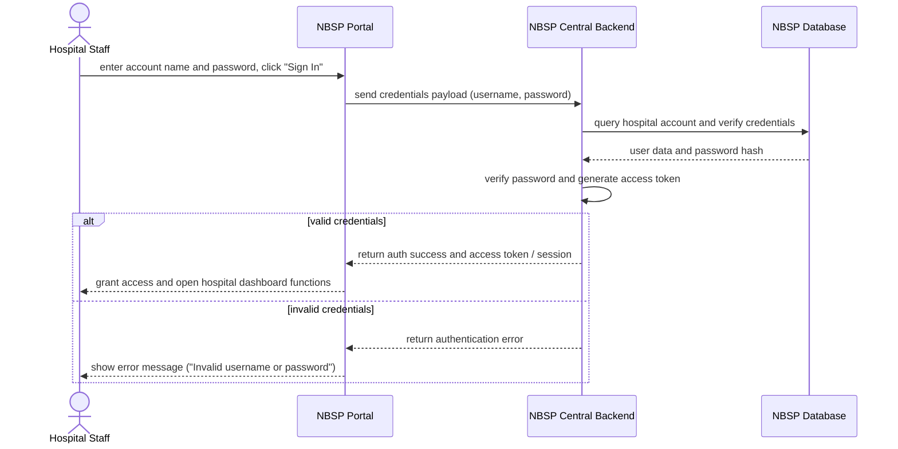

# Sequence Diagram: SD-UC-06 Sign in with hospital account

Lesson 4, analysis level: how the parts of NBSP talk to each other when Hospital Staff sign in with a hospital account. The lifelines are the elements of the
[physical design](../architecture/architecture.md). The user's own actions (what they choose or
type) are shown in the activity diagram [AD-UC-06](../activity/AD-UC-06.md), not here.

| Field | Value |
|---|---|
| Use case | UC-06 Sign in with hospital account |
| Version | v1 |
| FRs | FR-04-01 |

The `alt` fragment is an outcome decided inside the system, so it belongs in a sequence diagram.
