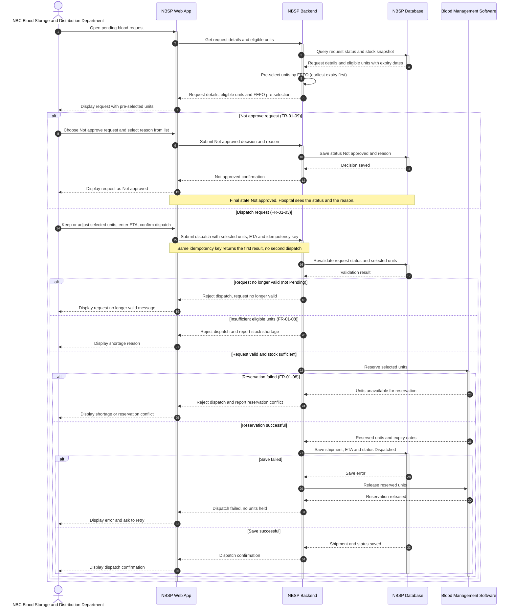

# Sequence Diagram: SD-UC-08 Review and process blood request

| Field | Value |
|---|---|
| Use case | UC-08 Review and process blood request |
| Version | v2 |
| FRs | FR-01-03, FR-01-08, FR-01-09 |
| Decisions | D-04, D-07, D-09, D-24 |

