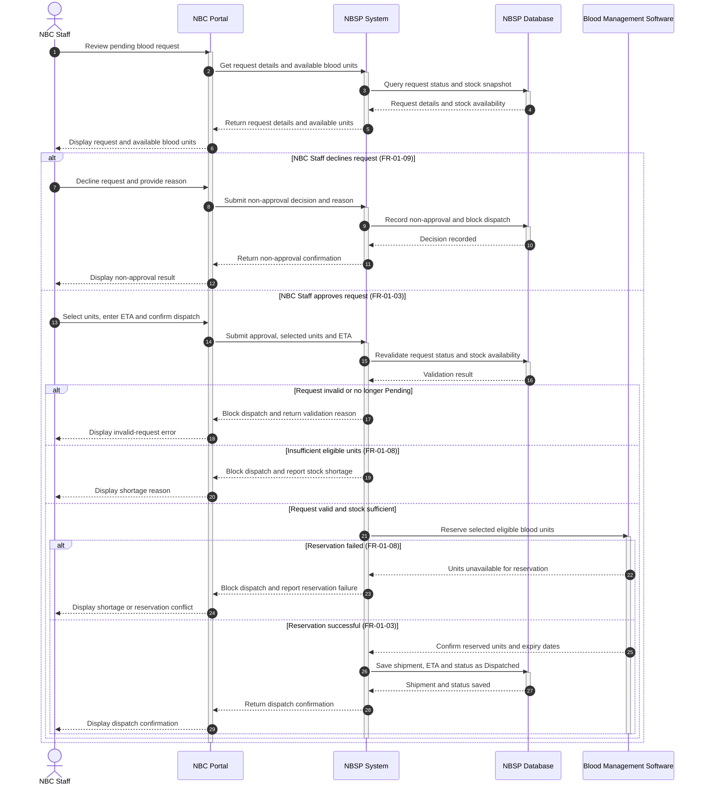

# Sequence Diagram: SD-UC-08 Review and process blood request

| Field | Value |
|---|---|
| Use case | UC-08 Review and process blood request |
| Version | v1 |
| FRs | FR-01-03, FR-01-08, FR-01-09 |

