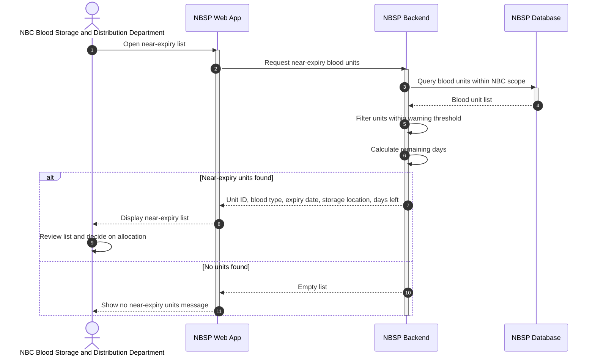

# Sequence Diagram: SD-UC-10 View near-expiry blood units

| Field | Value |
|---|---|
| Use case | UC-10 View near-expiry blood units |
| Version | v2 |
| FRs | FR-02-03 |
| Decisions | D-01, D-24 |

