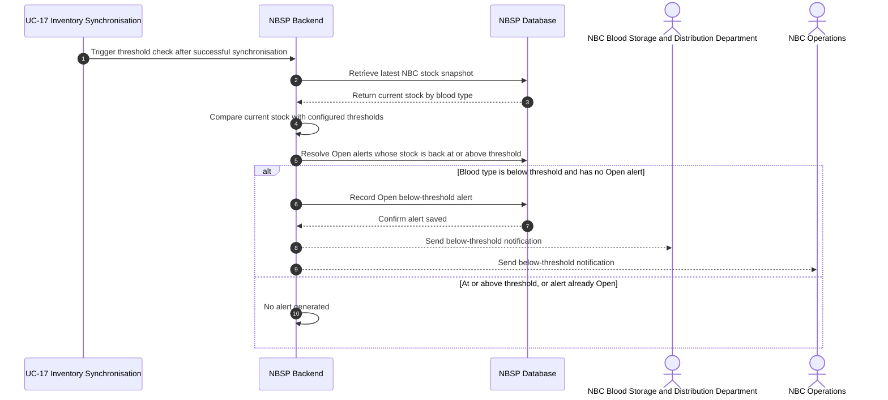

# SD-UC-11 — Receive Below-Threshold Alert

| Field | Value |
|---|---|
| Product | National Blood Supply Chain Platform (NBSP) |
| Use case | UC-11 |
| Feature | F-02 |
| Recipients | NBC Blood Storage and Distribution Department; NBC Operations |
| Trigger | Successful inventory synchronisation (UC-17) |
| Function trace | FR-02-04; dependency FR-02-05 |
| Screen | No dedicated screen; UC-09 / S-F02-02 is a separate follow-up action |
| Status | Recovered sequence, aligned with the merged usage flow; review before implementation |

## Sequence Diagram

## Description

The UC-11 Sequence Diagram illustrates the automated process for detecting and notifying below-threshold blood inventory conditions. After successful inventory synchronisation in UC-17, the NBSP System compares the current stock of each blood type with its configured threshold. If the stock is below the threshold, the system records an alert and notifies the NBC Blood Storage and Distribution Department and NBC Operations. Otherwise, no alert is generated. The main objective is to ensure that the responsible NBC users are informed when a blood type falls below its required inventory level.

## Requirement trace

| Requirement | Sequence responsibility |
|---|---|
| FR-02-04 | Compare stock against the configured threshold, create an alert when required and notify the responsible recipients. |
| FR-02-05 | Supply the successfully synchronised inventory snapshot through UC-17; not implemented as a second synchronisation in UC-11. |

## Source and review notes

- Alignment with `usage-flow.md` v2.3 (20/11/2026): UC-17 is the upstream trigger; both the Department and NBC Operations receive the alert; thresholds are loaded at deployment; UC-11 has no screen of its own. These are documented group decisions, not new functional requirements. The older W1 wording and use-case actor list still require reconciliation as noted in that source.
- Channel: in-app badge and banner on S-F02-02 plus email (D-20). One alert per episode (D-17). No acknowledgement or alert-centre screen.
- The UC-17 lifeline denotes a logical upstream process rather than a new external system or deployable service.
