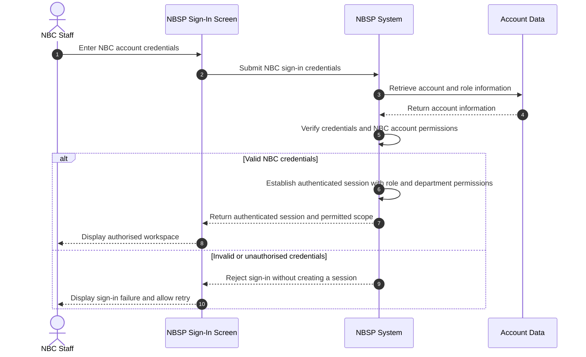

# SD-UC-12 — Sign in with NBC Account

| Field | Value |
|---|---|
| Product | National Blood Supply Chain Platform (NBSP) |
| Use case | UC-12 |
| Feature | F-04 |
| Primary actor | NBC Staff (authorised NBC roles) |
| Screen | S-F04-01 — Sign in (shared with UC-06) |
| Function trace | FR-04-02; related FR-04-03 |
| Status | Reconstructed draft — original SD not located in available sources |

## Sequence Diagram

## Description

The UC-12 Sequence Diagram illustrates how authorised NBC Staff sign in to NBSP using their NBC account. The system verifies the submitted credentials and establishes an authenticated session with the user's role and department permissions. The user can then access the workspace and functions permitted by that role. If the credentials are invalid or the account is not authorised, the system rejects the sign-in without creating an authenticated session and allows the user to try again.

## Requirement trace

| Requirement | Sequence responsibility |
|---|---|
| FR-04-02 | Verify NBC credentials and establish a session containing the user's role and department permissions. |
| FR-04-03 | Related authorisation rule: subsequent requests and data access must remain within the permitted role and department scope. |

## Source and review notes

- Reconstructed from the W1 Function List (FR-04-02 / FR-04-03) shown in the project conversation and `usage-flow-total.md` v2.2 (07/11/2026), which defines UC-12 as shared NBC sign-in on S-F04-01.
- The previous sequence-diagram work in the available chat history lists UC-11, UC-13 and UC-14. No original UC-12 diagram was located. This diagram is therefore a new reconstruction, not a transcription of an approved SD.
- The invalid sign-in branch and logical Account Data lifeline are proposed design details; confirm against the original use-case specification. No password storage scheme, authentication protocol, MFA, password recovery or specific default landing screen is assumed.
- NBC Staff covers the Department, NBC Forecasting Analyst and NBC Operations. This use case does not automatically launch UC-13 or other workspaces.
