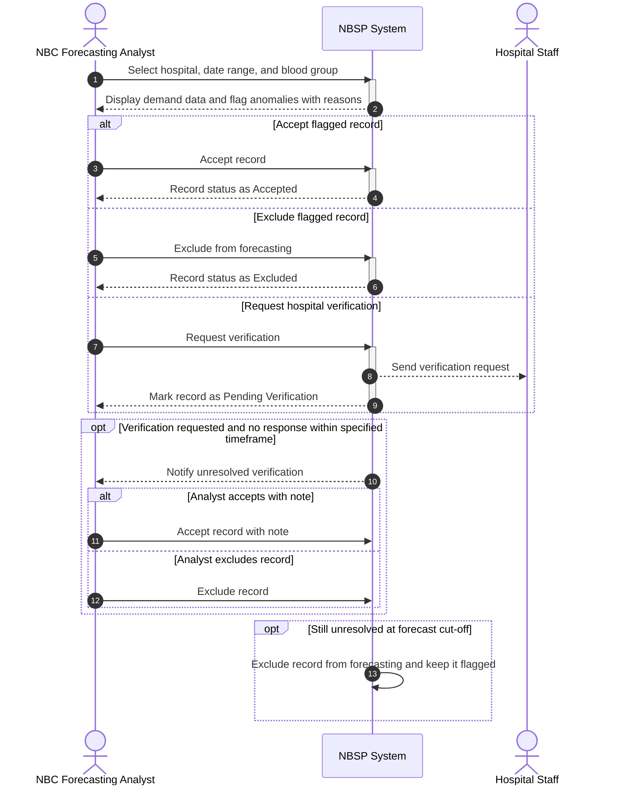

# SD-UC-13 — Validate Clinical Demand Data

| Field | Value |
|---|---|
| Product | National Blood Supply Chain Platform (NBSP) |
| Use case | UC-13 |
| Feature | F-03 |
| Primary actor | NBC Forecasting Analyst |
| Supporting actor | Hospital Staff (verification handoff) |
| Screen | S-F03-02 — Demand Data Review |
| Function trace | FR-03-02; FR-03-03; FR-03-08 (closure rule) |
| Related use cases | UC-12 (sign in); UC-14 (verification response); UC-15 (downstream forecast review) |
| Status | Recovered simplified Mermaid sequence; review before implementation |

## Sequence Diagram

## Description

The UC-13 Sequence Diagram illustrates the process for validating clinical demand data before forecasting. The analyst reviews hospital demand data and system-flagged anomalies, then decides whether to accept, exclude, or request verification of each flagged record. If a verification remains unresolved, the analyst makes the final decision, while unresolved records at the forecast cut-off are excluded. The main objective is to ensure that reviewed and reliable data are used for forecasting.

## Requirement trace

| Requirement | Sequence responsibility |
|---|---|
| FR-03-02 | Display blood usage, transfusion-patient counts and scheduled demand within the selected scope, including anomaly flags and reasons. |
| FR-03-03 | Record Accept, Exclude or Request Verification decisions; handle overdue verification decisions. |
| FR-03-08 | Exclude unresolved records at the forecast cut-off and finalise the forecasting period under the defined closure rule. The record-level exclusion is shown in the diagram. |
| FR-04-04 | Related cross-cutting audit requirement for validation decisions; detailed audit persistence is not expanded in this use-case-level sequence. |

## Source and review notes

- Recovered from the last simplified Mermaid version in `LỊCH SỬ CHATGPT DBIZ 2.pdf`, PDF pp. 76–77. Wrapped PDF lines are joined into valid Mermaid message lines; the overdue guard is made explicit so it applies only where verification was requested. Other business branches and the original level of detail are preserved.
- `usage-flow-total.md` v2.2 (07/11/2026) confirms the three analyst decisions and the UC-14 handoff. The hospital response and overdue-request processing belong to UC-14 / FR-03-04; this sequence illustrates the analyst-facing consequences, not a second implementation of that process.
- The source sequence depicts one flagged record. Repeat the applicable decision for each flagged record as needed. A decision on one record does not finalise the entire period. Under FR-03-08, the period is Finalised only when no flagged record remains unresolved or the forecast cut-off is reached. Draft generation (FR-03-05) and review (UC-15) are downstream, not immediate screen transitions.
- The anomaly rule definitions, timeframe, cut-off configuration and detailed persistence/API design are outside this simplified sequence. No new rule values are assumed.
