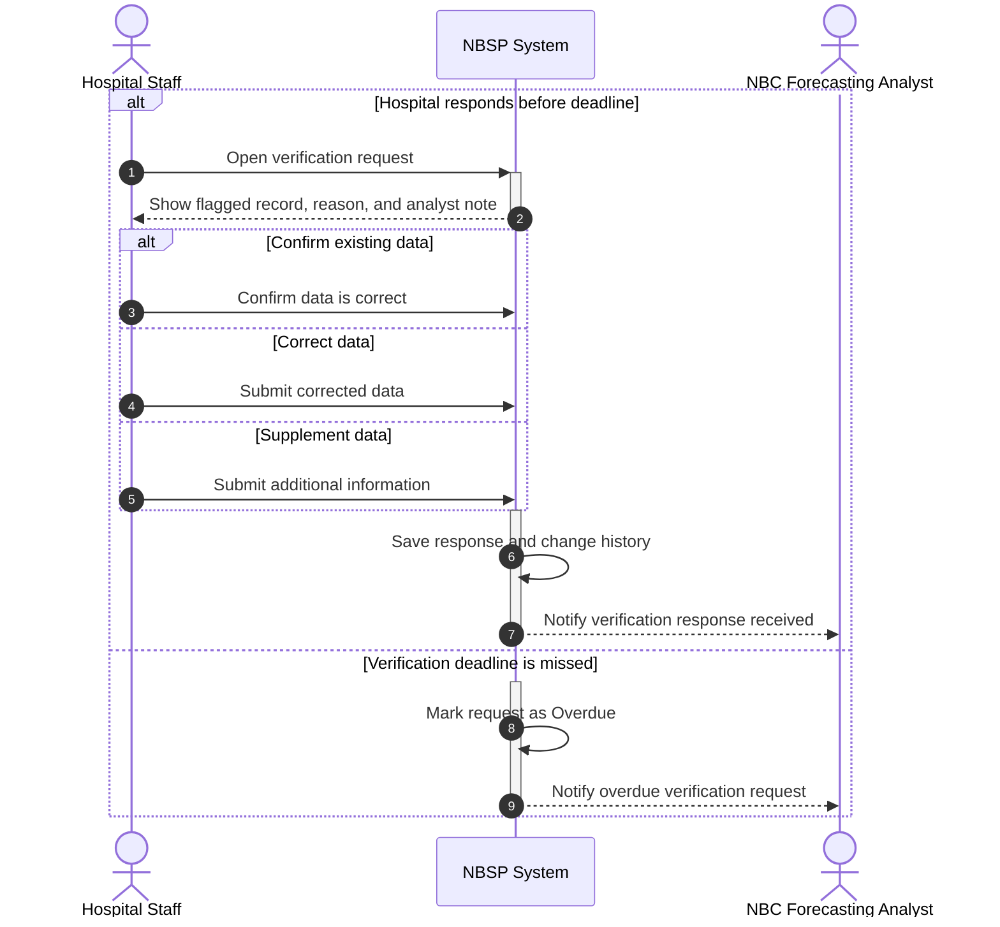

# Sequence Diagram: SD-UC-14 Respond to Data Verification Request

| Field | Value |
|---|---|
| Use case | UC-14 Respond to Data Verification Request |
| Version | v1 |
| FRs | FR-03-04; supporting: FR-04-04 (audit of the response and change history) |

