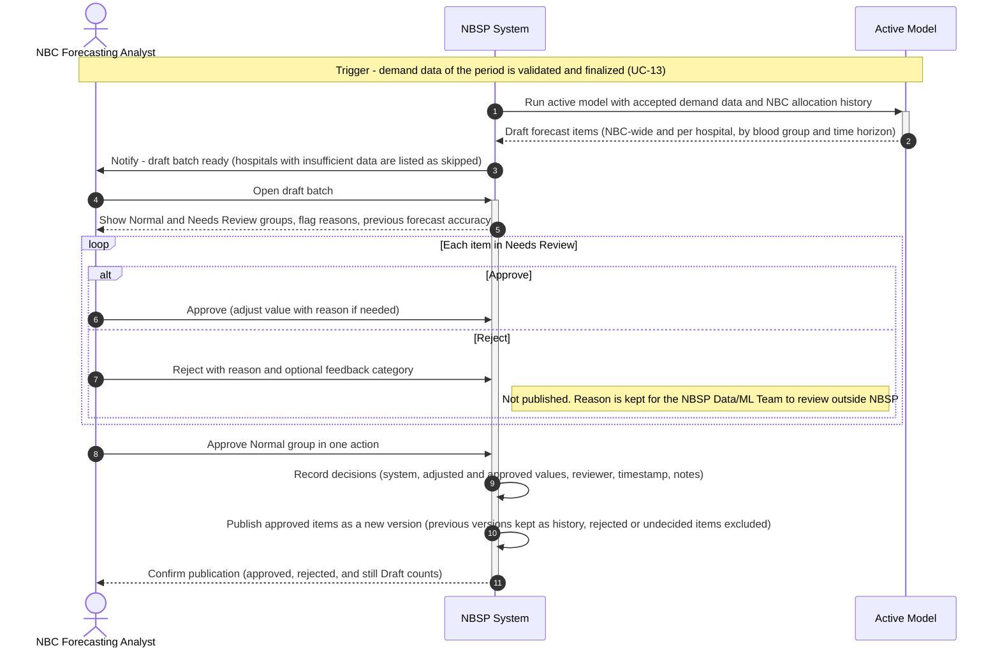

# Sequence Diagram: SD-UC-15 Review and Approve Blood Forecast

| Field | Value |
|---|---|
| Use case | UC-15 Review and Approve Blood Forecast |
| Version | v1 |
| FRs | FR-03-05, FR-03-06; supporting: FR-04-04 (audit of review decisions); trigger comes from FR-03-08 (period Finalised) |

