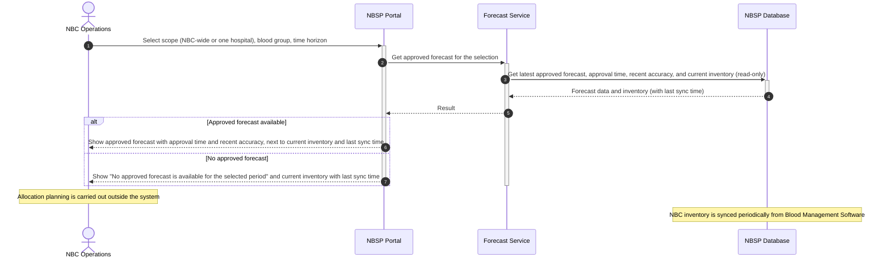

# Sequence Diagram: SD-UC-16 View Validated Blood Forecast

| Field | Value |
|---|---|
| Use case | UC-16 View Validated Blood Forecast |
| Version | v1 |
| FRs | FR-03-07; data source: FR-02-05 (periodic sync) |

