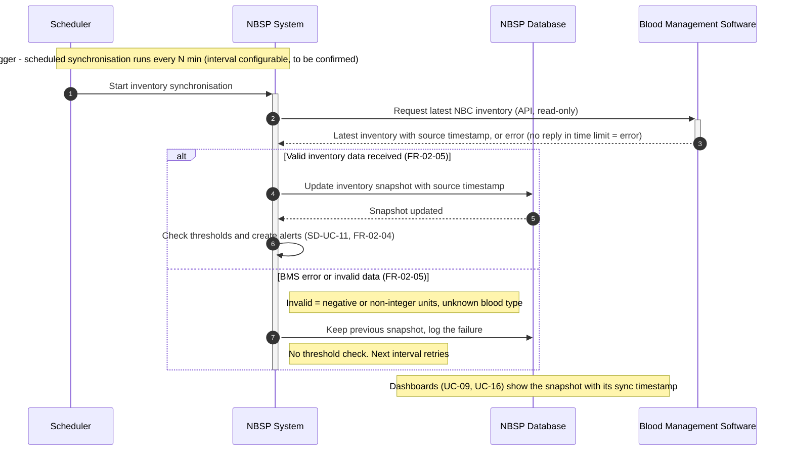

# Sequence Diagram: SD-UC-17 Synchronise NBC Inventory

| Field | Value |
|---|---|
| Use case | UC-17 Synchronise NBC Inventory |
| Version | v1 (new use case, approved 2026-11-01; started by time, not by a person) |
| FRs | FR-02-05 (threshold check after a valid sync: FR-02-04, see SD-UC-11) |

