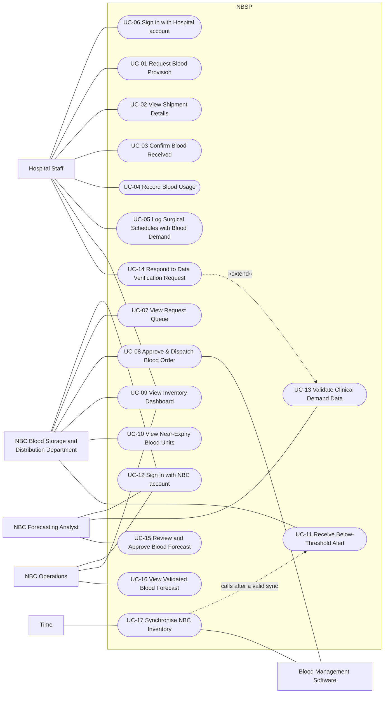

# Use Case Diagram: NBSP (National Blood Supply Chain Platform)

Lesson 4 (Prof. Seki). Who wants NBSP to do what. Mermaid has no use case diagram type, so the
diagram below is drawn as a flowchart: people and external systems on the outside, use cases
(rounded) inside the system boundary. In a drawing tool use the UML notation (stick figures, ovals).

| Field | Value |
|---|---|
| Version | v1 |
| Actors | Hospital Staff, NBC Blood Storage and Distribution Department, NBC Forecasting Analyst, NBC Operations (primary); Time (starts UC-17); Blood Management Software (secondary, external system) |

## Diagram

Reading notes:

- Solid line = the actor takes part in the use case. Dashed line = relationship between use cases.
- **UC-17** is started by time (a scheduler), not by a person. The Blood Management Software (BMS) answers the request. NBSP only reads inventory (FR-02-05). **UC-08** is the only use case that writes to BMS (reserve selected units, FR-01-03). This matches the Context Diagram v4.
- **UC-11** has no actor trigger: it is called at the end of UC-17 after each valid synchronisation. The recipient is the Dept (see open point 1).
- **UC-14** extends UC-13: it only happens when the Analyst requests verification of a flagged record.
- **UC-15** is preceded by an automatic background step (FR-03-05, generate draft forecast), which is not a use case and has no actor. The Analyst only reviews and approves the result.
- Sign in: UC-06 (Hospital Staff) and UC-12 (NBC actors) are needed before every other use case. «include» lines are not drawn to keep the diagram readable, as on the Context Diagram.
- NBC Forecasting Analyst does not use UC-09 (Context Diagram, actor mapping).

The full use case inventory, with features and login rules, is W0 Table 1 in
[w0-scope.md](../function-list/w0-scope.md).

## Sequence diagrams

One sequence diagram per use case, at analysis level: the lifelines are the elements of the
[physical design](../architecture/architecture.md).

| Use case | Sequence diagram | Status |
|---|---|---|
| UC-01 Request Blood Provision | [SD-UC-01](SD-UC-01.md) | Done |
| UC-02 View Shipment Details | [SD-UC-02](SD-UC-02.md) | Done |
| UC-03 Confirm Blood Received | [SD-UC-03](SD-UC-03.md) | Done |
| UC-04 Record Blood Usage | [SD-UC-04](SD-UC-04.md) | Done (lifelines still use "Hospital Blood Mgmt Portal", align with the physical design) |
| UC-05 Log Surgical Schedules with Blood Demand | [SD-UC-05](SD-UC-05.md) | Done (same lifeline naming point as UC-04) |
| UC-06 Sign in with Hospital account | [SD-UC-06](SD-UC-06.md) | Done |
| UC-07 View Request Queue | [SD-UC-07](SD-UC-07.md) | Done (actor still "NBC Staff": rename to the Dept) |
| UC-08 Approve & Dispatch Blood Order | [SD-UC-08](SD-UC-08.md) | Done, to update (still has the decline branch FR-01-09; release 1 has no "not approved" outcome; actor "NBC Staff") |
| UC-09 View Inventory Dashboard | [SD-UC-09](SD-UC-09.md) | Done, to update (header says "UC-XX"; add NBC Operations as actor) |
| UC-10 View Near-Expiry Blood Units | [SD-UC-10](SD-UC-10.md) | Done, to update (header says "UC-XX"; actor "NBC Staff") |
| UC-11 Receive Below-Threshold Alert | [SD-UC-11](SD-UC-11.md) | Recovered, review (recipients differ from AD-UC-11, see open point 1) |
| UC-12 Sign in with NBC account | [SD-UC-12](SD-UC-12.md) | Reconstructed draft, review |
| UC-13 Validate Clinical Demand Data | [SD-UC-13](SD-UC-13.md) | Recovered, review |
| UC-14 Respond to Data Verification Request | [SD-UC-14](SD-UC-14.md) | Done |
| UC-15 Review and Approve Blood Forecast | [SD-UC-15](SD-UC-15.md) | Done |
| UC-16 View Validated Blood Forecast | [SD-UC-16](SD-UC-16.md) | Done |
| UC-17 Synchronise NBC Inventory | [SD-UC-17](SD-UC-17.md) | Done (new use case, approved 2026-11-01) |

## Open points

| # | Point | Where to fix |
|---|---|---|
| 1 | Who receives the below-threshold alert (UC-11)? AD-UC-11 v0.9 says the Dept only. Context Diagram v4, Usage Flow v2.2 and SD-UC-11 still list NBC Operations as a second recipient. This diagram follows AD-UC-11 (Dept only). If the team decides Operations also receives alerts, add the line `OPS --- UC11` | Team decision, then Context Diagram, SD-UC-11, FR-02-04 |
| 2 | UC list (mid-term report) has 16 use cases and still says "NBC Staff" and "Hospitals" as actors; UC-17 is missing there | UC list |
| 3 | Actor names must be the same in the UC list, this diagram and the Context Diagram | UC list, Context Diagram |
